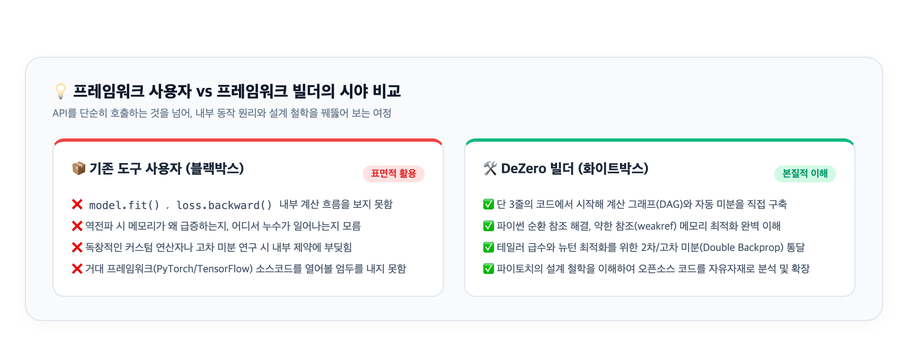

# 💡 0.1 왜 직접 만들어봐야 할까? (만들어봐야 비로소 보이는 것)

> *"진정한 여행은 새로운 풍경을 찾는 것이 아니라 새로운 눈을 뜨는 여정이다."*  
> — **마르셀 프루스트 (Marcel Proust)**

오늘날 딥러닝은 자율주행 자동차, 의료 영상 진단, 생성형 대규모 언어 모델(LLM), 로봇 지능 등 거의 모든 현대 과학기술의 프런티어를 개척하고 있습니다. 그리고 그 혁신의 중심에는 **파이토치(PyTorch)**와 **텐서플로(TensorFlow)**라는 거대한 딥러닝 프레임워크가 자리 잡고 있습니다.

하지만 완성된 프레임워크의 고수준 API(`model.fit()`, `loss.backward()`)를 호출하는 것만으로는 다음과 같은 질문에 답하기 어렵습니다:

* `loss.backward()`가 호출될 때, 파이썬 객체 내부에서는 도대체 어떤 일이 일어나는가?
* 계산 그래프는 메모리에 어떻게 구성되며, 왜 역전파가 끝나면 중간 텐서들을 정리해야 하는가?
* 왜 현대 프레임워크들은 과거의 정적 그래프(Static Graph)를 버리고 동적 계산 그래프(Define-by-Run)를 채택했는가?

*API를 호출하는 사용자의 관점을 넘어, 프레임워크의 내부 메커니즘을 꿰뚫어 보는 빌더(Builder)의 시야로 전환합니다.*

---

## 🔍 만들어봐야 비로소 보이는 3가지

딥러닝 프레임워크는 단순히 행렬 연산 함수나 인공신경망 계층(Layer)을 모아둔 평범한 라이브러리가 아닙니다. 본질적으로 **"미분 계산을 프로그래밍 언어 차원에서 자동으로 지원하는 미분 가능 프로그래밍(Differentiable Programming) 시스템"**입니다.

### 1. 블랙박스의 완전한 해체
다른 사람이 설계해 둔 라이브러리를 사용할 때는 내부가 까만 상자(Black-box)처럼 보입니다. 하지만 무(Zero)의 상태인 **단 3줄의 파이썬 코드**에서 시작하여 변수(`Variable`), 함수(`Function`), 계산 그래프(DAG)를 직접 조립해 나가면, 거대 프레임워크의 복잡한 마법이 실은 지극히 명쾌하고 아름다운 객체 지향 알고리즘의 결합임을 깨닫게 됩니다.

### 2. 소프트웨어 아키텍처의 도약
동작하는 스크립트를 작성하는 것과, 제3자가 안정적으로 사용할 수 있는 프레임워크를 개발하는 것은 완전히 다른 차원의 경험입니다.
* 사용자가 수학 기호처럼 직관적으로 연산할 수 있도록 하는 **연산자 오버로딩(`+`, `*`, `-`)**
* 순환 참조로 인한 메모리 누수를 방지하는 **약한 참조(`weakref`) 기법**
* 복잡한 고차 미분을 재귀 없이 안전하게 처리하는 **반복문 기반 위상 정렬 역전파**

이러한 고급 소프트웨어 엔지니어링 설계를 직접 경험하며 엔지니어로서의 기초 체력을 단련합니다.

### 3. 현대 프레임워크를 자유자재로 다루는 눈
DeZero를 완성하고 나면, 파이토치나 텐서플로 내부 소스 코드를 열어보아도 결코 두렵지 않습니다. 그들이 왜 그러한 클래스 계층 구조를 택했는지, 텐서 브로드캐스팅과 autograd 엔진이 내부적으로 어떻게 결합되어 있는지 그 **설계 철학**을 공유하게 됩니다.

---

> 💬 **지니(Jiny)의 조언**:  
> *"프레임워크를 만들어보는 것은 자동차의 엑셀만 밟던 운전자가 보닛을 열고 엔진의 피스톤과 기어박스를 조립해보는 것과 같아요. 이제 우리는 딥러닝이라는 마법의 내부 기계 장치를 하나씩 직접 만들어갈 거예요!"*

---

| ◀️ 이전 | 📑 목차 | 다음 ▶️ |
|:---|:---:|---:|
| [프롤로그 소개](../index.html) | [00. 프롤로그](../index.html) | [0.2 DeZero의 3대 특징](../0_2_DeZero의_3대_특징/index.html) |
