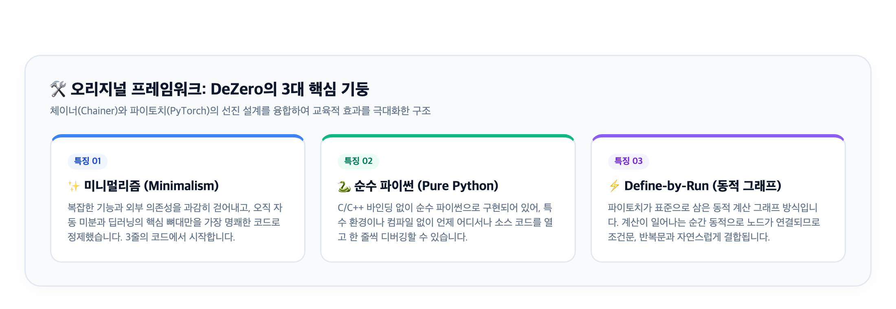

# 🛠️ 0.2 오리지널 프레임워크: DeZero의 3대 특징

이 강의에서 함께 구현할 **DeZero(디제로, Deep Learning from Zero)**는 체이너(Chainer)와 파이토치(PyTorch)의 선진 설계를 융합하여 교육적 효과를 극대화한 독창적인 미니멀 딥러닝 프레임워크입니다.

DeZero는 학습자의 이해를 돕기 위해 다음의 **3가지 핵심 설계 원칙**을 엄격히 고수합니다:


*미니멀리즘, 순수 파이썬 구현, 그리고 Define-by-Run 동적 계산 그래프라는 3대 기둥 위에 DeZero가 구축됩니다.*

---

## 1. ✨ 미니멀리즘 (Minimalism)

DeZero는 복잡한 부가 기능, 방대한 C/C++ 최적화 레이어, 불필요한 서드파티 라이브러리 의존성을 과감히 배제했습니다.
* **단 3줄의 코드에서 시작**: 1단계에서는 단 3줄의 파이썬 코드로 `Variable` 클래스를 정의하며 출발합니다.
* **본질에 집중하는 구조**: 자동 미분과 딥러닝 프레임워크의 본질적인 알고리즘만을 가장 명쾌하고 간결한 형태로 구현합니다.
* **직관적인 설계**: 모든 클래스와 메서드는 한눈에 파악할 수 있는 크기로 점진적으로 확장됩니다.

```python
# 1단계에서 시작하는 DeZero의 최초 형태 (단 3줄!)
class Variable:
    def __init__(self, data):
        self.data = data
```

---

## 2. 🐍 순수 파이썬 (Pure Python)

대다수의 상용 프레임워크(PyTorch, TensorFlow)는 속도를 위해 내부 연산 엔진이 수십만 줄의 C++과 CUDA로 감싸져 있어, 내부를 열어보고 디버깅하기가 매우 어렵습니다.

* DeZero는 **100% 순수 파이썬(Pure Python)**으로 작성되었습니다.
* 별도의 C/C++ 컴파일 환경이나 복잡한 빌드 도구 없이, 일반 파이썬 인터프리터만 있으면 즉시 실행되고 디버깅할 수 있습니다.
* 파이썬의 표준 디버거(`pdb`)나 IDE의 중단점(Breakpoint)을 걸어 객체 내부와 호출 스택을 투명하게 들여다볼 수 있습니다.

---

## 3. ⚡ 현대적 동적 계산 그래프 (Define-by-Run)

과거 텐서플로 1.x 시절에는 그래프를 먼저 선언하고 별도의 세션(`sess.run()`)에서 실행하는 정적 그래프(Define-and-Run) 방식이 대세였습니다. 하지만 디버깅이 어렵고 파이썬의 일반적인 제어문(if, for)을 활용하기 어려웠습니다.

* DeZero는 파이토치가 표준으로 삼은 **Define-by-Run (동적 계산 그래프)** 방식을 채택했습니다.
* 순전파(Forward) 계산이 일어나는 런타임에 계산 그래프의 노드와 엣지가 동적으로 생성되고 연결됩니다.
* 파이썬의 조건문(`if`), 반복문(`while`, `for`)과 자연스럽게 결합하여 복잡한 신경망(RNN, 트리 구조 신경망 등)을 직관적으로 모델링할 수 있습니다.

```
[Define-by-Run의 동적 연결 원리]

입력 x (Variable)
    │
    ▼ 순전파 연산 실행 시점에 함수와 변수 노드가 상호 참조로 연결
[Function (Square)] ──► 출력 y (Variable)
    ▲                      │
    │                      ▼
    └─────────── 역전파를 위한 계산 그래프(DAG)가 메모리에 자동 구성됨
```

---

> 💬 **도로시(Dorothy)의 발견**:  
> *"복잡한 컴파일 없이 내가 평소에 쓰던 파이썬 문법만으로 파이토치와 똑같이 동작하는 계산 그래프를 만들 수 있다니 정말 신기해요!"*

---

| ◀️ 이전 | 📑 목차 | 다음 ▶️ |
|:---|:---:|---:|
| [0.1 왜 직접 만들어봐야 할까](../0_1_왜_직접_만들어봐야_할까/index.html) | [00. 프롤로그](../index.html) | [0.3 핵심 습득 역량](../0_3_핵심_습득_역량/index.html) |
