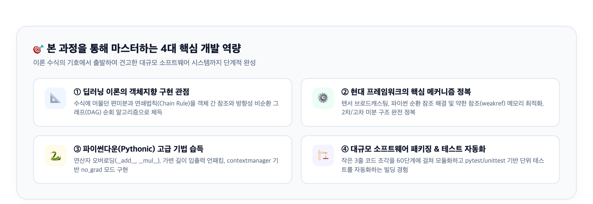

# 🎯 0.3 본 강의를 통해 얻게 되는 4가지 핵심 역량

단순히 딥러닝 예제 코드를 따라 치는 것과, 프레임워크 자체를 밑바닥부터 설계하고 구현하는 것은 학습 밀도에서 큰 차이가 납니다. 본 과정을 완주한 학습자는 다음 **4가지 전문 개발 역량**을 확고하게 체득하게 됩니다:

*이론 수식의 객체 지향 구현부터 고난도 메모리 최적화, 파이썬 고급 테크닉, 대규모 소프트웨어 모듈화까지 체득합니다.*

---

## 1. 📐 딥러닝 기초 이론의 구현 관점 체득

교과서나 논문에서 기호로만 보던 수학적 개념들이 실제 컴퓨터 메모리와 알고리즘으로 어떻게 변환되는지 체득합니다.
* **연쇄 법칙(Chain Rule)**: 합성함수의 편미분 수식이 어떻게 방향성 비순환 그래프(DAG)를 역방향으로 순회하며 기울기(`grad`)를 누적하는 코드로 바뀌는지 이해합니다.
* **수치 미분 vs 오차역전파법**: 두 방식의 정확도와 계산 복잡도($O(N)$ vs $O(1)$)를 직접 벤치마킹하며, 왜 역전파가 딥러닝 혁명의 열쇠가 되었는지 체감합니다.

---

## 2. ⚙️ 현대 딥러닝 프레임워크의 내부 메커니즘 정복

파이토치 내부에서 벌어지는 핵심 기술 난제들을 직접 코드로 마주하고 해결합니다.
* **다차원 텐서와 브로드캐스팅**: 모양이 다른 텐서 간의 연산 규칙(Broadcasting)과, 역전파 시 원래 형상으로 기울기를 축소(Sum/Reshape)하는 연산자를 구현합니다.
* **메모리 최적화와 순환 참조 해결**: 함수와 변수가 서로를 참조할 때 발생하는 파이썬 GC(Garbage Collector)의 한계를 이해하고, **약한 참조(`weakref`)**를 적용해 불필요한 메모리를 즉시 반환하도록 설계합니다.
* **고차 미분(Double Backprop)**: 역전파를 수행하는 연산 자체도 계산 그래프로 기록하여 헤시안 행렬(Hessian)이나 2차 도함수 최적화(뉴턴법)를 자연스럽게 지원하는 엔진을 만듭니다.

---

## 3. 🐍 파이썬다운(Pythonic) 고급 프로그래밍 기법 습득

단순 문법을 넘어 파이썬 언어가 제공하는 최고의 메타프로그래밍 및 고급 기법들을 프레임워크 수준에서 활용합니다.
* **연산자 오버로딩**: `x + y`, `x * y`, `x ** 2` 등 매직 메서드(`__add__`, `__mul__`, `__pow__`)를 오버라이딩하여 프레임워크 사용자에게 수식과 동일한 경험을 선사합니다.
* **가변 길이 인수 처리**: 임의의 개수를 갖는 다중 입력 및 다중 출력 연산자를 우아하게 처리하는 튜플/리스트 언패킹 기법을 익힙니다.
* **컨텍스트 매니저(`contextmanager`)**: `with no_grad():`와 같이 평가 모드나 추론 모드에서 계산 그래프 기록을 일시적으로 중단하는 효율적인 상태 제어 패턴을 구현합니다.

---

## 4. 🏗️ 체계적인 대규모 소프트웨어 개발 경험

프레임워크 제작은 단순 알고리즘 문제를 푸는 것과 달리 프로젝트의 지속적인 유지보수와 모듈화 역량을 요구합니다.
* **60단계 점진적 리팩토링**: 3줄짜리 장난감 코드에서 시작하여, 각 단계마다 설계를 점진적으로 확장하고 다듬는 애자일 아키텍처 과정을 경험합니다.
* **단위 테스트 자동화**: `unittest`를 도입하여 기울기 확인(Gradient Check)과 같은 수학적 정확성 검증을 자동화하고, 결함 없는 소프트웨어를 완성하는 개발 문화를 체득합니다.

---

> 💬 **이호진 교수님의 말씀**:  
> *"프레임워크 내부를 한 번 끝까지 구현해 본 엔지니어는 어떤 새로운 AI 모델이나 라이브러리가 등장해도 두려워하지 않습니다. 원리를 알기 때문에 본질을 빠르게 꿰뚫어 볼 수 있기 때문입니다."*

---

| ◀️ 이전 | 📑 목차 | 다음 ▶️ |
|:---|:---:|---:|
| [0.2 DeZero의 3대 특징](../0_2_DeZero의_3대_특징/index.html) | [00. 프롤로그](../index.html) | [0.4 5대 고지 탐험 로드맵](../0_4_5대_고지_탐험_로드맵/index.html) |
