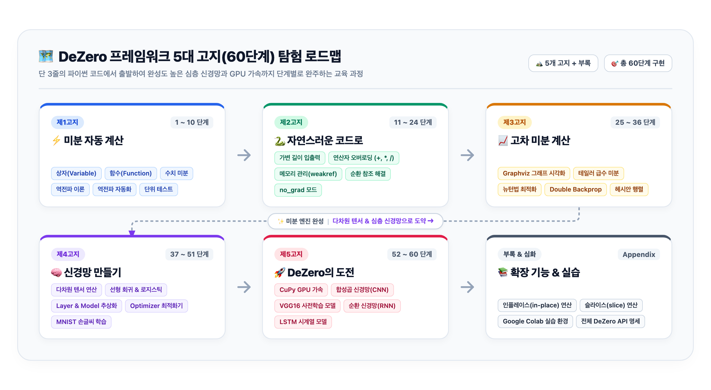

# 🗺️ 0.4 5대 고지(60단계) 탐험 로드맵

DeZero 프레임워크를 밑바닥부터 완성하는 여정은 단계별로 실행과 검증이 가능한 **5개의 거대한 고지(총 60단계)**와 심화 부록으로 구성되어 있습니다.

*이호진 교수님, 마법 고양이 지니, 도로시, 토토와 함께 단 3줄의 코드(제1고지)에서 출발하여 심층 신경망과 GPU 가속(제5고지)까지 단계적으로 정복해 나가는 5대 고지 모험 로드맵입니다.*

---

## 📊 기술 스택 인포그래픽 로드맵

*DeZero 프레임워크 5대 고지(60단계) 및 부록 기술 스택 인포그래픽 로드맵*

---

## 🏔️ 5대 고지 상세 안내

### [제1고지: 미분 자동 계산 (1~10단계)](../../01_미분_자동_계산/)
* **주요 목표**: 자동 미분의 원리를 이해하고 핵심 엔진을 구축합니다.
* **핵심 내용**:
  - 변수를 담는 상자 `Variable` 클래스 구현
  - 변수를 변환하는 `Function` 클래스 구현
  - 수치 미분(Numerical Differentiation)과 오차역전파 이론 비교
  - 계산 그래프의 역방향 순회를 통한 자동 역전파(Backprop) 구현
  - 재귀 호출에서 안전한 반복문 기반 역전파로의 전환
  - 기울기 확인(Gradient Check) 자동 단위 테스트 작성

### [제2고지: 자연스러운 코드로 (11~24단계)](../../02_자연스러운_코드로/)
* **주요 목표**: DeZero를 진짜 파이썬 라이브러리처럼 편리하고 효율적으로 쓸 수 있도록 다듬습니다.
* **핵심 내용**:
  - 가변 길이 인수(다중 입출력) 지원을 위한 튜플 언패킹
  - 파이썬 기본 연산자 오버로딩(`+`, `-`, `*`, `/`, `**`, 음수 부호)
  - 복잡한 분기/합류 계산 그래프에서의 역전파 정합성 보장
  - 파이썬 가비지 컬렉션의 한계 극복: **약한 참조(`weakref`)**를 통한 순환 참조 제거
  - `with no_grad():` 모드를 통한 추론 시 메모리 최적화

### [제3고지: 고차 미분 계산 (25~36단계)](../../03_고차_미분_계산/)
* **주요 목표**: 미분을 위한 미분(2차, 3차 도함수)을 지원하는 고급 자동 미분 엔진으로 확장합니다.
* **핵심 내용**:
  - Graphviz 및 DOT 언어를 활용한 계산 그래프 시각화 자동화
  - 테일러 급수(Taylor Series)를 이용한 초월함수(Sin, Cos, Tanh) 미분
  - 2차 도함수를 이용한 뉴턴 최적화(Newton's Method) 알고리즘 구현
  - **Double Backpropagation**: 역전파 계산 자체를 다시 계산 그래프로 기록하여 고차 미분을 매끄럽게 지원

### [제4고지: 신경망 만들기 (37~51단계)](../../04_신경망_만들기/)
* **주요 목표**: 텐서 연산을 기반으로 실제 딥러닝 신경망 모델을 설계하고 학습시킵니다.
* **핵심 내용**:
  - 다차원 텐서 형상 변환(`reshape`), 전치(`transpose`), 합(`sum`)과 브로드캐스팅
  - 선형 회귀(Linear Regression)와 로지스틱 회귀를 통한 머신러닝 학습 루프
  - 매개변수를 자동으로 추적하는 `Parameter` 및 `Layer` 클래스 추상화
  - 완전연결 신경망(MLP)과 복합 모델 `Model` 클래스 구축
  - 다양한 최적화 알고리즘: SGD, Momentum, Adam 구현
  - `Dataset`, `DataLoader`를 구축하여 MNIST 손글씨 숫자 인식 데이터셋 학습

### [제5고지: DeZero의 도전 (52~60단계)](../../05_DeZero의_도전/)
* **주요 목표**: GPU 가속과 최신 딥러닝 아키텍처(CNN, RNN)를 탑재하여 상용 프레임워크 수준으로 완성합니다.
* **핵심 내용**:
  - **CuPy 연동**: 단 한 줄의 디바이스 전환으로 NVIDIA GPU CUDA 가속 지원
  - 모델 가중치 파일 저장 및 불러오기(영속화)
  - 2차원 합성곱 계층(`Conv2d`) 및 풀링(`Pooling`) 구현
  - 딥러닝의 상징인 **VGG16 사전학습 모델** 탑재 및 실전 이미지 분류
  - 시계열 데이터를 다루기 위한 **순환 신경망(RNN)** 및 장단기 메모리(**LSTM**) 계층 구현
  - sin 파형 시계열 예측 신경망 완성

### [부록: 심화 기능 & API](../../06_부록/)
* 메모리 재할당을 방지하는 인플레이스(in-place) 연산 최적화
* 다차원 텐서의 자유로운 슬라이싱(`__getitem__`) 연산 지원
* Google Colab 환경에서의 전체 코드 실습 및 전체 DeZero API 명세서

---

> 💬 **토토(Toto)의 한마디**:  
> *"멍멍! 1단계부터 60단계까지 차근차근 따라가다 보면 어느새 파이토치 부럽지 않은 멋진 프레임워크가 내 손으로 완성되어 있을 거야!"*

---

| ◀️ 이전 | 📑 목차 | 다음 ▶️ |
|:---|:---:|---:|
| [0.3 핵심 습득 역량](../0_3_핵심_습득_역량/index.html) | [00. 프롤로그](../index.html) | [0.5 현업 추천사](../0_5_현업_추천사/index.html) |
