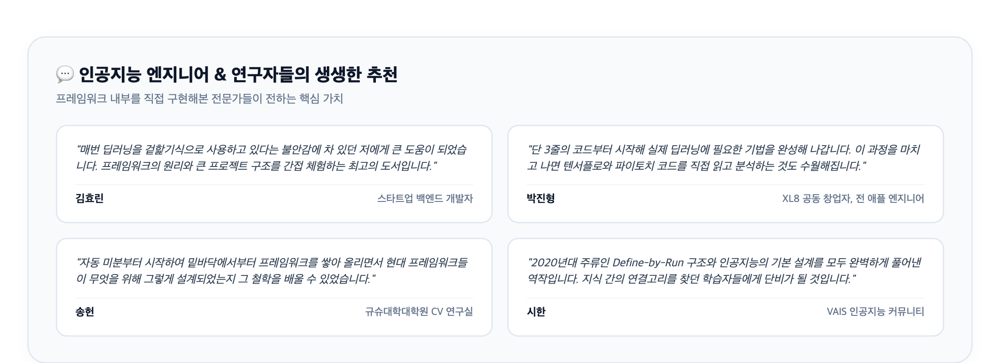

# 💬 0.5 현업 엔지니어 및 연구자 추천사

본 과정의 원작인 『밑바닥부터 시작하는 딥러닝 3』을 먼저 경험한 현업 인공지능 엔지니어, 빅테크 개발자, 그리고 컴퓨터 비전 연구자들의 생생한 추천의 글입니다.

*프레임워크 내부를 직접 구현해본 전문가들이 전하는 핵심 가치와 성장 경험*

---

## 🌟 추천의 글

### 🔹 김효린 — 스타트업 백엔드 개발자
> *"『밑바닥부터 시작하는 딥러닝』이라는 책의 제목이 너무나도 알맞은 책입니다. 매번 딥러닝을 겉핥기식으로 사용하고 있다는 불안감에 차 있던 저에게 큰 도움이 되었습니다.  
> 더불어 프레임워크의 원리나 큰 프로젝트의 구조를 간접적으로나마 체험해볼 수 있는 좋은 기회였습니다. 딥러닝을 더 깊이 이해하고 싶은 개발자들에게 강력히 추천합니다."*

---

### 🔹 박진형 — XL8 공동 창업자, 전 애플 엔지니어
> *"단 3줄의 코드부터 시작하여 실제 딥러닝에 필요한 각종 기법을 한 단계씩 구현해 나갑니다. 객체 지향 프로그래밍과 소프트웨어 아키텍처의 정수를 맛볼 수 있습니다.  
> 이 과정을 마치고 나면 텐서플로와 파이토치 같은 거대 프레임워크의 코드를 직접 읽고 분석하는 것도 한결 수월해집니다. AI 시대를 살아가는 모든 엔지니어의 필독서입니다."*

---

### 🔹 송헌 — 규슈대학대학원 컴퓨터비전 연구실
> *"자동 미분부터 시작하여 정말 밑바닥에서부터 프레임워크를 쌓아 올리면서 현대 딥러닝 프레임워크들이 무엇을 위해 그렇게 설계되었는지 그 철학을 배울 수 있었습니다.  
> 논문에 나오는 복잡한 모델을 파이토치로 구현할 때 내부 동작이 머릿속에 투명하게 그려지기 시작했습니다. 파이토치를 더 깊고 자유롭게 다루고 싶은 모든 분께 적극 추천합니다."*

---

### 🔹 시한 — VAIS 인공지능 커뮤니티
> *"2020년대 주류인 Define-by-Run의 구조와 인공지능의 기본 설계를 모두 완벽하게 풀어낸 역작입니다.  
> 수식과 코드 사이에서 연결고리를 찾지 못해 헤매던 인공지능 학습자들에게 단비 같은 가이드가 될 것입니다. 프레임워크를 직접 만들어보는 쾌감을 꼭 느껴보시기 바랍니다."*

---

## 🎯 이런 분들께 특히 추천합니다

1. **파이토치/텐서플로를 쓰고 있지만 내부 동작이 궁금한 개발자**: API 호출 뒤에 숨겨진 메모리 관리와 자동 미분의 메커니즘을 꿰뚫어 볼 수 있습니다.
2. **AI 대학원 진학 및 연구를 준비하는 학생**: 최신 논문의 복잡한 모델이나 비표준 손실 함수, 커스텀 역전파를 자유롭게 작성할 수 있는 내공이 생깁니다.
3. **파이썬 실력을 한 차원 끌어올리고 싶은 소프트웨어 엔지니어**: 연산자 오버로딩, 약한 참조, 컨텍스트 매니저, 모듈화 등 파이썬 객체 지향 설계의 정수를 배웁니다.

---

| ◀️ 이전 | 📑 목차 | 다음 ▶️ |
|:---|:---:|---:|
| [0.4 5대 고지 탐험 로드맵](../0_4_5대_고지_탐험_로드맵/index.html) | [00. 프롤로그](../index.html) | [0.6 실습 환경 및 준비 사항](../0_6_실습_환경_및_준비_사항/index.html) |
