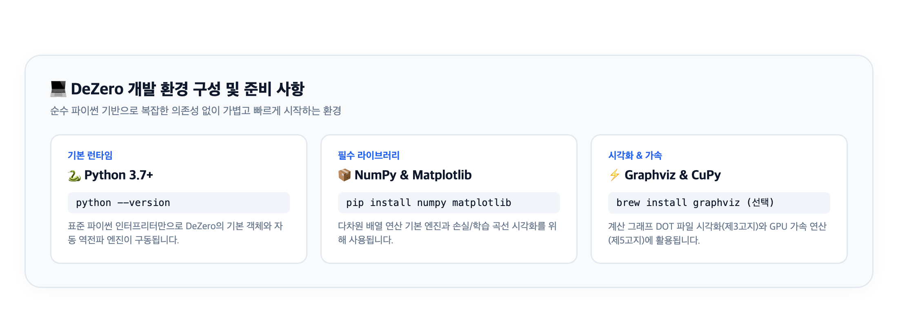

# 💻 0.6 실습 환경 및 준비 사항

DeZero는 외부 라이브러리 의존성을 최소화한 순수 파이썬 프레임워크이므로, 복잡한 환경 설정 없이도 가볍고 빠르게 실습을 시작할 수 있습니다.


*표준 파이썬과 기본 수학 라이브러리만으로 즉시 구동되는 가볍고 직관적인 개발 환경*

---

## 1. 🐍 파이썬 런타임 환경

DeZero는 최신 파이썬의 풍부한 문법 기능을 적극 활용합니다.
* **권장 버전**: Python 3.7 이상 (Python 3.8 ~ 3.11 적극 권장)
* **버전 확인 방법**:
  ```bash
  python --version
  # 또는
  python3 --version
  ```

---

## 2. 📦 필수 및 권장 라이브러리

기본 연산과 손실/학습 곡선 시각화를 위해 최소한의 라이브러리를 설치합니다:

```bash
# 기본 필수 라이브러리 설치
pip install numpy matplotlib
```

* **NumPy (`numpy`)**: 다차원 배열 연산 및 기본 수치 계산 엔진으로 사용됩니다.
* **Matplotlib (`matplotlib`)**: 회귀 모델의 피팅 결과, 손실 함수 감소 곡선, 이미지 시각화에 사용됩니다.

---

## 3. ⚡ 선택 라이브러리 및 도구 (제3고지 & 제5고지)

### ① Graphviz (제3고지 계산 그래프 시각화)
DeZero가 동적으로 생성한 복잡한 계산 그래프를 시각적인 다이어그램(PNG/SVG/PDF)으로 렌더링하기 위해 Graphviz를 사용할 수 있습니다.

* **macOS (Homebrew)**:
  ```bash
  brew install graphviz
  ```
* **Ubuntu / Debian**:
  ```bash
  sudo apt-get install graphviz
  ```
* **Windows**:
  공식 웹사이트([graphviz.org](https://graphviz.org/download/))에서 인스톨러를 다운로드하여 설치 후 환경변수 PATH에 등록합니다.

### ② CuPy (제5고지 GPU 가속)
NVIDIA 그래픽 카드를 장착한 환경에서 DeZero 코드를 GPU로 수십~수백 배 가속하고 싶다면 CuPy를 설치할 수 있습니다:

```bash
# 사용 중인 CUDA 버전에 맞춰 설치 (예: CUDA 12.x)
pip install cupy-cuda12x
```
*(※ CPU 환경에서도 DeZero의 모든 단계는 100% 동일하게 동작하므로 CuPy 설치는 필수가 아닌 선택 사항입니다.)*

---

## 🚀 이제 모든 준비가 끝났습니다!

이호진 교수님, 조교 지니, 도로시, 토토와 함께 딥러닝 프레임워크의 가장 깊은 심장부로 떠날 준비가 되셨나요?

첫 번째 발걸음은 무(Zero)에서 출발하는 **단 3줄의 파이썬 코드**입니다!

👉 **[제1고지 1단계: 상자로서의 변수 시작하기 ➔](../../01_미분_자동_계산/1_1_상자로서의_변수/)**

---

| ◀️ 이전 | 📑 목차 | 다음 ▶️ |
|:---|:---:|---:|
| [0.5 현업 추천사](../0_5_현업_추천사/index.html) | [00. 프롤로그](../index.html) | [제1고지 1단계: 상자로서의 변수](../../01_미분_자동_계산/1_1_상자로서의_변수/index.html) |
