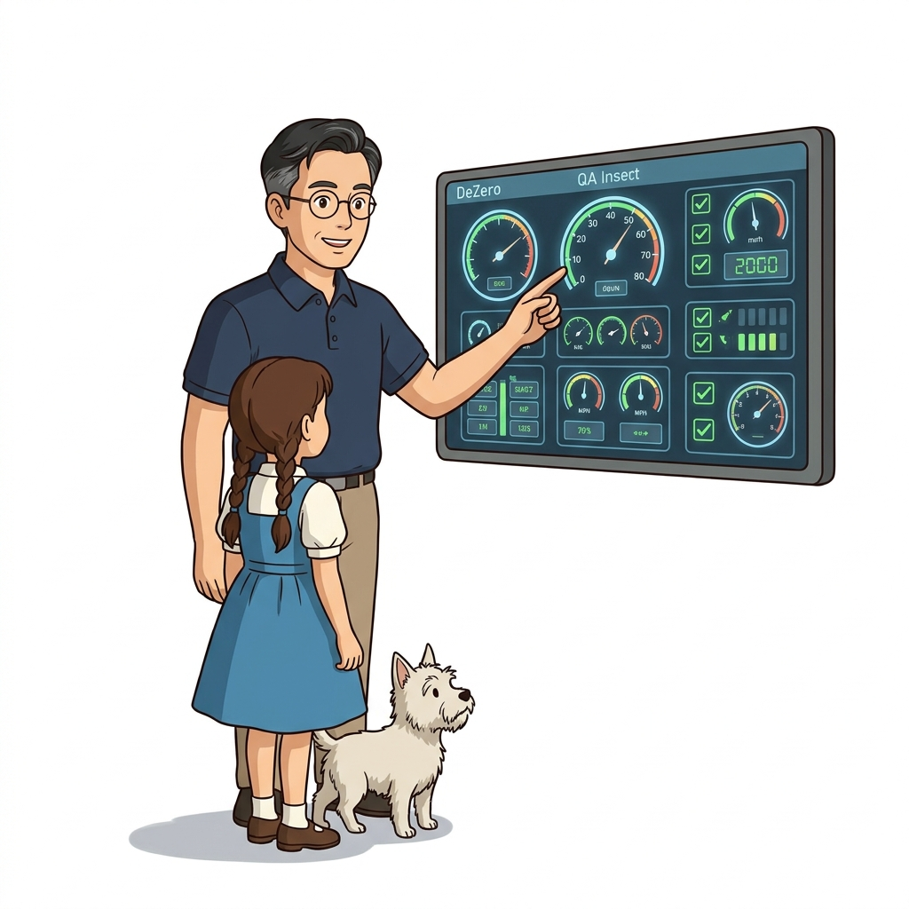
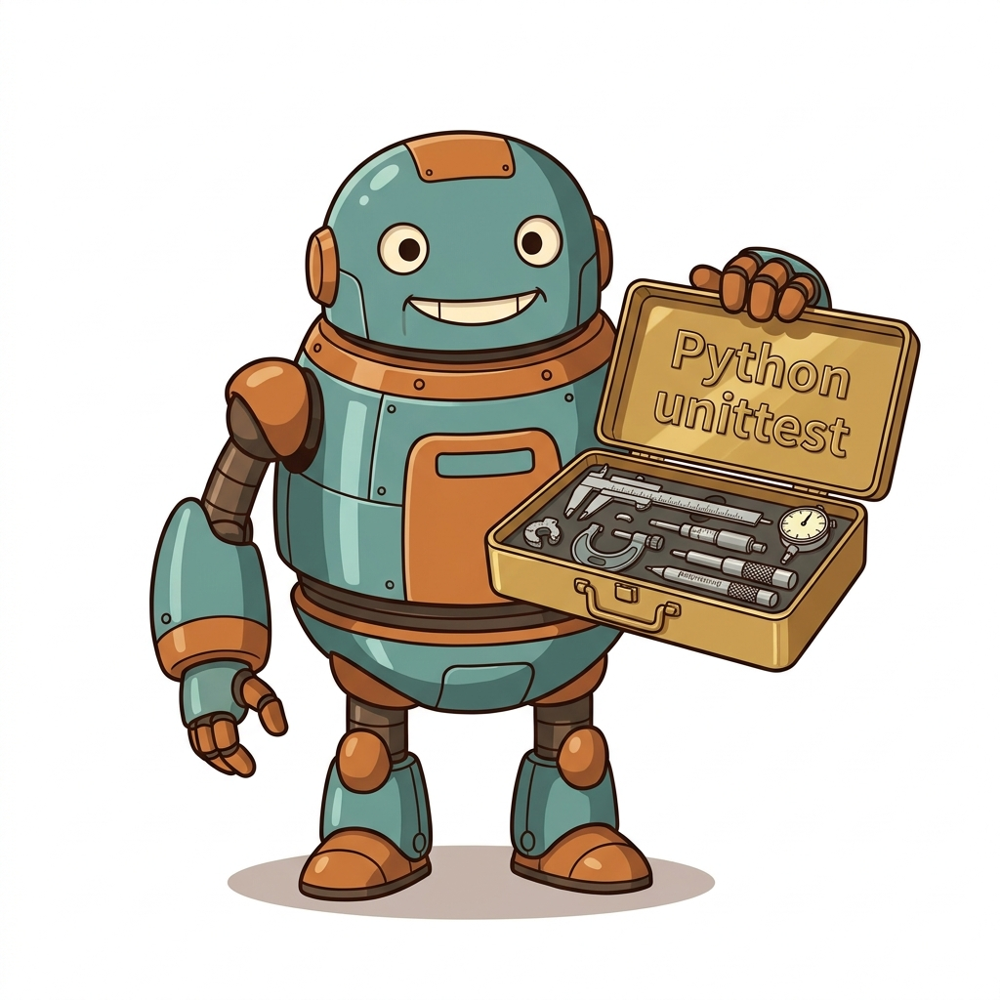
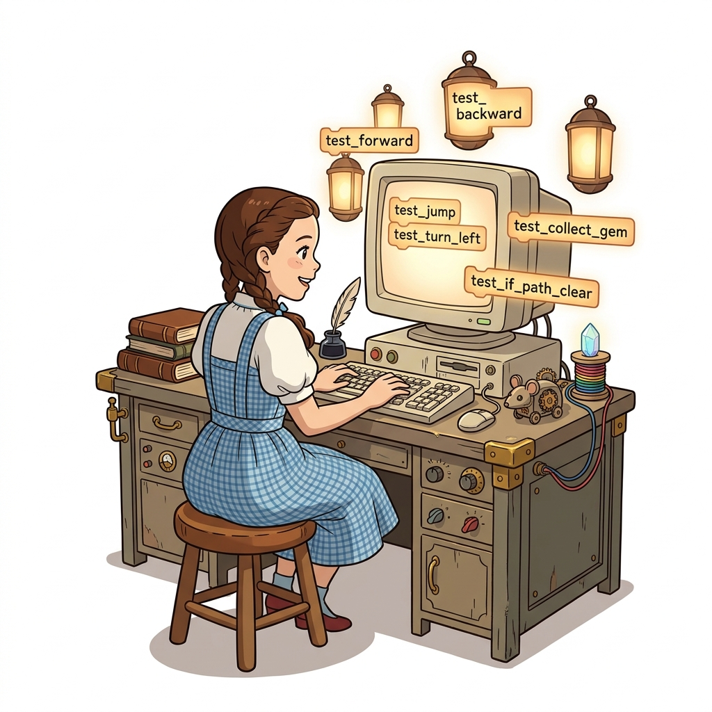
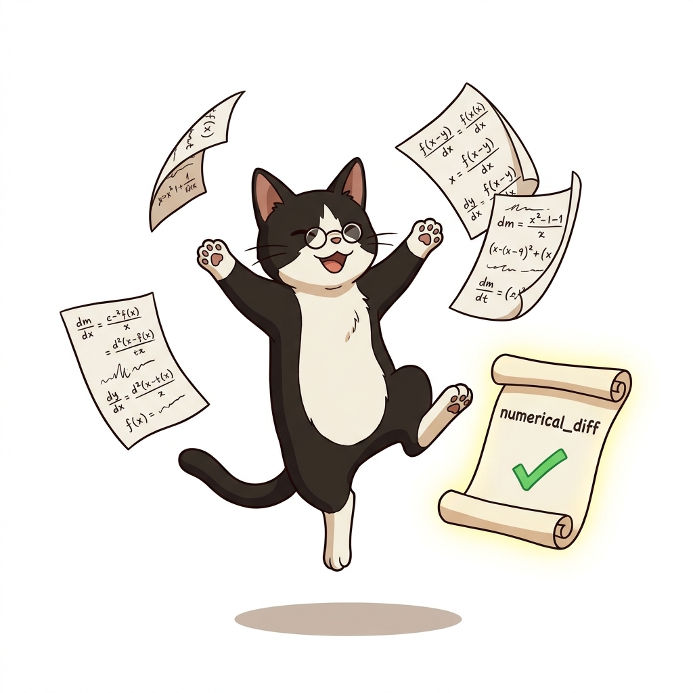
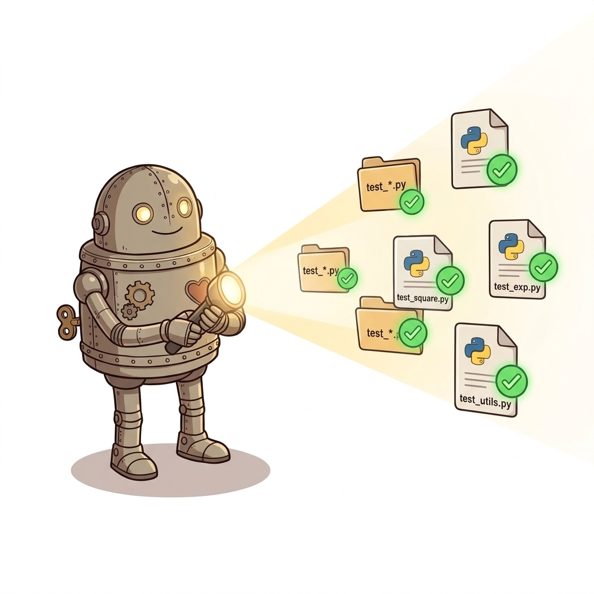
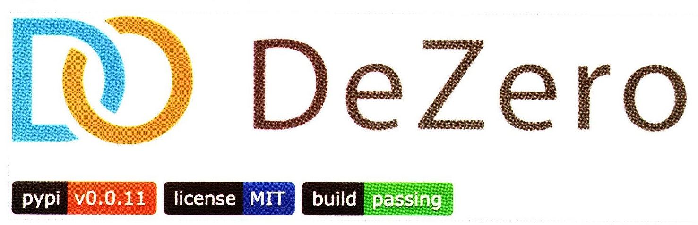
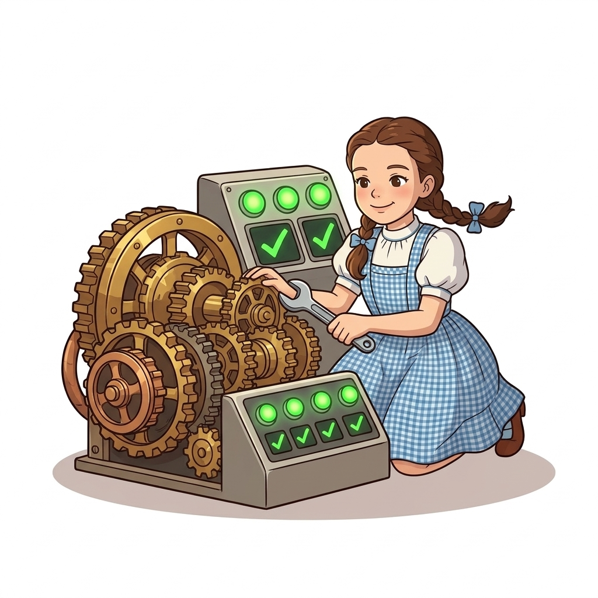
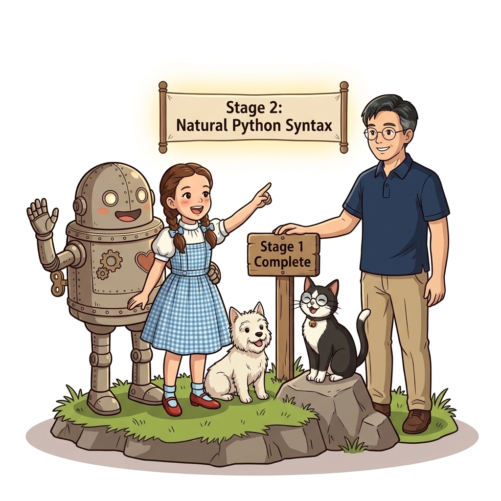

# 10단계 테스트

소프트웨어 개발에서는 테스트를 빼놓을 수 없습니다. 테스트를 해야 실수(버그)를 예방할 수 있으며 테스트를 자동화해야 소프트웨어의 품질을 유지할 수 있습니다. DeZero도 마찬가지입니다. 그래서 이번 단계에서는 테스트 방법, 특히 딥러닝 프레임워크의 테스트 방법에 대해 설명하겠습니다.


*그림 10-1: 복잡한 계산 그래프의 무결성을 지키고 버그를 방지하는 자동화 테스트*

---

> **NOTE**  
> 소프트웨어 테스트는 규모가 커지면 독특한 규약이나 세세한 규칙이 많아지기 쉽습니다. 그렇다고 테스트를 처음부터 어렵게 생각할 필요는 없습니다. 우선 '테스트한다'는 그 자체가 중요합니다. 이번 단계에서는 본격적인 테스트가 아니라 가능한 한 간단한 테스트를 해보겠습니다.


*그림 10-2: 거창한 규칙보다 '작은 단위부터 테스트한다'는 핵심 실천의 중요성*

---

## 10.1 파이썬 단위 테스트

파이썬으로 테스트할 때는 표준 라이브러리에 포함된 `unittest`를 사용하면 편합니다. 여기에서는 이전 단계에서 구현한 `square` 함수를 테스트해봅시다. 


*그림 10-3: 파이썬에 내장된 신뢰도 높은 단위 테스트 도구 unittest*

---

코드는 다음과 같습니다.

**steps/step10.py**
```python
import unittest

class SquareTest(unittest.TestCase):
    def test_forward(self):
        x = Variable(np.array(2.0))
        y = square(x)
        expected = np.array(4.0)
        self.assertEqual(y.data, expected)
```

---

이와 같이 우선 unittest를 임포트하고 `unittest.TestCase`를 상속한 `SquareTest` 클래스를 구현합니다. 여기서 기억할 규칙이 있습니다. 테스트할 때는 이름이 `test`로 시작하는 메서드를 만들고 그 안에 테스트할 내용을 적습니다. 앞의 테스트는 square 함수의 출력이 기댓값 `expected`과 같은지 확인합니다. 정확하게는 입력이 2.0일 때 출력이 4.0이 맞는지 확인합니다.


*그림 10-4: test로 시작하는 메서드를 통해 테스트 시나리오를 정의하는 규칙*

---

> **NOTE**  
> 앞의 예에서 square 함수의 출력이 기댓값과 같은지 확인하기 위해 `self.assertEqual`이라는 메서드를 사용했습니다. 이 메서드는 주어진 두 객체가 동일한지 여부를 판정합니다. 이 메서드 외에도 `self.assertGreater`와 `self.assertTrue` 등 unittest에는 다양한 메서드가 준비되어 있습니다. 다른 메서드들의 사용법은 unittest 문서를 참고하세요.


*그림 10-5: 계산된 출력과 이론적 기댓값이 동일한지 검증하는 assertEqual*

---

이제 테스트를 실행해볼까요? 앞의 테스트 코드가 `steps/step10.py` 파일에 있다고 가정했을 때 터미널에서 다음 명령을 실행하면 됩니다.

```bash
$ python -m unittest steps/step10.py
```

python 명령을 실행할 때 앞의 예처럼 `-m unittest` 인수를 제공하면 파이썬 파일을 테스트 모드로 실행할 수 있습니다. 

---

혹은 `step10.py` 파일 끝에 다음 코드를 추가하면 평소처럼 `python steps/step10.py`만 입력해도 테스트를 수행할 수 있습니다.

```python
# step10.py
unittest.main()
```

---

테스트가 뭐라고 출력했는지 확인할 차례입니다. 실제로 앞의 명령을 실행하면 다음 결과가 출력됩니다.

**실행 결과**
```text
.
----------------------------------------------------------------------
Ran 1 tests in 0.000s

OK
```

'1개의 테스트를 실행했고, 결과는 OK다'라는 뜻입니다. 즉, 테스트를 통과한 것입니다. 만약 무언가 문제가 있다면 'FAIL: test_forward (step10.SquareTest)' 같은 문장이 출력되어 테스트가 실패했음을 알려줄 것입니다.

---

## 10.2 square 함수의 역전파 테스트

이어서 square 함수의 역전파도 테스트해보겠습니다. 방금 구현한 `SquareTest` 클래스에 다음 코드를 추가합니다.

**steps/step10.py**
```python
class SquareTest(unittest.TestCase):
    ...

    def test_backward(self):
        x = Variable(np.array(3.0))
        y = square(x)
        y.backward()
        expected = np.array(6.0)
        self.assertEqual(x.grad, expected)
```

`test_backward` 메서드를 추가했습니다. 메서드 안에서 `y.backward()`로 미분값을 구하고, 그 값이 기댓값과 일치하는지 확인합니다. 참고로 여기에서 설정한 기댓값 6.0은 손으로 계산해서 구한 값을 하드코딩한 것입니다.

---

그럼 다시 테스트를 돌려봅시다. 결과는 다음과 같습니다.

**실행 결과**
```text
..
----------------------------------------------------------------------
Ran 2 tests in 0.001s

OK
```

결과를 보면 2개의 테스트를 통과했음을 알 수 있습니다. 원한다면 지금까지와 같은 요령으로 다른 테스트 케이스(입력과 기댓값)도 추가해나갈 수 있습니다. 테스트 케이스가 많아질수록 square 함수의 신뢰도도 높아질 겁니다. 그리고 코드를 수정할 때마다 즉시즉시 테스트를 실행해주면 square 함수의 상태를 반복해서 확인할 수 있습니다.

---

## 10.3 기울기 확인을 이용한 자동 테스트

앞 절에서 역전파 테스트를 작성하며 미분의 기댓값을 손으로 계산해 입력했습니다. 사실 이 부분을 자동화할 방법이 있습니다. 바로 기울기 확인<sup>gradient checking</sup>이라는 방법이죠. 기울기 확인이란 수치 미분으로 구한 결과와 역전파로 구한 결과를 비교하여 그 차이가 크면 역전파 구현에 문제가 있다고 판단하는 검증 기법입니다.


*그림 10-6: 터미널에서 모든 테스트 케이스가 통과했음을 알리는 OK 사인*

---

> **NOTE**  
> 우리는 4단계에서 수치 미분을 구현했습니다. 수치 미분은 쉽게 구현할 수 있고 거의 정확한 미분값을 내어줍니다. 따라서 수치 미분의 결과와 비교하면 역전파를 정확히 구현했는지 검증할 수 있습니다.


*그림 10-7: 순전파뿐만 아니라 역전파로 구해진 기울기(x.grad)의 정확성 검증*

---

기울기 확인은 (기댓값을 몰라도) 입력값만 준비하면 되므로 테스트 효율을 높여줍니다. 그러니 우리 테스트에서도 기울기 확인을 이용하겠습니다. 4단계에서 구현한 `numerical_diff` 함수를 사용하면 되겠군요. 


*그림 10-8: 수치 미분값과 역전파 미분값을 비교하여 구현의 정합성을 교차 검증*

---

복습도 겸해서 이 함수의 코드까지 함께 보여드리겠습니다.

**steps/step10.py**
```python
def numerical_diff(f, x, eps=1e-4):
    x0 = Variable(x.data - eps)
    x1 = Variable(x.data + eps)
    y0 = f(x0)
    y1 = f(x1)
    return (y1.data - y0.data) / (2 * eps)

class SquareTest(unittest.TestCase):
    ...

    def test_gradient_check(self):
        x = Variable(np.random.rand(1)) # 무작위 입력값 생성
        y = square(x)
        y.backward()
        num_grad = numerical_diff(square, x)
        flg = np.allclose(x.grad, num_grad)
        self.assertTrue(flg)
```

기울기 확인을 할 `test_gradient_check` 메서드 안에서 무작위 입력값을 하나 생성합니다. 

---

이어서 역전파로 미분값을 구하고, `numerical_diff` 함수를 사용해서 수치 미분으로도 계산해봅니다. 그런 다음 두 메서드로 각각 구한 값들이 거의 일치하는지 확인합니다. 이때 `np.allclose`라는 넘파이 함수를 이용합니다.


*그림 10-9: 손으로 기댓값을 일일이 미분하지 않고 수치 미분을 참값(Ground Truth)으로 활용*

---

`np.allclose(a, b)`는 ndarray 인스턴스인 $a$ 와 $b$ 의 값이 가까운지<sup>close</sup> 판정합니다. 얼마나 가까워야 가까운 것인지는 `np.allclose(a, b, rtol=1e-05, atol=1e-08)`과 같이 인수 `rtol`과 `atol`로 지정할 수 있습니다. 


*그림 10-10: 미세한 오차가 발생하는 부동소수점 연산에서 허용 오차 내 일치 여부 판정*

---

이 함수는 $a$ 와 $b$ 의 모든 요소가 다음 조건을 만족하면 `True`를 반환합니다.

$$
|a - b| \le (\text{atol} + \text{rtol} \times |b|)
$$


*그림 10-11: 절대 오차(atol)와 상대 오차(rtol)를 결합한 판정 부등식*

---

> **참고**: 수식에서 $| \cdot |$ 는 절댓값을 뜻합니다.

한편 기울기 확인을 하는 대상의 계산(함수)에 따라 `atol`과 `rtol`의 값을 미세하게 조정해야 할 수도 있습니다. 기준을 정하는 데는 참고문헌 등을 참고하면 도움이 됩니다. 그럼 이상의 기울기 확인을 코드에 추가하고 테스트를 돌려봅시다. 


*그림 10-12: np.random.rand로 생성한 임의의 입력값으로 테스트의 일반성 확보*

---

이번에 얻은 결과는 다음과 같습니다.

**실행 결과**
```text
...
Ran 3 tests in 0.001s

OK
```

이와 같이 기울기 확인을 이용하면 미분을 자동으로 계산하는 딥러닝 프레임워크를 반자동으로 테스트할 수 있고, 덕분에 더 체계적으로 더 넓은 범위를 검증하는 테스트 케이스를 만들 수 있습니다.

---

## 10.4 테스트 정리

DeZero 개발에 한정한다면 테스트에 관한 지식은 이 정도면 충분합니다. 여기서 배운 것만으로도 DeZero 테스트 코드를 작성하는 데 아무런 무리가 없을 겁니다. 다만 앞으로 이 교제에서는 테스트에 대한 직접적인 설명은 생략하고 진행하겠습니다. 만약 테스트 코드가 필요하다고 느껴지면 스스로 추가해보기 바랍니다.


*그림 10-13: 순전파, 수동 기댓값 역전파, 기울기 확인 테스트 모두 완벽 통과*

---

또한 테스트 파일들은 하나의 장소에 모아 관리하는 것이 일반적입니다. 이 교제에서도 테스트 코드는 tests 디렉터리에 모아뒀습니다(테스트용 편의 기능도 추가로 구현해뒀습니다). 관심 있는 분은 해당 테스트 코드를 찾아보세요. 이번 단계에서 작성한 것과 비슷한 코드를 많이 발견할 수 있을 겁니다. 


*그림 10-14: 디렉터리 내 모든 테스트 파일을 일괄 발굴하여 실행하는 discover 기능*

---

덧붙여서, 테스트 파일들은 다음 명령으로 한꺼번에 실행할 수 있습니다.

```bash
$ python -m unittest discover tests
```

이와 같이 `discover`라는 하위 명령을 사용하면 `discover` 다음에 지정한 디렉터리에서 테스트 파일이 있는지 검색합니다. 그리고 발견한 모든 파일을 실행하는 것이죠. 기본적으로는 지정한 디렉터리에서 이름이 `test*.py` 형태인 파일을 테스트 파일로 인식합니다(변경할 수 있습니다). 이것으로 tests 디렉터리에 들어 있는 모든 테스트를 한 번에 실행할 수 있습니다.

---

> **NOTE**  
> DeZero의 tests 디렉터리에는 정답을 체이너(Chainer)에게 묻는 테스트도 있습니다. 예를 들어 시그모이드 함수를 테스트하는 경우 동일한 입력으로 DeZero와 Chainer 각각에 계산을 시키고 출력값이 거의 같은지 비교합니다.


*그림 10-15: 깃허브 액션 등 CI 서버와 결합하여 코드 커밋마다 자동으로 테스트 수행*

---

또한 DeZero의 깃허브 저장소는 트래비스 CI<sup>Travis CI</sup>라는 지속적 통합<sup>continuous integration (CI)</sup> 서비스와 연계해뒀습니다. DeZero의 깃허브 저장소에서 코드를 푸시<sup>push</sup>하고, 풀 리퀘스트<sup>pull request</sup>를 병합하고, 매시간 자동으로 테스트가 실행되도록 설정해놓은 것이죠. 테스트 결과에 문제가 있으면 메일 등으로 보고됩니다. 


*그림 10-16: 코드베이스가 거대해져도 리팩터링을 두려워하지 않게 해주는 든든한 안전망*

---

게다가 DeZero 깃허브 저장소의 첫 화면에는 [그림 10-1]과 같이 로고 하단 왼쪽에 빌드 상태가 표시되게 해뒀습니다.

  
*그림 10-1 DeZero의 깃허브 저장소 첫 화면*

지금의 DeZero는 작은 소프트웨어지만 앞으로 더 큰 소프트웨어로 성장시킬 것입니다. 여기에서 설명한 테스트 방식을 도입하면 성장 과정에서도 코드의 신뢰성을 꾸준히 유지할 수 있을 것입니다.

---

축하합니다! 이상으로 제1고지를 무사히 점령했습니다!


*그림 10-17: 테스트 스위트의 초록 신호등을 믿고 구조를 과감하게 개선하는 힘*

---

★ ★ ★ ★ ★ ★ ★

여기까지 우리는 조금씩 그리고 꾸준히 DeZero를 만들어왔습니다. '작은 상자(변수)'밖에 없는 모습으로 탄생했지만 지금은 역전파라는 복잡한 알고리즘도 수행할 만큼 성장했습니다. 그러나 현재의 역전파 구현은 간단한 계산밖에 처리하지 못합니다. 그래서 다음 고지에서는 더 복잡한 계산에도 적용할 수 있도록 DeZero를 확장해보겠습니다.


*그림 10-18: 10단계를 거쳐 미분 자동 계산의 기초를 확립하고 자연스러운 코드로 도약*
