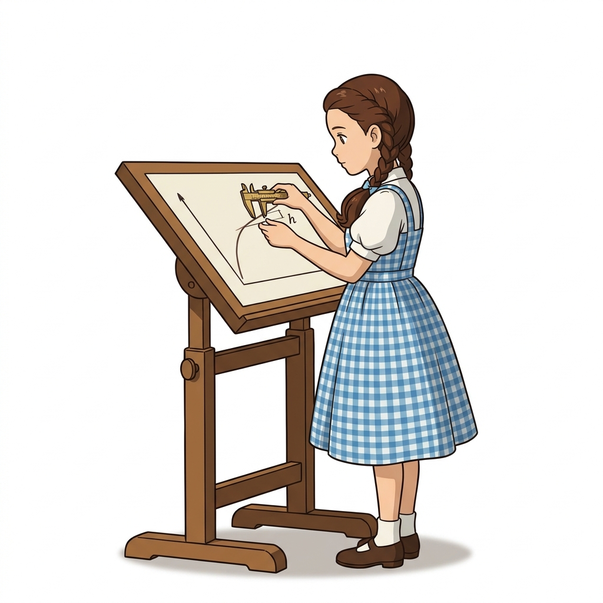
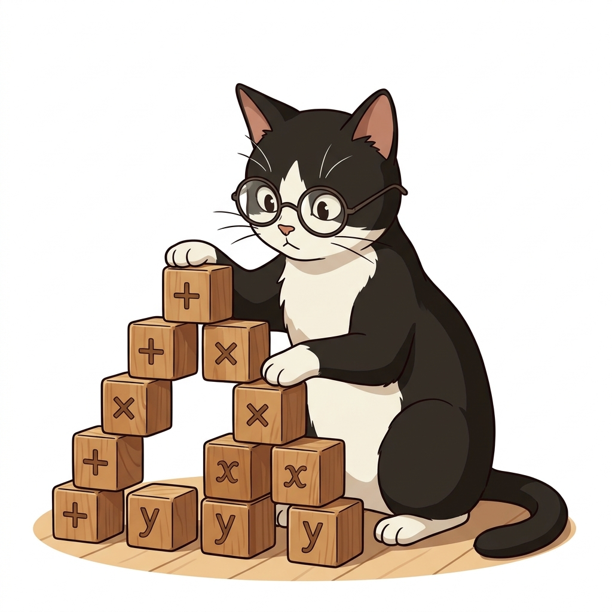
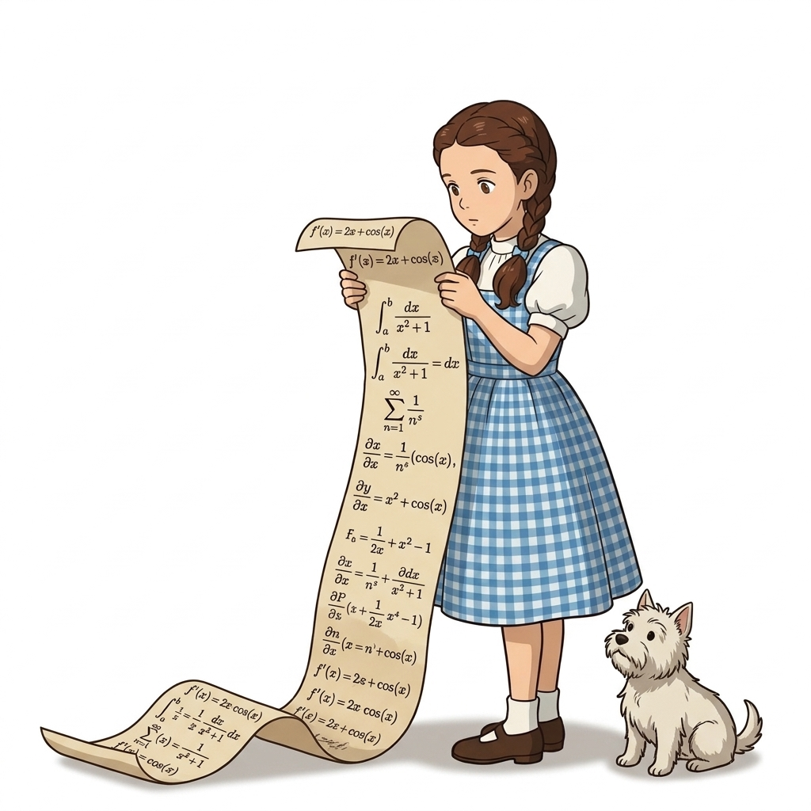
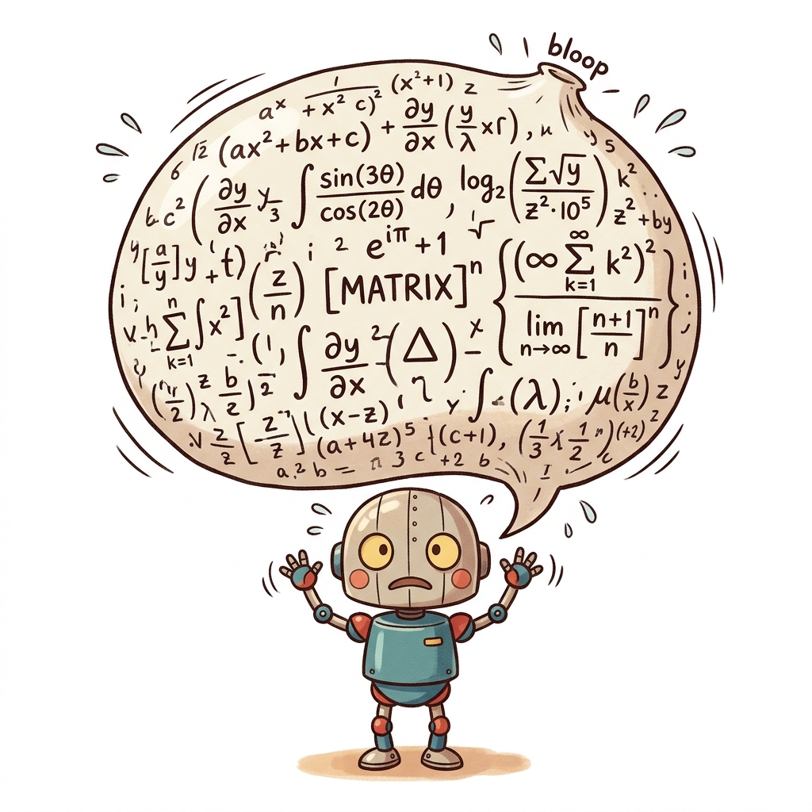
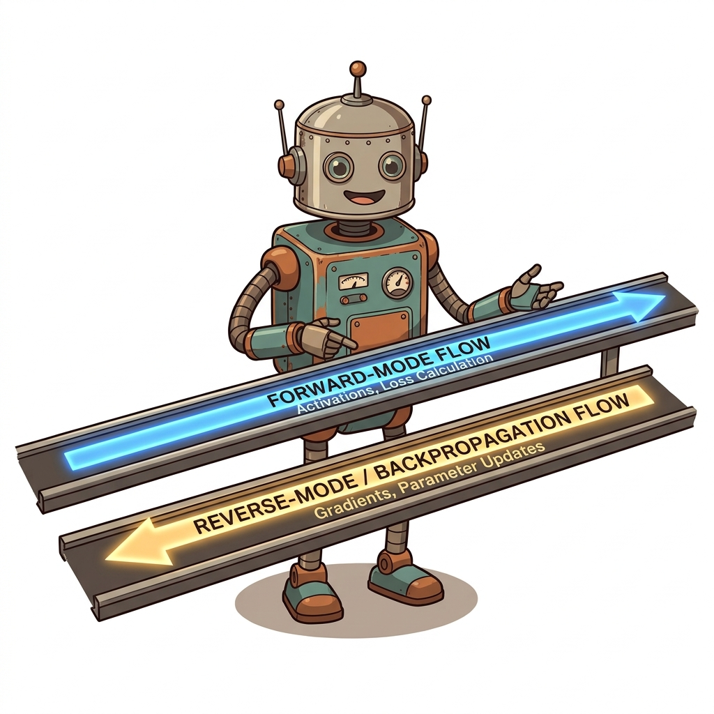
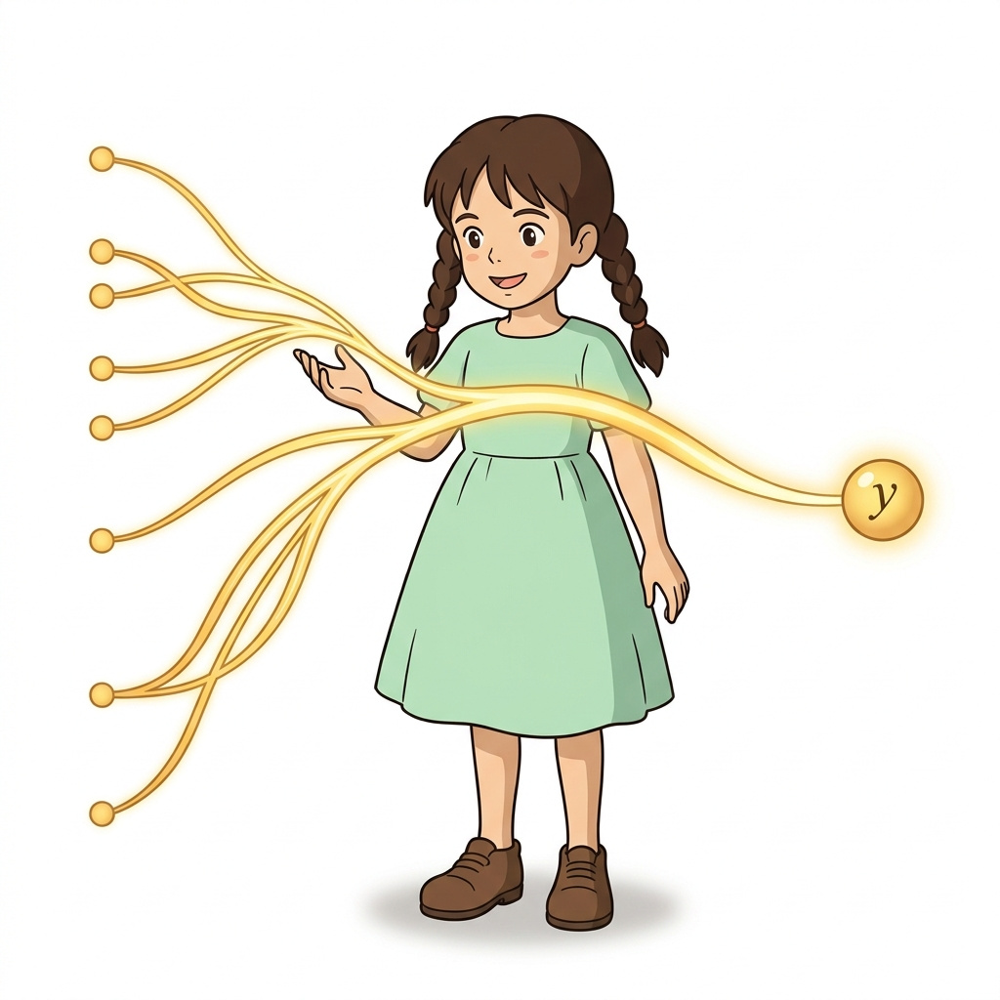
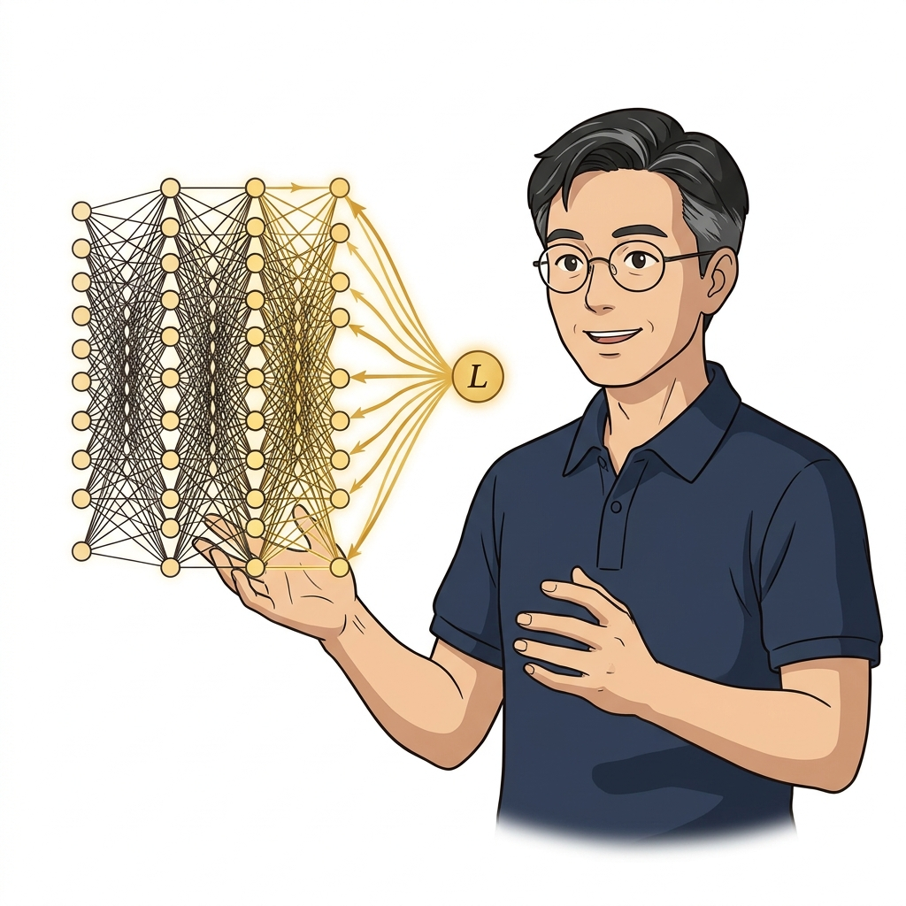
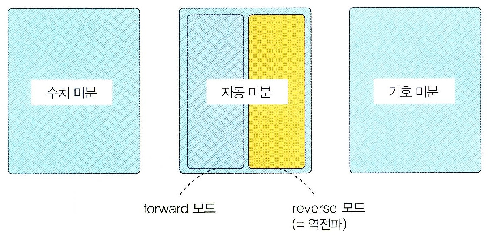
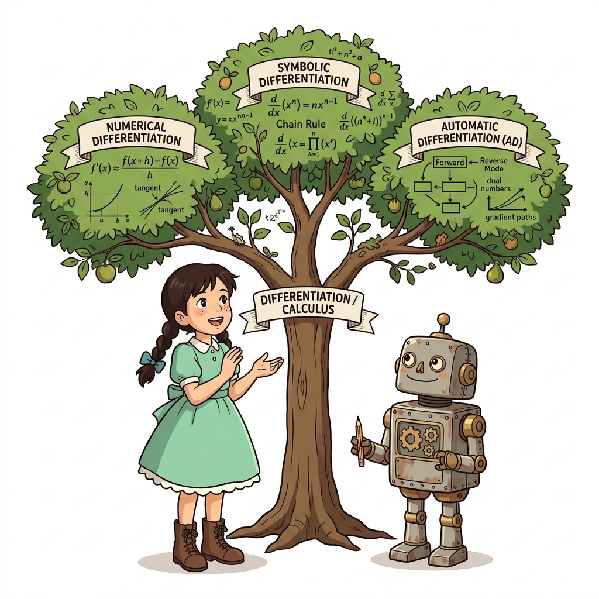

# 칼럼: 자동 미분

딥러닝 프레임워크의 중심에는 역전파가 있습니다. 역전파를 문헌에 따라 '자동 미분'이라고 부르기도 합니다. 하지만 '자동 미분'이라는 용어는 (특히 학술 분야에서는) 더 제한적인 방법을 뜻하므로 주의해야 합니다. 이번 칼럼에서는 자동 미분에 대해 한 걸음 더 들어가 보겠습니다.

*그림 11-1: 딥러닝의 핵심 엔진이자 컴퓨터 계산의 정수인 자동 미분(AD) 심층 탐구*

---

> **NOTE**  
> 자동 미분을 문자 그대로 해석하면 '자동으로 미분을 계산하는 방법(기술)'입니다. '자동으로'라 함은 (사람이 아니라) 컴퓨터가 미분을 계산한다는 뜻이죠. 정확히 말하면 어떤 계산(함수)을 코드로 구현하면 그 계산의 미분을 컴퓨터가 자동으로 계산해주는 시스템을 가리킵니다.
>
> 
*그림 11-2: 사람이 아닌 컴퓨터 프로그램이 함수의 도함수를 정확하게 산출하는 시스템*

---

## 세 가지 미분 계산 방법

컴퓨터 프로그램에서 미분을 계산하는 방법은 크게 세 가지로 나눌 수 있습니다.

*그림 11-3: 수치 미분, 기호 미분, 자동 미분의 세 가지 패러다임 비교*

---

### 1. 수치 미분 (Numerical Differentiation)
첫 번째는 수치 미분numerical differentiation입니다. 수치 미분은 4단계에서 구현한 것처럼 변수에 미세한 차이를 주어 일반적인 계산(순전파)을 2회 실시하고, 두 출력의 차이로부터 근사적으로 미분을 계산합니다. 수치 미분은 구현하기 쉽지만 출력에 오차가 포함되기 쉽고, 다량의 변수를 사용하는 함수를 다룰 때는 계산 비용이 높다는 단점이 있습니다.

*그림 11-4: 구현이 간단하지만 근사 오차와 대규모 변수 계산량 문제를 안고 있는 수치 미분*

---

### 2. 기호 미분 (Symbolic Differentiation)
두 번째 방법은 기호 미분symbolic differentiation입니다. 기호 미분은 고등학교 수학에서 배운 것처럼 미분 공식을 이용하여 계산하는 방법입니다. 입력도 '수식'이고 출력도 '수식'입니다(수식은 트리 데이터 구조로 표현할 수 있습니다). Mathematica와 MATLAB 등에서 이용하는 방법입니다.

*그림 11-5: 미분 공식을 적용하여 수식(트리) 자체를 도함수 식 변환하는 기호 미분*

---

> **CAUTION**  
> 기호 미분의 출력은 미분된 '식'(즉, 도함수)이며, 출력 시점에는 아무런 수치 계산도 수행되지 않습니다. 대신 도함수를 얻은 후 구체적인 값(예: $x = 3.0$)에서의 미분을 계산하는 식입니다.

*그림 11-6: 계산 결과로 즉시 수치가 나오는 것이 아니라 새로운 도함수 식이 도출됨*

---

기호 미분의 단점은 수식이 크게 부풀어 오르기 쉽다는 것입니다. 특히 최적화를 고려하지 않고 구현하면 수식이 곧바로 거대해집니다(수식이 '폭발'한다고 합니다). 그런데 딥러닝에서 취급하는 계산은 수많은 변수에 대한 (수식이 아닌) 미분'값'을 효율적으로 구해야 합니다. 그래서 기호 미분보다 효율적인 방법이 필요합니다.

*그림 11-7: 복잡한 신경망에서 수식의 길이가 기하급수적으로 팽창하는 수식 폭발 문제*

---

### 3. 자동 미분 (Automatic Differentiation)
세 번째 방법은 자동 미분automatic differentiation입니다. 자동 미분은 연쇄 법칙을 사용하여 미분하는 방법으로, 어떤 함수를 프로그램으로 짜서 건네주면 그 미분을 효율적이고 정밀하게 계산할 수 있습니다. 

*그림 11-8: 수식 팽창 없이 연쇄 법칙에 따라 정확한 미분값을 초고속으로 계산*

---

역전파 방식도 자동 미분에 속합니다. 더 정확히 말하면 자동 미분은 크게 두 가지로 나눌 수 있습니다. 바로 'forward 모드'와 'reverse 모드'죠. 역전파는 후자인 'reverse 모드 자동 미분'에 해당합니다.

*그림 11-9: 입력에서 출발하는 전진 모드와 출력에서 거슬러오는 후진 모드(역전파)*

---

> **NOTE**  
> 역전파(reverse 모드 자동 미분)는 미분 결과를 출력 쪽으로부터 입력 쪽으로 전달합니다. 반대로 forward 모드 자동 미분은 입력 쪽으로부터 출력 쪽으로 전달합니다. 두 방법 모두 연쇄 법칙을 사용하여 미분값을 계산하지만 그 '경로'가 다른 것이죠.  

*그림 11-10: 출력 노드에서 시작하여 입력 방향으로 기울기를 전파하는 역방향 스위프*

---
> 출력이 하나뿐이고, 그 하나의 출력 변수를 미분하려면 reverse 모드 자동 미분이 적합합니다. 머신러닝은 대부분 출력이 변수 하나로 모아지는 문제를 다루기 때문에 reverse 모드 자동 미분이 사용됩니다. 이러한 이유로 이 책에서는 forward 모드 자동 미분에 대해서는 더 이상 설명하지 않으니, 관심 있는 분은 따로 관련 참고문헌을 참고하기 바랍니다.

*그림 11-11: 단 하나의 손실(Loss)로부터 수백만 개의 가중치 매개변수 기울기를 단숨에 획득*

---

## 미분 계산 방법의 분류

지금까지의 내용을 정리하면 '컴퓨터 프로그램으로 미분을 계산하는 방법'은 [그림 A-1]과 같이 나뉩니다.

  
*그림 A-1 컴퓨터 프로그램으로 미분을 계산하는 방법*

---

[그림 A-1]에서 보듯 '자동 미분'은 컴퓨터로 미분을 계산하는 여러 방법 중 하나입니다. 딥러닝 프레임워크는 그중에서도 'reverse 모드 자동 미분'을 구현해 사용합니다. 

*그림 11-12: 컴퓨터 수학에서 수치, 기호, 자동 미분의 위치와 역전파의 위상*

---
그러나 문헌에 따라 forward 모드와 reverse 모드를 구분하지 않고, 역전파를 가리켜 '자동 미분'이라고 부르기도 합니다.
---

> **NOTE**  
> 자동 미분은 학계에서 오랫동안 연구해온 분야입니다. 오랜 역사만큼이나 중요한 지식도 많이 쌓여 있지요. 하지만 아쉽게도 지금까지 머신러닝 분야와는 그다지 교류가 없었습니다. 최근 딥러닝 붐이 일면서 자동 미분 분야에 대한 관심이 높아지는 추세이며, 머신러닝과 프로그래밍 언어 등의 분야와 자동 미분 분야의 새로운 교류가 꿈틀대고 있답니다.

*그림 11-13: 1고지를 마무리하고 더 풍부한 계산 그래프가 펼쳐질 제2고지를 향한 출발*
