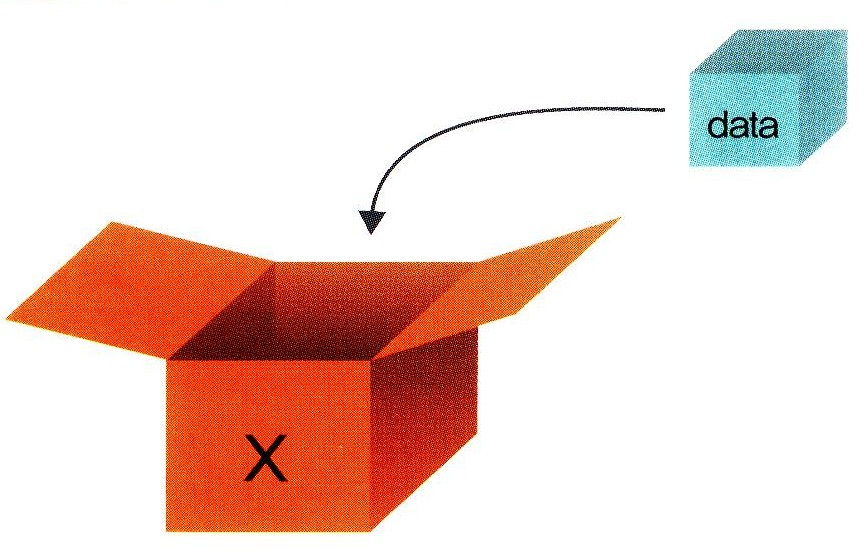
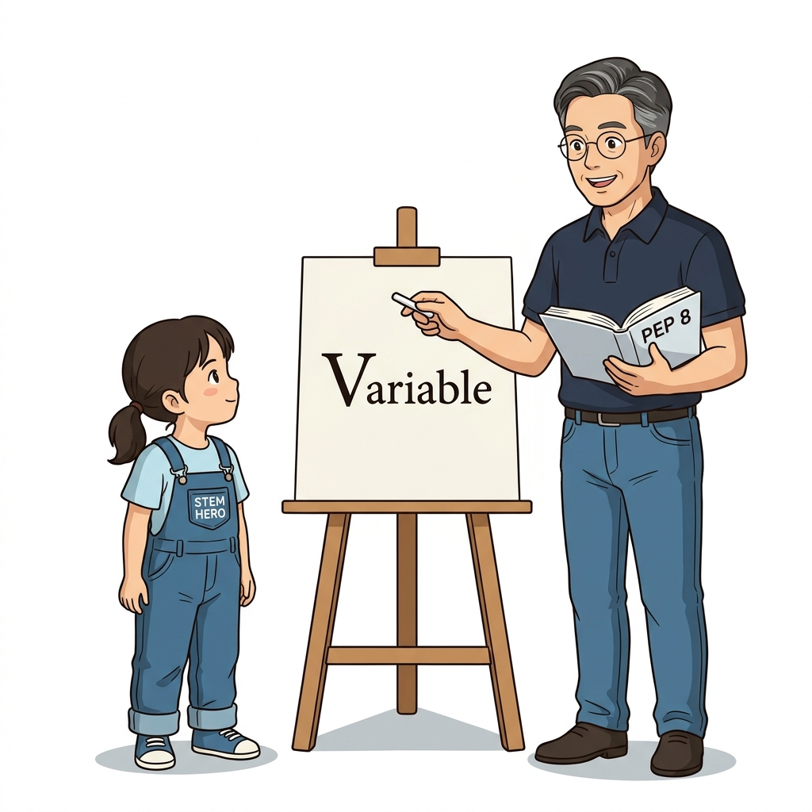
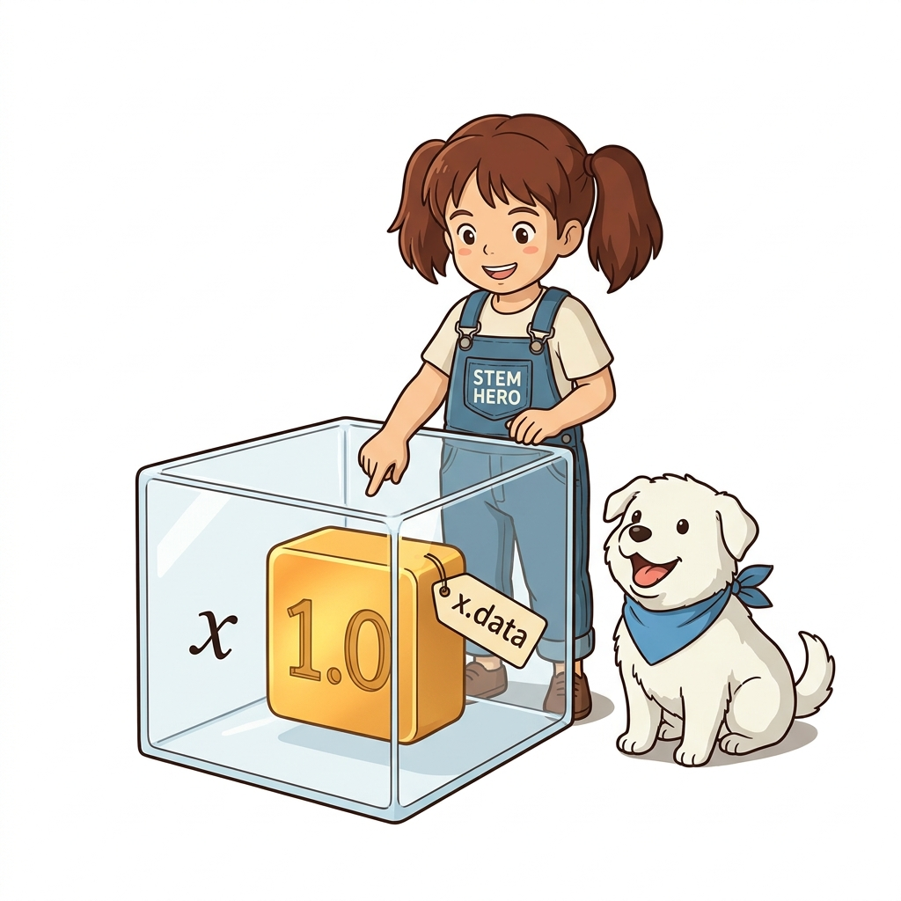
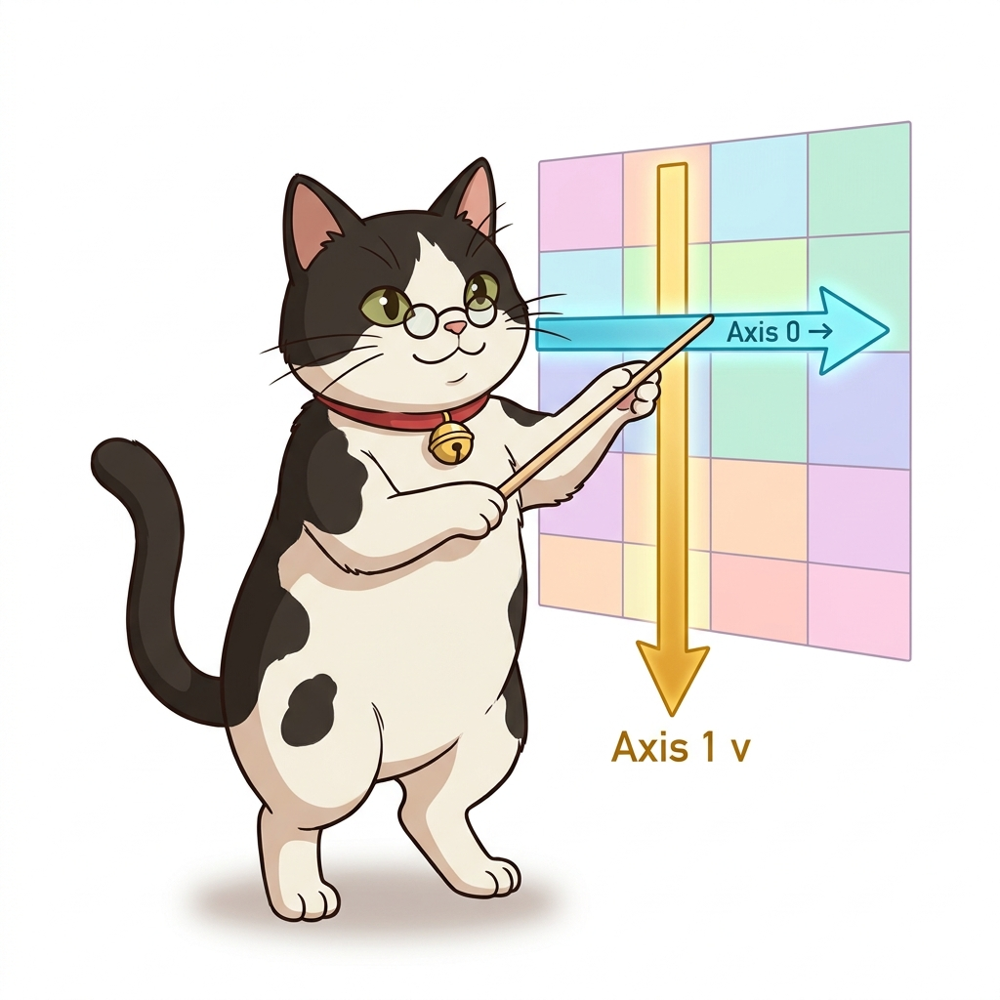
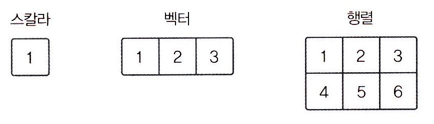
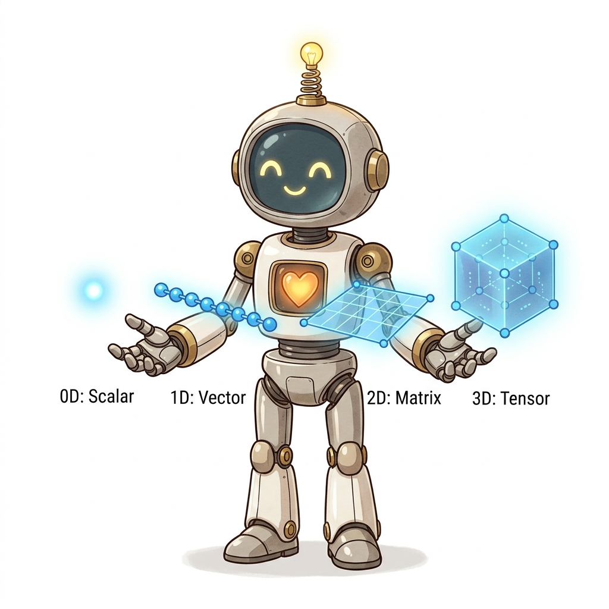
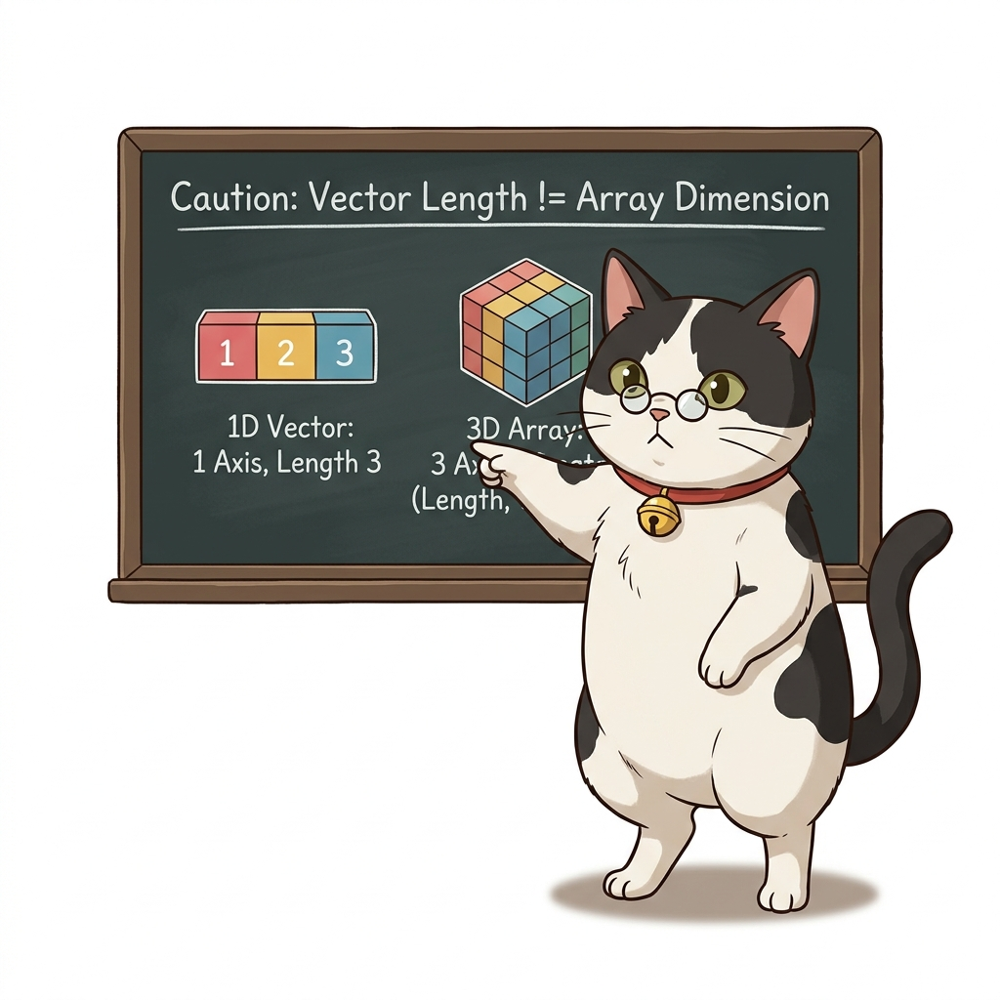

# 1단계 상자로서의 변수

첫 번째 단계에서는 DeZero의 구성 요소인 '변수'를 만듭니다. 변수는 DeZero에서 가장 중요한 개념입니다. 

이번 단계에서는 변수가 어떤 기능을 하는지 이해하고, 그 기능에 맞게 코드로 구현합니다.

  
*이호진 교수님이 DeZero의 첫걸음인 '상자로서의 변수' 개념을 따뜻하게 소개하고 있습니다.*

---

## 1.1 변수란

본론으로 들어가서, 변수란 무엇일까요? 프로그래밍 입문서를 펼쳐보면 변수는 대략 [그림 1-1]과 같은 이미지로 설명합니다.

  
*그림 1-1 변수 설명 예*

[그림 1-1]과 같이 상자<sup>box</sup>에 데이터를 넣는 그림을 보여주며 이 '상자'가 바로 변수라고 설명합니다. 변수를 상자에 비유한 설명은 변수의 성질을 (제법) 잘 보여줍니다. 

---

정리하면 다음과 같습니다.

* 상자와 데이터는 별개다.
* 상자에는 데이터가 들어간다(대입 혹은 할당한다).
* 상자 속을 들여다보면 데이터를 알 수 있다(참조한다).

그럼 이 상자 그림에 맞게 DeZero 변수를 구현해보죠.

---

## 1.2 Variable 클래스 구현

변수는 영어로 variable입니다. 

  
*도로시와 조교 지니가 '변할 수 있는 상자'라는 뜻의 Variable 어원을 탐구하고 있습니다.*

---

그래서 DeZero에서 사용하는 변수라는 개념을 Variable이라는 이름의 클래스로 구현하겠습니다. 

덧붙여서, 파이썬에서는 클래스 이름의 첫 글자를 보통 대문자로 합니다. 

파이썬이 권장하는 코딩 규칙은 PEP 8*을 참고하세요.

  
*이호진 교수님이 파이썬 표준 코딩 규칙(PEP 8)에 따른 클래스 이름 표기법(대문자 시작)을 설명하고 있습니다.*

---

이제 Variable 클래스가 상자가 되도록 구현해보죠. 

다음은 이 기능을 최소한의 코드로 작성해본 모습입니다.

**steps/step01.py**
```python
class Variable:
    def __init__(self, data):
        self.data = data
```

보는 바와 같이 초기화 함수 `__init__`에 주어진 인수를 인스턴스 변수 `data`에 대입했습니다. 

아주 간단한 코드지만, 이제 Variable 클래스를 상자로 사용할 수 있습니다. 

실제 데이터가 Variable의 `data`에 보관되기 때문이죠. 

---

다음 예를 보면 더 명확해질 것입니다.

\* https://www.python.org/dev/peps/pep-0008/

**steps/step01.py**
```python
import numpy as np

data = np.array(1.0)
x = Variable(data)
print(x.data)
```

**실행 결과**
```text
1.0
```

이 예에서 상자에 넣는 데이터로는 '넘파이의 다차원 배열'을 사용했습니다. 

이때 x는 Variable 인스턴스이며, 실제 데이터는 x 안에 담겨 있습니다. 즉, x는 데이터 자체가 아니라 데이터를 담은 상자가 됩니다.

  
*인스턴스 x라는 상자 안에 실제 데이터 1.0(x.data)이 안전하게 담겨 있는 모습입니다.*

---

> **NOTE**  
> 예시 코드 바로 위에 대응하는 파일 이름을 적어뒀습니다. 바로 앞 코드에는 `steps/step01.py`라고 적혀 있는데, 이 책 깃허브 저장소의 `steps/step01.py` 파일에서 이 코드를 찾을 수 있다는 뜻입니다. 파일 이름을 적지 않은 경우는 대응하는 파일이 없다는 뜻입니다.

  
*조교 지니가 교재의 예시 코드와 깃허브 저장소(steps/step01.py)의 매핑 구조를 안내하고 있습니다.*

---

머신러닝 시스템은 기본 데이터 구조로 '다차원 배열'을 사용합니다. 

그래서 DeZero의 Variable 클래스는 넘파이의 다차원 배열만 취급합니다. 넘파이의 다차원 배열 클래스는 `numpy.ndarray`이며 `np.ndarray`로 줄여 쓰곤 합니다. 

  
*이호진 교수님이 머신러닝의 핵심 데이터 구조인 넘파이 다차원 배열(ndarray)을 설명하고 있습니다.*

---

넘파이 배열은 앞의 코드에서 볼 수 있듯 `np.array` 함수를 이용해 생성할 수 있습니다. 이 책에서는 앞으로 `numpy.ndarray` 인스턴스를 단순히 ndarray 인스턴스라고 부르겠습니다.

  
*도로시가 np.array() 함수를 사용하여 일반 숫자를 넘파이 다차원 배열로 생성하고 있습니다.*

---

이어서 앞 코드의 x에 새로운 데이터를 대입해보겠습니다.

**steps/step01.py**
```python
x.data = np.array(2.0)
print(x.data)
```

**실행 결과**
```text
2.0
```

보는 바와 같이 `x.data = ...` 형태로 쓰면 새로운 데이터가 대입됩니다. 이제 Variable 클래스를 상자로 사용할 수 있게 되었습니다.

---

이상이 1단계에서 구현하는 전부입니다. 

현재 Variable 클래스는 단 3줄의 코드밖에 없지만 이것을 기점으로 DeZero를 현대적인 프레임워크로 만들어갈 것입니다.

  
*단 3줄의 Variable 클래스 씨앗이 미래의 거대한 DeZero 프레임워크로 자라나는 첫 순간입니다.*

---

## 1.3 [보충] 넘파이의 다차원 배열

마지막으로 넘파이의 다차원 배열에 관해 간단히 보충하겠습니다. 

  
*이호진 교수님이 넘파이 다차원 배열의 축(Axis)과 차원의 세계로 독자들을 이끌고 있습니다.*

---

다차원 배열은 숫자 등의 원소가 일정하게 모여 있는 데이터 구조입니다. 

다차원 배열에서 원소의 순서에는 방향이 있고, 이 방향을 차원<sup>dimension</sup> 혹은 축<sup>axis</sup>이라고 합니다. 

  
*조교 지니가 다차원 배열의 방향을 결정짓는 차원(Dimension)과 축(Axis)의 개념을 지휘하고 있습니다.*

---

[그림 1-2]는 다차원 배열의 예입니다.

  
*그림 1-2 다차원 배열의 예*

[그림 1-2]에는 왼쪽부터 0차원 배열, 1차원 배열, 2차원 배열이 나오는데, 차례대로 스칼라<sup>scalar</sup>, 벡터<sup>vector</sup>, 행렬<sup>matrix</sup>이라고 합니다. 스칼라는 단순히 하나의 수를 나타냅니다. 벡터는 하나의 축을 따라 숫자가 늘어서 있고, 행렬은 축이 두 개입니다.

---

> **NOTE**  
> 다차원 배열을 텐서<sup>tensor</sup>라고도 합니다. [그림 1-2]는 왼쪽부터 0차원 텐서, 1차원 텐서, 2차원 텐서가 되겠죠.

  
*로봇 틴맨이 0차원 스칼라부터 1차원 벡터, 2차원 행렬, 3차원 텐서로 이어지는 개념 계층을 시각화하고 있습니다.*

---

넘파이의 ndarray 인스턴스에는 `ndim`이라는 인스턴스 변수가 있습니다.

`ndim`은 'number of dimensions'의 약자로, 다차원 배열의 '차원 수'를 뜻합니다. 한번 사용해보죠.

```python
>>> import numpy as np
>>> x = np.array(1)
>>> x.ndim
0
>>> x = np.array([1, 2, 3])
>>> x.ndim
1
>>> x = np.array([[1, 2, 3],
...                [4, 5, 6]])
>>> x.ndim
2
```

여기서는 파이썬 인터프리터의 대화 모드에서 실행했습니다(인터프리터를 이용하는 예에서는 독자가 입력해야 하는 코드 앞에 `>>>` 기호를 붙였습니다). 앞의 예시와 같이 인스턴스 변수인 `ndim`을 사용하여 배열이 몇 차원인지 확인할 수 있습니다.

---

> **CAUTION**  
> 벡터를 다룰 때는 '차원'이라는 말에 주의해야 합니다. 예를 들어 `np.array([1, 2, 3])`은 벡터인데, 세 개의 요소가 일렬로 늘어서 있기 때문에 '3차원 벡터'라고도 합니다. 이때 '벡터의 차원'은 벡터의 원소 수를 말합니다. 한편 '3차원 배열'이라고 할 때의 '배열의 차원'은 (원소가 아닌) 축이 3개라는 뜻입니다.

  
*조교 지니가 '3차원 벡터(원소 3개)'와 '3차원 배열(축 3개)'의 결정적 차이를 명쾌하게 비교 설명하고 있습니다.*

---

이상과 같이 ndarray 인스턴스를 사용하면 스칼라, 벡터, 행렬, 심지어 더 높은 차원의 텐서를 만들 수 있습니다. 

그러나 이 강의에서는 당분간 스칼라만을 취급하겠습니다. 

나중에 37단계에 가면 벡터와 행렬도 다룰 수 있도록 DeZero를 확장할 것입니다.

  
*이호진 교수님이 지금은 기본 스칼라에 집중하고 향후 고차원 텐서로 나아갈 로드맵을 격려하고 있습니다.*
