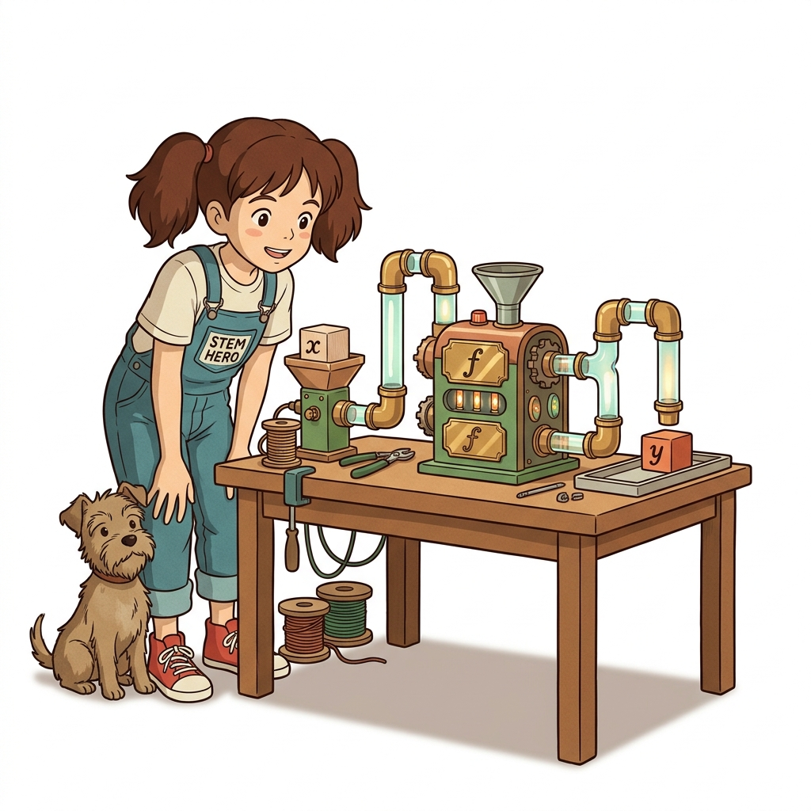
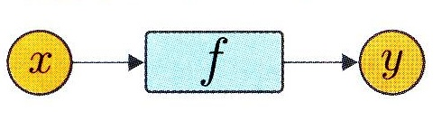
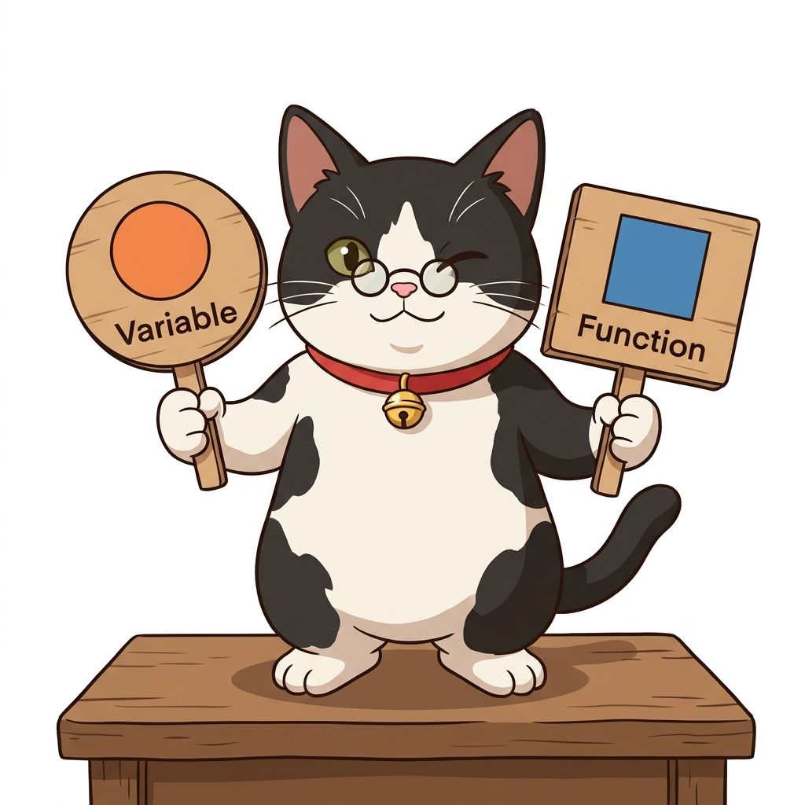
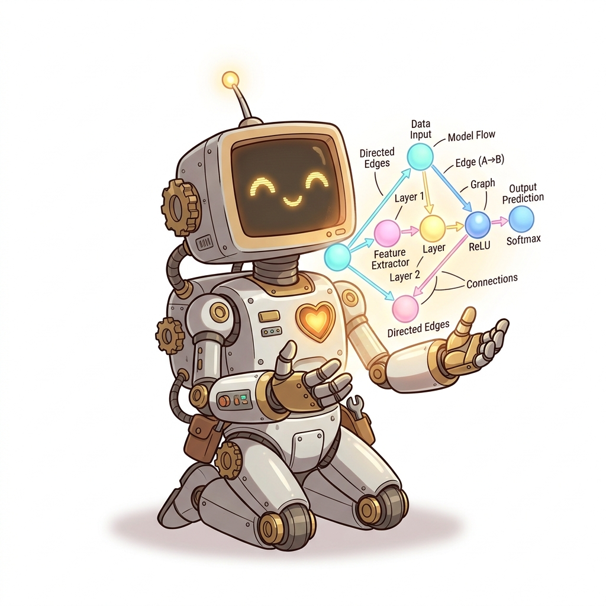
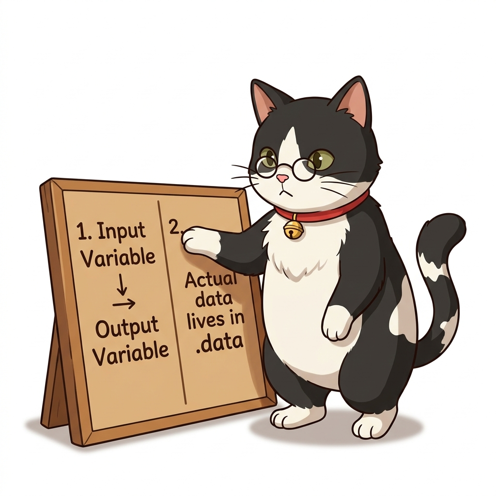
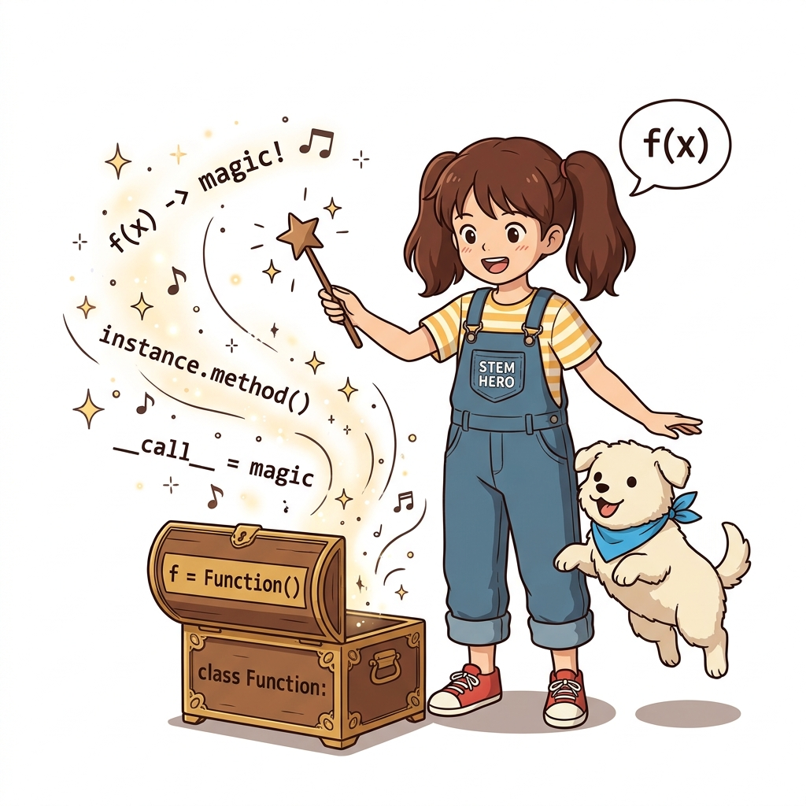

# 2단계 변수를 낳는 함수

앞 단계에서 Variable 클래스를 상자로 사용할 수 있게 했습니다. 하지만 지금 이대로는 그냥 상자일뿐입니다. 우리에겐 단순한 상자를 마법의 상자로 바꾸는 장치가 필요한데, 그 열쇠는 바로 '함수'입니다. 이번 단계에서는 함수에 대해 생각해보겠습니다.


*그림 2-1: 함수와 변수의 기본 관계 (입력 변수 x와 출력 변수 y)*

---

## 2.1 함수란

함수란 무엇일까요? 

조금 딱딱하게 표현하면 '어떤 변수로부터 다른 변수로의 대응 관계를 정한 것'이라고 할 수 있습니다. 


*그림 2-2: DeZero의 기본 Function 클래스 아키텍처*

---

구체적인 예가 있으면 좋겠군요. 

제곱을 계산하는 함수 $f(x) = x^2$ 이 있다고 해봅시다. 

이때 $y = f(x)$ 라고 하면 변수 $y$ 와 $x$ 의 관계가 함수 $f$ 에 의해 결정됩니다. 

즉, 함수 $f$ 에 의해 '$y$ 는 $x$ 의 제곱이다'라는 관계가 성립됩니다.


*그림 2-3: Function에 Variable 인스턴스를 입력으로 전달하는 과정*

---

이와 같이 변수 사이의 대응 관계를 정하는 역할을 함수가 맡게 되며, [그림 2-1]은 그 의미를 시각적으로 표현한 모습입니다.

그림 2-1 변수와 함수의 관계


[그림 2-1]은 변수 $x$ 와 $y$, 그리고 함수 $f$ 의 관계를 보여줍니다. 이처럼 원(○)과 사각형(□) 모양의 노드들을 화살표로 연결해 계산 과정을 표현한 그림을 계산 그래프<sup>computational graph</sup>라고 합니다. 

이 강의에서는 변수를 ○로, 함수를 □로 표시하겠습니다.


*그림 2-4: Variable 상자 내부의 ndarray 데이터를 꺼내는 언패킹 과정*

---

> **CAUTION**  
> '그래프'라고 하면 막대그래프나 원그래프 같은 게 떠오를 수 있지만, 컴퓨터 과학에서 그래프<sup>graph</sup>는 노드<sup>node, 교점</sup>와 에지<sup>edge, 변, 간선</sup>로 구성된 데이터 구조(혹은 그 구조를 나타낸 그림)를 말합니다. [그림 2-1]에서 화살표는 '방향이 있는' 에지에 해당합니다.


*그림 2-5: forward 메서드로 실제 계산 로직을 위임하는 추상 클래스 구조*

---


## 2.2 Function 클래스 구현

그러면 [그림 2-1]의 함수를 프로그래밍 관점에서 생각해보죠. 

구체적으로는, 앞서 구현한 Variable 인스턴스를 변수로 다룰 수 있는 함수를 Function 클래스로 구현합니다. 


*그림 2-6: 계산된 결과 배열을 다시 Variable 상자에 담아 반환하는 패킹 과정*

---


여기서 주의할 점은 다음 두 가지입니다.

* Function 클래스는 Variable 인스턴스를 입력받아 Variable 인스턴스를 출력합니다.
* Variable 인스턴스의 실제 데이터는 인스턴스 변수인 `data`에 있습니다.


*그림 2-7: 상속을 강제하는 기반 클래스의 NotImplementedError 예외 처리*

---


이 두 가지에 유의하여 Function 클래스를 다음과 같이 구현합니다.

```python
class Function:
    def __call__(self, input):
        x = input.data  # 데이터를 꺼낸다.
        y = x ** 2  # 실제 계산
        output = Variable(y)  # Variable 형태로 되돌린다.
        return output
```

`__call__` 메서드의 인수 input은 Variable 인스턴스라고 가정합니다.

 따라서 실제 데이터는 `input.data`에 존재합니다. 

데이터를 꺼낸 후 원하는 계산(여기서는 제곱)을 하고, 결과를 Variable이라는 '상자'에 담아 돌려줍니다.

---

> **NOTE**  
> `__call__` 메서드는 파이썬의 특수 메서드입니다. 이 메서드를 정의하면 `f = Function()` 형태로 함수의 인스턴스를 변수 f에 대입해두고, 나중에 `f(...)` 형태로 `__call__` 메서드를 호출할 수 있습니다.


*그림 2-8: Function 클래스를 상속받아 제곱 계산을 구현한 Square 클래스*

---

## 2.3 Function 클래스 이용

Function 클래스를 실제로 사용해보죠. 

Variable 인스턴스인 $x$ 를 Function 인스턴스인 $f$ 에 입력해보겠습니다.

```python
x = Variable(np.array(10))
f = Function()
y = f(x)

print(type(y))  # type() 함수는 객체의 클래스를 알려준다.
print(y.data)
```

---

실행 결과

```
<class '__main__.Variable'>
```

이와 같이 Variable과 Function을 연계할 수 있습니다. 

실행 결과를 보면 $y$ 의 클래스는 Variable이며, 데이터는 `y.data`에 잘 저장되어 있음을 알 수 있습니다.

---

그런데 방금 구현한 Function 클래스는 용도가 '입력값의 제곱'으로 고정된 함수입니다. 


*그림 2-9: 파이썬 __call__ 특수 메서드를 통한 객체 호출 메커니즘*

---

따라서 Square라는 명확한 이름이 더 어울립니다. 앞으로 Sin, Exp 등 다양한 함수가 필요하다는 점을 고려하면 Function 클래스는 기반 클래스로 두고 DeZero의 모든 함수가 공통적으로 제공하는 기능만 담아두는 것이 좋겠습니다. 


*그림 2-10: Variable을 입력받아 Variable을 출력하는 데이터 타입 일관성*

---

그래서 앞으로 모든 DeZero 함수는 다음의 두 사항을 충족하도록 구현하겠습니다.

* Function 클래스는 기반 클래스로서, 모든 함수에 공통되는 기능을 구현합니다.
* 구체적인 함수는 Function 클래스를 상속한 클래스에서 구현합니다.


*그림 2-11: 데이터 타입 불일치를 사전에 방지하는 런타임 유효성 검사*

---

이를 위해 Function 클래스를 다음처럼 수정합니다.

steps/step02.py
```python
class Function:
    def __call__(self, input):
        x = input.data
        y = self.forward(x)  # 구체적인 계산은 forward 메서드에서 한다.
        output = Variable(y)
        return output
```

```python
    def forward(self, x):
        raise NotImplementedError()
```

---

`__call__`을 살짝 수정하고 `forward`라는 메서드를 추가했습니다. `__call__` 메서드는 'Variable에서 데이터 찾기'와 '계산 결과를 Variable에 포장하기'라는 두 가지 일을 합니다. 

그리고 그 사이의 구체적인 계산은 `forward` 메서드를 호출하여 수행합니다. 마지막으로 `forward` 메서드의 구체적인 로직은 하위 클래스에서 구현합니다.


*그림 2-12: 복잡한 연산을 캡슐화하는 DeZero 객체 지향 프로그래밍*

---

> **NOTE**  
> Function 클래스의 `forward` 메서드는 예외를 발생시킵니다. 이렇게 해두면 Function 클래스의 `forward` 메서드를 직접 호출한 사람에게 '이 메서드는 상속하여 구현해야 한다'는 사실을 알려줄 수 있습니다.


*그림 2-13: 편리한 사용성을 제공하는 파이썬 함수 래퍼 패턴*

---

이어서 Function 클래스를 상속하여 입력값을 제곱하는 클래스를 구현하겠습니다. 

클래스 이름은 Square라고 짓고 다음과 같이 구현합니다.


*그림 2-14: 다양한 수학 함수 확장을 위한 표준 템플릿 완성*

---

steps/step02.py

```python
class Square(Function):
    def forward(self, x):
        return x ** 2
```

Square 클래스는 Function 클래스를 상속하기 때문에 `__call__` 메서드는 그대로 계승됩니다. 따라서 `forward` 메서드에 구체적인 계산 로직을 작성해 넣는 것만으로 구현은 끝입니다. 

---

실제로 잘 동작하는지 Square 클래스를 사용하여 Variable을 처리하는 모습을 보시죠.

steps/step02.py
```python
x = Variable(np.array(10))
f = Square()
y = f(x)
print(type(y))
print(y.data)
```

---

실행 결과

```
<class '__main__.Variable'>
```

보다시피 이전과 같은 결과를 얻었습니다. 

이것으로 2단계도 끝! 벌써 Variable과 Function 클래스의 기초가 완성되었습니다!

---

> **NOTE**  
> 한동안 Function의 입력과 출력은 '하나의 변수'로 한정합니다. DeZero가 여러 변수를 다룰 수 있도록 확장하는 작업은 11단계에 가서 하겠습니다.


*그림 2-15: 단일 변수와 함수 구현을 성공적으로 매듭짓는 마일스톤*
