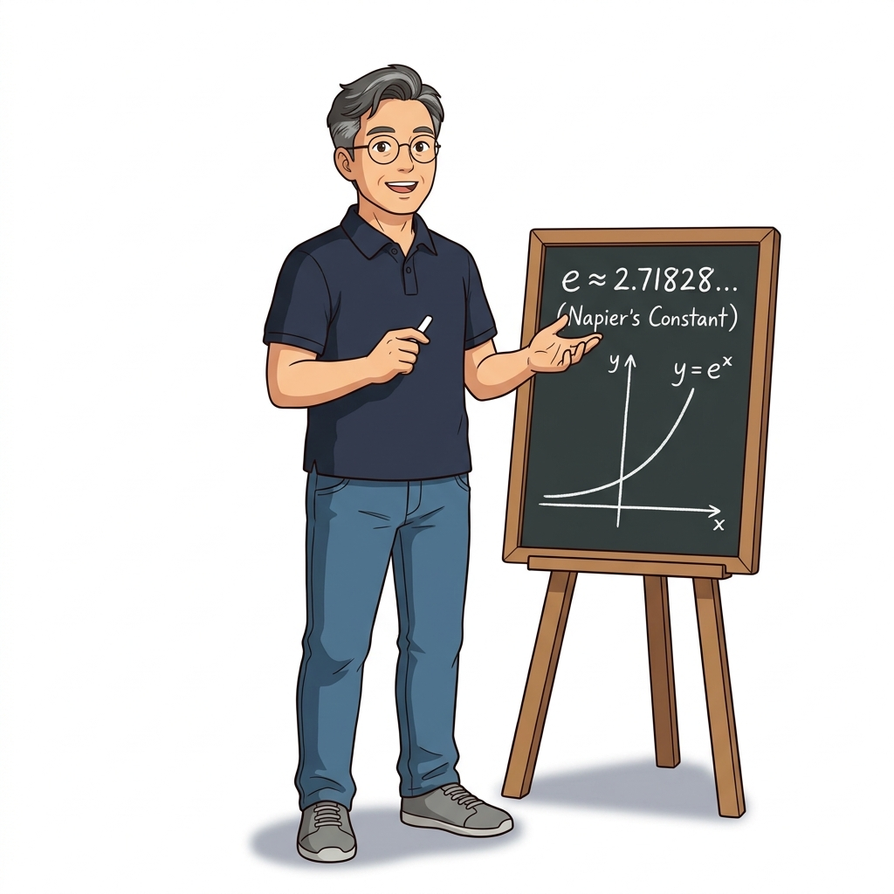
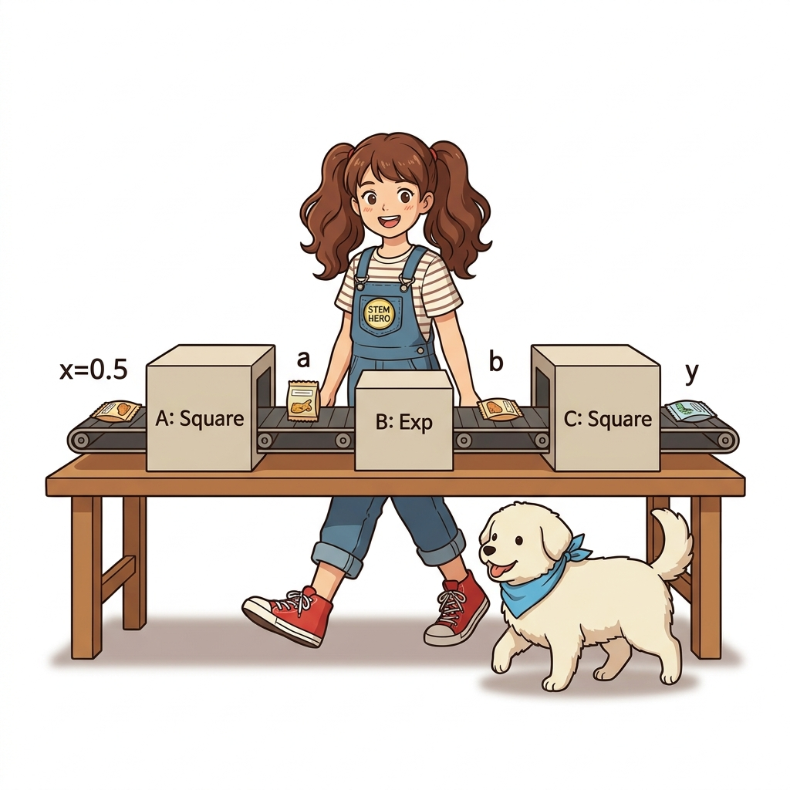
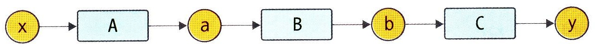
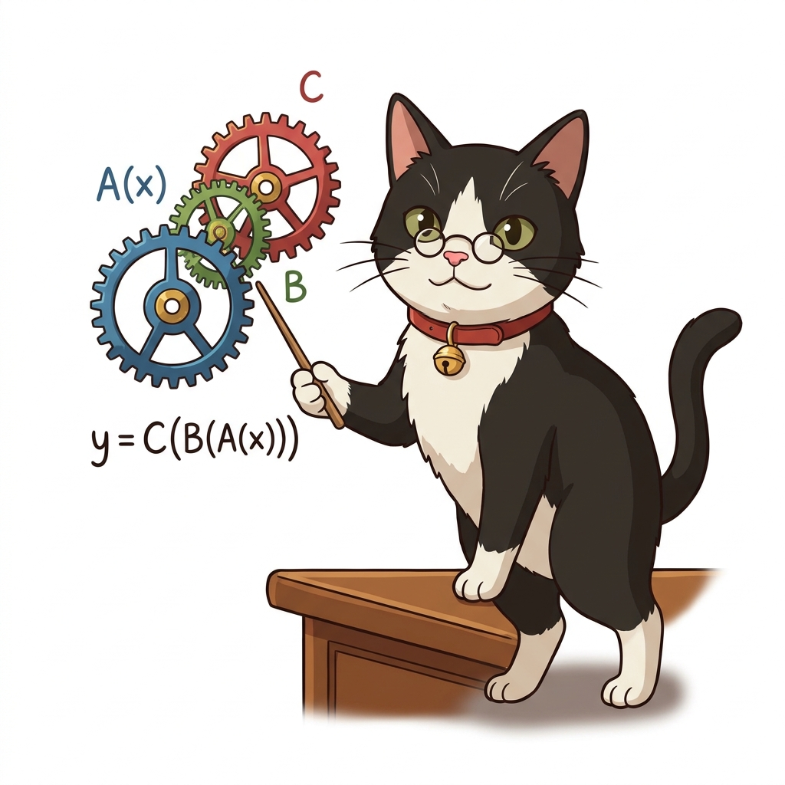

# 3단계 함수 연결

지금까지 DeZero의 '변수'와 '함수'를 만들어봤습니다. 그리고 2단계에서는 Square라는 제곱 계산용 함수 클래스를 구현했습니다. 이번 단계에서는 또 다른 함수를 구현하고 여러 함수를 조합해 계산할 수 있도록 하겠습니다.

  
*이호진 교수님이 여러 함수 블록(Square, Exp)을 결합하여 강력한 계산 체인을 구성하는 원리를 소개하고 있습니다.*

---

## 3.1 Exp 함수 구현

우선 DeZero에 새로운 함수를 하나 구현하겠습니다. 바로 $y = e^x$ 라는 계산을 하는 함수입니다. 여기서 $e$ 는 자연로그의 밑<sup>base of the natural logarithm</sup>으로 구체적인 값은 2.718... 입니다(오일러의 수<sup>Euler's number</sup> 혹은 네이피어 상수<sup>Napier's constant</sup>라고도 합니다). 

  
*이호진 교수님이 자연상수이자 지수 함수의 밑인 오일러의 수(e ≈ 2.718...)의 수학적 성질을 설명하고 있습니다.*

---

바로 구현해보죠.

**steps/step03.py**
```python
class Exp(Function):
    def forward(self, x):
        return np.exp(x)
```

Square 클래스와 마찬가지로 Function 클래스를 상속한 다음 forward 메서드에서 원하는 계산을 구현했습니다. Square 클래스와의 차이는 forward 메서드의 내용이 `x ** 2`에서 `np.exp(x)`로 바뀐 점입니다.

---

## 3.2 함수 연결

Function 클래스의 `__call__` 메서드는 입력과 출력이 모두 Variable 인스턴스이므로 자연스럽게 DeZero 함수들을 연이어 사용할 수 있습니다. $y = (e^{x^2})^2$ 이라는 계산을 예로 생각해보죠. 

  
*도로시와 토토가 입력 x=0.5에서 시작해 A(Square), B(Exp), C(Square)를 차례로 거치며 최종 출력 y가 계산되는 과정을 관찰하고 있습니다.*

---

코드는 다음과 같이 작성할 수 있습니다.

**steps/step03.py**
```python
A = Square()
B = Exp()
C = Square()

x = Variable(np.array(0.5))
a = A(x)
b = B(a)
y = C(b)
print(y.data)
```

---

**실행 결과**
```text
1.648721270700128
```

3개의 함수 A, B, C를 연이어 적용했습니다. 여기서 중요한 점은 중간에 등장하는 4개의 변수 $x, a, b, y$ 가 모두 Variable 인스턴스라는 것입니다. Function 클래스의 `__call__` 메서드의 입출력이 Variable 인스턴스로 통일되어 있는 덕분에 이와 같이 여러 함수를 연속하여 적용할 수 있는 것이죠. 

---

참고로 방금 한 계산은 [그림 3-1]과 같이 함수와 변수가 교대로 늘어선 계산 그래프로 표현할 수 있습니다.

  
*그림 3-1 여러 함수를 연이어 사용하는 계산 그래프(○은 변수, □은 함수)*

---

> **NOTE**  
> [그림 3-1]과 같이 여러 함수를 순서대로 적용하여 만들어진 변환 전체를 하나의 큰 함수로 볼 수도 있습니다. 이처럼 여러 함수로 구성된 함수를 합성 함수<sup>composite function</sup>라고 합니다. 합성 함수를 구성하는 각 함수의 계산은 간단하더라도, 연속으로 적용하면 더 복잡한 계산도 해낼 수 있다는 사실을 기억하세요.

  
*조교 지니가 서로 맞물린 톱니바퀴 모형을 통해 단순한 함수들이 모여 복잡한 합성 함수를 이루는 원리를 설명하고 있습니다.*

---

그런데 일련의 계산을 '계산 그래프'로 보여드린 이유는 무엇일까요? 

그 이유는 계산 그래프를 이용하면 각 변수에 대한 미분을 효율적으로 계산할 수 있기 때문이랍니다(정확하게는 그럴 준비가 됩니다).

그리고 변수별 미분을 계산하는 알고리즘이 바로 역전파입니다. 다음 단계부터는 역전파를 구현할 수 있도록 DeZero를 확장하겠습니다.

  
*이호진 교수님이 순전파 계산 그래프를 기반으로 다음 단계에서 펼쳐질 역전파(Backpropagation)의 세계를 안내하고 있습니다.*
