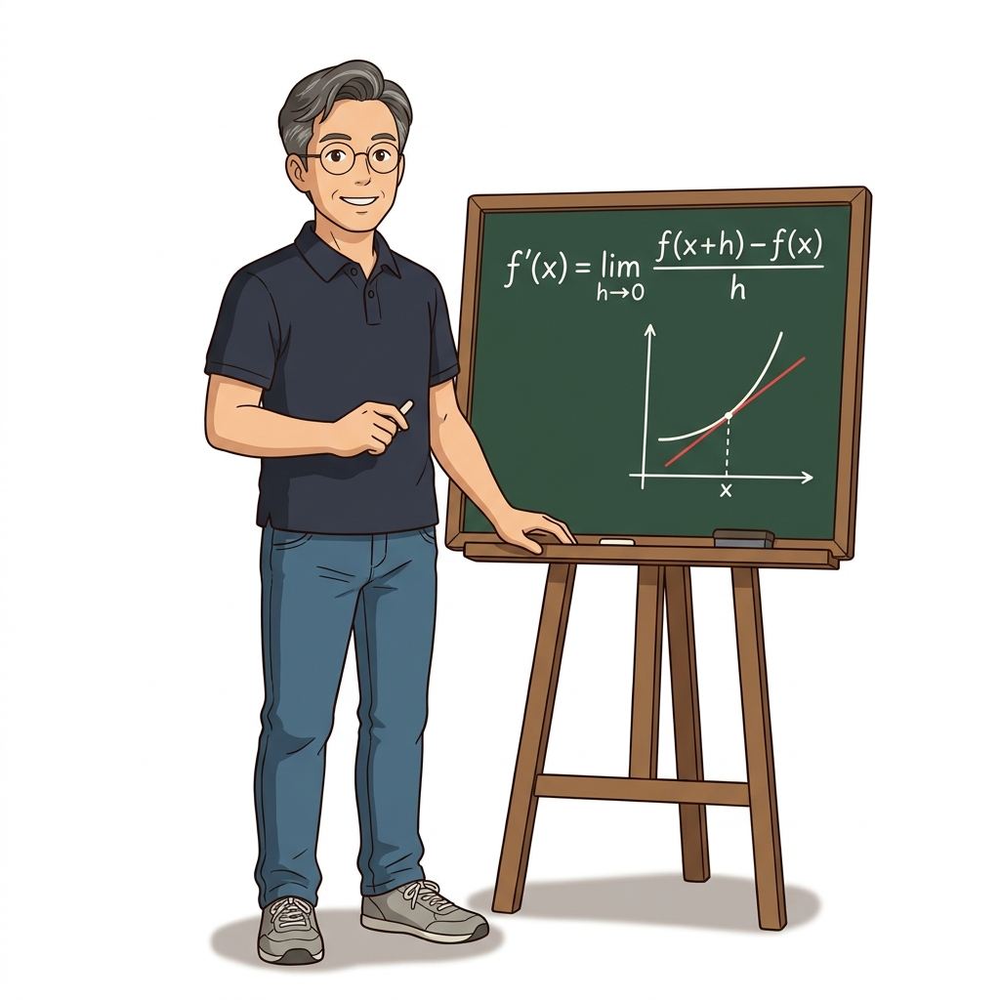
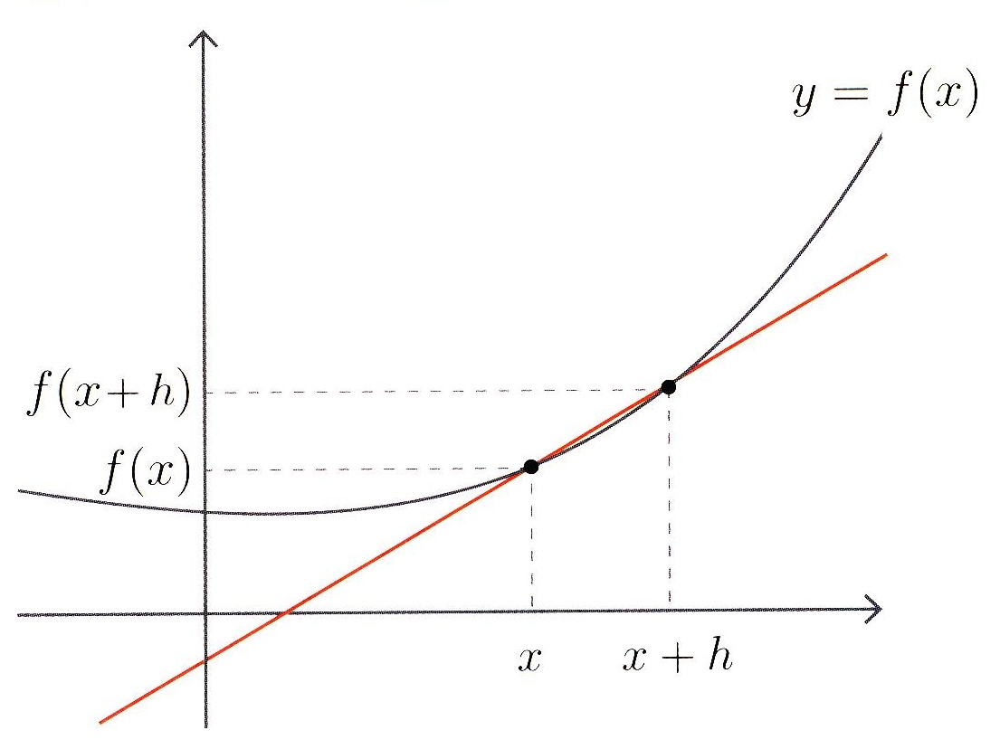
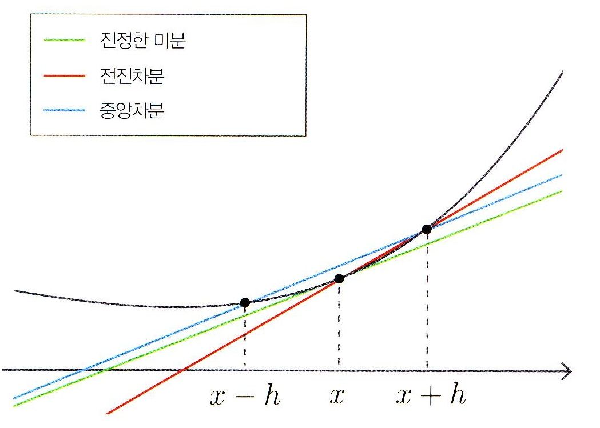
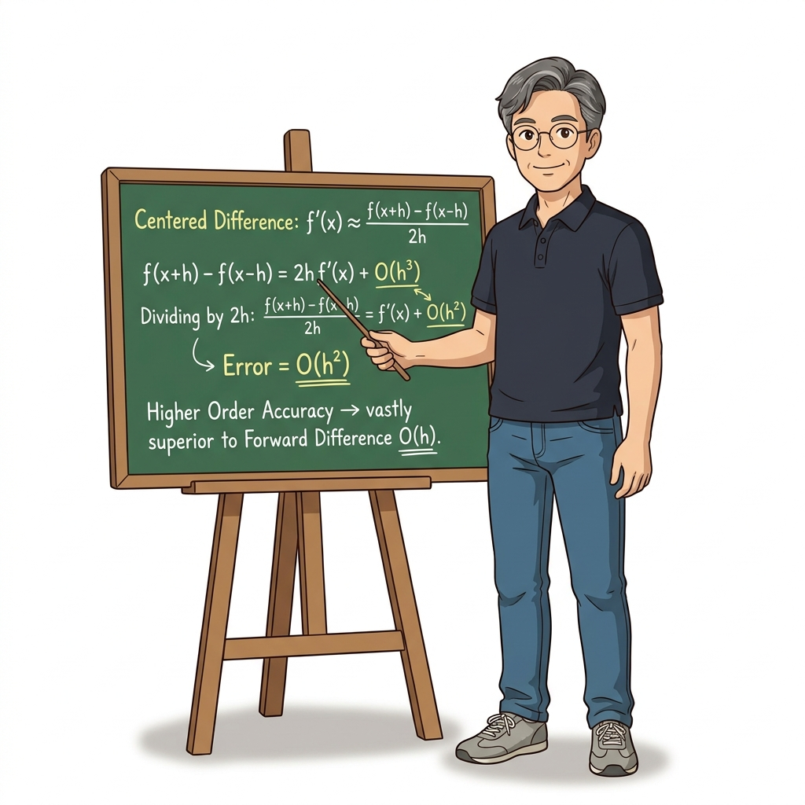
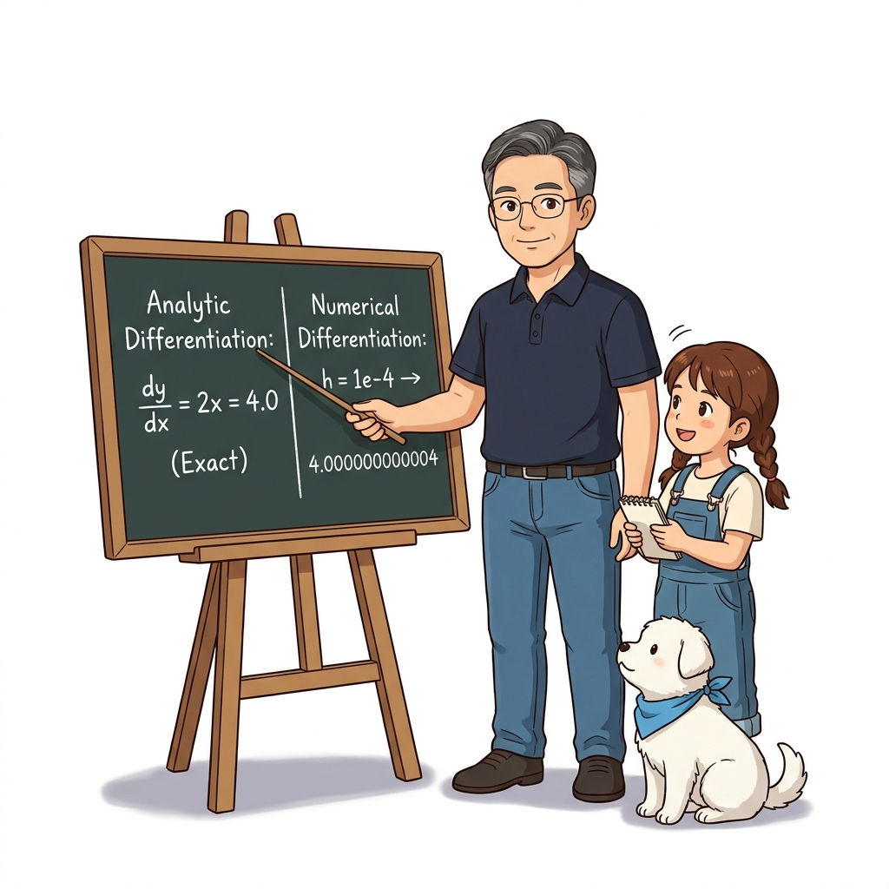
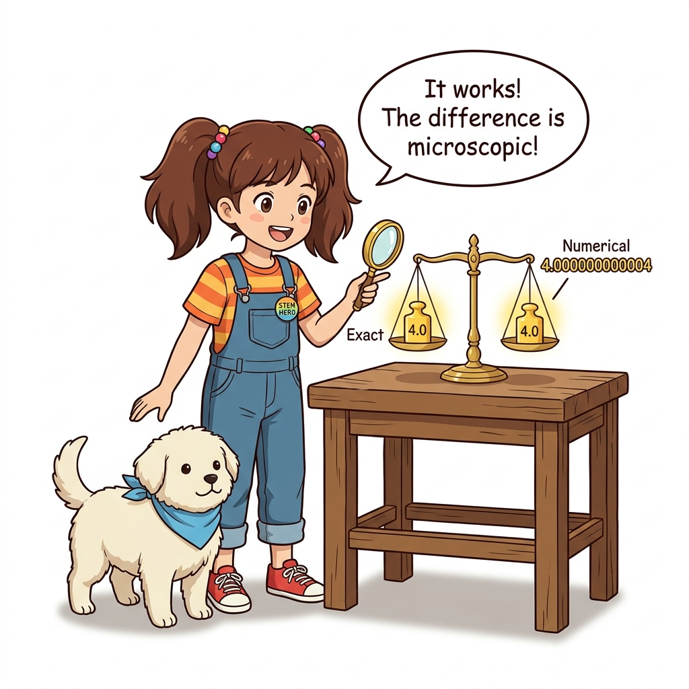
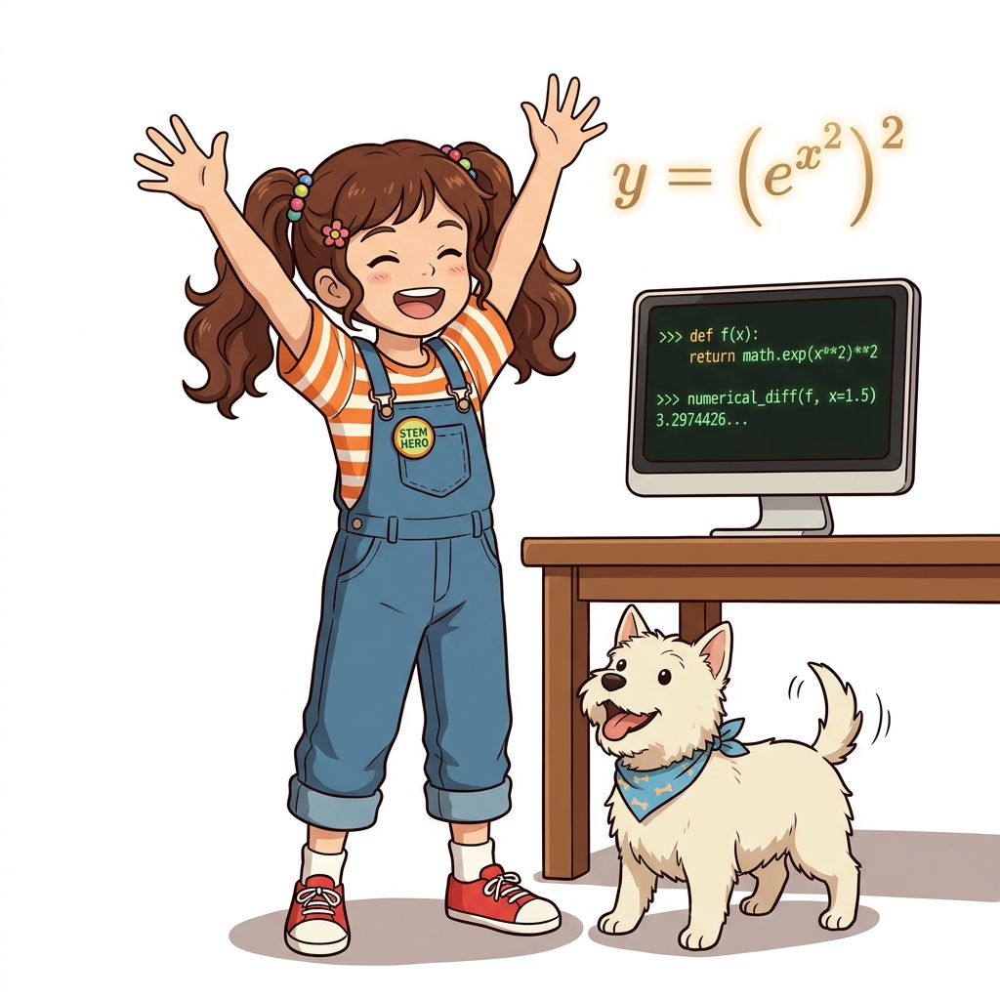
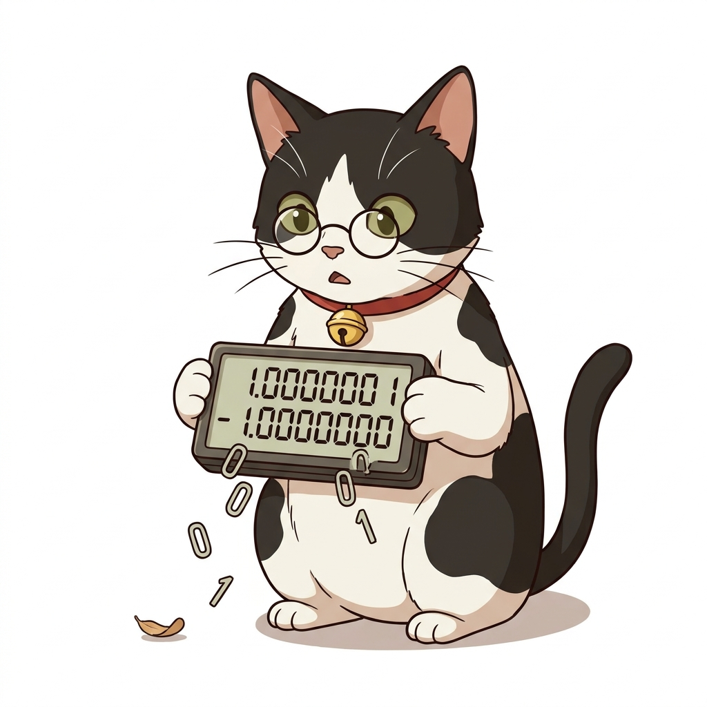

# 4단계 수치 미분

지금까지 Variable 클래스와 Function 클래스를 구현했습니다. 

이 클래스들을 구현한 이유는 미분을 자동으로 계산하기 위해서입니다. 


*그림 4-0: Variable과 Function이 향하는 궁극의 목적지 - 자동 미분(Automatic Differentiation)*

---

본격적인 구현에 앞서 이번 단계에서는 미분이 무엇인지 복습하고 수치 미분이라는 간단한 방법으로 미분을 계산해보겠습니다. 

그런 다음 5단계에서 수치 미분을 대신하는 더 효율적인 알고리즘(역전파)을 구현할 계획입니다.


*그림 4-1: 컴퓨터를 이용한 함수의 변화율 측정 - 수치 미분의 출발*

---

> **NOTE**  
> 머신러닝 외에도 많은 분야에서 미분을 활용합니다. 유
>
> 체 역학, 금융 공학, 기상 시뮬레이션, 엔지니어링 설계 최적화 등 정말 많죠. 이런 다양한 분야에서 자동 미분 계산 기능이 실제로 사용되고 있습니다.


*그림 4-2: 속도, 가속도, 공기역학 등 현실 세계 속 다양한 미분의 응용*

---

## 4.1 미분이란

미분이란 무엇일까요? 

간단히 말하면 '변화율'을 뜻합니다. 


---

예컨대 물체의 시간에 따른 위치 변화율(위치의 미분)은 속도가 됩니다. 

시간에 대한 속도 변화율(속도의 미분)은 가속도에 해당하죠. 


*그림 4-3: 시간에 따른 위치의 변화율(속도)과 속도의 변화율(가속도)*

---

이와 같이 미분은 **변화율**을 나타냅니다. 

정확한 정의는 '극한으로 짧은 시간(순간)'에서의 변화량입니다. 


---

수식으로 표현하면 $f(x)$ 라는 함수가 있을 때 미분은 다음 식으로 정의됩니다.
$$
f'(x) = \lim_{h \to 0} \frac{f(x + h) - f(x)}{h}
$$

[식 4.1]


*그림 4-4: 접선의 기울기와 미분의 극한 공식*

---

[식 4.1]의 $\lim_{h \to 0}$ 은 극한을 나타내며, $h$ 가 한없이 0에 근접한다는 뜻입니다. 

여기서 [식 4.1]의 $\frac{f(x + h) - f(x)}{h}$ 는 [그림 4-1]과 같이 두 점을 지나는 직선의 기울기입니다.


그림 4-1 곡선 $y = f(x)$ 위의 두 점을 지나는 직선


[그림 4-1]에서 보듯 $x$ 와 $x + h$ 라는 두 점에서 함수 $f(x)$ 의 변화 비율은 $\frac{f(x + h) - f(x)}{h}$ 입니다. 여기서 폭 $h$ 를 한없이 0에 가깝게 줄여 $x$ 의 변화 비율을 구하면 그 값이 바로 $y = f(x)$ 의 미분입니다. 또한 $y = f(x)$ 가 어떤 구간에서 미분 가능하다면 [식 4.1]은 해당 구간의 '모든 $x$'에서 성립합니다. 따라서 [식 4.1]의 $f'(x)$ 도 함수이며, $f(x)$ 의 도함수라고 합니다.


---

## 4.2 수치 미분 구현

그럼 미분을 정의한 [식 4.1]에 따라 미분을 계산하는 코드를 구현해봅시다. 

그런데 컴퓨터는 극한을 취급할 수 없으니 $h$ 를 극한과 비슷한 값으로 대체하겠습니다. 


---

예를 들어 $h = 0.0001 (= 10^{-4})$ 과 같은 매우 작은 값을 이용하여 [식 4.1]을 계산합니다. 

이런 미세한 차이를 이용하여 함수의 변화량을 구하는 방법을 수치 미분<sup>numerical differentiation</sup>이라고 합니다.


*그림 4-5: 컴퓨터에서 아주 작은 간격 h를 이용해 기울기를 근사하는 수치 미분*

---

#### 수치 미분은 작은 값을 사용하여 '진정한 미분'을 근사합니다.

따라서 값에 어쩔 수 없이 오차가 포함되는데, 이 근사 오차를 줄이는 방법으로는 '중앙차분<sup>centered difference</sup>'이라는 게 있습니다.


*그림 4-6: 전진 차분의 오차를 대칭적으로 상쇄시키는 중앙 차분(Centered Difference)*

---

중앙차분은 $f(x)$ 와 $f(x + h)$ 의 차이를 구하는 대신 $f(x - h)$ 와 $f(x + h)$ 의 차이를 구합니다. 

그림으로 나타내면 [그림 4-2]의 파란 선에 해당하죠.

그림 4-2 진정한 미분, 전진차분, 중앙차분 비교


[그림 4-2]에서 보듯 $x$ 와 $x + h$ 지점에서의 기울기를 구하는 방법을 '전진차분<sup>forward difference</sup>'이라 하고, $x - h$ 와 $x + h$ 에서의 기울기를 구하는 방법을 '중앙차분'이라 하는데, 중앙차분 쪽이 상대적으로 오차가 작습니다. 교제에 증명까지는 싣지 않았지만 직관적으로는 [그림 4-2]에서 직선들의 기울기를 비교해보면 알 수 있습니다. 참고로 중앙차분에서 직선의 기울기는 $\frac{f(x + h) - f(x - h)}{2h}$ 입니다(분모가 $2h$ 인 점에 주의하세요).

---

> **NOTE**  
> 전진차분보다 중앙차분이 진정한 미분값에 가깝다는 사실은 테일러 급수<sup>Taylor series</sup>를 이용해 증명할 수 있습니다. 
>
> 구체적인 증명은 참고문헌 [1]을 참고하세요.


*그림 4-7: 테일러 급수 전개를 통해 증명하는 중앙 차분의 2차 오차 상쇄 원리*

---

그러면 중앙차분을 이용하여 수치 미분을 계산하는 함수를 `numerical_diff(f, x, eps=1e-4)`라는 이름으로 구현해봅시다. 


---

첫 번째 인수 $f$ 는 미분의 대상이 되는 함수이며, 앞에서 구현한 Function의 인스턴스입니다. 

두 번째 인수 $x$ 는 미분을 계산하는 변수로, Variable 인스턴스입니다. 

마지막의 eps는 작은 값을 나타내며, 기본값은 1e-4입니다.* 수치 미분은 다음과 같이 구현할 수 있습니다.


*그림 4-8: 파이썬으로 구현한 범용 수치 미분 함수 numerical_diff*

---
> eps는 epsilon(엡실론)의 약어입니다. 
>
> 엡실론은 수학에서 작은 양의 값을 나타내는 데 사용되고, 컴퓨터에서는 아주 작은 양의 부동소수점값을 담는 변수의 이름으로 흔히 사용됩니다.


*그림 4-9: 극한을 컴퓨터에서 시뮬레이션하기 위한 극미소량 1e-4의 역할*

---

코드를 작성해 봅시다.

실제 데이터는 Variable의 인스턴스 변수인 `data`에 들어 있다는 것만 주의하면 특별히 조심할 점은 없어 보입니다. 

steps/step04.py

```python
def numerical_diff(f, x, eps=1e-4):
    x0 = Variable(x.data - eps)
    x1 = Variable(x.data + eps)
    y0 = f(x0)
    y1 = f(x1)
    return (y1.data - y0.data) / (2 * eps)
```


---

그러면 3단계에서 구현한 Square 클래스를 대상으로 미분해보겠습니다.

steps/step04.py
```python
f = Square()
x = Variable(np.array(2.0))
dy = numerical_diff(f, x)
print(dy)
```

---

이렇게 함수 $y = x^2$ 에서 $x = 2.0$ 일 때 수치 미분한 결과를 구했습니다.

실행 결과

```
4.000000000004
```

 오차가 없었다면 4.0이 나왔어야 하니, 이 결과는 거의 올바른 값이라고 할 수 있겠네요.


---

> **CAUTION**  
> 미분을 해석적으로 계산할 수도 있습니다. 
>
> 해석적으로 계산한다고 함은 수식 변형만으로 답을 유도한다는 뜻입니다. 


*그림 4-9-b: 수식 유도로 구하는 해석적 미분과 컴퓨터가 근사하는 수치 미분의 비교*

---

> 앞의 예에서는 미분 공식으로부터 $y = x^2$ 일 때 $\frac{dy}{dx} = 2x$ 가 됩니다($\frac{dy}{dx}$ 는 $y$ 의 $x$ 에 대한 미분을 뜻하는 기호입니다).
>
>  따라서 $x = 2.0$ 에서의 미분값은 4.0이 됩니다.
>
>  이 4.0이라는 값은 오차를 포함하지 않는 정확한 값입니다. 
>
> 앞의 수치 미분 결과는 비록 정확하지는 않지만 오차가 매우 작음을 알 수 있습니다.


*그림 4-10: 이론적 참값(4.0)과 컴퓨터 수치 미분값(4.000000000004) 사이의 극미세 오차*

---

## 4.3 합성 함수의 미분

지금까지는 $y = x^2$ 이라는 단순한 함수를 다뤘습니다. 

이어서 합성 함수를 미분해봅시다.


*그림 4-11: 여러 함수가 연쇄적으로 결합된 합성 함수의 미분 준비*

---

#### $y = (e^{x^2})^2$ 이라는 계산에 대한 미분 $\frac{dy}{dx}$ 를 계산할 것입니다. 


*그림 4-12: 복잡한 합성 함수 y = (e^{x^2})^2 도 손쉽게 미분하는 numerical_diff*

---

코드는 다음과 같습니다.

steps/step04.py
```python
def f(x):
    A = Square()
    B = Exp()
    C = Square()
    return C(B(A(x)))

x = Variable(np.array(0.5))
dy = numerical_diff(f, x)
print(dy)
```

---

이 코드는 일련의 계산을 f라는 함수로 정리했습니다.  

파이썬에서는 함수도 객체이기 때문에 다른 함수에 인수로 전달할 수 있습니다.

실제로 앞의 코드에서는 `numerical_diff` 함수에 함수 f를 전달했습니다.


---

실행 결과를 보면 미분한 값이 3.297... 입니다.

**실행 결과**

```
3.2974426293330694
```


 $x$ 를 0.5에서 작은 값만큼 변화시키면 $y$ 는 작은 값의 3.297... 배만큼 변한다는 의미죠.


---

이상에서 우리는 미분을 '자동으로' 계산하는 데 성공했습니다. 

원하는 계산을 파이썬 코드로 표현한 다음(앞의 예에서는 함수 f로 정의) 미분해달라고 프로그램에 요구했습니다.


---

 이 방식대로 하면 아무리 복잡하게 조합된 함수라도 미분을 자동으로 계산할 수 있습니다! 

이제부터는 함수의 종류를 늘려가면서 어떠한 계산도 (미분 가능한 함수라면) 미분할 수 있습니다. 


*그림 4-13: 함수 객체만 전달하면 자동으로 기울기를 산출하는 유연성*

---

## 4.4 수치 미분의 문제점

그러나 안타깝게도 수치 미분에는 문제가 있습니다. 

수치 미분의 결과에는 오차가 포함되어 있기 때문입니다.


---

대부분의 경우 오차는 매우 작지만 어떤 계산이냐에 따라 커질 수도 있습니다.


*그림 4-14: h가 너무 작아지면 발생하는 수치 해석적 오차의 경고*

---

> **NOTE**  
> 수치 미분의 결과에 오차가 포함되기 쉬운 이유는 주로 '자릿수 누락' 때문입니다. 
>
> 중앙차분 등 '차이'를 구하는 계산은 주로 크기가 비슷한 값들을 다루므로 계산 결과에서 자릿수 누락이 생겨 유효 자릿수가 줄어들 수 있습니다. 


---


> 예를 들어 유효 자릿수가 4일 때 $1.234 - 1.233$ 이라는 계산(비슷한 값끼리의 뺄셈)을 생각해보죠. 계산 결과는 0.001이 되어 유효 자릿수가 1로 줄어듭니다. 원래는 $1.234... - 1.233... = 0.001434...$ 같은 결과였을지도 모르는데, 자릿수 누락 때문에 0.001이 됐다고 볼 수 있습니다. 이와 같은 원리 때문에 수치 미분을 이용하면 자릿수 누락이 발생하여 오차가 포함되기 쉽습니다.


*그림 4-15: 컴퓨터 부동소수점 유한 정밀도 한계와 자릿수 탈락(Round-off Error)*

---

#### 수치 미분의 더 심각한 문제는 계산량이 많다는 점입니다. 

변수가 여러 개인 계산을 미분할 경우 변수 각각을 미분해야 하기 때문입니다. 

신경망에서는 매개변수를 수백만 개 이상 사용하는 건 일도 아니므로 이 모두를 수치 미분으로 구하는 것은 현실적이지 않습니다. 


*그림 4-16: 변수가 수백만 개인 신경망에서 역전파가 필수적인 이유 (계산량 폭증)*

---

#### 그래서 등장한 것이 바로 역전파입니다. 

다음 단계에서 드디어 역전파를 소개합니다.


---

덧붙여서, 수치 미분은 구현하기 쉽고 거의 정확한 값을 얻을 수 있습니다. 

이에 비해 역전파는 복잡한 알고리즘이라서 구현하면서 버그가 섞여 들어가기 쉽습니다. 


*그림 4-16-b: 양팔 저울로 복잡한 역전파 알고리즘의 정합성을 검증하는 기울기 확인(Gradient Checking)*

---

그래서 역전파를 정확하게 구현했는지 확인하기 위해 수치 미분의 결과를 이용하곤 합니다. 

이를 기울기 확인<sup>gradient checking</sup>이라고 하는데, 단순히 수치 미분 결과와 역전파의 결과를 비교하는 것입니다. 


*그림 4-17: 향후 역전파 구현체의 정합성을 검증하는 골든 스탠다드, 수치 미분의 진가*


---

기울기 확인은 10단계에서 구현합니다.

