# 5단계 역전파 이론

## 역전파 이론

우리는 **수치 미분**을 이용해 미분을 계산할 수 있게 되었지만 수치 미분은 계산 비용과 **정확도** 면에서 문제가 있습니다. 

*그림 5-0: 수치 미분의 한계를 넘어 역방향 기울기 계산의 신세계를 여는 이호진 교수와 도로시 탐험대*

---

*그림 5-1: 단 한 번의 전파로 모든 변수의 기울기를 계산하는 역전파(Backpropagation)의 개막*

---

지금이 바로 역전파backpropagation, 오차역전파법가 구세주로 등장할 시점입니다! 

역전파를 이용하면 미분을 효율적으로 계산할 수 있고 결과값의 오차도 더 작습니다. 

*그림 5-2: 근사 오차 없이 정확하고 번개처럼 빠른 역전파의 성능적 우위*

이번 단계에서는 아직 역전파 구현까지는 들어가지 않고 이론 설명에 집중하겠습니다

(구현은 다음 단계로 양보했습니다).

---

## 5.1 연쇄 법칙

역전파를 이해하는 열쇠는 연쇄 법칙chain rule입니다. 

chain은 '사슬'이라는 뜻으로, 여러 함수를 사슬처럼 연결하여 사용하는 모습을 빗댄 것입니다. 

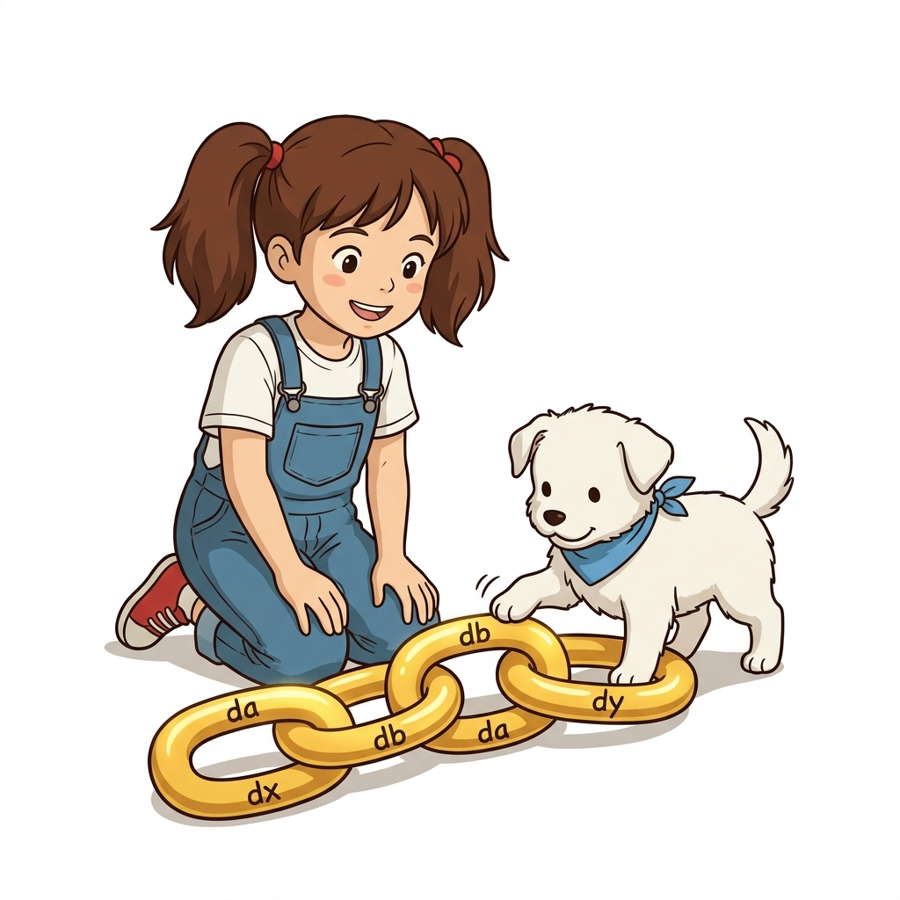
*그림 5-2-b: 여러 함수가 견고한 황금 사슬처럼 맞물려 미분을 전파하는 연쇄 법칙(Chain Rule)*

---

연쇄 법칙에 따르면 합성 함수(여러 함수가 연결된 함수)의 미분은 구성 함수 각각을 미분한 후 곱한 것과 같습니다.

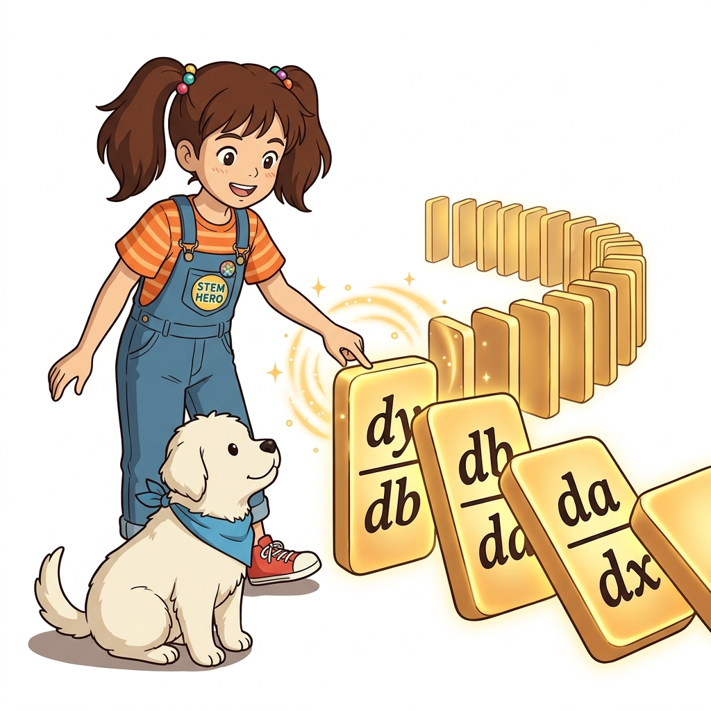
*그림 5-3: 도미노처럼 국소적 미분들이 차례로 곱해져 전달되는 합성 함수의 연쇄 법칙*

---

#### 구체적인 예를 하나 들어보죠. $y = F(x)$ 라는 함수가 있다고 합시다. 

이 함수는 $a = A(x)$, $b = B(a)$, $y = C(b)$ 라는 세 함수로 구성되어 있습니다.

계산 그래프로 그리면 [그림 5-1]처럼 됩니다.

그림 5-1 합성 함수의 예
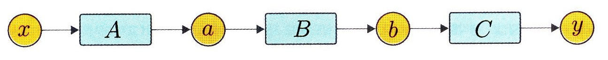

---

이때 $x$ 에 대한 $y$ 의 미분은 [식 5.1]로 표현할 수 있습니다.
$$
\frac{dy}{dx} = \frac{dy}{db} \frac{db}{da} \frac{da}{dx}
$$

[식 5.1]

[식 5.1]에서 알 수 있듯이 $x$ 에 대한 $y$ 의 미분은 구성 함수 각각의 미분값을 모두 곱한 값과 같습니다. 

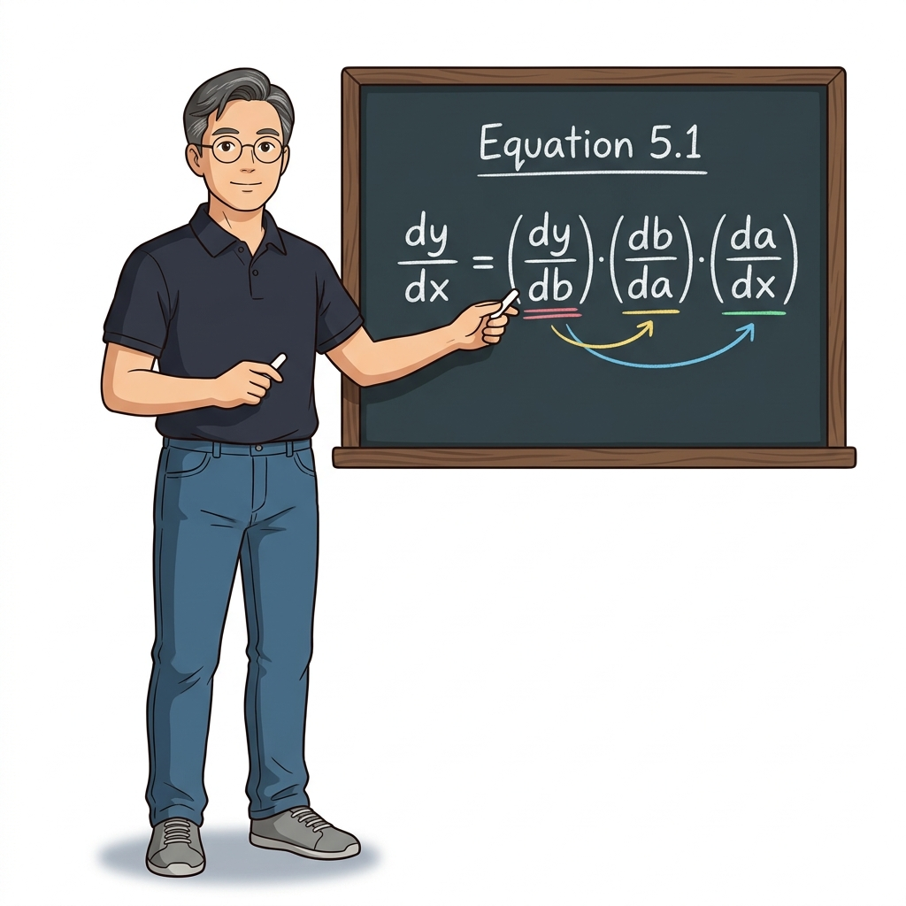
*그림 5-4: 식 (5.1) 합성 함수 전체의 미분은 각 국소 미분들의 곱으로 표현된다*

---

즉, 합성 함수의 미분은 각 함수의 **국소적인 미분들로 분해**할 수 있습니다. 

이것이 연쇄 법칙입니다. 

---

또한 [식 5.1] 앞에 다음과 같이 $\frac{dy}{dy}$ 를 명시할 수도 있습니다.
$$
\frac{dy}{dx} = \frac{dy}{dy} \frac{dy}{db} \frac{db}{da} \frac{da}{dx}
$$

[식 5.2]

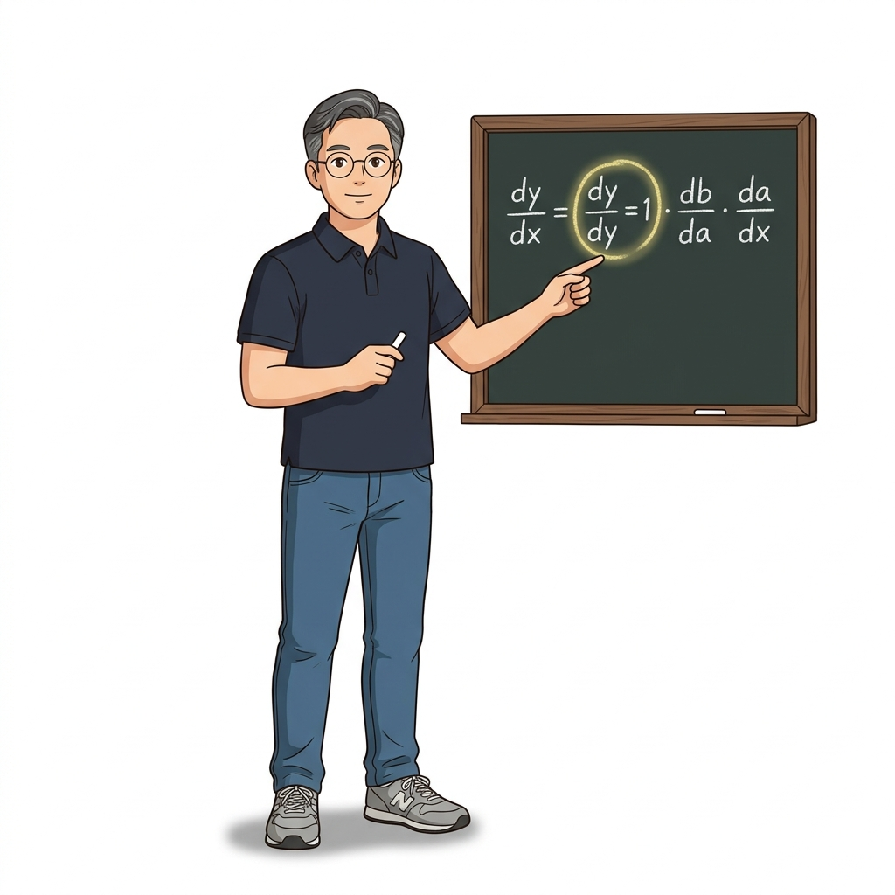
*그림 5-5: 역전파 계산의 시작을 알리는 dy/dy 항의 의의*

---

$$
\frac{dy}{dy} = 1
$$

$\frac{dy}{dy}$ 는 '자신'에 대한 미분이라서 항상 1입니다. 

따라서 생략하는 것이 보통이지만 이 강의에서는 역전파를 구현할 때를 대비하여 포함하도록 하겠습니다.

*그림 5-6: 최종 출력 y에서 입력 방향으로 출발하는 초기 기울기 신호 1.0*

---

> **NOTE**  
> $\frac{dy}{dy}$ 는 $y$ 의 $y$ 에 대한 미분입니다. 
>
> 이때 $y$ 가 작은 값만큼 변하면 자기 자신인 $y$ 도 당연히 같은 크기만큼 변합니다. 
>
> 따라서 변화율은 어떤 함수의 경우에도 항상 1입니다.

*그림 5-7: 1:1 거울처럼 자기 자신의 변화량에 대한 변화율은 항상 1이다*

---

## 5.2 역전파 원리 도출

이제 [식 5.2]를 차분히 살펴볼 시간입니다.

$$
\frac{dy}{dx} = \frac{dy}{dy} \frac{dy}{db} \frac{db}{da} \frac{da}{dx}
$$

[식 5.2]

[식 5.2]는 합성 함수의 미분은 구성 함수들의 미분의 곱으로 분해할 수 있음을 뜻합니다. 

---

'곱하는 순서'까지 말해주지는 않지만 사실 어떤 순서로 곱해도 상관없습니다.

*그림 5-8: 곱하는 순서를 바꾸어도 결과가 같은 스칼라 곱셈의 교환 법칙*

---

 그러니 [식 5.3]과 같이 출력에서 입력 방향으로(즉, 역방향으로) 순서대로 계산해보겠습니다.*
$$
\frac{dy}{dx} = \left( \left( \frac{dy}{dy} \frac{dy}{db} \right) \frac{db}{da} \right) \frac{da}{dx}
$$

[식 5.3]

[식 5.3]과 같이 출력에서 입력 방향으로, 즉 보통의 계산과는 반대 방향으로 미분을 계산합니다. 

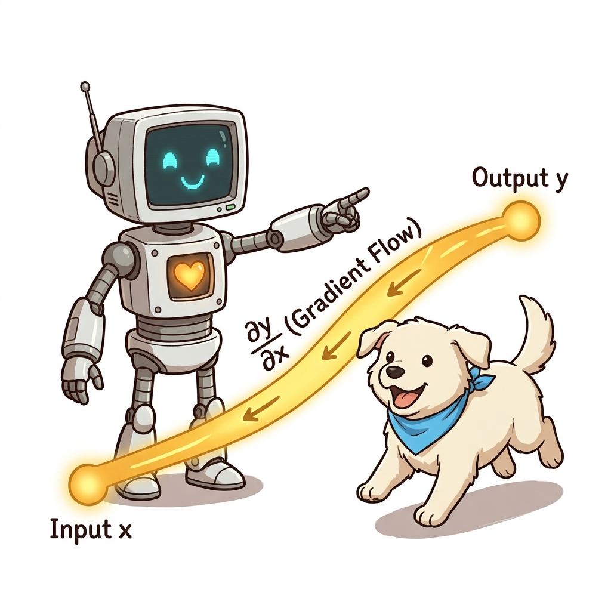
*그림 5-9: 출력 y로부터 중간 변수들을 거쳐 입력 x로 향하는 역방향 계산 흐름*

---

이때 [식 5.3]의 계산 흐름은 [그림 5-2]와 같습니다.

그림 5-2 출력 쪽의 미분부터 순서대로 계산
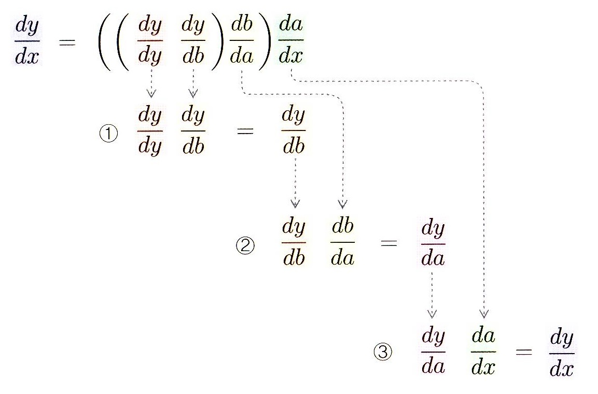

[그림 5-2]처럼 출력 $y$ 에서 입력 $x$ 방향으로 곱하면서 순서대로 미분하면 최종적으로 $\frac{dy}{dx}$ 가 구해집니다. 계산 그래프로는 [그림 5-3]처럼 됩니다.

---

입력에서 출력 방향으로 계산하는 방법도 생각할 수 있습니다. 이를 '포워드 모드 자동 미분'이라고 하며, 제1고지 마지막의 '칼럼: 자동 미분'에서 설명하겠습니다.

---

그림 5-3 $\frac{dy}{dx}$ 를 구하는 계산 그래프
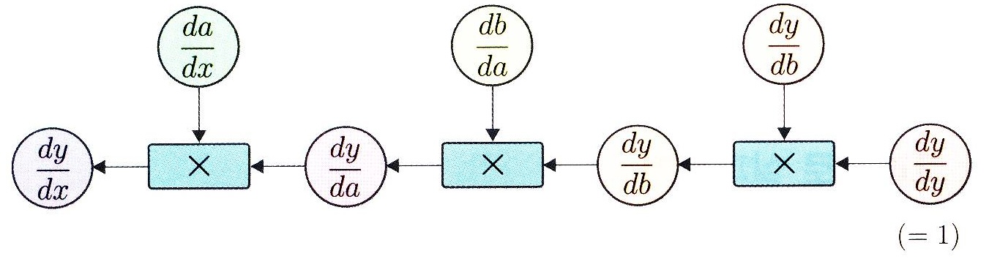

[그림 5-3]의 계산 그래프를 잘 관찰해봅시다. 우선 $\frac{dy}{dy} (= 1)$ 에서 시작하여 $\frac{dy}{db}$ 와 곱합니다. 

---

#### 여기서 $\frac{dy}{db}$ 는 함수 $y = C(b)$ 의 미분입니다. 

따라서 함수 $C$ 의 도함수를 $C'$ 로 나타내면 $\frac{dy}{db} = C'(b)$ 라고 쓸 수 있습니다. 

---

#### 마찬가지로 $\frac{db}{da} = B'(a)$ 이고 $\frac{da}{dx} = A'(x)$ 입니다. 

이에 따라 [그림 5-3]의 계산 그래프는 다음과 같이 단순화할 수 있습니다.

그림 5-4 단순화한 역전파 계산 그래프($A'(x)$ 의 곱셈을 '$A'(x)$'라는 노드로 간략하게 표현)
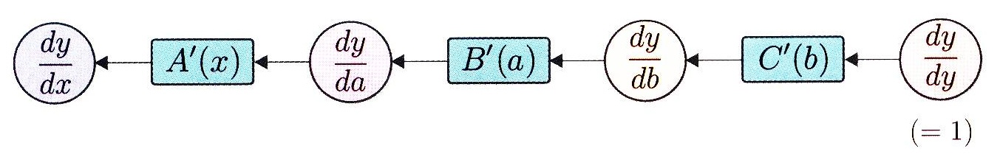

[그림 5-4]와 같이 도함수의 곱을 함수 노드 하나로 그릴 수 있습니다. 이제 미분값이 전파되는 흐름이 명확해집니다.

---

[그림 5-4]를 보면 '$y$ 의 각 변수에 대한 미분값', 즉 변수 $y$, $b$, $a$, $x$ 에 대한 미분값이 오른쪽에서 왼쪽으로 전파되는 것을 알 수 있습니다.

 이것이 역전파입니다.

*그림 5-10: 미분값을 출력에서 입력 방향으로 전파하는 역전파(Backpropagation)의 본질*

---

#### 여기서 중요한 점은 전파되는 데이터는 모두 '$y$ 의 미분값'이라는 것입니다. 

구체적으로는 $\frac{dy}{dy}$, $\frac{dy}{db}$, $\frac{dy}{da}$, $\frac{dy}{dx}$ 처럼 모두 '$y$ 의 OO에 대한 미분값'이 전파되고 있습니다.

*그림 5-11: dy/db, dy/da, dy/dx 로 이어지는 미분값의 연쇄 전달 과정*

---

> **NOTE**  
> [식 5.3]과 같이 계산 순서를 출력에서 입력 방향으로 정한 이유는 $y$ 의 미분값을 전파하기 위해서입니다. 
>
> 즉, $y$ 를 '중요 요소'로 대우하기 때문입니다. 
>
> 만약 입력에서 출력 방향으로 계산했다면 중요 요소는 입력인 $x$ 가 됩니다. 
>
> 이 경우 전파되는 값은 $\frac{dx}{dx} \to \frac{da}{dx} \to \frac{db}{dx} \to \frac{dy}{dx}$ 가 되어 $x$ 에 대한 미분을 전파하게 됩니다.

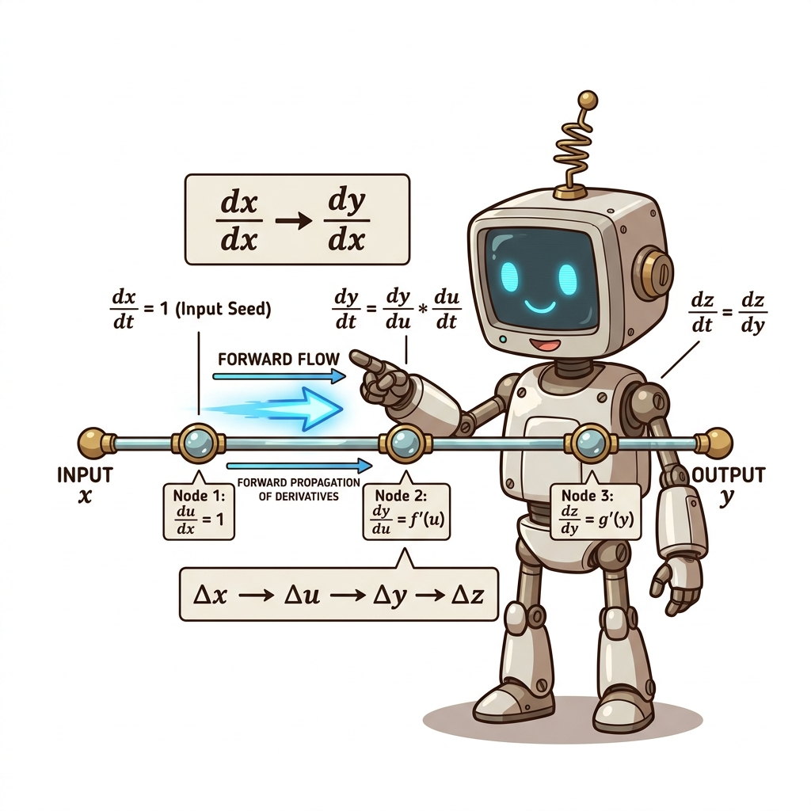
*그림 5-12: 입력부터 출발하는 순방향 미분과 출력부터 거슬러오는 역방향 미분의 구조 비교*

---

#### 머신러닝은 주로 대량의 매개변수를 입력받아서 마지막에 손실 함수loss function를 거쳐 출력을 내는 형태로 진행됩니다. 

손실 함수의 출력은 (많은 경우) 단일한 스칼라값이며, 이 값이 '중요 요소'입니다. 

즉, 손실 함수의 각 매개변수에 대한 미분을 계산해야 합니다. 

---

이런 경우 미분값을 출력에서 입력 방향으로 전파하면 한 번의 전파만으로 모든 매개변수에 대한 미분을 계산할 수 있습니다. 

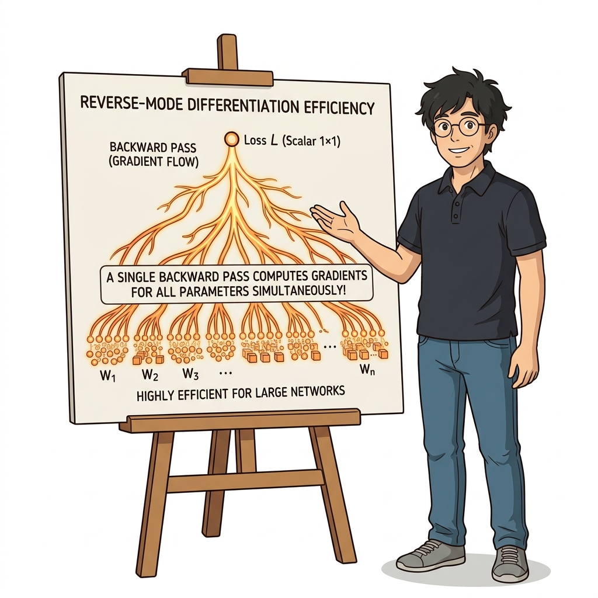
*그림 5-13: 하나의 스칼라 손실(Loss)로부터 수천~수억 개의 가중치 기울기를 구하는 딥러닝 환경*

---

이처럼 계산이 효율적으로 이뤄지기 때문에 미분을 반대 방향으로 전파하는 방식(역전파)을 이용하는 것입니다.

*그림 5-14: 단 한 번의 역전파 패스로 모든 매개변수의 기울기를 동시 산출하는 혁신적 효율성*

---

## 5.3 계산 그래프로 살펴보기

다음과 같이 통상적인 계산인 순전파 계산 그래프(그림 5-1)와 미분을 계산하는 역전파 계산 그래프(그림 5-4)를 위아래로 나란히 놓고 살펴봅시다.

그림 5-5 순전파(위)와 역전파(아래)
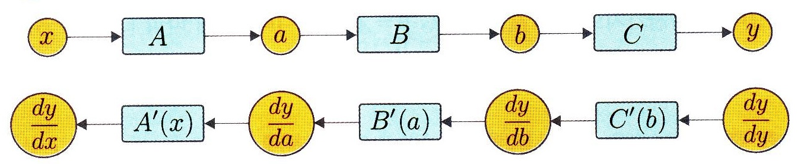

---

#### 이렇게 비교하니 순전파와 역전파의 관계가 명확히 보입니다. 

예를 들어 순전파 시의 변수 $a$ 는 역전파 시의 미분 $\frac{dy}{da}$ 에 대응합니다. 

마찬가지로 $b$ 와 $\frac{dy}{db}$ 가 대응하고 $x$ 와 $\frac{dy}{dx}$ 가 대응합니다. 

또한 함수에도 대응 관계가 보입니다. 

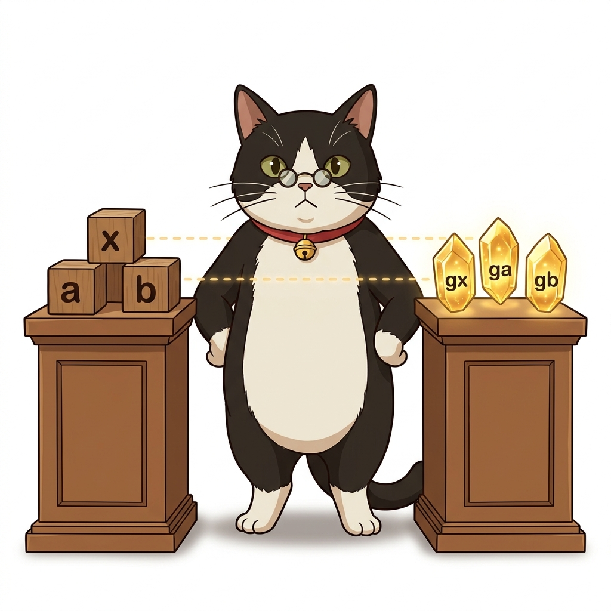
*그림 5-15: 순전파의 변수 (x, a, b, y)와 역전파의 기울기 (gx, ga, gb, gy)의 완벽한 1:1 대칭 대응*

---

#### 함수 $B$ 는 역전파의 $B'(a)$ 에 대응하고 $A$ 는 $A'(x)$ 에 대응하는 식입니다. 

이렇게 변수는 '통상값'과 '미분값'이 존재하고, 함수는 '통상 계산(순전파)'과 '미분값을 구하기 위한 계산(역전파)'이 존재하는 것으로 생각할 수 있습니다. 

---

이를 통해 역전파를 어떻게 구현할지 짐작해볼 수 있을 것입니다.

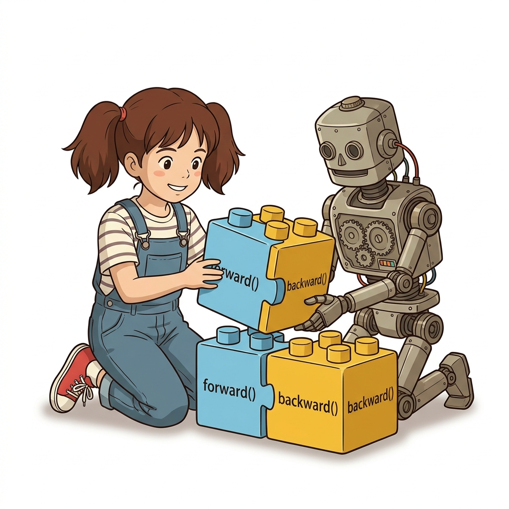
*그림 5-16: forward 계산의 짝꿍으로 설계되는 각 함수의 backward 역전파 메서드*

---

#### 마지막으로 [그림 5-5]의 함수 노드 $C'(b)$ 에 주목해보죠. 

$y = C(b)$ 라는 계산의 미분입니다만, 여기서 주의할 점은 $C'(b)$ 를 계산하려면 $b$ 값이 필요하다는 사실입니다. 마찬가지로 $B'(a)$ 를 구하려면 입력 $a$ 의 값이 필요합니다. 

---

#### 무슨 말인고 하니, 역전파 시에는 순전파 시 이용한 데이터가 필요하다는 것입니다. 

따라서 역전파를 구현하려면 먼저 순전파를 하고, 이때 각 함수가 입력 변수(앞의 예에서는 $x$, $a$, $b$)의 값을 기억해두지 않으면 안 됩니다. 그런 다음에야 각 함수의 역전파를 계산할 수 있습니다.

*그림 5-17-b: 틴맨과 지니가 순전파 입력 데이터(x)를 self.input 서랍에 안전하게 보관하여 역전파 계산을 준비하는 모습*

---

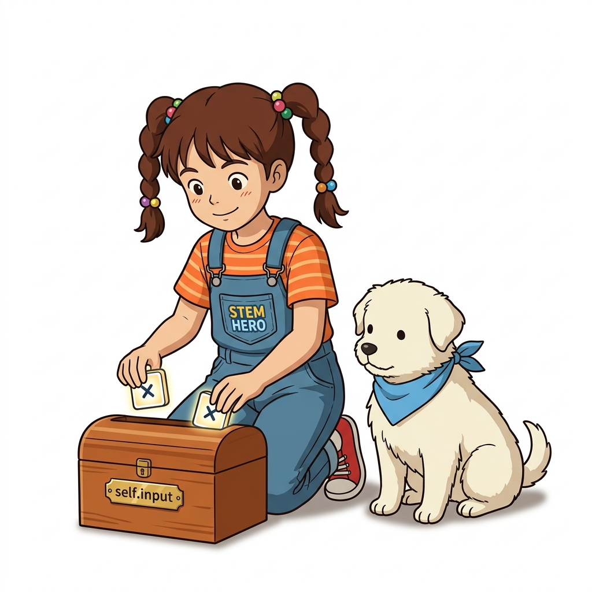
*그림 5-17: 도함수 계산(2x)을 위해 순전파 시 입력값(x)을 self.input에 기억해야 하는 필연적 이유*

---

이상이 역전파의 이론 설명입니다. 

다소 복잡한가요? 좋은 소식을 알려드리겠습니다. 다행히 역전파는 이 교제에서 가장 어려운 내용에 속한답니다. 

그리고 아직 잘 이해되지 않는 부분도 실제로 코드를 실행해보면 이해될 것입니다. 

다음 단계에서는 역전파를 구현하고 실제로 돌려보며 검증하겠습니다.

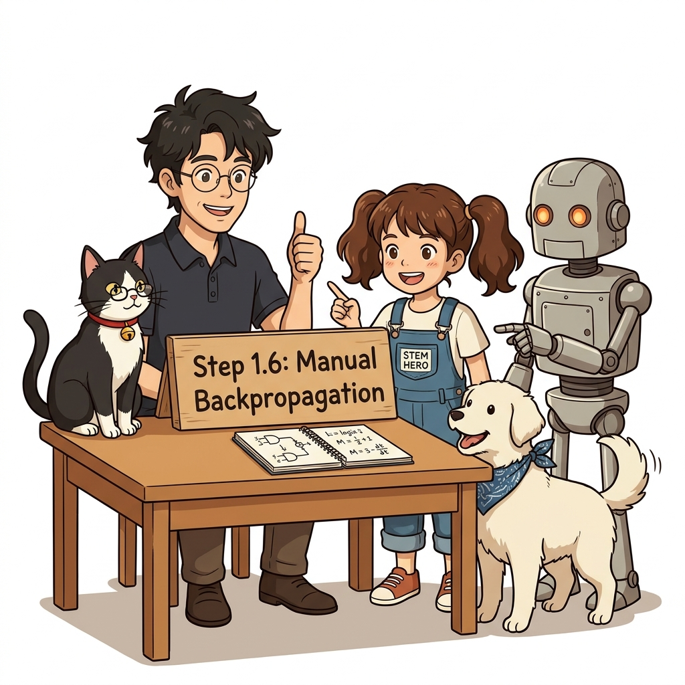
*그림 5-18: 이론을 코드로 완성할 다음 단계(1.6 수동 역전파)로의 힘찬 출발*
