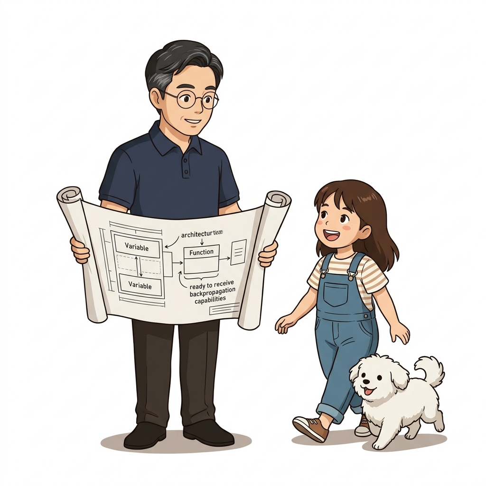
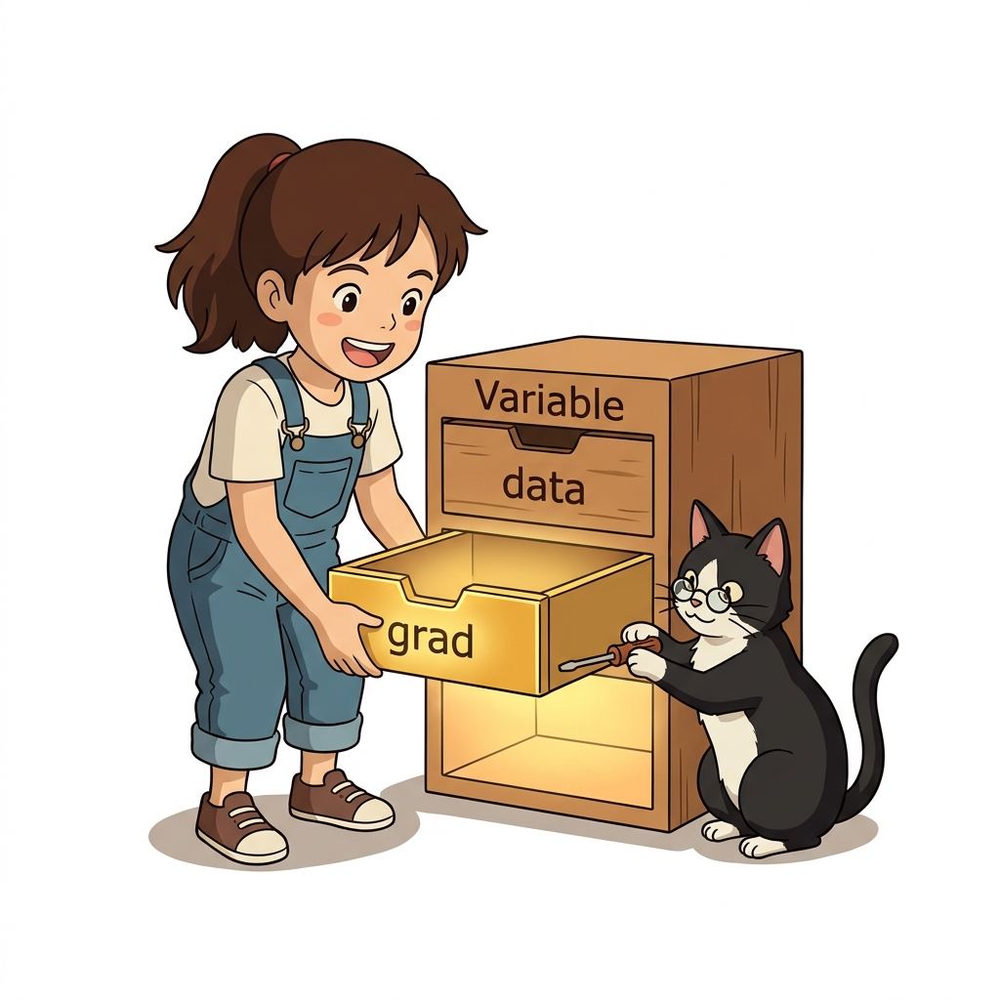
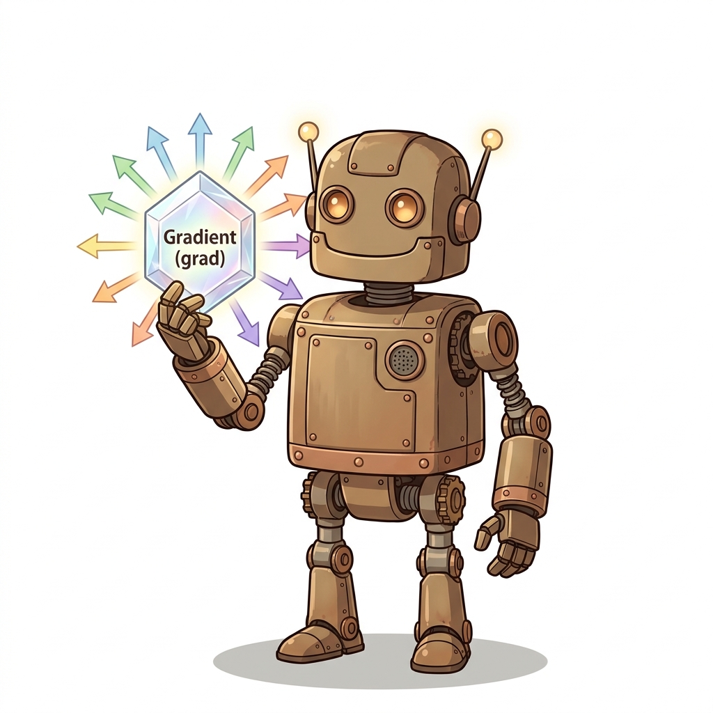
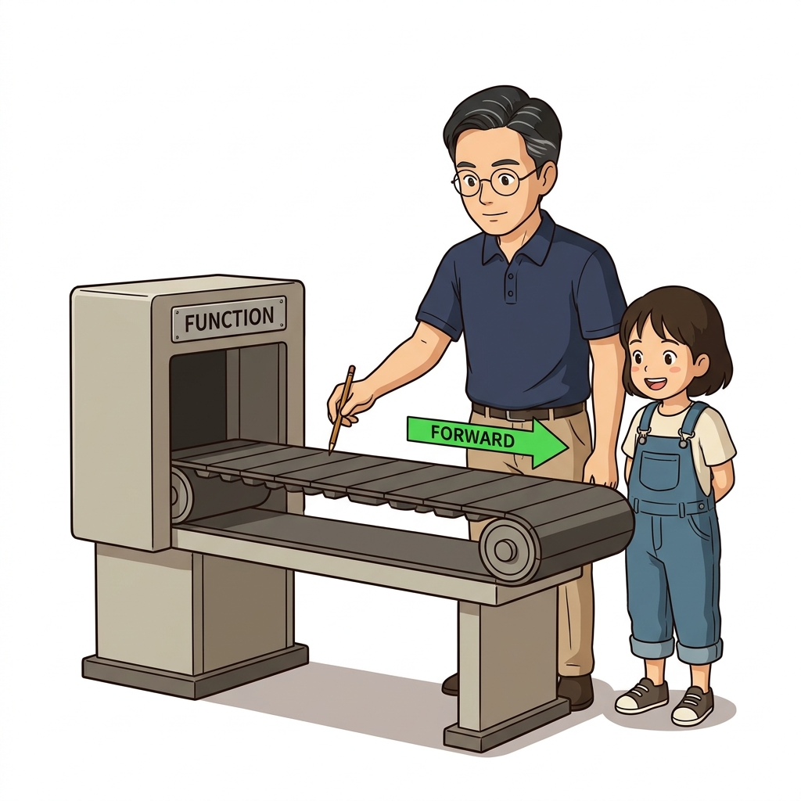
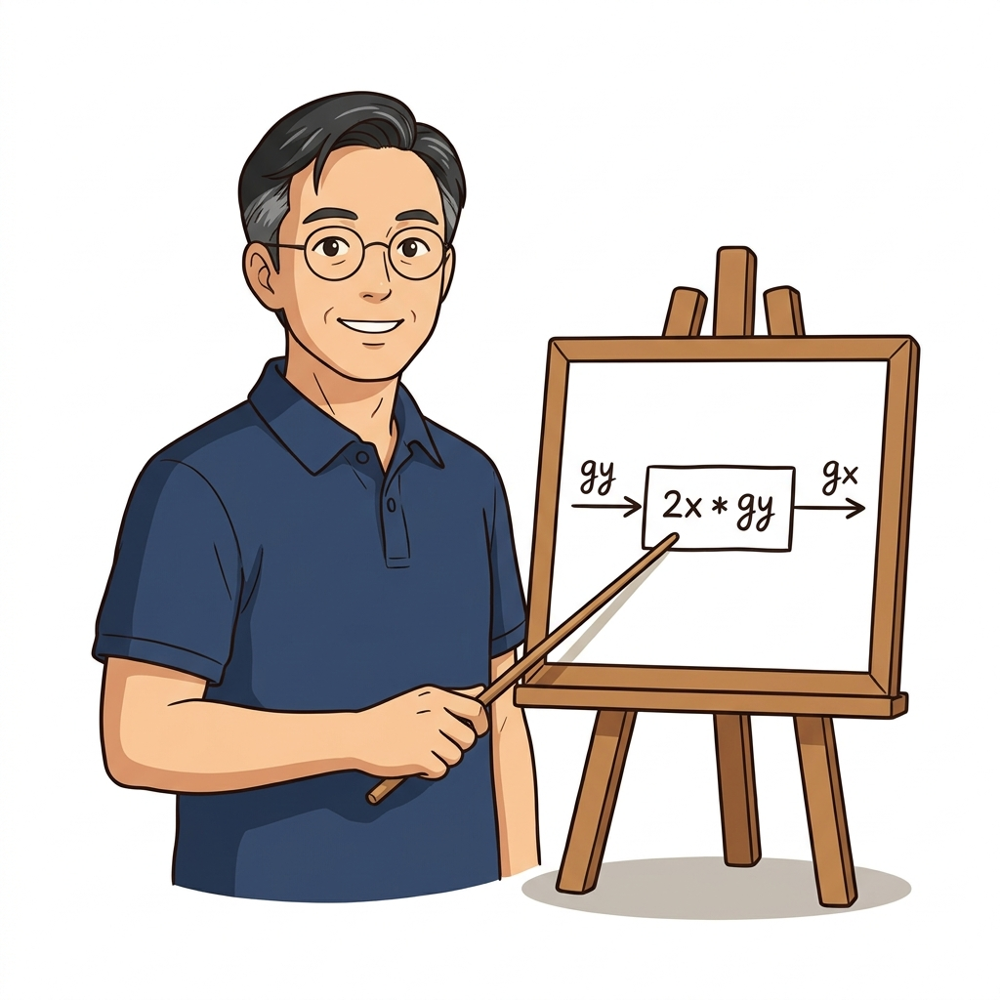
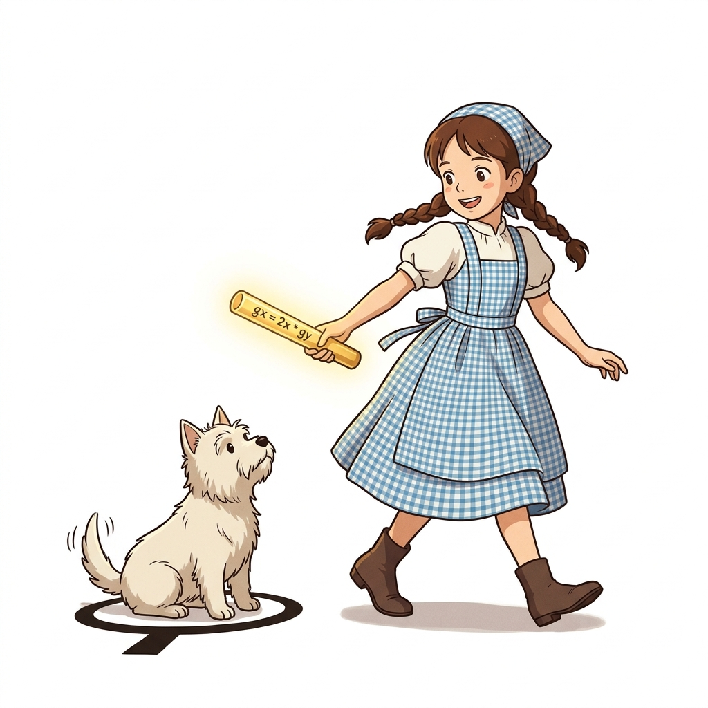
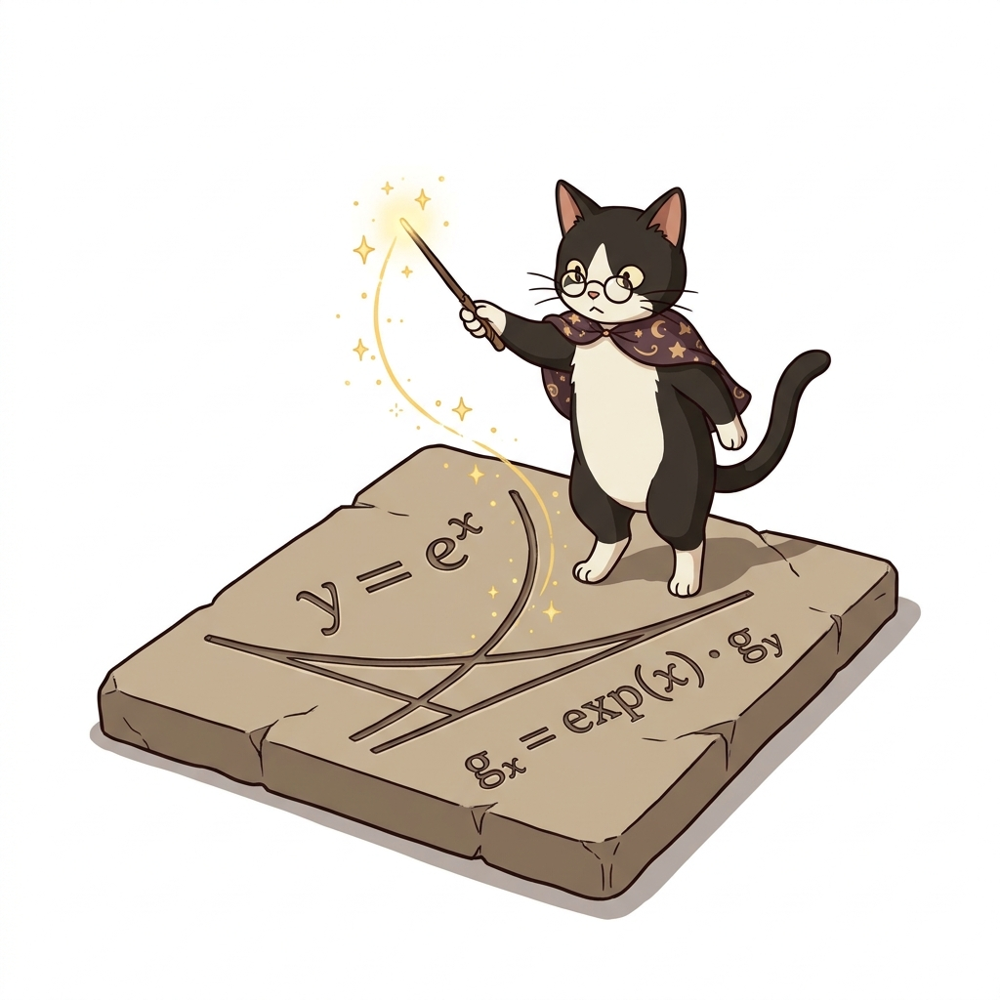
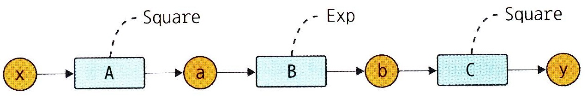
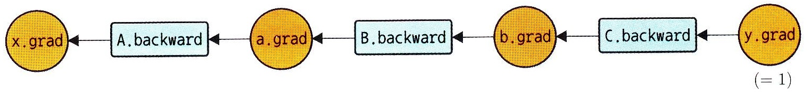

# 6단계 수동 역전파

이전 단계에서 역전파의 구동 원리를 설명했습니다. 이번 단계에서는 Variable과 Function 클래스를 확장하여 역전파를 이용한 미분을 구현하겠습니다. Variable 클래스부터 살펴보죠.


*그림 6-1: Variable과 Function 클래스에 역전파 기능을 추가하는 수동 역전파 개요*

---

## 6.1 Variable 클래스 추가 구현

역전파에 대응하는 Variable 클래스를 구현하겠습니다. 그러기 위해 통상값(data)과 더불어 그에 대응하는 미분값(grad)도 저장하도록 확장합니다. 


*그림 6-2: 통상값(data)과 함께 미분값(grad)을 보관하도록 확장된 Variable 상자*

---

새로 추가된 코드에는 음영을 덧씌웠습니다.

steps/step06.py
```python
class Variable:
    def __init__(self, data):
        self.data = data
        self.grad = None
```

이와 같이 새로 grad라는 인스턴스 변수를 추가했습니다. 인스턴스 변수인 data와 grad는 모두 넘파이의 다차원 배열(ndarray)이라고 가정합니다. 또한 grad는 None으로 초기화해둔 다음, 나중에 실제로 역전파를 하면 미분값을 계산하여 대입합니다.

---

> **NOTE**  
> 벡터나 행렬 등 다변수에 대한 미분은 기울기<sup>gradient</sup>라고 합니다. Variable 클래스에 새로 추가한 grad 변수의 이름은 gradient를 줄인 것입니다.


*그림 6-3: 다변수에 대한 미분 벡터를 의미하는 기울기(gradient)와 grad 필드*

---

## 6.2 Function 클래스 추가 구현

Function 클래스를 알아볼 차례입니다. 

이전 단계까지의 Function 클래스는 일반적인 계산을 하는 순전파(forward 메서드) 기능만 지원하는 상태입니다. 


*그림 6-4: 순방향 계산(forward)만 지원하던 기존 Function 클래스*

---

이외에 다음 두 기능을 추가하겠습니다.

* 미분을 계산하는 역전파(backward 메서드)
* forward 메서드 호출 시 건네받은 Variable 인스턴스 유지


*그림 6-5: 미분을 계산하는 backward 메서드와 순전파 시 입력 변수 보관(self.input)*

---

다음은 이 두 기능을 구현한 코드입니다.

steps/step06.py
```python
class Function:
    def __call__(self, input):
        x = input.data
        y = self.forward(x)
        output = Variable(y)
        self.input = input # 입력 변수를 기억(보관)한다.
        return output

    def forward(self, x):
        raise NotImplementedError()

    def backward(self, gy):
        raise NotImplementedError()
```

---

코드에서 보듯 `__call__` 메서드에서 입력된 input을 인스턴스 변수인 `self.input`에 저장합니다. 이렇게 해서 나중에 `backward` 메서드에서 함수(Function)에 입력한 변수(Variable 인스턴스)가 필요할 때 `self.input`에서 가져와 사용할 수 있습니다.


*그림 6-6: 역전파 시 도함수 계산에 필요한 입력값을 self.input에 기억하는 과정*

---

## 6.3 Square와 Exp 클래스 추가 구현

이어서 Function을 상속한 구체적인 함수에서 역전파(backward)를 구현해보겠습니다. 

첫 번째 대상은 제곱을 계산하는 Square 클래스입니다. $y = x^2$ 의 미분은 $\frac{dy}{dx} = 2x$ 가 되기 때문에 다음과 같이 구현할 수 있습니다.


*그림 6-7: 제곱 계산의 도함수 2x를 이용해 역전파를 계산하는 Square backward*

---

steps/step06.py
```python
class Square(Function):
    def forward(self, x):
        y = x ** 2
        return y

    def backward(self, gy):
        x = self.input.data
        gx = 2 * x * gy
        return gx
```

이와 같이 역전파를 담당하는 backward 메서드를 추가했습니다. 

---

이 메서드의 인수 gy는 ndarray 인스턴스이며, 출력 쪽에서 전해지는 미분값을 전달하는 역할을 합니다. 

그리고 인수로 전달된 미분에 '$y = x^2$ 의 미분'을 곱한 값이 backward의 결과가 됩니다. 

역전파에서는 이 결과값을 입력 쪽에 더 가까운 다음 함수로 전파해나갈 것입니다.


*그림 6-8: 상위에서 전달받은 gy에 자신의 도함수를 곱해 이전 단계로 전달하는 gx*

---

이어서 $y = e^x$ 계산을 할 Exp 클래스입니다. 

이 계산의 미분은 $\frac{dy}{dx} = e^x$ 이기 때문에 다음과 같이 구현할 수 있습니다.


*그림 6-9: 도함수가 e^x인 지수 함수의 역전파 계산: gx = np.exp(x) * gy* gy*

---

steps/step06.py
```python
class Exp(Function):
    def forward(self, x):
        y = np.exp(x)
        return y

    def backward(self, gy):
        x = self.input.data
        gx = np.exp(x) * gy
        return gx
```


*그림 6-10: Square -> Exp -> Square 순서로 연결된 합성 함수의 순방향 계산*

---

## 6.4 역전파 구현

이상으로 준비 작업이 끝났습니다. 

이번 절에서는 [그림 6-1]에 해당하는 계산의 미분을 역전파로 계산해보겠습니다.

그림 6-1 역전파할 대상(합성 함수)


---

먼저 [그림 6-1]을 순전파하는 코드부터 보겠습니다.

steps/step06.py
```python
A = Square()
B = Exp()
C = Square()

x = Variable(np.array(0.5))
a = A(x)
b = B(a)
y = C(b)
```

---

이어서 역전파로 $y$ 를 미분해보죠. 

순전파 때와는 반대 순서로 각 함수의 `backward` 메서드를 호출하면 됩니다.

 [그림 6-2]는 이때 이루어지는 역전파를 계산 그래프로 그린 모습입니다.

그림 6-2 역전파의 계산 그래프


[그림 6-2]를 보면 어떤 순서로 어느 함수의 `backward` 메서드를 호출하면 되는지 알 수 있습니다.

 또한 `backward` 메서드의 결과를 어느 변수의 grad로 설정하면 되는지도 알 수 있습니다. 

---

다음은 [그림 6-2]의 계산 그래프를 코드로 옮긴 모습입니다.

steps/step06.py
```python
y.grad = np.array(1.0)
b.grad = C.backward(y.grad)
a.grad = B.backward(b.grad)
x.grad = A.backward(a.grad)
print(x.grad)
```

---

실행 결과

```
3.297442541400256
```

---

역전파는 $\frac{dy}{dy} = 1$ 에서 시작합니다. 따라서 출력 $y$ 의 미분값을 `np.array(1.0)`으로 설정합니다. 그런 다음 C $\to$ B $\to$ A 순으로 `backward` 메서드를 호출하기만 하면 됩니다. 이것으로 각 변수의 미분값이 구해집니다.


*그림 6-11: y.grad = 1.0 설정 후 C -> B -> A 순서로 backward 메서드를 호출하는 역전파*

---

앞의 코드를 실행하면 `x.grad`의 값이 3.297442541400256이라고 나옵니다. 

이 값이 $y$ 의 $x$ 에 대한 미분 결과입니다. 

4단계에서 수치 미분으로 구한 값이 3.2974426293330694였으니 두 결과가 거의 같음을 알 수 있습니다. 역전파를 제대로 구현한 것입니다(더 정확하게는, 올바르게 구현했을 가능성이 큽니다).


*그림 6-12: 4단계의 수치 미분값과 완벽하게 일치하는 역전파 결과(3.29744) 검증*

---

이상이 역전파 구현입니다. 

제대로 동작하지만 역전파 순서(C $\to$ B $\to$ A)에 맞춰 호출하는 코드를 우리가 일일이 작성해 넣는 건 영 불편할 것 같습니다. 그래서 다음 단계에서는 이 작업을 자동화하겠습니다.


*그림 6-13: 수동 호출의 번거로움을 넘어 자동 역전파(7단계)로 나아가는 동기*
