# 7단계 역전파 자동화

이전 단계에서 역전파를 동작시키는 데 성공했습니다. 그러나 역전파 계산 코드를 수동으로 조합해야 했습니다. 새로운 계산을 할 때마다 역전파 코드를 직접 작성해야 한다는 뜻이죠. 

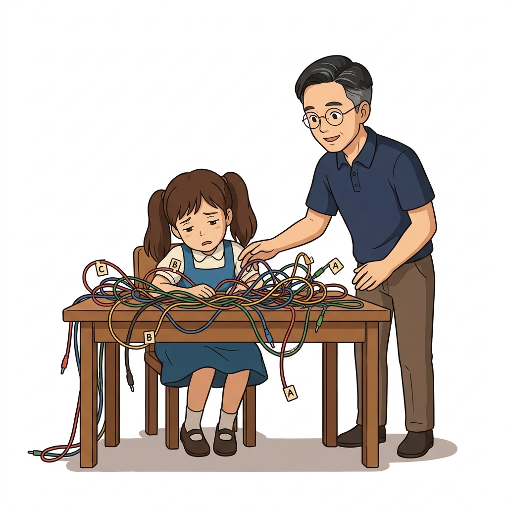
*그림 7-1: 수동으로 연결하기 번거로운 역전파 호출을 자동화하려는 이유*

---

[그림 7-1]처럼 계산 그래프가 여러 개라면 각각의 계산에 맞게 역전파 코드를 수동으로 따로따로 작성해야 합니다. 

그러다 보면 실수가 생길 수 있고, 무엇보다도 지루할 것입니다. 


그림 7-1 다양한 계산 그래프(변수명은 생략하고 함수명은 클래스 이름으로 대신함)
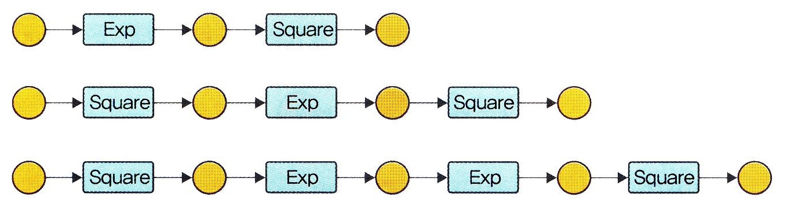


---

지루한 일은 파이썬에게 시키자고요!

그래서 이제부터 역전파를 자동화하려 합니다. 더 정확히 말하면, 일반적인 계산(순전파)을 한 번만 해주면 어떤 계산이라도 상관없이 역전파가 자동으로 이루어지는 구조를 만들 것입니다. 두둥! 지금부터가 바로 Define-by-Run의 핵심을 건드리는 내용입니다!

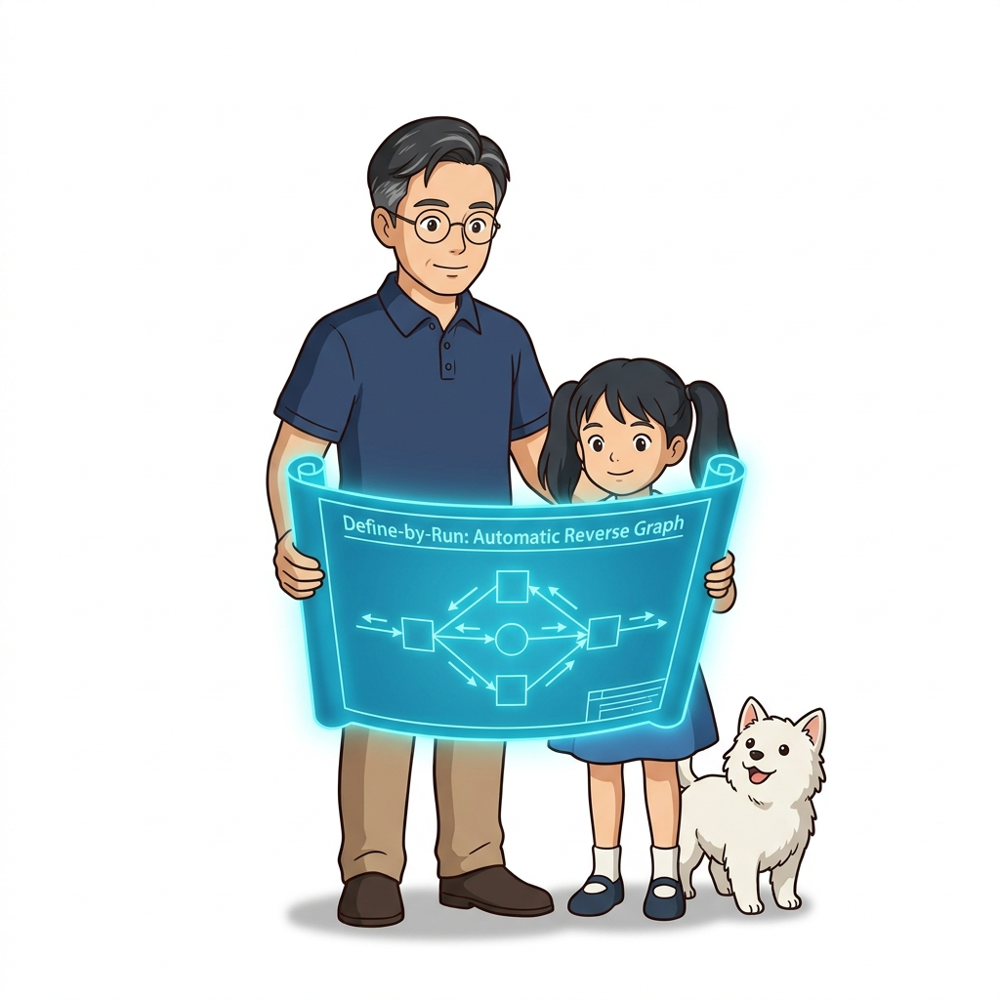
*그림 7-2: 순전파를 실행하는 순간 동적으로 계산 그래프를 연결하는 Define-by-Run*

---

> **NOTE**  
> Define-by-Run이란 딥러닝에서 수행하는 계산들을 계산 시점에 '연결'하는 방식으로, '동적 계산 그래프'라고도 합니다. Define-by-Run의 개념과 장점은 제2고지 마지막의 '칼럼: Define-by-Run'에서 자세히 설명합니다.

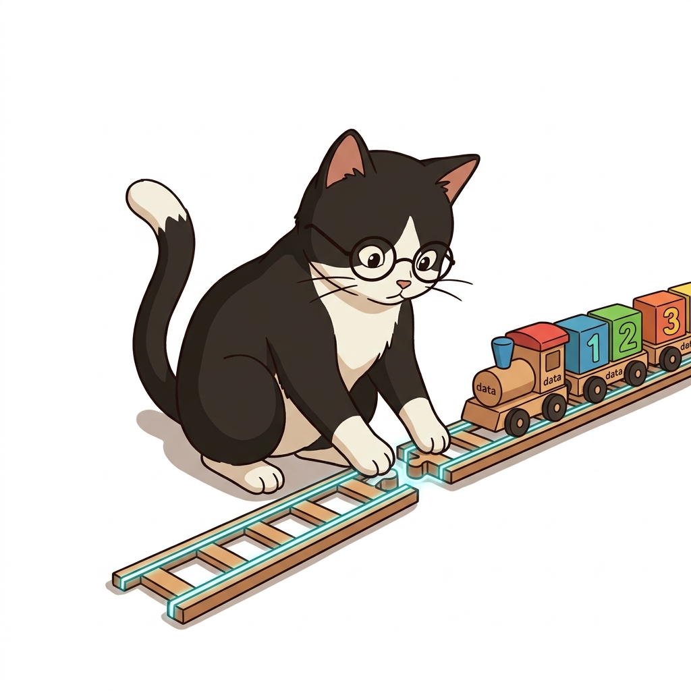
*그림 7-3: 실제 연산이 일어나는 런타임에 유연하게 조립되는 동적 그래프 메커니즘*

---

그런데 [그림 7-1]의 계산 그래프들은 모두 일직선으로 늘어선 계산입니다.

 따라서 함수의 순서를 리스트 형태로 저장해두면 나중에 거꾸로 추적하는 식으로 역전파를 자동화할 수 있습니다. 


*그림 7-4: 분기 없이 일렬로 순차 연결된 선형 계산 그래프의 특징*

---

그러나 `분기`가 있는 계산 그래프나 같은 변수가 `여러 번 사용`되는 복잡한 계산 그래프는 단순히 리스트로 저장하는 식으로는 풀 수 없습니다. 

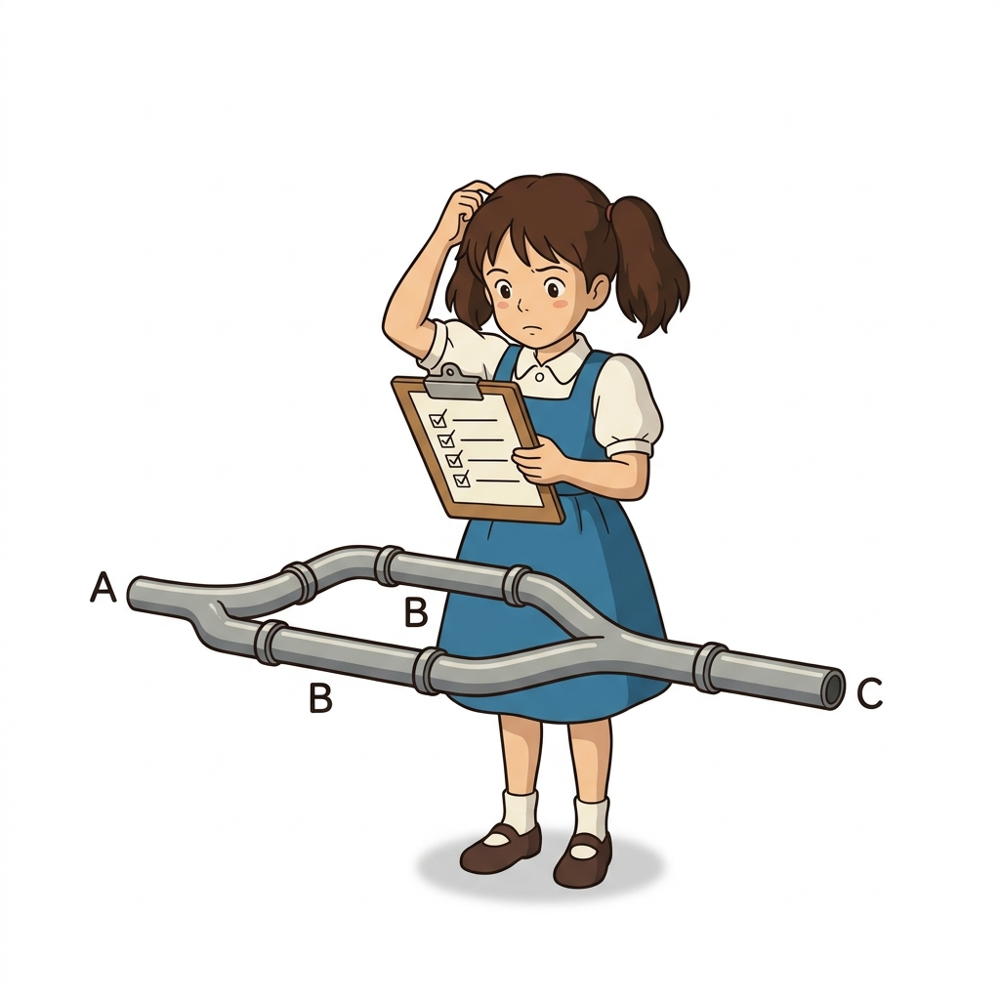
*그림 7-5: 복잡한 분기와 재사용이 발생하는 그래프에서는 단순 리스트로 해결할 수 없음*

우리 목표는 아무리 복잡한 계산 그래프라 하더라도 역전파를 자동으로 할 수 있는 구조를 마련하는 것입니다.

---

> **CAUTION**  
> 사실 리스트 데이터 구조를 응용하면 수행한 계산을 리스트에 추가해 나가는 것만으로 어떠한 계산 그래프의 역전파도 제대로 해낼 수 있습니다. 이 데이터 구조를 웬거트 리스트<sup>Wengert List</sup>(혹은 테이프<sup>tape</sup>)라고 합니다. 이 책에서는 웬거트 리스트에 대한 설명은 하지 않으니 관심 있는 분은 참고문헌 [2]와 [3]을 참고하시고, 웬거트 리스트를 활용하는 Define-by-Run의 장점은 참고문헌 [4]를 참고해주세요.

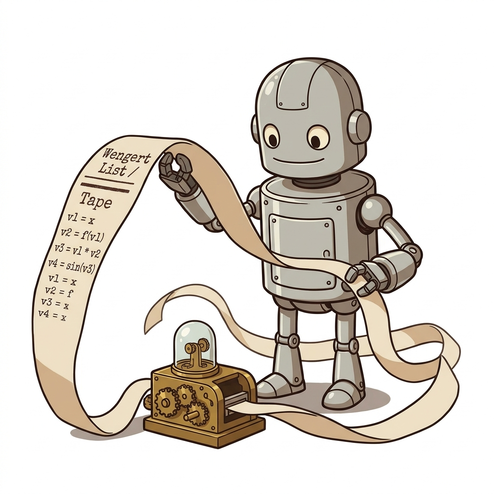
*그림 7-6: 연산 순서를 테이프에 기록하듯 관리하는 웬거트 리스트(Wengert List)*

---

## 7.1 역전파 자동화의 시작

역전파 자동화로 가는 길은 변수와 함수의 '관계'를 이해하는 데서 출발합니다. 우선 함수 관점에서 '함수는 변수를 어떻게 바라볼까'를 생각해봅시다. 

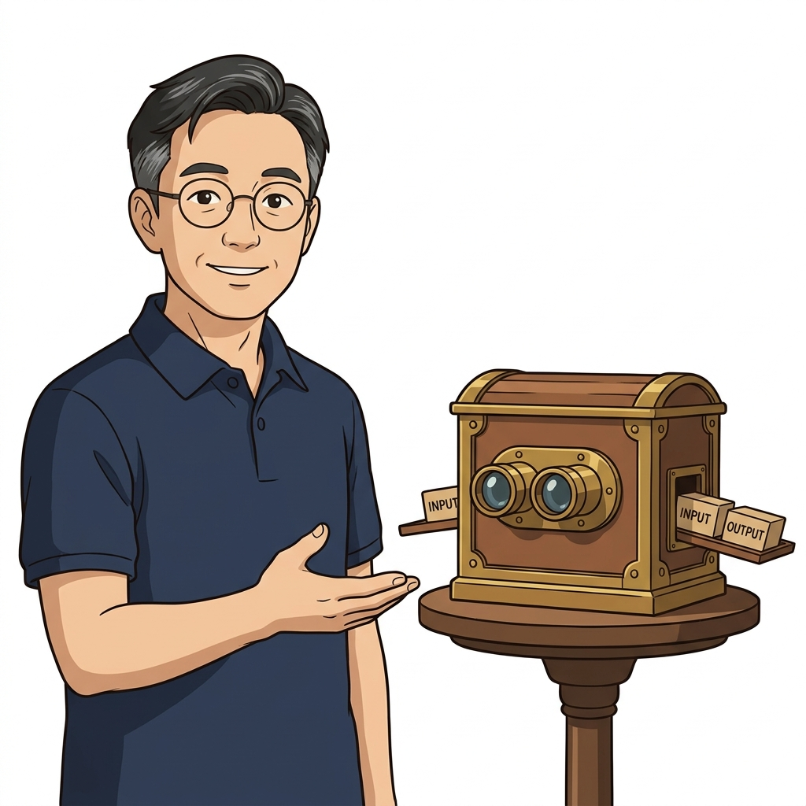
*그림 7-7: Function은 입력 변수를 받아 새로운 출력 변수를 생성한다*

---

함수 입장에서 변수는 '입력'과 '출력'에 쓰입니다. 

즉, [그림 7-2]의 왼쪽과 같이 함수에게 변수는 '입력 변수(input)'와 '출력 변수(output)'로서 존재합니다(그림의 점선은 참조<sup>reference</sup>를 뜻합니다).

그림 7-2 함수 입장에서 본 변수와의 관계(왼쪽)와 변수 입장에서 본 함수와의 관계(오른쪽)
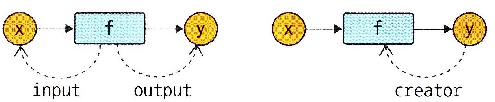

---

변수 관점에서 함수는 어떤 존재일까요? 

여기서 눈여겨볼 점은 변수는 함수에 의해 '만들어진다'라는 것입니다. 즉, 변수에게 있어 함수는 '창조자<sup>creator</sup>' 혹은 '부모'입니다. 창조자인 함수가 존재하지 않는 변수는 함수 이외의 존재, 예컨대 사용자에 의해 만들어진 변수로 간주됩니다.

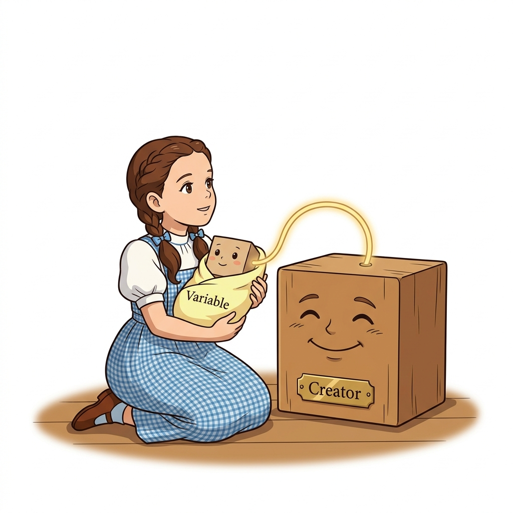
*그림 7-8: 변수에게 있어 함수는 자신을 만들어낸 창조자(creator/부모)이다*

---

일단 [그림 7-2]와 같은 함수와 변수의 관계를 DeZero 코드에 녹여볼까요? 

여기서는 일반적인 계산(순전파)이 이루어지는 시점에 '관계'를 맺어주도록(즉, 함수와 변수를 연결 짓도록) 만들겠습니다. 

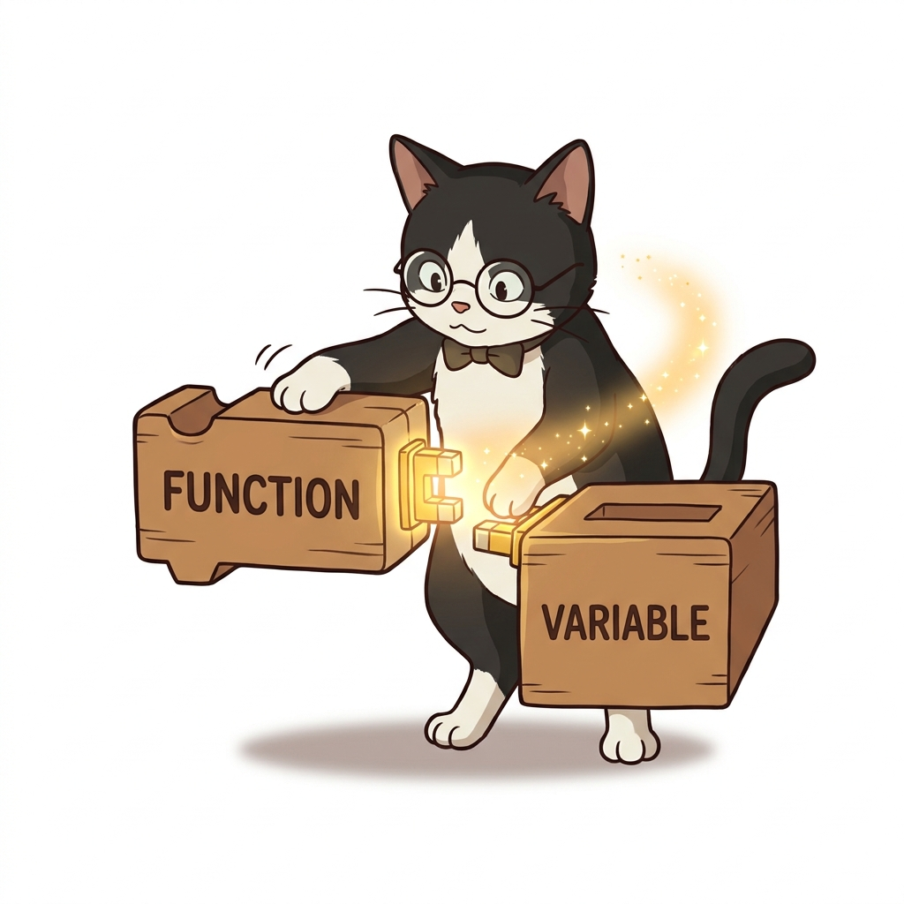
*그림 7-9: 순전파 계산이 일어나는 순간 변수에 창조자 링크를 동적으로 연결*

---

이를 위해 우선 Variable 클래스에 다음 코드를 추가합니다.

steps/step07.py
```python
class Variable:
    def __init__(self, data):
        self.data = data
        self.grad = None
        self.creator = None

    def set_creator(self, func):
        self.creator = func
```

creator라는 인스턴스 변수를 추가했습니다. 그리고 creator를 설정할 수 있도록 `set_creator` 메서드도 추가합니다. 

---

이어서 Function 클래스에 다음 코드를 추가합니다.

steps/step07.py
```python
class Function:
    def __call__(self, input):
        x = input.data
        y = self.forward(x)
        output = Variable(y)
        output.set_creator(self) # 출력 변수에 창조자를 설정한다.
        self.input = input
        self.output = output # 출력도 저장한다.
        return output
```

---

순전파를 계산하면 그 결과로 output이라는 Variable 인스턴스가 생성됩니다. 이때 생성된 output에 '내가 너의 창조자임'을 기억시킵니다. 이 부분이 '연결'을 동적으로 만드는 기법의 핵심입니다. 그런 다음 앞으로를 위해 output을 인스턴스 변수에 저장했습니다.

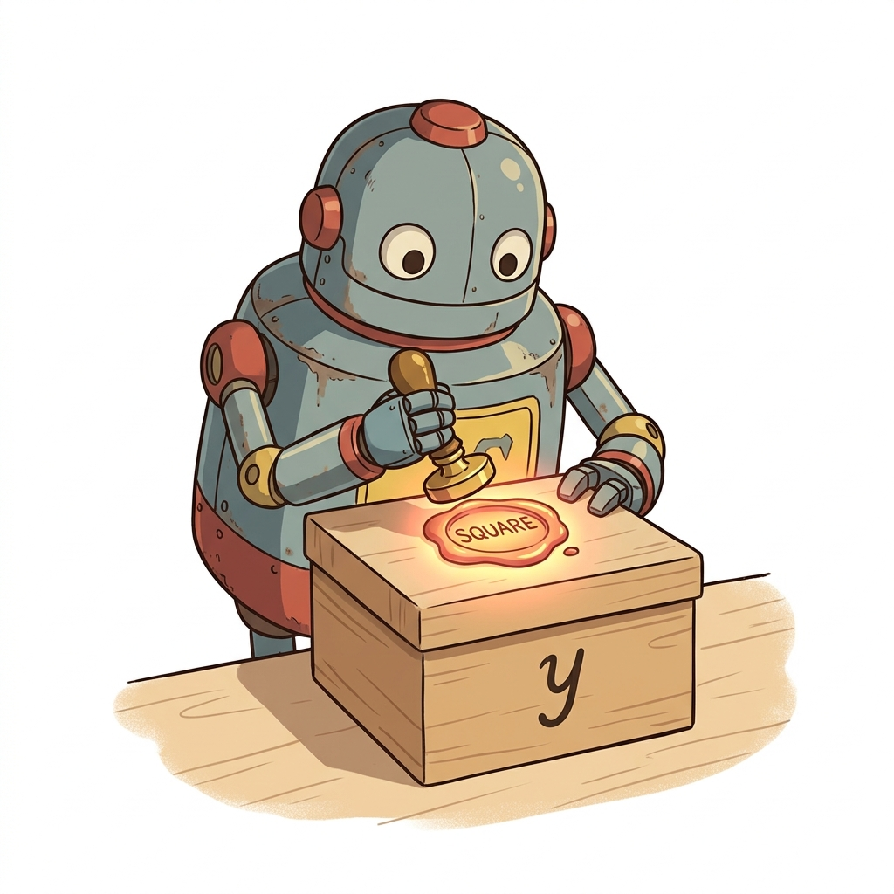
*그림 7-10: 생성된 출력 변수에 자신(함수)을 창조자로 각인시키는 연결 기법*

---

> **NOTE**  
> DeZero의 동적 계산 그래프<sup>Dynamic Computational Graph</sup>는 실제 계산이 이루어질 때 변수(상자)에 관련 '연결'을 기록하는 방식으로 만들어집니다. 체이너와 파이토치의 방식도 이와 비슷합니다.


*그림 7-11: 현대 딥러닝 프레임워크의 근간이 된 Define-by-Run 철학*

---

이와 같이 '연결'된 Variable과 Function이 있다면 계산 그래프를 거꾸로 거슬러 올라갈 수 있습니다. 

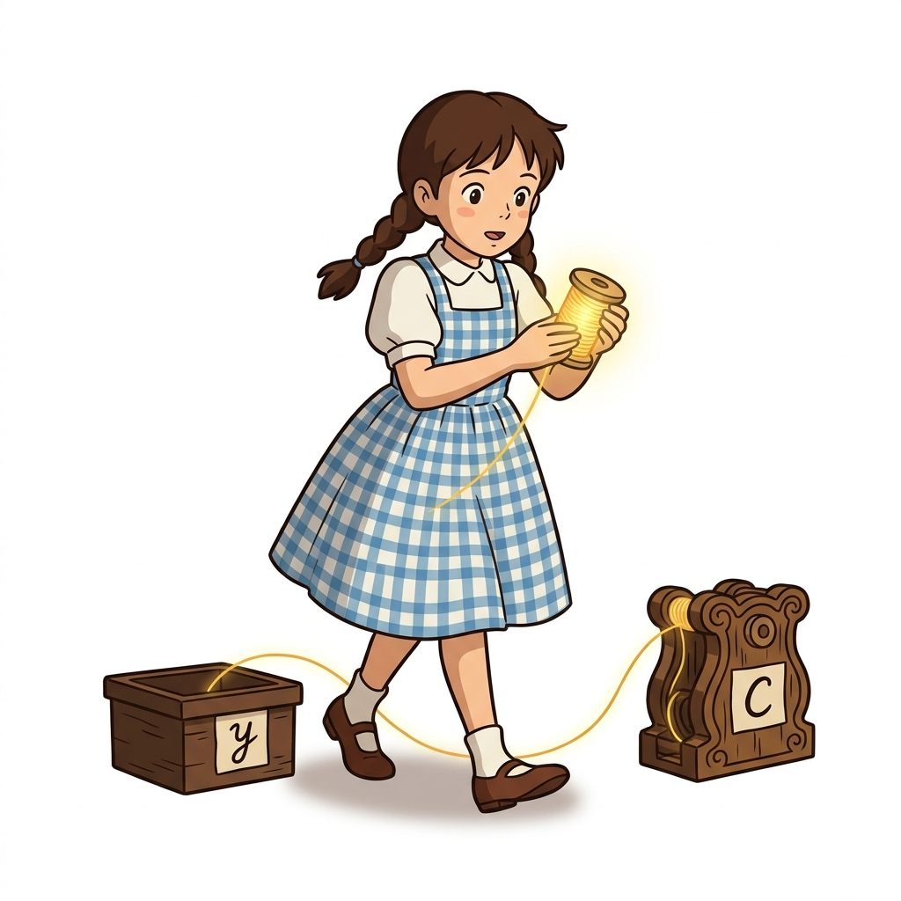
*그림 7-12: 출력 y에서 creator를 추적하여 이전 함수와 입력 변수로 이동하는 역방향 탐색*

---

구체적인 코드로 나타내면 다음과 같습니다.

```python
A = Square()
B = Exp()
C = Square()

x = Variable(np.array(0.5))
```

```python
a = A(x)
b = B(a)
y = C(b)

# 계산 그래프의 노드들을 거꾸로 거슬러 올라간다.
assert y.creator == C
assert y.creator.input == b
assert y.creator.input.creator == B
assert y.creator.input.creator.input == a
assert y.creator.input.creator.input.creator == A
assert y.creator.input.creator.input.creator.input == x
```

---

우선 assert 문이 무엇인지 설명해야겠네요. 

먼저 'assert'는 우리말로 '단호하게 주장하다', '단언하다'라는 뜻입니다. assert 문은 `assert ...` 형태로 사용합니다. 여기서 `...` 부분이 '주장'에 해당하는 내용으로, 그 평가 결과가 True가 아니면 예외가 발생합니다. 따라서 assert 문은 조건을 충족하는지 여부를 확인하는 데 사용할 수 있습니다. 참고로 앞의 코드는 문제없이(예외가 발생하지 않고) 실행되므로 assert 문의 조건을 모두 충족함을 알 수 있습니다.

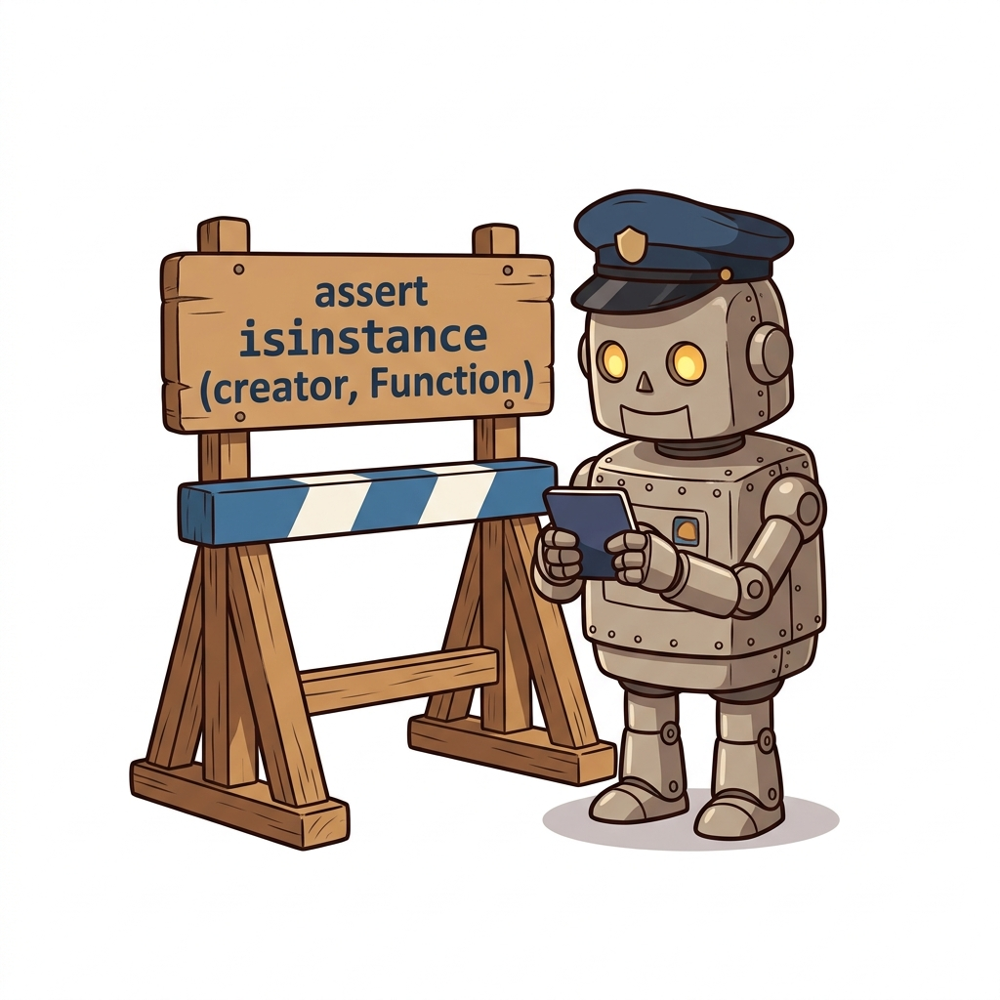
*그림 7-13: 연결된 creator가 Function 인스턴스인지 엄격하게 검증하는 assert 문*

---

앞의 코드가 보여주듯 Variable의 인스턴스 변수 `creator`에서 바로 앞의 Function으로 건너갑니다. 그리고 그 Function의 인스턴스 변수 `input`에서 다시 하나 더 앞의 Variable로 건너가죠.

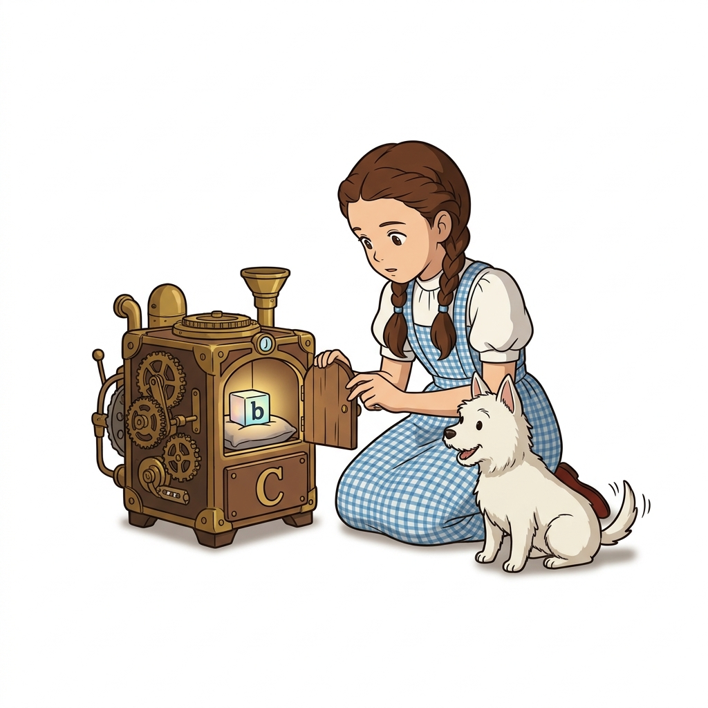
*그림 7-14: 창조자 함수의 input 변수로부터 역전파에 필요한 입력값을 손쉽게 접근*

---

[그림 7-3]은 이 관계를 잘 보여줍니다.

그림 7-3 계산 그래프 역추적($y$ 에서 시작)
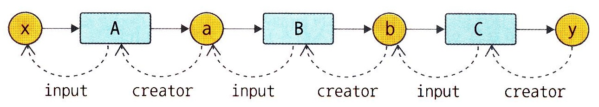

[그림 7-3]과 같이 우리 계산 그래프는 함수와 변수 사이의 연결로 구성됩니다. 그리고 중요한 점은 이 '연결'이 실제로 계산을 수행하는 시점에 (순전파로 데이터를 흘려보낼 때) 만들어진다는 것입니다. 이러한 특성에 이름을 붙인 것이 Define-by-Run입니다. 데이터를 흘려보냄으로써(Run함으로써) 연결이 규정된다는(Define된다는) 뜻입니다.

---

또한 [그림 7-3]과 같이 노드들의 연결로 이루어진 데이터 구조를 '링크드 리스트<sup>linked list</sup>'라고 합니다. 노드는 그래프를 구성하는 요소이며, 링크<sup>link</sup>는 다른 노드를 가리키는 참조를 뜻합니다. 결국 우리는 '링크드 리스트'라는 데이터 구조를 이용해 계산 그래프를 표현하고 있는 것입니다.

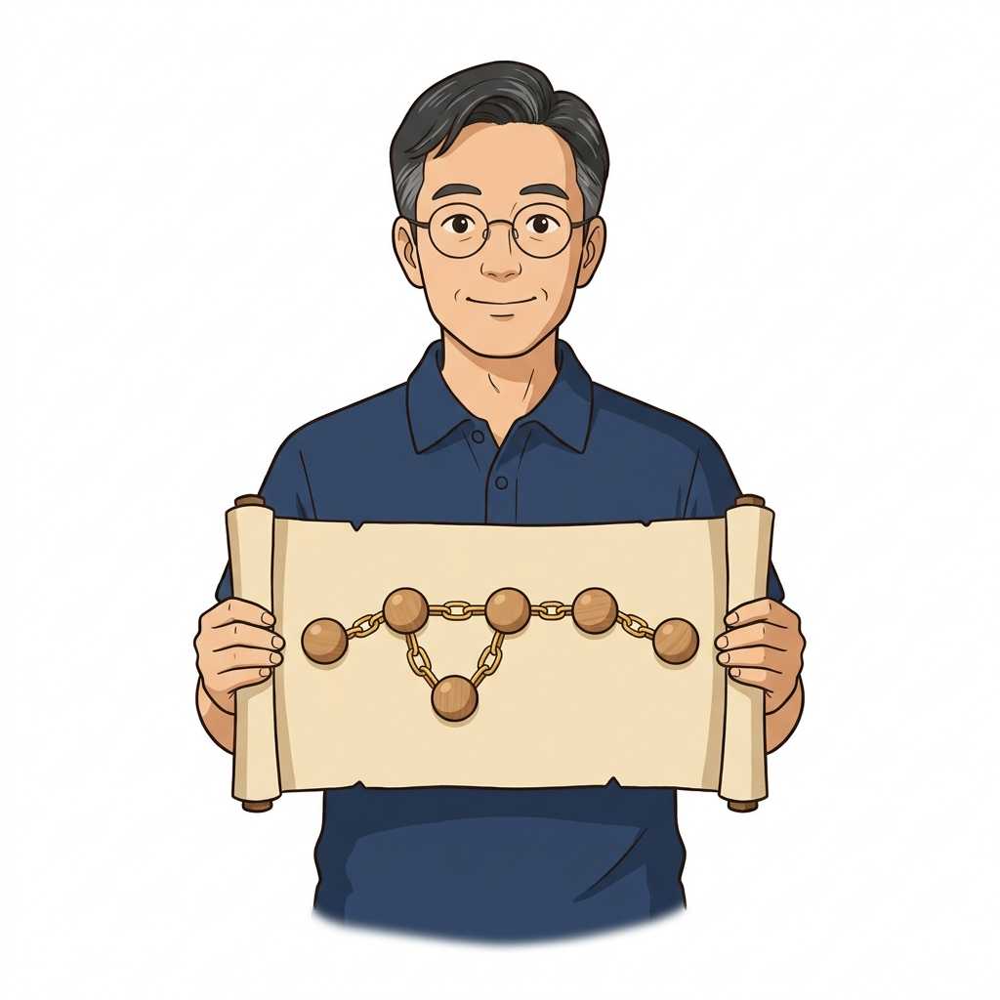
*그림 7-15: 노드와 참조 링크로 유연하게 연결된 DeZero의 링크드 리스트 계산 그래프*

---

## 7.2 역전파 도전!

변수와 함수의 관계를 이용하여 역전파를 시도해보겠습니다. 우선 $y$ 에서 $b$ 까지의 역전파를 시도해보죠.

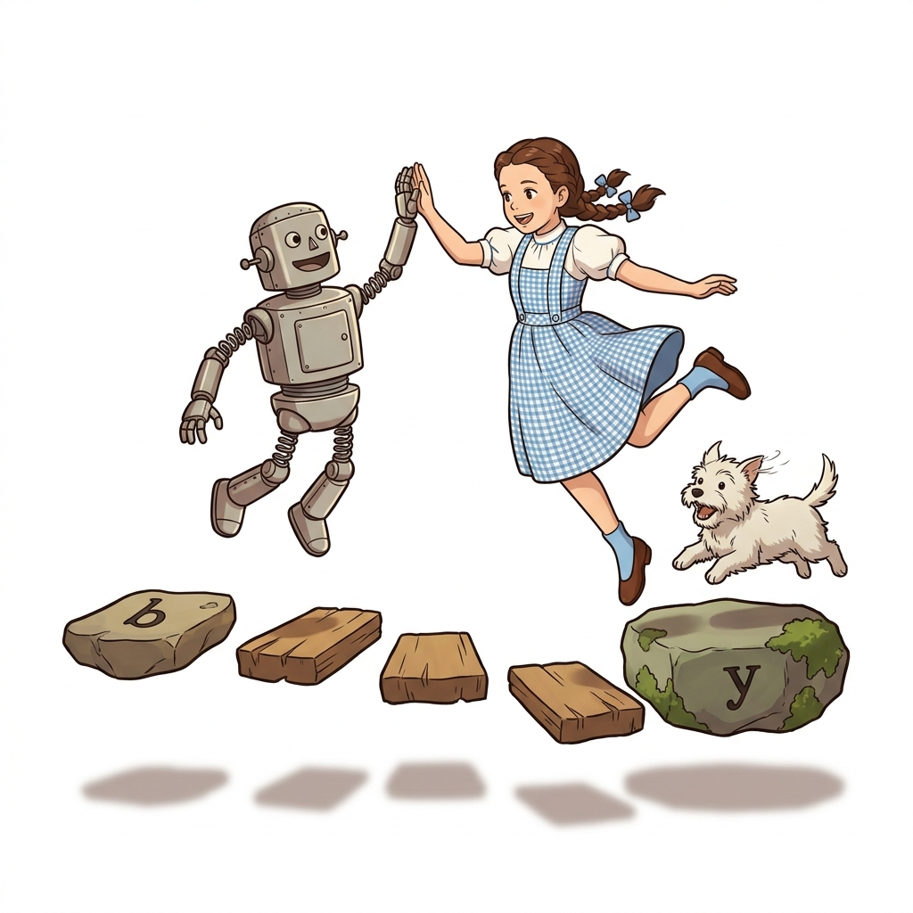
*그림 7-16: 관계 링크를 활용해 출력 y에서 중간 변수 b로 역전파를 수행하는 첫 걸음*

---

이 부분은 다음과 같이 구현할 수 있습니다.

```python
y.grad = np.array(1.0)

C = y.creator  # 1. 함수를 가져온다.
b = C.input    # 2. 함수의 입력을 가져온다.
b.grad = C.backward(y.grad)  # 3. 함수의 backward 메서드를 호출한다.
```

$y$ 의 인스턴스 변수 `creator`에서 함수를 얻어오고, 그 함수의 `input`에서 입력 변수를 가져왔습니다. 그런 다음 함수의 `backward` 메서드를 호출합니다. 

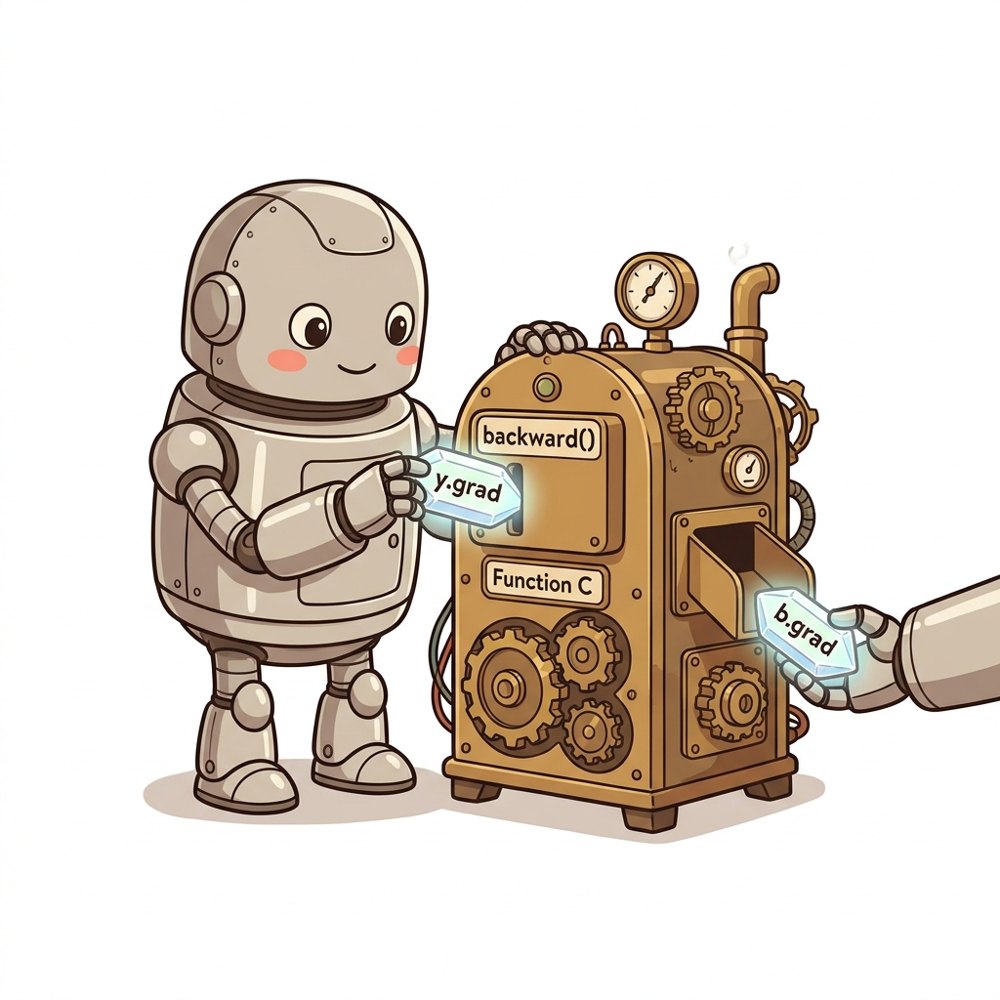
*그림 7-17: 창조자 함수의 backward(y.grad)를 호출하여 b의 기울기를 획득*

---이어서 변수 $b$ 에서 $a$ 로의 역전파를 보겠습니다.

```python
B = b.creator  # 1. 함수를 가져온다.
a = B.input    # 2. 함수의 입력을 가져온다.
a.grad = B.backward(b.grad)  # 3. 함수의 backward 메서드를 호출한다.
```

똑같은 흐름입니다. 


*그림 7-18: 동일한 패턴으로 b의 creator를 얻어 a의 기울기를 계산하는 연속성*

---

구체적으로 다음과 같은 순서로 진행됩니다.

1. 함수를 가져온다.
2. 함수의 입력을 가져온다.
3. 함수의 `backward` 메서드를 호출한다.

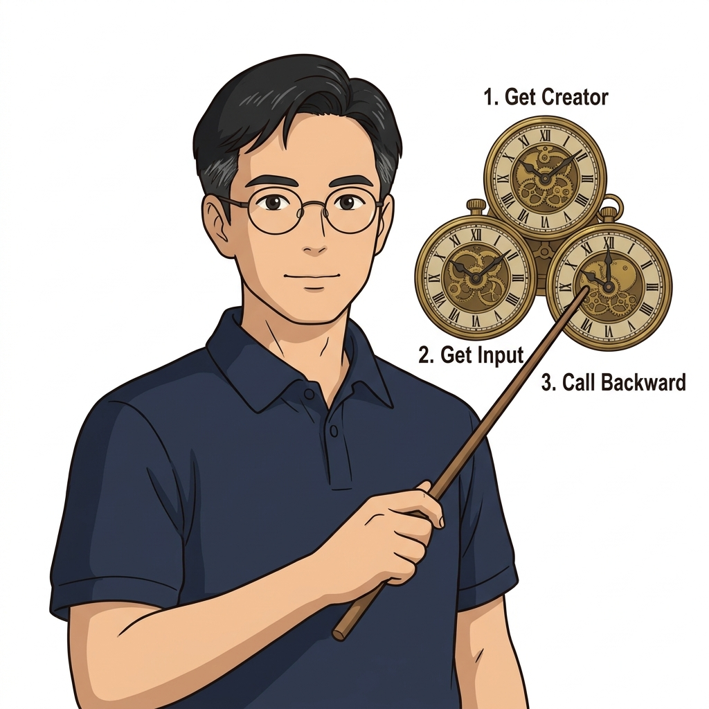
*그림 7-19: 1. 함수 가져오기 -> 2. 입력 가져오기 -> 3. backward 호출의 3단계 자동화 패턴*

---

마지막으로 변수 $a$ 에서 $x$ 로의 역전파까지 진행합니다.

```python
A = a.creator  # 1. 함수를 가져온다.
x = A.input    # 2. 함수의 입력을 가져온다.
x.grad = A.backward(a.grad)  # 3. 함수의 backward 메서드를 호출한다.
print(x.grad)
```

---

실행 결과

```
3.297442541400256
```

이상으로 모든 역전파가 끝났습니다.

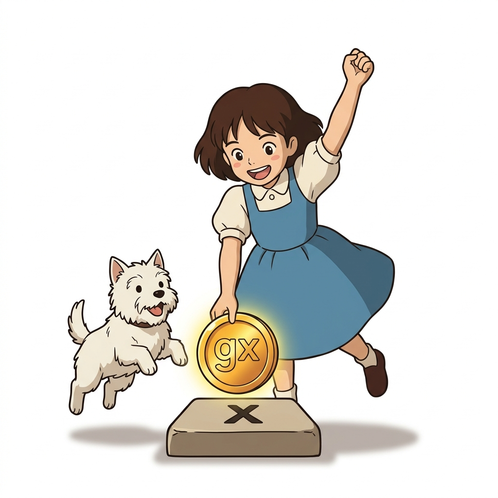
*그림 7-20: 출발점인 입력 x까지 성공적으로 도달하여 모든 기울기를 완성*

---

## 7.3 backward 메서드 추가

방금 보여드린 역전파 코드에는 똑같은 처리 흐름이 반복해서 나타났습니다. 변수에서 하나 앞의 변수로 거슬러 올라가는 로직이 그러했습니다. 그러므로 이 반복 작업을 자동화할 수 있도록 Variable 클래스에 `backward`라는 새로운 메서드를 추가하겠습니다.

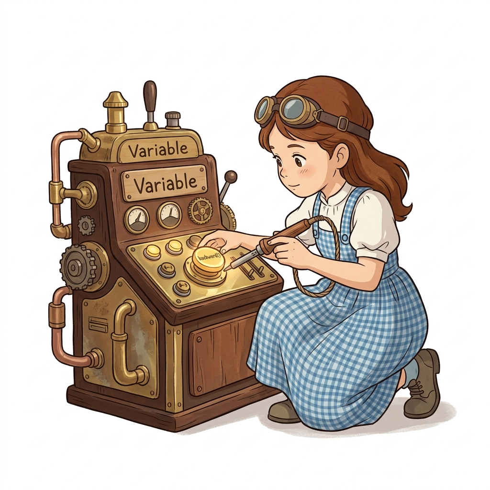
*그림 7-21: 수동 루프를 캡슐화하여 Variable 자체에 backward 메서드를 장착*

---

steps/step07.py
```python
class Variable:
    def __init__(self, data):
        self.data = data
        self.grad = None
        self.creator = None

    def set_creator(self, func):
        self.creator = func

    def backward(self):
        f = self.creator # 1. 함수를 가져온다.
        if f is not None:
            x = f.input # 2. 함수의 입력을 가져온다.
            x.grad = f.backward(self.grad) # 3. 함수의 backward 메서드를 호출한다.
            x.backward() # 하나 앞 변수의 backward 메서드를 호출한다(재귀).
```

---

`backward` 메서드는 지금까지 반복한 처리 흐름과 거의 동일합니다. Variable의 `creator`에서 함수를 얻어오고, 그 함수의 입력 변수를 가져옵니다. 그런 다음 함수의 `backward` 메서드를 호출합니다. 마지막으로 자신보다 하나 앞에 놓인 변수의 `backward` 메서드를 호출합니다. 이런 식으로 각 변수의 `backward` 메서드가 재귀적으로 불리게 됩니다.

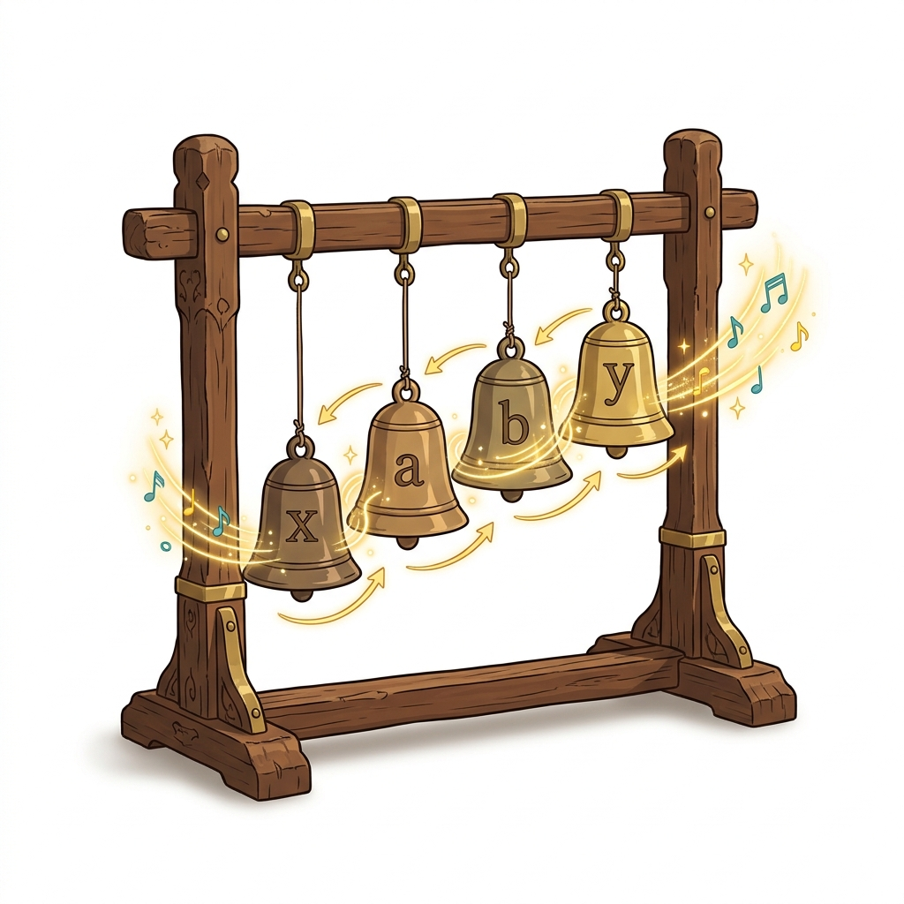
*그림 7-22: y.backward() 호출 하나로 앞선 변수들의 backward가 연쇄적으로 불리는 재귀 구조*

---

> 
>
> **NOTE**  
> Variable 인스턴스의 `creator`가 `None`이면 역전파가 중단됩니다. 창조자가 없으므로 이 Variable 인스턴스는 함수 바깥에서 생성됐음을 뜻합니다(높은 확률로 사용자가 만들어 건넨 변수일 것입니다).

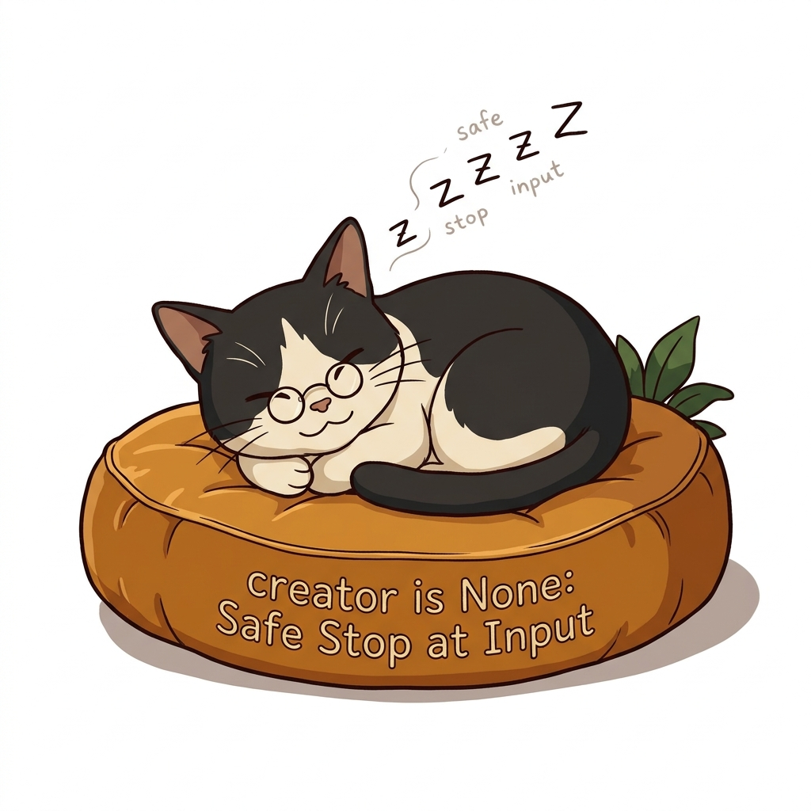
*그림 7-23: 사용자가 직접 생성한 입력 변수에 도달하면(creator=None) 안전하게 역전파 종료*

---

이제 새로워진 Variable을 이용하여 역전파가 자동으로 실행되는 모습을 보겠습니다.

steps/step07.py
```python
A = Square()
B = Exp()
C = Square()

x = Variable(np.array(0.5))
a = A(x)
b = B(a)
y = C(b)

# 역전파
y.grad = np.array(1.0)
y.backward()
print(x.grad)
```

---

실행 결과

```
3.297442541400256
```

이와 같이 변수 $y$ 의 `backward` 메서드를 호출하면 역전파가 자동으로 진행됩니다. 실행 결과도 지금까지와 동일합니다. 축하합니다! 여러분은 방금 DeZero에서 가장 중요한 개념인 자동 미분의 기초를 완성했습니다.

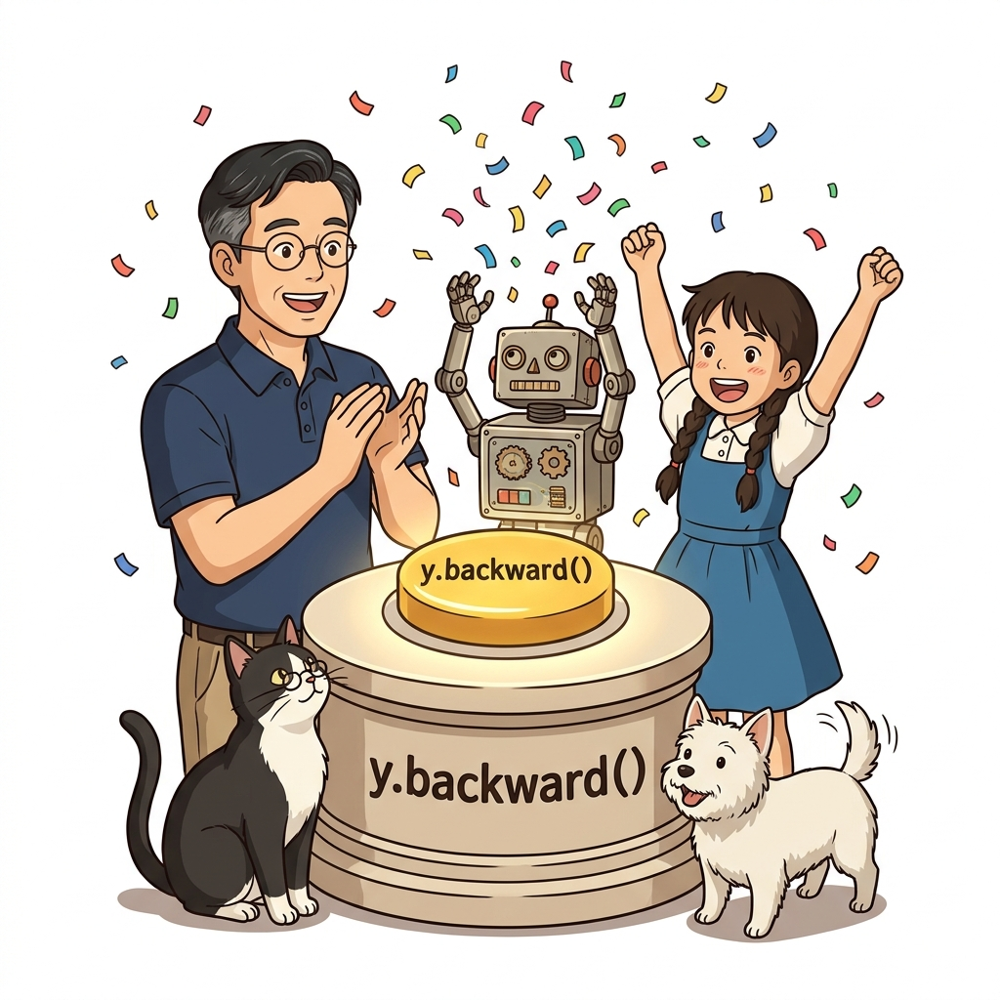
*그림 7-24: 단 한 줄의 코드로 전체 미분이 자동 계산되는 Define-by-Run DeZero의 완성*
