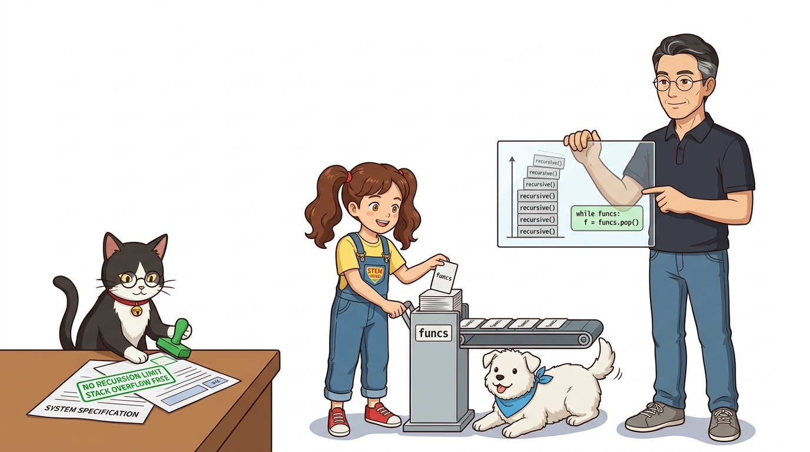
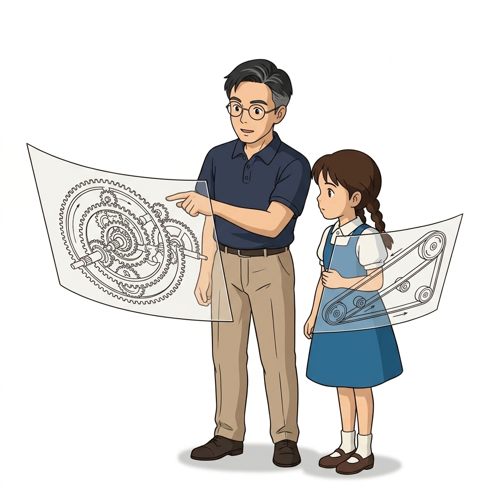
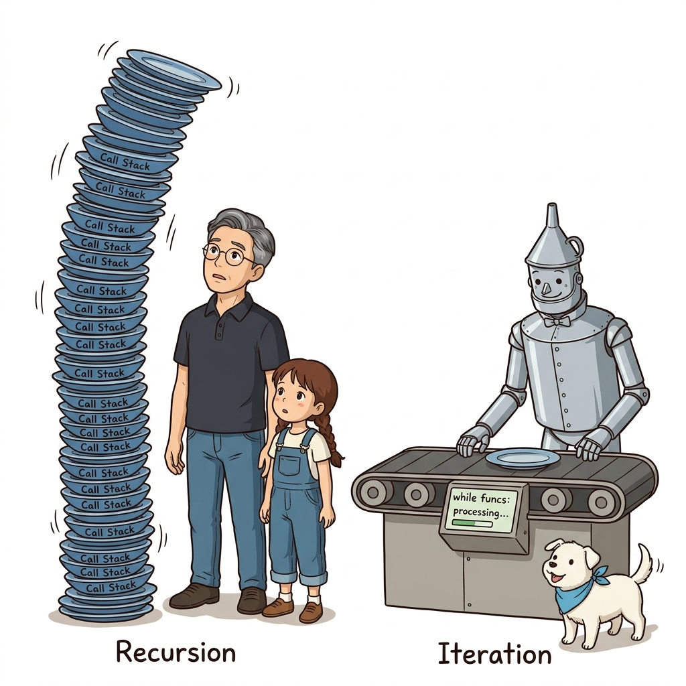
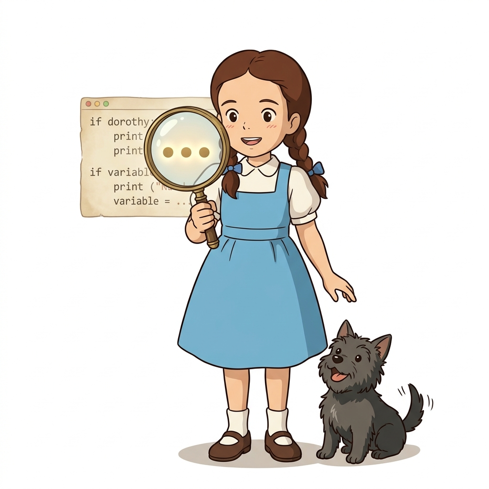
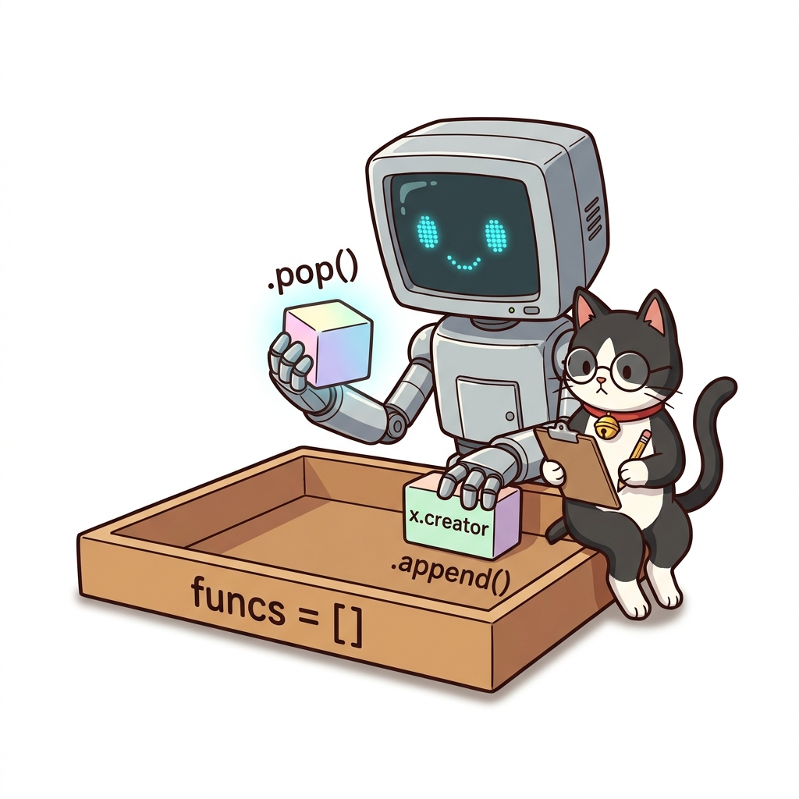
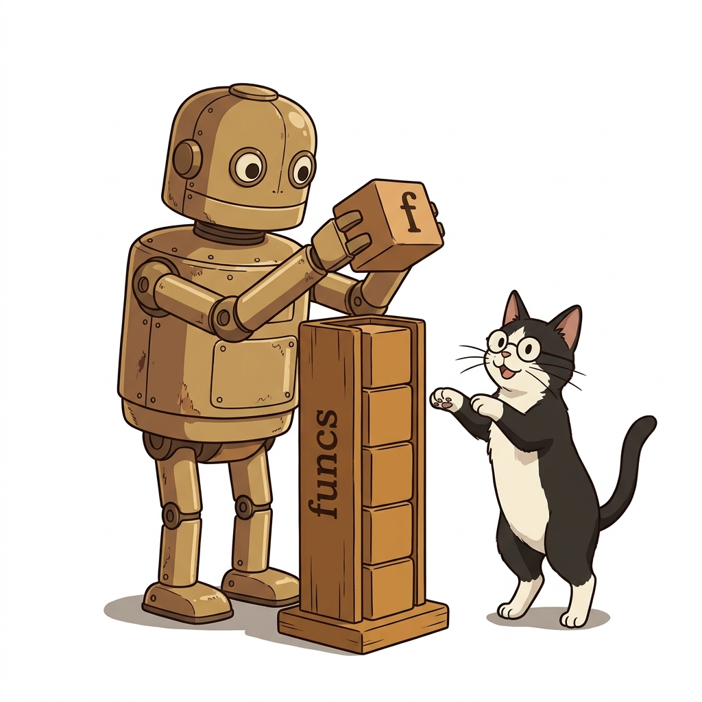
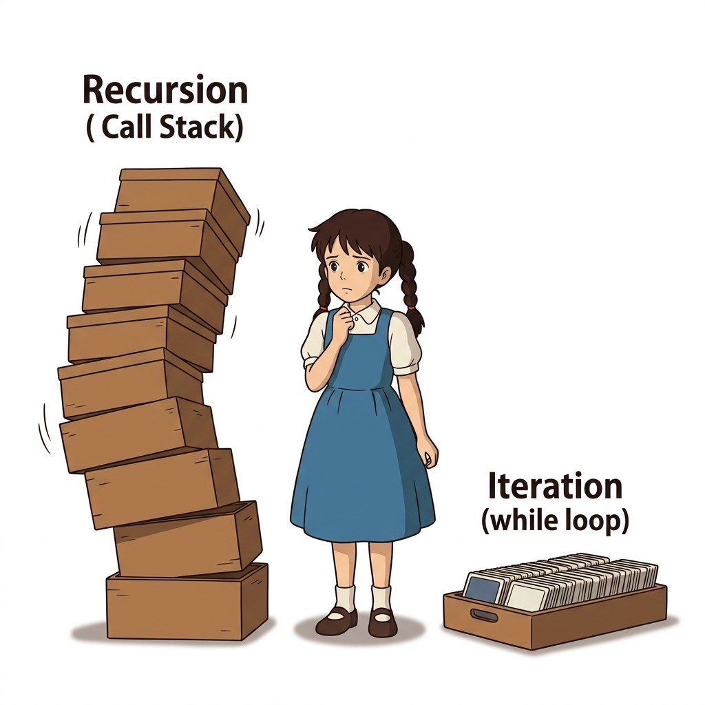
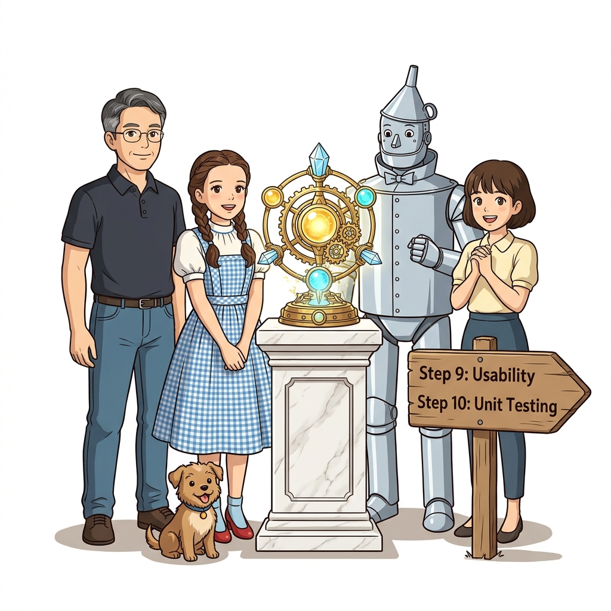
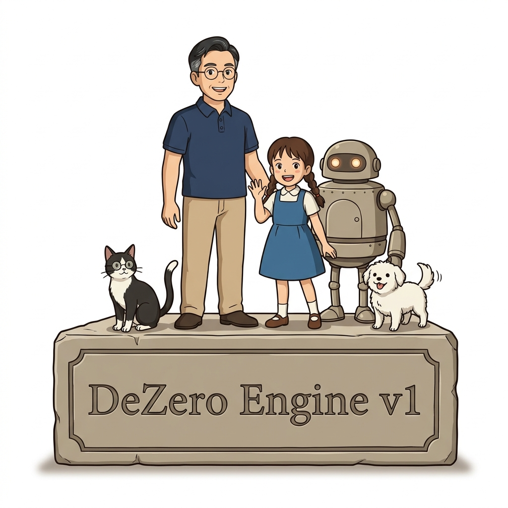

# 8단계 재귀에서 반복문으로


**그림 08-Intro** 스택 오버플로 한계를 극복하고 리스트 기반 반복문(while funcs.pop())으로 진화한 DeZero 코어 엔진 (이호진 교수와 도로시 탐험대)

---


앞 단계에서는 Variable 클래스에 `backward` 메서드를 추가했습니다. 

이번에는 처리 효율을 개선하고 앞으로의 확장을 대비해 `backward` 메서드의 구현 방식을 바꿔보겠습니다.


*그림 8-1: 처리 효율과 확장성을 위해 재귀 호출을 반복문(Loop) 구조로 개선*

---

## 8.1 현재의 Variable 클래스

이전 장에서 우리는 Variable 클래스의 `backward` 메서드를 다음처럼 구현했습니다.

steps/step07.py
```python
class Variable:
    ... # 생략

    def backward(self):
        f = self.creator
        if f is not None:
            x = f.input
            x.grad = f.backward(self.grad)
            x.backward()
```

---

이 `backward` 메서드에서 눈에 밟히는 부분은 (입력 방향으로) 하나 앞 변수의 `backward` 메서드를 호출하는 코드입니다. '`backward` 메서드에서 `backward` 메서드를 호출하고, 호출된 `backward` 메서드에서 또 다른 `backward` 메서드를 호출하고, ...' 과정이 계속됩니다(창조자 함수가 없는 변수, 즉 `self.creator`가 `None`인 변수를 찾을 때까지 계속됩니다). 

이를 재귀 구조라고 합니다.


*그림 8-1-b: 깊어질수록 위태로운 재귀 호출 스택(Stack)과 안전하고 효율적인 while 반복문(Loop) 컨베이어 벨트*

---

> **CAUTION**  
> 이 교제에서는 페이지 수를 절약하고 설명 내용과 관련된 코드에 집중하기 위해 코드 일부를 생략하고 보여줄 때도 있습니다. 생략된 부분은 '...'로 표기합니다(파이썬 인터프리터에서 줄바꿈 시 나타나는 '...'와는 의미가 다릅니다).


*그림 8-2: 핵심 로직에 집중하기 위해 사용된 코드 생략 표기법 안내*

---

## 8.2 반복문을 이용한 구현

이번 절에서는 지금까지의 '재귀를 사용한 구현'을 '반복문을 이용한 구현'으로 고쳐보겠습니다. 

코드는 다음과 같습니다.

steps/step08.py
```python
class Variable:
    ...

    def backward(self):
        funcs = [self.creator]
        while funcs:
            f = funcs.pop() # 함수를 가져온다.
            x, y = f.input, f.output # 함수의 입력과 출력을 가져온다.
            x.grad = f.backward(y.grad) # backward 메서드를 호출한다.

            if x.creator is not None:
                funcs.append(x.creator) # 하나 앞의 함수를 리스트에 추가한다.
```

---

이것이 반복문을 이용한 구현입니다. 

주목할 점은 처리해야 할 함수들을 `funcs`라는 리스트에 차례로 집어넣는다는 것입니다. 


*그림 8-2-b: funcs 작업 트레이에서 .pop()으로 함수를 꺼내고 .append(x.creator)로 선행 함수를 적재하는 스택 동작*

---

while 블록 안에서 `funcs.pop()`을 호출하여 처리할 함수 $f$ 를 꺼내고, $f$ 의 `backward` 메서드를 호출합니다. 

이때 `f.input`과 `f.output`에서 함수 $f$ 의 입력과 출력 변수를 얻음으로써 `f.backward()`의 인수와 반환값을 올바르게 설정할 수 있습니다.


---

> **NOTE**  
> 리스트의 `pop` 메서드는 리스트에서 마지막 원소를 꺼내줍니다(반환된 요소는 리스트에서 제거됩니다). 
>
> 예컨대 `funcs = [1, 2, 3]`일 때 `x = funcs.pop()`을 실행하면 3이 반환되고 `funcs`는 `[1, 2]`가 됩니다.


*그림 8-3: funcs 리스트에서 마지막 함수를 꺼내 처리하는 pop() 스택 메커니즘*

---

## 8.3 동작 확인

개선된 Variable 클래스를 사용하여 실제로 미분을 해봅시다. 

7단계에서와 똑같은 코드를 실행해보겠습니다.

steps/step08.py
```python
A = Square()
B = Exp()
C = Square()

x = Variable(np.array(0.5))
a = A(x)
b = B(a)
y = C(b)

# 역전파
y.grad = np.array(1.0)
y.backward()
print(x.grad)
```

---

실행 결과

```
3.297442541400256
```

결과도 이전과 똑같습니다. 이상으로 '재귀'에서 '반복문'으로 구현 방식을 전환했습니다. 

반복문 방식의 이점은 15단계에서 알 수 있습니다. 15단계에서는 복잡한 계산 그래프를 다루는데, 방금 전환한 구현 덕분에 부드럽게 확장할 수 있습니다. 처리 효율도 반복문 방식이 뛰어납니다.

---

> **CAUTION**  
> 재귀는 함수를 재귀적으로 호출할 때마다 중간 결과를 메모리에 유지하면서(스택에 쌓으면서) 처리를 이어갑니다. 
>
> 일반적으로 반복문 방식의 효율이 더 좋은 이유입니다. 
>
> 그러나 요즘 컴퓨터는 메모리가 넉넉한 편이라서 조금 더 사용하는 건 그리 문제가 되지 않습니다. 또한 '꼬리 재귀<sup>tail recursion</sup>' 기법을 이용하여 재귀를 반복문처럼 실행할 수 있는 경우도 있습니다.


*그림 8-4: 깊은 함수 호출 스택을 절약하고 오버헤드를 줄이는 while 반복문 방식의 이점*

---

이상으로 역전파 구현의 기반은 완성했습니다. 

앞으로는 더욱 복잡한 계산도 가능하도록 현재의 DeZero를 확장해나갈 것입니다. 하지만 그전에 다음 단계에서 DeZero의 '사용자 편의성'부터 개선하겠습니다.


*그림 8-5-b: 견고한 자동 미분 코어 엔진 완성을 축하하며 사용자 편의성(9단계)과 테스트(10단계)로 나아가는 도로시 탐험대*


*그림 8-5: 견고한 자동 미분 코어 엔진을 바탕으로 더 편리한 DeZero(9단계)로 전진*
