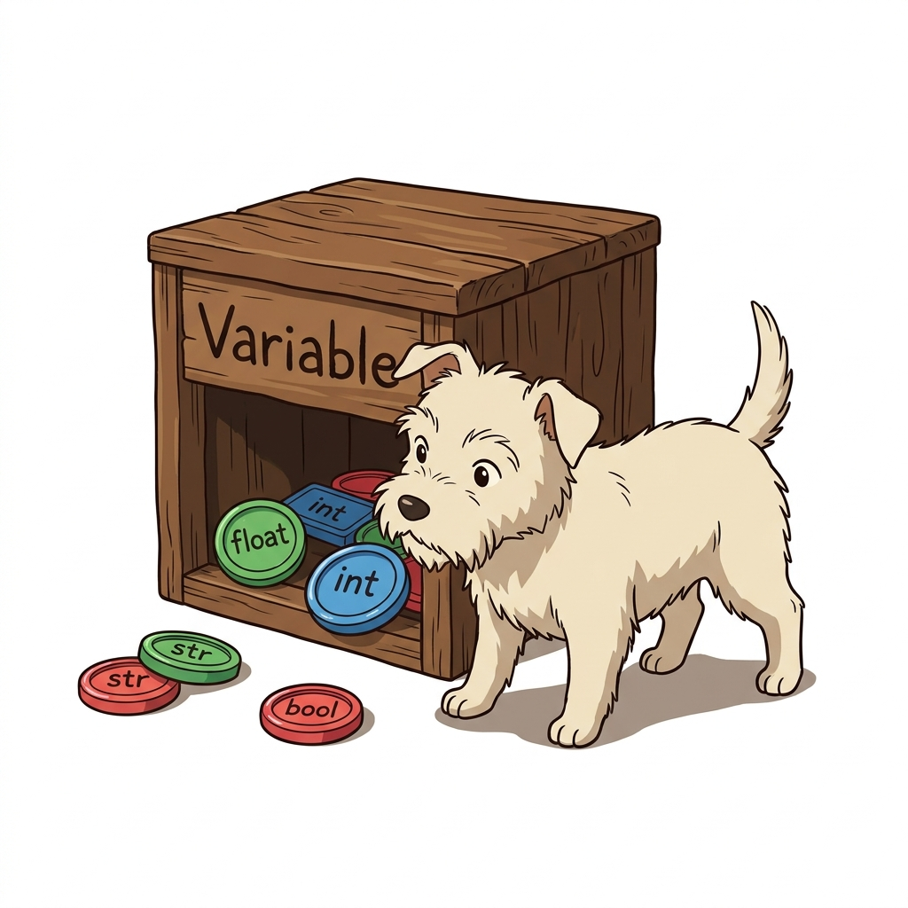
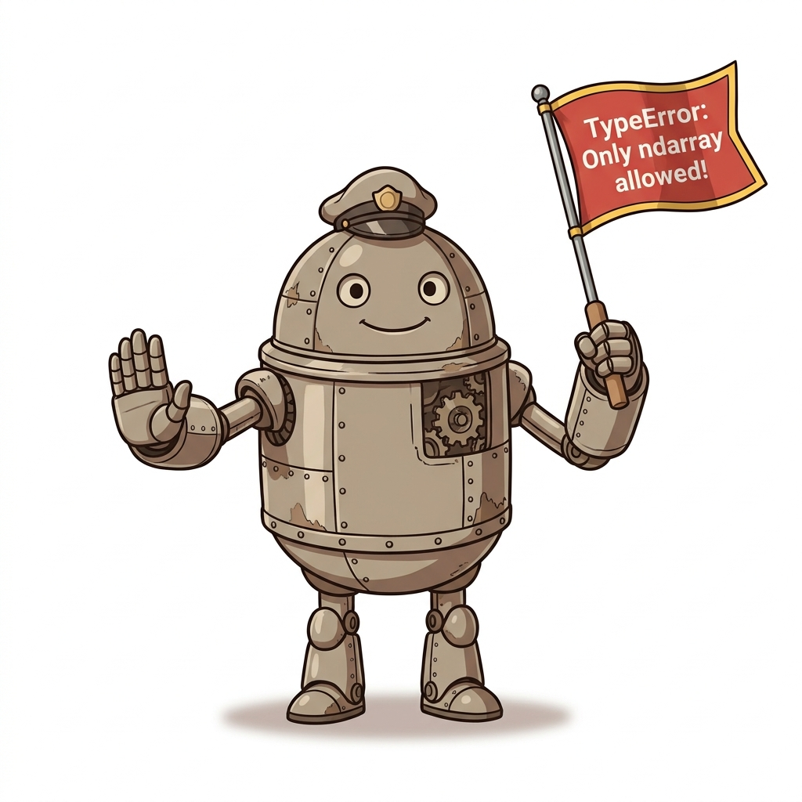
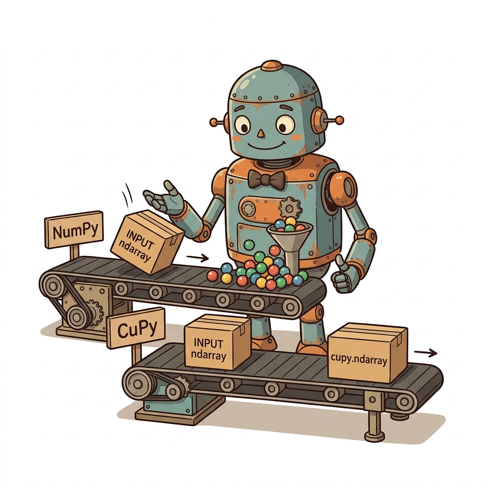
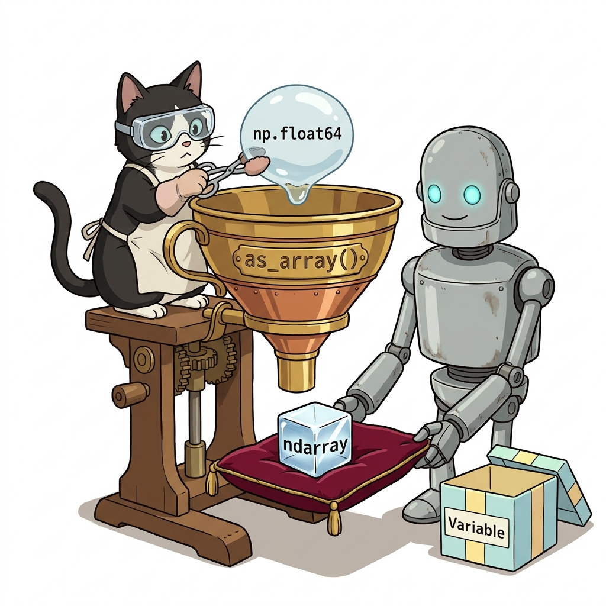

# 9단계 함수를 더 편리하게


**그림 09-Intro** 파이썬다운 함수 인터페이스(square(x)), 자동 시드 생성 및 as_array 타입 안전 금형 구축 (이호진 교수와 도로시 탐험대)

---


DeZero가 역전파를 해낼 수 있게 되었습니다. 

또한 Define-by-Run이라고 하는 전체 계산의 각 조각들을 런타임에 '연결'해내는 능력도 갖췄습니다.

 하지만 사용하기에 조금 불편한 부분이 있어서 이번 단계에서는 DeZero의 함수에 세 가지 개선을 추가하겠습니다.


*그림 9-1: 파이썬 함수 지원, 역전파 시드 생략, ndarray 타입 안전성의 3대 편의성 개선*

---

## 9.1 파이썬 함수로 이용하기

지금까지의 DeZero는 함수를 '파이썬 클래스'로 정의해 사용했습니다. 

그래서 가령 `Square` 클래스를 사용하는 계산을 하려면 코드를 다음처럼 작성해야 했습니다.

```python
x = Variable(np.array(0.5))
f = Square()
y = f(x)
```

---

이와 같이 `Square` 클래스의 인스턴스를 생성한 다음, 이어서 그 인스턴스를 호출하는 두 단계로 구분해 진행해야 합니다. 


*그림 9-2-b: 번거로운 클래스 인스턴스화를 걷어내고 자연스러운 파이썬 함수(square, exp)로 진화한 DeZero*

---

사용자 입장에서는 조금 번거롭죠. `y = Square()(x)` 형태로 한 줄로 적을 수도 있지만 모양새가 좋지 않습니다. 

더 바람직한 해법은 '파이썬 함수'를 지원하는 것입니다. 


*그림 9-2: DeZero Function 클래스를 파이썬 표준 함수로 감싸 간편하게 호출*

---

그래서 다음 코드를 추가합니다.

```python
def square(x):
    f = Square()
    return f(x)

def exp(x):
    f = Exp()
    return f(x)
```

보다시피 `square`와 `exp`라는 두 가지 파이썬 함수를 구현했습니다. 

이로써 'DeZero 함수'를 '파이썬 함수'로 이용할 수 있게 됩니다. 

---

참고로 이 코드는 다음과 같이 한 줄로 표현할 수도 있습니다.

**steps/step09.py**
```python
def square(x):
    return Square()(x) # 한 줄로 작성

def exp(x):
    return Exp()(x)
```

이전의 `f = Square()` 형태에서는 DeZero 함수를 `f`라는 변수 이름으로 참조한 데 반해, 간소화한 코드에서는 직접 `Square()(x)`라고 쓴 것입니다. 

---

그럼 방금 구현한 두 함수를 사용해보죠.

```python
x = Variable(np.array(0.5))
a = square(x)
b = exp(a)
y = square(b)

y.grad = np.array(1.0)
y.backward()
print(x.grad)
```

---

**실행 결과**
```text
3.297442541400256
```

보다시피 최초의 `np.array(0.5)`를 `Variable`로 감싸면 일반적인 수치 계산을 하듯, 즉 넘파이를 사용해 계산하도록 코딩할 수 있습니다. 

---

또한 다음과 같이 함수를 연속으로 적용할 수 있습니다.

```python
x = Variable(np.array(0.5))
y = square(exp(square(x))) # 연속하여 적용
y.grad = np.array(1.0)
y.backward()
print(x.grad)
```

---

**실행 결과**
```text
3.297442541400256
```

이제 계산을 더 자연스러운 코드로 표현할 수 있게 되었습니다. 이것이 첫 번째 개선입니다.

---

## 9.2 backward 메서드 간소화

두 번째 개선은 역전파 시 사용자의 번거로움을 줄이기 위한 것입니다. 

구체적으로는 방금 작성한 코드에서 `y.grad = np.array(1.0)` 부분을 생략하려 합니다. 

지금까지는 역전파할 때마다 `y.grad = np.array(1.0)`이라는 코드를 작성해야 했습니다. 


*그림 9-3: 번거로운 y.grad = 1.0 설정을 backward() 내부에서 자동 처리*

---

이 코드를 생략할 수 있도록 `Variable`의 `backward` 메서드에 다음 두 줄을 추가합니다.

**steps/step09.py**
```python
class Variable:
    ...

    def backward(self):
        if self.grad is None:
            self.grad = np.ones_like(self.data)

        funcs = [self.creator]
        while funcs:
            f = funcs.pop()
            x, y = f.input, f.output
            x.grad = f.backward(y.grad)

            if x.creator is not None:
                funcs.append(x.creator)
```

---

이와 같이 만약 변수의 `grad`가 `None`이면 자동으로 미분값을 생성합니다. 


*그림 9-4-b: y.grad가 None일 때 데이터의 형상과 정밀도에 맞춰 자동으로 1.0을 스탬핑해주는 np.ones_like 시더*

---

`np.ones_like(self.data)` 코드는 `self.data`와 형상과 데이터 타입이 같은 ndarray 인스턴스를 생성하는데, 모든 요소를 1로 채워서 돌려줍니다. 

`self.data`가 스칼라면 `self.grad`도 스칼라가 됩니다.


---

> **NOTE**  
> 이전까지는 출력의 미분값을 `np.array(1.0)`으로 사용했지만, 방금 코드에서는 `np.ones_like()`를 썼습니다. 
>
> 그 이유는 Variable의 `data`와 `grad`의 데이터 타입을 같게 만들기 위해서입니다. 
>
> 예를 들어 `data`의 타입이 32비트 부동소수점 숫자면 `grad`의 타입도 32비트 부동소수점 숫자가 됩니다. 
>
> 참고로 `np.array(1.0)`은 64비트 부동소수점 숫자 타입으로 만들어줍니다.


*그림 9-4: data와 grad의 부동소수점 데이터 타입을 완벽히 동기화하는 np.ones_like*

---

이제 어떤 계산을 하고 난 뒤의 최종 출력 변수에서 `backward` 메서드를 호출하는 것만으로 미분값이 구해집니다. 


*그림 9-5: 최종 출력 변수에서 backward() 호출 한 번으로 모든 미분값 산출*

---

실제로 돌려보죠.

**steps/step09.py**
```python
x = Variable(np.array(0.5))
y = square(exp(square(x)))
y.backward()
print(x.grad)
```

---

**실행 결과**
```text
3.297442541400256
```

---

## 9.3 ndarray만 취급하기

DeZero의 `Variable`은 데이터로 ndarray 인스턴스만 취급하게끔 의도했습니다. 

하지만 사용하는 사람이 모르고 `float`나 `int` 같은 의도치 않은 데이터 타입을 사용하는 일도 충분히 일어날 수 있습니다. 


---

예컨대 `Variable(1.0)` 혹은 `Variable(3)`처럼 사용할 수도 있겠죠. 


*그림 9-6: ndarray가 아닌 float나 int의 오용을 감시하는 안전 장치*

---

이런 사태를 막기 위해 `Variable`이 ndarray 인스턴스만을 담는 '상자'가 되도록 고민을 해봤습니다. 

그래서 `Variable`에 ndarray 인스턴스 외의 데이터를 넣을 경우 즉시 오류를 일으키기로 했습니다 (미분값은 `None`으로 유지합니다). 이

렇게 하면 문제를 조기에 발견할 수 있겠지요. 


*그림 9-7: 부적합한 데이터 타입 입력 시 즉시 TypeError를 발생시켜 오류 방지*

---

자, 우선 `Variable` 클래스의 **초기화 부분**에 다음 코드를 추가합니다.

**steps/step09.py**
```python
class Variable:
    def __init__(self, data):
        if data is not None:
            if not isinstance(data, np.ndarray):
                raise TypeError('{}은(는) 지원하지 않습니다.'.format(type(data)))

        self.data = data
        self.grad = None
        self.creator = None
```

이와 같이 인수로 주어진 `data`가 `None`이 아니고 ndarray 인스턴스도 아니라면 `TypeError`라는 예외를 발생시킵니다. 

---

이때 오류 메시지로 출력할 문장도 준비합니다. 

이제 새로워진 `Variable`을 사용해봅시다.

**steps/step09.py**
```python
x = Variable(np.array(1.0)) # OK
x = Variable(None)          # OK

x = Variable(1.0)           # NG: 오류 발생!
```

---

**실행 결과**
```text
TypeError: <class 'float'>은(는) 지원하지 않습니다.
```

보는 바와 같이 ndarray나 `None`이면 아무 문제가 없지만, 다른 데이터 타입을 입력하면 (앞의 예에서는 `float`) 예외가 발생합니다. 

덕분에 잘못된 데이터 타입을 사용했음을 즉시 알 수 있습니다.

---

그런데 이렇게 바꾸면 주의할 게 하나 생깁니다. 

넘파이의 독특한 관례 때문인데요. 다음 코드를 보면서 설명하겠습니다.

```python
x = np.array([1.0])
y = x ** 2
print(type(x), x.ndim)
print(type(y))
```

---

**실행 결과**
```text
<class 'numpy.ndarray'> 1
<class 'numpy.ndarray'>
```

여기서 `x`는 1차원 ndarray입니다. 

여기에 제곱(`x ** 2`)을 하면 `y`의 데이터 타입도 ndarray가 됩니다. 


---

예상대로의 결과죠. 

문제가 되는 것은 다음 경우입니다.

```python
x = np.array(1.0) # 0차원 ndarray
y = x ** 2
print(type(x), x.ndim)
print(type(y))
```

---

**실행 결과**
```text
<class 'numpy.ndarray'> 0
<class 'numpy.float64'>
```

여기서 `x`는 0차원의 ndarray인데, 제곱(`x ** 2`)을 하면 `np.float64`가 되어버립니다. 


---

이상해 보일지 모르지만 넘파이가 의도한 동작입니다.

* 즉, 0차원 ndarray 인스턴스를 사용하여 계산하면 결과의 데이터 타입이 `numpy.float64`나 `numpy.float32` 등으로 달라집니다. 


*그림 9-8: 0차원 ndarray 계산 시 numpy.float64 스칼라로 자동 변환되는 넘파이 특성*

---

다시 말해 DeZero 함수의 계산 결과(출력)도 `numpy.float64`나 `numpy.float32`가 되는 경우가 나옵니다. 

그러나 우리 `Variable`은 데이터가 항상 ndarray 인스턴스라고 가정하고 있으니 대처를 해줘야 합니다. 

이를 위해 우선 다음과 같은 편의 함수를 준비합니다.


---

> **참고**: CuPy의 동작도 넘파이와 거의 같지만 '0차원 ndarray로 바뀌는 동작'은 다릅니다. 
>
> CuPy의 경우 `cupy.ndarray`를 사용해 계산하면 차원 수에 관계없이 항상 `cupy.ndarray`를 돌려줍니다.


*그림 9-9: 차원 수와 무관하게 항상 cupy.ndarray를 유지하는 CuPy의 동작 차이*

---

**steps/step09.py**
```python
def as_array(x):
    if np.isscalar(x):
        return np.array(x)
    return x
```

여기에 쓰인 `np.isscalar`는 입력 데이터가 `numpy.float64` 같은 스칼라 타입인지 확인해주는 함수입니다

(파이썬의 `int`와 `float` 타입도 스칼라로 판단합니다). 

---
다음은 `np.isscalar` 함수를 사용하는 예입니다.

```python
>>> import numpy as np
>>> np.isscalar(np.float64(1.0))
True
>>> np.isscalar(2.0)
True
>>> np.isscalar(np.array(1.0))
False
>>> np.isscalar(np.array([1, 2, 3]))
False
```

이처럼 `x`가 스칼라 타입인지 쉽게 확인할 수 있으며, `as_array` 함수는 이를 이용하여 입력이 스칼라인 경우 ndarray 인스턴스로 변환해줍니다. 

---

이제 `as_array`라는 편의 함수가 준비되었으니 `Function` 클래스에 다음 코드를 추가합니다.

**steps/step09.py**
```python
class Function:
    def __call__(self, input):
        x = input.data
        y = self.forward(x)
        output = Variable(as_array(y))
        output.set_creator(self)
        self.input = input
        self.output = output
        return output
```

---

이와 같이 순전파의 결과인 `y`를 `Variable`로 감쌀 때 `as_array()`를 이용합니다. 

이렇게 하여 출력 결과인 `output`은 항상 ndarray 인스턴스가 되도록 보장하는 것이죠. 

이제 0차원 ndarray 인스턴스를 사용한 계산에서도 모든 데이터는 ndarray 인스턴스이니 안심해도 좋습니다.


*그림 9-10: 스칼라 결과를 안전하게 ndarray로 재변환하는 as_array 헬퍼 함수*

---


*그림 9-10-b: 0차원 스칼라(np.float64)를 다시 완전한 ndarray 결정체로 주조해내는 as_array() 안전 금형*

---

이상으로 이번 단계에서 할 일을 마쳤습니다. 

다음 단계의 이야기 주제는 DeZero의 '테스트'입니다.


*그림 9-11: 더욱 편리해진 함수 인터페이스를 바탕으로 소프트웨어 테스트 단계로 전진*
