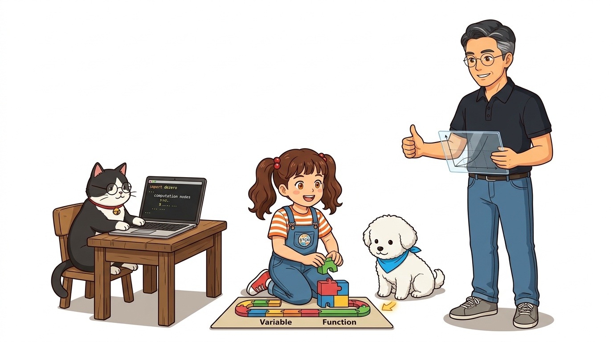

# 제1고지: 미분 자동 계산

> *"무(Zero)에서 시작하여 자동 미분의 엔진을 완성하다"*

**제1고지**에서는 딥러닝 프레임워크의 가장 핵심적인 심장인 **자동 미분(Automatic Differentiation)** 시스템을 밑바닥부터 직접 만듭니다.  
단 3줄의 파이썬 코드로 데이터를 담는 상자(`Variable`)를 정의하는 것에서 출발하여, 연산을 수행하는 함수(`Function`), 계산 그래프(DAG)의 동적 연결, 그리고 연쇄 법칙(Chain Rule)에 기반한 **오차역전파법(Backpropagation)의 자동화**와 자동 단위 테스트까지 단계별로 정복합니다.

**그림 01-Intro** 단 3줄의 Variable 클래스에서 출발하여 계산 그래프와 자동 역전파(Backpropagation) 엔진을 완성하는 여정 (이호진 교수와 도로시 탐험대)

---

## 🎯 학습 목표

이 단원을 학습하고 나면 제1고지 미분 자동 계산에 포함된 다음 핵심 내용을 명확히 이해하고 구현할 수 있습니다:

1. **1단계 상자로서의 변수**의 원리와 구현 방식을 이해하고 실전에 적용할 수 있다.
2. **2단계 변수를 낳는 함수**의 원리와 구현 방식을 이해하고 실전에 적용할 수 있다.
3. **3단계 함수 연결**의 원리와 구현 방식을 이해하고 실전에 적용할 수 있다.
4. **4단계 수치 미분**의 원리와 구현 방식을 이해하고 실전에 적용할 수 있다.
5. **5단계 역전파 이론**의 원리와 구현 방식을 이해하고 실전에 적용할 수 있다.

---

## 📚 학습 목차

- **[1단계 상자로서의 변수](./1_1_상자로서의_변수/index.html)**
  - 상자로서의 변수 첫 번째 단계에서는 DeZero의 구성 요소인 '변수'를 만듭니다. 변수는 DeZero에서 가장 중요한 개념입니다. 이번 단계에서는 변수가 어떤 기능을 하는지 이해하고, 그 기능에 맞게 코드로 구현합니다. 1.1 변수란 본론으로 들어가...
- **[2단계 변수를 낳는 함수](./1_2_변수를_낳는_함수/index.html)**
  - 변수를 낳는 함수 앞 단계에서 Variable 클래스를 상자로 사용할 수 있게 했습니다. 하지만 지금 이대로는 그냥 상자일뿐입니다. 우리에겐 단순한 상자를 마법의 상자로 바꾸는 장치가 필요한데, 그 열쇠는 바로 '함수'입니다. 이번 단계에서는 함수에...
- **[3단계 함수 연결](./1_3_함수_연결/index.html)**
  - 함수 연결 지금까지 DeZero의 '변수'와 '함수'를 만들어봤습니다. 그리고 2단계에서는 Square라는 제곱 계산용 함수 클래스를 구현했습니다. 이번 단계에서는 또 다른 함수를 구현하고 여러 함수를 조합해 계산할 수 있도록 하겠습니다. 3.1 Ex...
- **[4단계 수치 미분](./1_4_수치_미분/index.html)**
  - 수치 미분 지금까지 Variable 클래스와 Function 클래스를 구현했습니다. 이 클래스들을 구현한 이유는 미분을 자동으로 계산하기 위해서입니다. 본격적인 구현에 앞서 이번 단계에서는 미분이 무엇인지 복습하고 수치 미분이라는 간단한 방법으로 미분...
- **[5단계 역전파 이론](./1_5_역전파_이론/index.html)**
  - 역전파 이론 우리는 수치 미분을 이용해 미분을 계산할 수 있게 되었지만 수치 미분은 계산 비용과 정확도 면에서 문제가 있습니다. 지금이 바로 역전파backpropagation, 오차역전파법가 구세주로 등장할 시점입니다! 역전파를 이...
- **[6단계 수동 역전파](./1_6_수동_역전파/index.html)**
  - 수동 역전파 이전 단계에서 역전파의 구동 원리를 설명했습니다. 이번 단계에서는 Variable과 Function 클래스를 확장하여 역전파를 이용한 미분을 구현하겠습니다. Variable 클래스부터 살펴보죠. 6.1 Variable 클래스 추가 구현 역...
- **[7단계 역전파 자동화](./1_7_역전파_자동화/index.html)**
  - 역전파 자동화 이전 단계에서 역전파를 동작시키는 데 성공했습니다. 그러나 역전파 계산 코드를 수동으로 조합해야 했습니다. 새로운 계산을 할 때마다 역전파 코드를 직접 작성해야 한다는 뜻이죠. [그림 7-1]처럼 계산 그래프가 여러 개라면 각각의 계산에...
- **[8단계 재귀에서 반복문으로](./1_8_재귀에서_반복문으로/index.html)**
  - 재귀에서 반복문으로 앞 단계에서는 Variable 클래스에 `backward` 메서드를 추가했습니다. 이번에는 처리 효율을 개선하고 앞으로의 확장을 대비해 `backward` 메서드의 구현 방식을 바꿔보겠습니다. 8.1 현재의 Variable 클래스...
- **[9단계 함수를 더 편리하게](./1_9_함수를_더_편리하게/index.html)**
  - 함수를 더 편리하게 DeZero가 역전파를 해낼 수 있게 되었습니다. 또한 Define-by-Run이라고 하는 전체 계산의 각 조각들을 런타임에 '연결'해내는 능력도 갖췄습니다. 하지만 사용하기에 조금 불편한 부분이 있어서 이번 단계에서는 DeZero...
- **[10단계 테스트](./1_10_테스트/index.html)**
  - 테스트 소프트웨어 개발에서는 테스트를 빼놓을 수 없습니다. 테스트를 해야 실수(버그)를 예방할 수 있으며 테스트를 자동화해야 소프트웨어의 품질을 유지할 수 있습니다. DeZero도 마찬가지입니다. 그래서 이번 단계에서는 테스트 방법, 특히 딥러닝 프레...
- **[칼럼 자동 미분](./1_11_칼럼_자동_미분/index.html)**
  - 딥러닝 프레임워크의 중심에는 역전파가 있습니다. 역전파를 문헌에 따라 '자동 미분'이라고 부르기도 합니다. 하지만 '자동 미분'이라는 용어는 (특히 학술 분야에서는) 더 제한적인 방법을 뜻하므로 주의해야 합니다. 이번 칼럼에서는 자동 미분에 대해 한...

---

## 💡 학습 정리

1. **1단계 상자로서의 변수**: 상자로서의 변수 첫 번째 단계에서는 DeZero의 구성 요소인 '변수'를 만듭니다. 변수는 DeZero에서 가장 중요한 개념입니다. 이번 단계에서는 변수가 어떤 기능을 하는지 이해하고, 그 기능에 맞게 코드로 구현합니다. 1.1 변수란 본론으로 들어가...
2. **2단계 변수를 낳는 함수**: 변수를 낳는 함수 앞 단계에서 Variable 클래스를 상자로 사용할 수 있게 했습니다. 하지만 지금 이대로는 그냥 상자일뿐입니다. 우리에겐 단순한 상자를 마법의 상자로 바꾸는 장치가 필요한데, 그 열쇠는 바로 '함수'입니다. 이번 단계에서는 함수에...
3. **3단계 함수 연결**: 함수 연결 지금까지 DeZero의 '변수'와 '함수'를 만들어봤습니다. 그리고 2단계에서는 Square라는 제곱 계산용 함수 클래스를 구현했습니다. 이번 단계에서는 또 다른 함수를 구현하고 여러 함수를 조합해 계산할 수 있도록 하겠습니다. 3.1 Ex...
4. **4단계 수치 미분**: 수치 미분 지금까지 Variable 클래스와 Function 클래스를 구현했습니다. 이 클래스들을 구현한 이유는 미분을 자동으로 계산하기 위해서입니다. 본격적인 구현에 앞서 이번 단계에서는 미분이 무엇인지 복습하고 수치 미분이라는 간단한 방법으로 미분...
5. **5단계 역전파 이론**: 역전파 이론 우리는 수치 미분을 이용해 미분을 계산할 수 있게 되었지만 수치 미분은 계산 비용과 정확도 면에서 문제가 있습니다. 지금이 바로 역전파backpropagation, 오차역전파법가 구세주로 등장할 시점입니다! 역전파를 이...
6. **6단계 수동 역전파**: 수동 역전파 이전 단계에서 역전파의 구동 원리를 설명했습니다. 이번 단계에서는 Variable과 Function 클래스를 확장하여 역전파를 이용한 미분을 구현하겠습니다. Variable 클래스부터 살펴보죠. 6.1 Variable 클래스 추가 구현 역...
