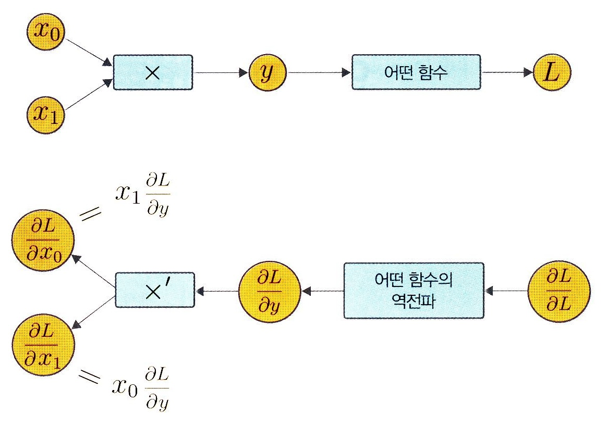
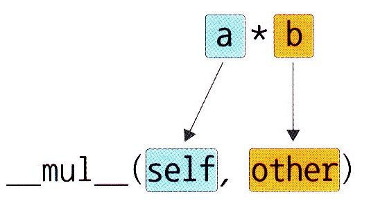

# 20단계 연산자 오버로드(1)

이전 단계부터 `Variable`을 '투명한 상자'로 만드는 작업을 시작했지만 아직 $+$ 와 $*$ 같은 연산자에 대응하는 작업이 남아 있습니다. 예컨대 `Variable` 인스턴스 `a`와 `b`가 있을 때 `y = a * b`처럼 코딩할 수 있으면 아주 유용한데, 이렇게 확장하는 것이 이번 단계의 목표입니다.

> **NOTE**  
> 궁극적인 목표는 `Variable` 인스턴스를 `ndarray` 인스턴스처럼 '보이게' 만드는 것입니다. 이렇게 하면 DeZero를 평범한 넘파이 코드를 작성하듯 사용할 수 있어서 넘파이를 사용해본 사람들이 아주 쉽게 배울 수 있습니다.

이제부터 $+$ 와 $*$ 연산자를 지원하도록 `Variable`을 확장할 것입니다. 그 첫 번째로 곱셈을 수행하는 함수를 구현하려 합니다(덧셈은 11단계에서 구현했습니다). 자, 함께 곱셈을 수행하는 클래스 `Mul`을 구현해봅시다(`Mul`은 Multiply의 약자입니다).

---

## 20.1 Mul 클래스 구현

곱셈의 미분은 $y = x_0 \times x_1$ 일 때 $\frac{\partial y}{\partial x_0} = x_1$, $\frac{\partial y}{\partial x_1} = x_0$ 가 됩니다. 따라서 역전파는 [그림 20-1]처럼 이루어집니다.

그림 20-1 곱셈의 순전파(위)와 역전파(아래)


[그림 20-1]에서 보듯 역전파는 최종 출력인 $L$ 의 미분을, 정확하게는 $L$ 의 각 변수에 대한 미분을 전파합니다. 이때 변수 $x_0$ 와 $x_1$ 에 대한 미분은 각각 $\frac{\partial L}{\partial x_0} = x_1 \frac{\partial L}{\partial y}$ 과 $\frac{\partial L}{\partial x_1} = x_0 \frac{\partial L}{\partial y}$ 입니다.

> **CAUTION**  
> 우리는 스칼라를 출력하는 합성 함수에 관심이 있습니다. 그래서 [그림 20-1]에서는 마지막에 $L$ 이라는 스칼라를 출력하는 합성 함수를 가정했습니다. 여기서 $L$ 은 오차, 다른 말로 손실<sup>loss</sup>을 뜻합니다.

그럼 `Mul` 클래스의 코드부터 보죠. [그림 20-1]을 참고하여 다음과 같이 구현할 수 있습니다.

**steps/step20.py**
```python
class Mul(Function):
    def forward(self, x0, x1):
        y = x0 * x1
        return y

    def backward(self, gy):
        x0, x1 = self.inputs[0].data, self.inputs[1].data
        return gy * x1, gy * x0
```

이어서 `Mul` 클래스를 파이썬 함수로 사용할 수 있도록 해줍니다. 코드는 다음과 같습니다.

**steps/step20.py**
```python
def mul(x0, x1):
    return Mul()(x0, x1)
```

이제 `mul` 함수를 사용하여 '곱셈'을 할 수 있습니다. 예를 들어 다음과 같은 코드를 작성할 수 있습니다.

```python
a = Variable(np.array(3.0))
b = Variable(np.array(2.0))
c = Variable(np.array(1.0))

y = add(mul(a, b), c)
y.backward()

print(y)
print(a.grad)
print(b.grad)
```

**실행 결과**
```
variable(7.0)
2.0
3.0
```

이와 같이 `add` 함수와 `mul` 함수를 함께 사용할 수 있게 됐습니다. 이때 미분도 자동으로 이루어집니다. 다만 매번 `y = add(mul(a, b), c)`처럼 코딩하기는 번거로울 것 같군요. 지금보다는 `y = a * b + c` 형태가 훨씬 깔끔하겠죠? 그래서 $+$ 와 $*$ 연산자를 사용할 수 있도록 `Variable`을 확장하려 합니다. 이를 위해 연산자 오버로드<sup>operator overload</sup>를 이용할 것입니다.

> **NOTE**  
> 연산자를 오버로드하면 $+$ 와 $*$ 같은 연산자 사용 시 사용자가 설정한 함수가 호출됩니다. 파이썬에서는 `__add__`와 `__mul__` 같은 특수 메서드를 정의함으로써 사용자 지정 함수가 호출되도록 합니다.

---

## 20.2 연산자 오버로드

먼저 곱셈 연산자 $*$ 를 오버로드하겠습니다. 곱셈의 특수 메서드는 `__mul__(self, other)`입니다(인수 `self`와 `other`에 대해서는 조금 뒤에 설명합니다). `__mul__` 메서드를 정의(구현)하면 $*$ 연산자를 사용할 때 `__mul__` 메서드가 호출됩니다. 시험 삼아 `Variable` 클래스의 `__mul__` 메서드를 다음과 같이 구현해보겠습니다.

```python
class Variable:
    ...

    def __mul__(self, other):
        return mul(self, other)
```

지금까지 구현한 `Variable` 클래스에 이 `__mul__` 메서드를 추가합니다. 이제부터 $*$ 를 사용하면 `__mul__` 메서드가 대신 불리고, 다시 그 안의 `mul` 함수가 불리게 됩니다. 시험해볼까요?

```python
a = Variable(np.array(3.0))
b = Variable(np.array(2.0))
y = a * b
print(y)
```

**실행 결과**
```
variable(6.0)
```

보다시피 `y = a * b`라는 코드를 문제없이 실행할 수 있습니다. `a * b`가 실행될 때 인스턴스 `a`의 `__mul__(self, other)` 메서드가 호출됩니다. 이때 [그림 20-2]와 같이 연산자 $*$ 왼쪽의 `a`가 인수 `self`에 전달되고, 오른쪽의 `b`가 `other`에 전달됩니다.

그림 20-2 `__mul__` 메서드로 인수가 전달되는 방식


> **CAUTION**  
> 앞의 예에서 `a * b`가 실행되면 먼저 인스턴스 `a`의 특수 메서드인 `__mul__`이 호출됩니다. 그런데 만약 `a`에 `__mul__` 메서드가 구현되어 있지 않으면 인스턴스 `b`의 $*$ 연산자 특수 메서드가 호출됩니다. 이 경우 `b`는 $*$ 연산자의 오른쪽에 위치하기 때문에 `__mul__`이 아닌 `__rmul__`이라는 특수 메서드가 호출됩니다(메서드 이름 앞에 오른쪽<sup>right</sup>을 뜻하는 'r'이 붙어 있습니다).

이상으로 $*$ 연산자를 오버로드해봤습니다. 정확히는 `Variable` 클래스의 `__mul__` 메서드를 구현했습니다. 그런데 이와 똑같은 작업을 다음 코드처럼 간단히 처리하는 방법도 있습니다.

**steps/step20.py**
```python
class Variable:
    ...

Variable.__mul__ = mul
Variable.__add__ = add
```

`Variable` 클래스를 정의한 후 `Variable.__mul__ = mul`이라고 작성하면 끝! 파이썬에서는 함수도 객체이므로 이와 같이 함수 자체를 할당할 수 있습니다. 이렇게 하면 `Variable` 인스턴스의 `__mul__` 메서드를 호출할 때 `mul` 함수가 불립니다.

앞의 코드에서 $+$ 연산자의 특수 메서드인 `__add__`도 설정했습니다. $+$ 연산자도 함께 오버로드한 것이죠. 그럼 $+$ 와 $*$ 를 모두 사용하여 계산을 해보겠습니다.

**steps/step20.py**
```python
a = Variable(np.array(3.0))
b = Variable(np.array(2.0))
c = Variable(np.array(1.0))

# y = add(mul(a, b), c)
y = a * b + c
y.backward()

print(y)
print(a.grad)
print(b.grad)
```

**실행 결과**
```
variable(7.0)
2.0
3.0
```

보다시피 `y = a * b + c` 형태로 코딩하는 게 가능해졌습니다. 계산 시 $+$ 와 $*$ 를 자유롭게 사용할 수 있게 된 것이죠. $/$ 와 $-$ 같은 다른 연산자도 같은 방식으로 구현할 수 있습니다. 그럼 다음 단계에서도 계속 연산자 오버로드를 살펴보겠습니다.
