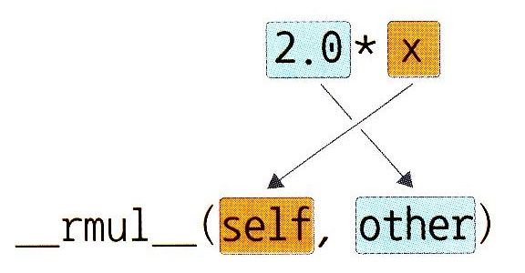

# 21단계 연산자 오버로드(2)

DeZero가 점점 편리해지고 있습니다. 이제 우리는 `Variable` 인스턴스 `a`와 `b`가 있을 때 `a * b` 혹은 `a + b` 같은 코드도 작성할 수 있지요. 하지만 안타깝게도 `a * np.array(2.0)`처럼 `ndarray` 인스턴스와 함께 사용할 수는 없습니다. `3 + b`처럼 수치 데이터도 함께 사용할 수 없습니다. `ndarray` 인스턴스와 수치 데이터와도 함께 사용할 수 있게 되면 DeZero가 더욱 편리할 텐데 말이죠. 그래서 이번 단계에서는 `Variable` 인스턴스와 `ndarray` 인스턴스, 심지어 `int`나 `float` 등도 함께 사용할 수 있도록 해보겠습니다.

---

## 21.1 ndarray와 함께 사용하기

우선 `Variable`을 `ndarray` 인스턴스와 함께 사용할 수 있게 하겠습니다. 전략은 간단합니다. 예를 들어 `a`가 `Variable` 인스턴스일 때 `a * np.array(2.0)`이라는 코드를 만나면 `ndarray` 인스턴스를 자동으로 `Variable` 인스턴스로 변환하는 것입니다. 즉, `Variable(np.array(2.0))`으로 변환해버리면 그다음 계산은 지금까지와 같습니다.

이를 위한 사전 준비로 `as_variable`이라는 편의 함수를 준비합니다. 인수로 주어진 객체를 `Variable` 인스턴스로 변환해주는 함수입니다. 구현은 다음과 같습니다.

**steps/step21.py**
```python
def as_variable(obj):
    if isinstance(obj, Variable):
        return obj
    return Variable(obj)
```

이 함수는 인수 `obj`가 `Variable` 인스턴스 또는 `ndarray` 인스턴스라고 가정합니다. `obj`가 `Variable` 인스턴스면 아무것도 손보지 않고 그대로 반환하고, 그렇지 않으면 `Variable` 인스턴스로 변환하여 반환합니다.

그럼 `Function` 클래스의 `__call__` 메서드가 `as_variable` 함수를 이용하도록 다음 음영 부분의 코드를 추가합니다.

**steps/step21.py**
```python
class Function:
    def __call__(self, *inputs):
        inputs = [as_variable(x) for x in inputs]

        xs = [x.data for x in inputs]
        ys = self.forward(*xs)
        ...
```

이와 같이 인수 `inputs`에 담긴 각각의 원소 `x`를 `Variable` 인스턴스로 변환합니다. 따라서 `ndarray` 인스턴스가 주어지면 `Variable` 인스턴스로 변환됩니다. 그러면 이후의 처리는 모든 변수가 `Variable` 인스턴스인 상태로 진행됩니다.

> **NOTE**  
> DeZero에서 사용하는 모든 함수(연산)는 `Function` 클래스를 상속하므로 실제 연산은 `Function` 클래스의 `__call__` 메서드에서 이루어집니다. 따라서 이 `__call__` 메서드에 가한 수정은 DeZero에서 사용하는 모든 함수에 적용됩니다.

그러면 새로운 DeZero를 사용하여 계산을 해봅시다.

**steps/step21.py**
```python
x = Variable(np.array(2.0))
y = x + np.array(3.0)
print(y)
```

**실행 결과**
```
variable(5.0)
```

`y = x + np.array(3.0)`이라는 코드를 실행했고, 출력을 보면 제대로 작동함을 알 수 있습니다. `ndarray` 인스턴스가 `Variable` 인스턴스로 자동 변환된 결과죠. 이렇게 `ndarray`와 `Variable`을 함께 사용할 수 있게 되었습니다.

---

## 21.2 float, int와 함께 사용하기

이어서 파이썬의 `float`와 `int`, 그리고 `np.float64`와 `np.int64` 같은 타입과도 함께 사용할 수 있도록 하겠습니다. `x`가 `Variable` 인스턴스일 때 `x + 3.0` 같은 코드를 실행할 수 있도록 하려면 어떻게 해야 할까요? 한 가지 방법으로 `add` 함수에 다음의 음영 부분의 코드를 추가하는 방법이 떠오르는군요.

**steps/step21.py**
```python
def add(x0, x1):
    x1 = as_array(x1)
    return Add()(x0, x1)
```

여기에서는 `as_array` 함수를 사용했습니다. 9단계에서 구현한 함수죠. `as_array`를 사용하면 `x1`이 `float`나 `int`인 경우 `ndarray` 인스턴스로 변환됩니다. 그리고 `ndarray` 인스턴스는 (이후에) `Function` 클래스에서 `Variable` 인스턴스로 변환됩니다. 이것으로 다음과 같은 코드를 작성할 수 있게 됐습니다.

**steps/step21.py**
```python
x = Variable(np.array(2.0))
y = x + 3.0
print(y)
```

**실행 결과**
```
variable(5.0)
```

이와 같이 `float`와 `Variable` 인스턴스를 조합한 계산이 가능해졌습니다. 여기서는 `add` 함수만 대표로 수정해봤지만, `mul`과 같은 다른 함수들도 같은 방식으로 수정할 수 있습니다. 다 수정하고 나면 $+$ 나 $*$ 로 `Variable` 인스턴스, `float`, `int`를 조합하여 계산할 수 있습니다. 그런데 실은 지금의 방식에는 두 가지 문제가 남아 있습니다.

---

## 21.3 문제점 1: 첫 번째 인수가 float나 int인 경우

현재의 DeZero는 `x * 2.0`이라는 코드를 제대로 실행할 수 있습니다(`x`는 `Variable` 인스턴스). 하지만 `2.0 * x`를 실행하면 오류가 납니다. 어떤 오류가 나는지 볼까요?

```python
y = 2.0 * x
```

**실행 결과**
```
TypeError: unsupported operand type(s) for *: 'float' and 'Variable'
```

원인은 `2.0 * x`를 실행했을 때 오류가 발생하는 과정을 보면 알 수 있습니다. `2.0 * x`는 다음 순서로 처리됩니다.

1. 연산자 왼쪽에 있는 2.0의 `__mul__` 메서드를 호출하려 시도한다.
2. 하지만 2.0은 `float` 타입이므로 `__mul__` 메서드는 구현되어 있지 않다.
3. 다음은 $*$ 연산자 오른쪽에 있는 `x`의 특수 메서드를 호출하려 시도한다.
4. `x`가 오른쪽에 있기 때문에 (`__mul__` 대신) `__rmul__` 메서드를 호출하려 시도한다.
5. 하지만 `Variable` 인스턴스에는 `__rmul__` 메서드가 구현되어 있지 않다.

이상이 오류 발생 과정입니다. 핵심은 $*$ 같은 이항 연산자의 경우 피연산자(항)의 위치에 따라 호출되는 특수 메서드가 다르다는 것입니다. 곱셈의 경우 피연산자가 좌항이면 `__mul__` 메서드가 호출되고, 우항이면 `__rmul__` 메서드가 호출됩니다.

따라서 이번 문제는 `__rmul__` 메서드를 구현하면 해결됩니다. 이때 `__rmul__` 메서드의 인수는 [그림 21-1]처럼 전달됩니다.

그림 21-1 `__rmul__` 메서드로 인수가 전달되는 방식


[그림 21-1]과 같이 `__rmul__(self, other)`의 인수 중 `self`는 자신인 `x`에 대응하고, `other`는 다른 쪽 항인 2.0에 대응합니다. 그런데 곱셈에서는 좌항과 우항을 바꿔도 결과가 같기 때문에 둘을 구별할 필요가 없습니다($2.0 \times x$ 와 $x \times 2.0$ 의 결과가 똑같죠). 덧셈도 마찬가지이므로 $+$ 와 $*$ 의 특수 메서드는 다음처럼 설정하면 됩니다.

**steps/step21.py**
```python
Variable.__add__ = add
Variable.__radd__ = add
Variable.__mul__ = mul
Variable.__rmul__ = mul
```

이제 `float`와 `int`를 자유롭게 조합하여 계산할 수 있습니다. 연습 삼아 실제로 해보죠.

**steps/step21.py**
```python
x = Variable(np.array(2.0))
y = 3.0 * x + 1.0
print(y)
```

**실행 결과**
```
variable(7.0)
```

이제 `Variable` 인스턴스와 `float`, `int`를 함께 사용할 수 있습니다. 이어서 나머지 문제 하나를 마저 해결해보죠.

---

## 21.4 문제점 2: 좌항이 ndarray 인스턴스인 경우

남은 문제는 `ndarray` 인스턴스가 좌항이고 `Variable` 인스턴스가 우항인 경우입니다. 예를 들어 다음과 같은 코드입니다.

```python
x = Variable(np.array([1.0]))
y = np.array([2.0]) + x
```

이 예에서 좌항은 `ndarray` 인스턴스이고 우항은 `Variable` 인스턴스입니다. 이렇게 되면 좌항인 `ndarray` 인스턴스의 `__add__` 메서드가 호출됩니다. 하지만 우리는 우항인 `Variable` 인스턴스의 `__radd__` 메서드가 호출되길 원합니다. 그러려면 '연산자 우선순위'를 지정해야 합니다. 구체적으로는 `Variable` 인스턴스의 속성에 `__array_priority__`를 추가하고 그 값을 큰 정수로 설정해야 합니다. 다음처럼 말이죠.

```python
class Variable:
    __array_priority__ = 200
    ...
```

이렇게 하면 `Variable` 인스턴스의 연산자 우선순위를 `ndarray` 인스턴스의 연산자 우선순위보다 높일 수 있습니다. 그 결과 좌항이 `ndarray` 인스턴스라 해도 우항인 `Variable` 인스턴스의 연산자 메서드가 우선적으로 호출됩니다.

이상이 연산자 오버로드 시 조심해야 할 핵심입니다. 마침내 DeZero는 $*$ 와 $+$ 연산자를 서로 다른 타입과 섞어 사용할 수 있게 되었습니다. 이어서 다음 단계에서는 $/$ 와 $-$ 같은 다른 연산자를 추가하겠습니다.
