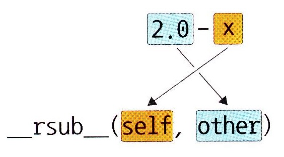

# 22단계 연산자 오버로드(3)

이전 단계에서는 DeZero가 $*$ 와 $+$ 연산자를 지원하도록 확장했는데, 연산자는 이밖에도 많습니다. 그래서 이번 단계에서는 [표 22-1]의 연산자들을 새로 추가하겠습니다.

**표 22-1 이번 단계에서 추가할 연산자들**

| 특수 메서드 | 예 |
| :--- | :--- |
| `__neg__(self)` | `-self` |
| `__sub__(self, other)` | `self - other` |
| `__rsub__(self, other)` | `other - self` |
| `__truediv__(self, other)` | `self / other` |
| `__rtruediv__(self, other)` | `other / self` |
| `__pow__(self, other)` | `self ** other` |

[표 22-1]의 첫 번째 메서드인 `__neg__(self)`는 양수를 음수로, 혹은 음수를 양수로 바꿔주는 부호 변환 연산자입니다. 또한 다른 연산자들과 달리 항이 하나뿐인 '단항 연산자'입니다. 그래서 특수 메서드의 인수도 하나뿐이죠. 나머지 연산자들은 차례로 뺄셈, 나눗셈, 거듭제곱으로, 모두 이항 연산자입니다($a - b$, $a / b$ 등). 따라서 적용 대상이 우항이냐 좌항이냐에 따라 2개의 특수 메서드 중 하나가 선별되어 호출됩니다. 단, 거듭제곱은 `x ** 3`처럼 좌항이 `Variable` 인스턴스이고 우항이 상수(2, 3 등의 `int`)인 경우만을 고려하겠습니다.

> **CAUTION**  
> 파이썬 연산자는 [표 22-1] 외에도 몇 가지가 더 있습니다. 예를 들어 `a // b`와 `a % b` 같은 연산자도 있고, `a += 1`과 `a -= 2` 같은 대입 연산자도 있습니다. 이 교제에서는 자주 사용하는 연산자만 선별하여 구현할 테니, 다른 연산자는 독자 여러분이 필요하면 추가하기 바랍니다. 한 가지 더, 이번 단계는 단조로운 작업이기 때문에 생략해도 무방합니다.

그러면 작업을 시작해볼까요? 우선 복습도 할 겸 새로운 연산자를 추가하는 순서를 살펴보죠.

1. `Function` 클래스를 상속하여 원하는 함수 클래스를 구현합니다(예: `Mul` 클래스).
2. 파이썬 함수로 사용할 수 있도록 합니다(예: `mul` 함수).
3. `Variable` 클래스의 연산자를 오버로드합니다(예: `Variable.__mul__ = mul`).

이번 단계에서도 똑같은 과정을 거쳐 새로운 연산자들을 추가할 것입니다. '부호 변환'부터 시작해보죠.

---

## 22.1 음수(부호 변환)

음수의 미분은 $y = -x$ 일 때 $\frac{dy}{dx} = -1$ 입니다. 따라서 역전파는 상류(출력 쪽)에서 전해지는 미분에 $-1$ 을 곱하여 하류로 흘려보내 주면 됩니다. 그러면 다음과 같이 구현할 수 있습니다.

**steps/step22.py**
```python
class Neg(Function):
    def forward(self, x):
        return -x

    def backward(self, gy):
        return -gy

def neg(x):
    return Neg()(x)

Variable.__neg__ = neg
```

이와 같이 `Neg` 클래스를 구현한 다음, 파이썬 함수로 사용할 수 있도록 `neg` 함수도 구현합니다. 그리고 특수 메서드인 `__neg__`에 `neg`를 대입하면 완성입니다. 이제 다음 코드를 실행할 수 있습니다.

**steps/step22.py**
```python
x = Variable(np.array(2.0))
y = -x  # 부호를 바꾼다.
print(y)
```

**실행 결과**
```
variable(-2.0)
```

다음은 '뺄셈' 차례입니다.

---

## 22.2 뺄셈

뺄셈의 미분은 $y = x_0 - x_1$ 일 때 $\frac{\partial y}{\partial x_0} = 1$, $\frac{\partial y}{\partial x_1} = -1$ 입니다. 따라서 역전파는 상류에서 전해지는 미분값에 1을 곱한 값이 $x_0$ 의 미분 결과가 되며, $-1$ 을 곱한 값이 $x_1$ 의 미분 결과가 됩니다. 코드로는 다음처럼 구현할 수 있습니다.

**steps/step22.py**
```python
class Sub(Function):
    def forward(self, x0, x1):
        y = x0 - x1
        return y

    def backward(self, gy):
        return gy, -gy

def sub(x0, x1):
    x1 = as_array(x1)
    return Sub()(x0, x1)

Variable.__sub__ = sub
```

이제 $x_0$ 와 $x_1$ 이 `Variable` 인스턴스라면 `y = x0 - x1` 계산을 수행할 수 있습니다. 그러나 $x_0$ 가 `Variable` 인스턴스가 아닌 경우, 예컨대 `y = 2.0 - x` 같은 코드는 제대로 처리할 수 없습니다. `x`의 `__rsub__` 메서드가 호출되어 인수가 [그림 22-1] 형태로 전달되기 때문이죠.

그림 22-1 `__rsub__` 메서드로 인수가 전달되는 방식


[그림 22-1]과 같이 `__rsub__(self, other)`가 호출될 때는 우항인 `x`가 인수 `self`에 전달됩니다. 따라서 다음처럼 구현해야 합니다.

**steps/step22.py**
```python
def rsub(x0, x1):
    x1 = as_array(x1)
    return Sub()(x1, x0)  # x0와 x1의 순서를 바꾼다.

Variable.__rsub__ = rsub
```

보다시피 함수 `rsub(x0, x1)`을 정의하고 인수의 순서를 바꿔서 `Sub()(x1, x0)`를 호출하게 합니다. 그런 다음 특수 메서드인 `__rsub__` 에 함수 `rsub`를 할당합니다.

> **CAUTION**  
> 덧셈과 곱셈은 좌항과 우항의 순서를 바꿔도 결과가 같기 때문에 둘을 구별할 필요가 없었습니다. 하지만 뺄셈에서는 좌우를 구별해야 합니다($x_0 - x_1$ 과 $x_1 - x_0$ 의 값은 다릅니다). 따라서 우항을 대상으로 했을 때 적용할 함수인 `rsub(x0, x1)`을 별도로 준비해야 합니다.

이상으로 뺄셈도 할 수 있게 되었습니다. 이제 다음 코드가 잘 작동합니다.

**steps/step22.py**
```python
x = Variable(np.array(2.0))
y1 = 2.0 - x
y2 = x - 1.0
print(y1)
print(y2)
```

**실행 결과**
```
variable(0.0)
variable(1.0)
```

다음은 '나눗셈'입니다.

---

## 22.3 나눗셈

나눗셈의 미분은 $y = x_0 / x_1$ 일 때 $\frac{\partial y}{\partial x_0} = 1 / x_1$, $\frac{\partial y}{\partial x_1} = -x_0 / x_1^2$ 입니다. 코드로는 다음처럼 구현할 수 있습니다.

**steps/step22.py**
```python
class Div(Function):
    def forward(self, x0, x1):
        y = x0 / x1
        return y

    def backward(self, gy):
        x0, x1 = self.inputs[0].data, self.inputs[1].data
        gx0 = gy / x1
        gx1 = gy * (-x0 / x1 ** 2)
        return gx0, gx1

def div(x0, x1):
    x1 = as_array(x1)
    return Div()(x0, x1)

def rdiv(x0, x1):
    x1 = as_array(x1)
    return Div()(x1, x0)  # x0와 x1의 순서를 바꾼다.

Variable.__truediv__ = div
Variable.__rtruediv__ = rdiv
```

나눗셈도 뺄셈과 마찬가지로 좌/우항 중 어느 것에 적용할지에 따라 적용되는 함수가 다릅니다. 그 외에는 특별히 어려운 점은 없을 것입니다.

그럼 마지막으로 '거듭제곱'을 살펴보겠습니다.

---

## 22.4 거듭제곱

거듭제곱은 $y = x^c$ 형태로 표현됩니다. 이때 $x$ 를 밑이라 하고 $c$ 를 지수라 합니다. 거듭제곱의 미분은 미분 공식으로부터 $\frac{\partial y}{\partial x} = cx^{c-1}$ 이 됩니다. $\frac{\partial y}{\partial c}$ 의 값도 구할 수는 있지만 실전에서는 거의 사용되지 않으니 이 교제에서는 밑이 $x$ 인 경우만 미분해보겠습니다. 즉, 지수 $c$ 는 상수로 취급하여 따로 미분을 계산하지 않기로 합니다. 다음은 이를 구현한 코드입니다.

**steps/step22.py**
```python
class Pow(Function):
    def __init__(self, c):
        self.c = c

    def forward(self, x):
        y = x ** self.c
        return y

    def backward(self, gy):
        x = self.inputs[0].data
        c = self.c
        gx = c * x ** (c - 1) * gy
        return gx

def pow(x, c):
    return Pow(c)(x)

Variable.__pow__ = pow
```

코드를 보면 `Pow` 클래스를 초기화할 때 지수 `c`를 제공할 수 있습니다. 그리고 순전파 메서드인 `forward(x)`는 밑에 해당하는 `x`만(즉, 하나의 항만) 받게 합니다. 그런 다음 특수 메서드인 `__pow__` 에 함수 `pow`를 할당합니다. 이제 `**` 연산자를 사용하여 거듭제곱을 계산할 수 있습니다. 한번 해볼까요?

**steps/step22.py**
```python
x = Variable(np.array(2.0))
y = x ** 3
print(y)
```

**실행 결과**
```
variable(8.0)
```

이상으로 목표한 연산자를 모두 추가했습니다. 이번 단계는 다소 단조로운 작업의 연속이었지만 그 덕분에 DeZero의 유용성은 크게 향상됐습니다. 사칙연산 연산자들을 자유롭게 계산에 활용할 수 있게 된 것이죠. 거듭제곱도 가능하기 때문에 제법 고급 계산까지 표현할 수 있답니다. 다음 단계에서는 지금까지의 성과를 파이썬 '패키지'로 정리한 다음 DeZero의 실력을 검증해보겠습니다.
