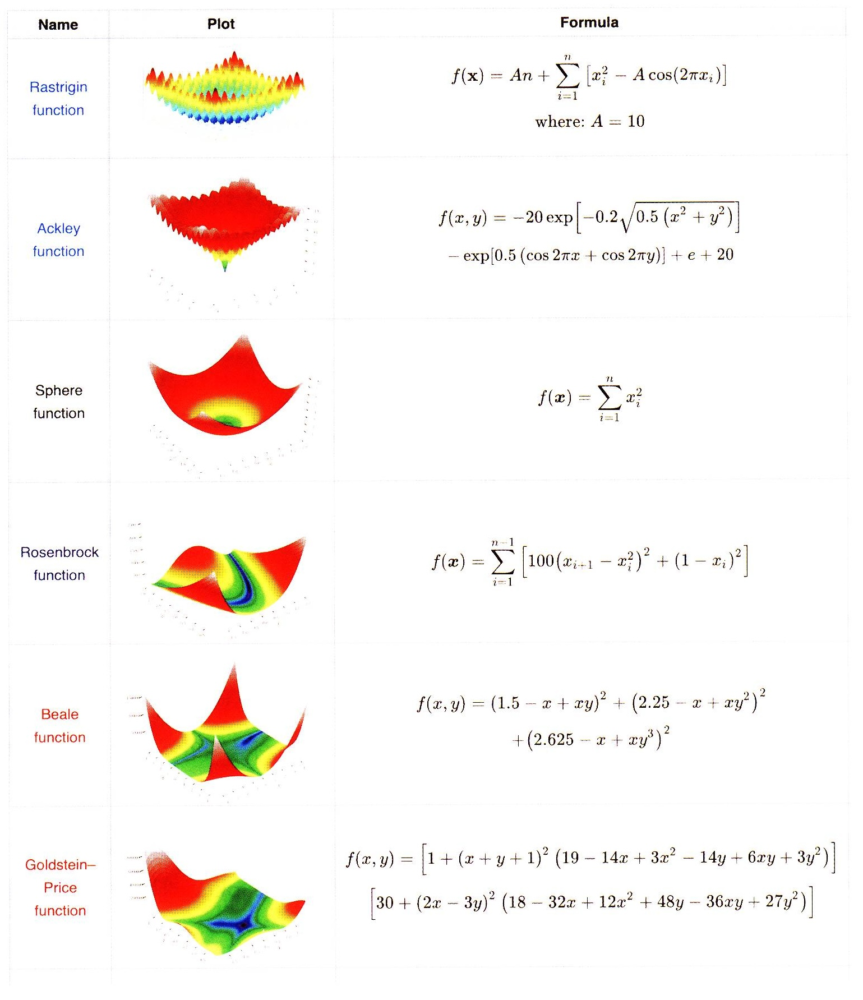

# 24단계 복잡한 함수의 미분

DeZero는 이제 대표적인 연산자들(+, \*, -, /, \*\*)을 지원합니다. 따라서 평소 파이썬 프로그래밍을 하듯 코딩할 수 있습니다. 이 혜택은 복잡한 수식을 코딩할 때 피부로 느껴질 것입니다. 그래서 이번 단계에서는 지금까지의 성과를 느낄 수 있는 복잡한 수식의 미분 몇 가지를 풀어보겠습니다.

이번 단계에서 다루는 함수들은 최적화 문제에서 자주 사용되는 테스트 함수입니다. 최적화 문제의 테스트 함수란 다양한 최적화 기법이 '얼마나 좋은가'를 평가하는 데 사용되는 함수를 뜻합니다. '벤치마크'용 함수라고 할 수 있겠네요. 테스트 함수에도 종류가 많은데, 위키백과의 'Test functions for optimization' 페이지<sup>[13]</sup>를 보면 대표적인 예를 확인할 수 있으며, [그림 24-1]과 같은 표로 정리되어 있습니다.

[그림 24-1]은 일부만 발췌한 것이며, 우리는 이 중 세 함수를 선택하여 실제로 미분해보려 합니다. 그러면 DeZero의 실력이 어느 정도인지 알 수 있겠죠. 우선 Sphere라는 간단한 함수에서 시작하겠습니다.

그림 24-1 최적화 문제에 사용되는 벤치마크 함수 목록(위키백과<sup>[13]</sup>에서 발췌)


| Name | Plot | Formula |
| --- | --- | --- |
| Rastrigin function | (생략) | $f(\mathbf{x}) = An + \sum_{i=1}^{n} [x_i^2 - A \cos(2\pi x_i)]$ <br> where: $A = 10$ |
| Ackley function | (생략) | $f(x, y) = -20 \exp\left[-0.2 \sqrt{0.5(x^2 + y^2)}\right] - \exp[0.5(\cos 2\pi x + \cos 2\pi y)] + e + 20$ |
| Sphere function | (생략) | $f(\mathbf{x}) = \sum_{i=1}^{n} x_i^2$ |
| Rosenbrock function | (생략) | $f(\mathbf{x}) = \sum_{i=1}^{n-1} \left[100(x_{i+1} - x_i^2)^2 + (1 - x_i)^2\right]$ |
| Beale function | (생략) | $f(x, y) = (1.5 - x + xy)^2 + (2.25 - x + xy^2)^2 + (2.625 - x + xy^3)^2$ |
| Goldstein–Price function | (생략) | $f(x, y) = \left[1 + (x + y + 1)^2 (19 - 14x + 3x^2 - 14y + 6xy + 3y^2)\right] \times \left[30 + (2x - 3y)^2 (18 - 32x + 12x^2 + 48y - 36xy + 27y^2)\right]$ |

---

## 24.1 Sphere 함수

Sphere 함수를 수식으로 표현하면 $z = x^2 + y^2$ 입니다. 단순히 두 개의 입력 변수를 제곱하

여 더하는 함수죠.\* 우리가 할 일은 그 미분($\frac{\partial z}{\partial x}$ 와 $\frac{\partial z}{\partial y}$)을 계산하는 것입니다. 이번 절에서는 $(x, y) = (1.0, 1.0)$ 인 경우를 미분해보겠습니다. 코드는 다음과 같습니다.

**steps/step24.py**
```python
import numpy as np
from dezero import Variable

def sphere(x, y):
    z = x ** 2 + y ** 2
    return z

x = Variable(np.array(1.0))
y = Variable(np.array(1.0))
z = sphere(x, y)
z.backward()
print(x.grad, y.grad)
```

**실행 결과**
```
2.0 2.0
```

코드에서 보듯 원하는 계산을 `z = x ** 2 + y ** 2`로 표현할 수 있습니다. 그리고 `x`와 `y`에 대한 미분 모두 2.0이라고 나옵니다. 수식으로 확인하면 $\frac{\partial z}{\partial x} = 2x$, $\frac{\partial z}{\partial y} = 2y$ 가 되므로 $(x, y) = (1.0, 1.0)$ 의 미분 결과는 $(2.0, 2.0)$ 입니다. 앞의 실행 결과와 일치하는군요.

---

## 24.2 matyas 함수

이어서 matyas 함수\*\*를 살펴보죠. 수식으로는 $z = 0.26(x^2 + y^2) - 0.48xy$ 이며, DeZero로는 다음처럼 구현할 수 있습니다.

**steps/step24.py**
```python
def matyas(x, y):
    z = 0.26 * (x ** 2 + y ** 2) - 0.48 * x * y
    return z
```

---
\* 옮긴이_ 예시로 사용한 함수는 차원이 $x, y, z$ 뿐인 3차원 공간에서의 Sphere 함수입니다. $n$ 차원으로 일반화한 Sphere 함수의 수식은 [그림 24-1]에도 나와 있듯이 $f(\mathbf{x}) = \sum_{i=1}^n x_i^2$ 입니다.
\*\* '마챠시'라고 읽습니다.

```python

x = Variable(np.array(1.0))
y = Variable(np.array(1.0))
z = matyas(x, y)
z.backward()
print(x.grad, y.grad)
```

**실행 결과**
```
0.040000000000000036 0.040000000000000036
```

이번에도 수식을 그대로 코드로 옮길 수 있었습니다. 사칙연산 연산자는 자유롭게 사용할 수 있으므로 손쉽게 해결됐습니다. 만약 이 연산자들을 사용할 수 없다면 `matyas` 함수를 다음과 같이 작성해야 합니다.

```python
def matyas(x, y):
    z = sub(mul(0.26, add(pow(x, 2), pow(y, 2))), mul(0.48, mul(x, y)))
    return z
```

사람에게는 읽기 어려운 코드죠. 이제 `+`와 `**` 같은 연산자를 사용할 수 있다는 게 얼마나 고마운 일인지 느껴질 것입니다. 이 연산자들 덕분에 타이핑 양도 줄이면서 일반 수식에 가까운 형태로 읽고 쓸 수 있는 것이죠. 그럼 마지막으로 Goldstein-Price 함수라는 복잡한 수식에 도전해봅시다.

---

## 24.3 Goldstein-Price 함수

Goldstein-Price 함수를 수식으로 표현하면 다음과 같습니다.

$$
f(x, y) = [1 + (x + y + 1)^2 (19 - 14x + 3x^2 - 14y + 6xy + 3y^2)] \times [30 + (2x - 3y)^2 (18 - 32x + 12x^2 + 48y - 36xy + 27y^2)]
$$

꽤 복잡해 보이지만 DeZero라면 어렵지 않게 표현할 수 있습니다. 직접 보시죠.

**steps/step24.py**
```python
def goldstein(x, y):
    z = (1 + (x + y + 1)**2 * (19 - 14*x + 3*x**2 - 14*y + 6*x*y + 3*y**2)) * \
        (30 + (2*x - 3*y)**2 * (18 - 32*x + 12*x**2 + 48*y - 36*x*y + 27*y**2))
    return z
```

수식과 비교해가며 코드로 옮기면 금방 끝날 것입니다. 반면 이 연산자들을 사용하지 않고 코딩하기란 보통 사람에게는 불가능할지 모릅니다. 그럼 Goldstein-Price 함수를 미분해볼까요?

**steps/step24.py**
```python
x = Variable(np.array(1.0))
y = Variable(np.array(1.0))
z = goldstein(x, y)
z.backward()
print(x.grad, y.grad)
```

**실행 결과**
```
-5376.0 8064.0
```

`x`에 대한 미분은 -5376.0이 나왔고, `y`에 대한 미분은 8064.0이 나왔습니다. 물론 올바른 결과입니다. 보다시피 DeZero는 Goldstein-Price 함수와 같은 복잡한 계산도 훌륭하게 미분할 수 있답니다! 또한 이 결과가 맞는지는 기울기 확인으로 검증할 수 있습니다. 이것으로 두 번째 고지도 무사히 정복했습니다.

$$
\star\star\star\star\star\star\star
$$

이번 제2고지에서 DeZero가 크게 성장했습니다. 고지 점령을 시작할 무렵의 DeZero는 간단한 계산밖에 할 수 없었지만 지금은 복잡한 계산도 가능하게 되었습니다(엄밀히 말하면 아무리 복잡하게 '연결'된 계산 그래프라도 올바르게 역전파할 수 있습니다). 또한 연산자를 오버로드한 덕에 보통의 파이썬 프로그래밍처럼 코드를 작성할 수 있습니다. 일반적인 파이썬 연산자를 이용해도 미분을 자동으로 계산할 수 있기 때문에 DeZero는 '일반적인 프로그래밍'을 '미분 가능'하게 만들었다고 표현할 수도 있습니다.

이제 DeZero의 기초는 충분히 닦았습니다. 다음 단계부터는 더 고급 계산도 처리할 수 있도록 DeZero를 확장해갈 것입니다.
