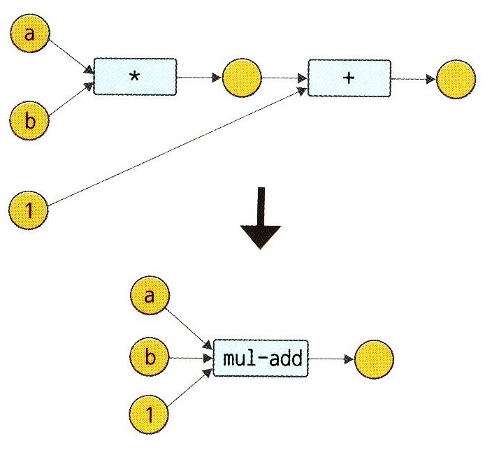

# 칼럼 Define-by-Run

딥러닝 프레임워크는 동작 방식에 따라 크게 두 가지로 나눌 수 있습니다. 하나는 '정적 계산 그래프' 혹은 'Define-and-Run' 방식이며, 다른 하나는 '동적 계산 그래프' 혹은 'Define-by-Run' 방식입니다. 이번 칼럼에서는 이 두 방식을 설명하며 장단점도 함께 알아보겠습니다.

#### Define-and-Run(정적 계산 그래프 방식)

Define-and-Run을 직역하면 '계산 그래프를 정의한 다음 데이터를 흘려보낸다'라는 뜻입니다. 계산 그래프 정의는 사용자가 제공하고, 프레임워크는 주어진 그래프를 컴퓨터가 처리할 수 있는 형태로 변환하여 데이터를 흘려보내는 식입니다. 이 흐름을 그림으로 표현하면 [그림 B-1]과 같습니다.

**그림 B-1 Define-and-Run 방식 프레임워크의 처리 흐름**

```text
[계산 그래프 정의] ──> [컴파일] ──> [데이터 흘려보내기]
```

[그림 B-1]에서 보듯 프레임워크는 계산 그래프의 정의를 변환합니다. 이 교제에서는 이 변환을 편의상 '컴파일'이라고 부르겠습니다. 컴파일에 의해 계산 그래프가 메모리상에 펼쳐지며, 실제 데이터를 흘려보낼 준비가 갖춰집니다. 여기서 중요한 점은 '계산 그래프 정의'와 '데이터 흘려보내기' 처리가 분리되어 있다는 것입니다. 다음 의사코드<sup>pseudocode</sup>를 보면 더 명확하게 이해될 것입니다.

```python
# 가상의 Define-and-Run 방식 프레임워크용 코드 예

# 계산 그래프 정의
a = Variable('a')
b = Variable('b')
c = a * b
d = c + Constant(1)
```

```python
# 계산 그래프 컴파일
f = compile(d)

# 데이터 흘려보내기
d = f(a=np.array(2), b=np.array(3))
```

주석을 제외한 첫 네 줄로 계산 그래프를 정의했습니다. 주의할 점은 이 네 줄의 코드에서는 실제 계산이 이루어지지 않는다는 사실입니다. 실제 '수치'가 아닌 '기호<sup>symbol</sup>'를 대상으로 프로그래밍됐기 때문입니다. 참고로 이런 프로그래밍 방식을 '기호 프로그래밍<sup>symbolic programming</sup>'이라고 합니다.

이와 같이 Define-and-Run 방식 프레임워크에서는 실제 데이터가 아닌 기호를 사용한 추상적인 계산 절차를 코딩해야 합니다. 그리고 도메인 특화 언어<sup>Domain-Specific Language (DSL)</sup>를 사용해야 하죠. 여기서 도메인 특화 언어란 프레임워크 자체의 규칙들로 이루어진 언어를 뜻합니다. 앞의 예에서는 '상수는 Constant에 담아라'라는 규칙을 따라야 합니다. 그 외에도, 예컨대 조건에 따라 분기하고 싶다면 if 문에 해당하는 특수 연산을 이용해야 합니다. 이것도 물론 도메인 특화 언어의 규칙입니다. 참고로 텐서플로에서는 if 문의 역할로 `tf.cond`라는 연산을 사용합니다. 다음은 실제 텐서플로 코드 예입니다.

```python
import tensorflow as tf

flg = tf.placeholder(dtype=tf.bool)
x0 = tf.placeholder(dtype=tf.float32)
x1 = tf.placeholder(dtype=tf.float32)
y = tf.cond(flg, lambda: x0+x1, lambda: x0*x1)
```

텐서플로는 이와 같이 데이터를 저장하는 플레이스홀더(`tf.placeholder`)로 이루어진 계산 그래프를 만듭니다. 마지막 줄에서는 `tf.cond`라는 연산을 사용하여 실행 시 `flg` 값에 따라 처리 방식을 달리합니다. `tf.cond` 연산이 파이썬의 if 문 역할을 해주는 것입니다.

> **NOTE**
> Define-and-Run 방식 프레임워크의 대부분은 도메인 특화 언어를 사용하여 계산을 정의합니다. 도메인 특화 언어는 한마디로 '파이썬 위에서 동작하는 새로운 프로그래밍 언어'라고 할 수 있

습니다(if 문이나 for 문 같은 흐름 제어용 명령이 따로 있다는 사실을 생각하면 '새로운 프로그래밍 언어'라고 불러도 이상하지 않을 것입니다). 그리고 미분을 하기 위해 설계된 언어이기도 합니다. 이러한 이유 때문에 최근에는 딥러닝 프레임워크를 일컬어 미분 가능 프로그래밍<sup>differentiable programming [14][15]</sup>이라고도 합니다.

이상이 Define-and-Run의 개요입니다. 딥러닝 여명기에는 Define-and-Run 방식 프레임워크가 대부분을 차지했습니다. 대표적으로 텐서플로, 카페, CNTK가 있죠(텐서플로는 2.0부터 Define-by-Run 방식도 도입했습니다). 그리고 다음 세대로 등장한 것이 우리 DeZero도 채용할 Define-by-Run입니다.

#### Define-by-Run(동적 계산 그래프 방식)

Define-by-Run이라는 용어는 '데이터를 흘려보냄으로써 계산 그래프가 정의된다'라는 뜻입니다. '데이터 흘려보내기'와 '계산 그래프 구축'이 동시에 이루어진다는 것이 특징입니다.

> **NOTE**
> DeZero의 경우 사용자가 데이터를 흘려보낼 때(일반적인 수치 계산을 수행할 때) 자동으로 계산 그래프를 구성하는 '연결(참조)'을 만듭니다. 이 연결이 바로 DeZero의 계산 그래프에 해당합니다. 구현 수준에서는 연결 리스트<sup>linked list</sup>로 표현되는데, 연결 리스트를 사용하면 계산이 끝난 후 해당 연결을 역방향으로 추적할 수 있기 때문입니다.

Define-by-Run 방식 프레임워크는 넘파이를 사용하는 일반적인 프로그래밍과 똑같은 형태로 코딩할 수 있습니다. 실제로 DeZero를 사용하면 코드를 다음과 같이 작성할 수 있습니다.

```python
import numpy as np
from dezero import Variable

a = Variable(np.ones(10))
b = Variable(np.ones(10) * 2)
c = b * a
d = c + 1
print(d)
```

넘파이를 사용한 일반적인 프로그램과 흡사하죠. 유일한 차이는 넘파이 데이터를 `Variable`이라는 클래스로 감쌌다는 점입니다. 그 외에는 넘파이를 사용한 보통의 코드와 같고, 결과값도 코드가 실행되면 즉시 구해집니다. 그리고 백그라운드에서는 계산 그래프를 위한 연결이 자동으로 만들어집니다.

`Define-by-Run` 방식은 2015년에 체이너<sup>Chainer</sup>에 의해 처음 제창되고, 이후 많은 프레임워크에 채용되고 있습니다. 대표적으로 파이토치, MXNet, DyNet, 텐서플로(2.0 이상에서는 기본값)를 들 수 있습니다.

#### 동적 계산 그래프 방식의 장점

동적 계산 그래프 프레임워크에서는 일반 넘파이를 사용할 때와 같은 방식으로 수치 계산이 가능합니다. 따라서 프레임워크 고유의 '도메인 특화 언어'를 배우지 않아도 됩니다. 계산 그래프를 '컴파일'하여 독자적인 데이터 구조로 변환할 필요도 없습니다. 즉, 일반 파이썬 프로그래밍으로 계산 그래프를 구축하고 실행할 수 있습니다. 파이썬의 if 문이나 for 문 등을 그대로 사용하여 계산 그래프를 만들 수 있다는 뜻이죠. 실제로 DeZero의 경우 다음과 같은 코딩이 가능합니다.

```python
x = Variable(np.array(3.0))
y = Variable(np.array(0.0))

while True:
    y = y + x
    if y.data > 100:
        break

y.backward()
```

이와 같이 계산에 `while` 문이나 `if` 문을 사용할 수 있습니다. 그러면 계산 그래프(DeZero의 경우는 계산 그래프를 이루는 연결)가 자동으로 만들어집니다. 앞의 예에서는 `while` 문과 `if` 문만 사용했지만 클로저나 재귀 호출 등 파이썬에서 사용할 수 있는 프로그래밍 기법이라면 그대로 DeZero에서도 사용할 수 있습니다.

동적 계산 그래프는 디버깅에도 유리합니다. 계산 그래프가 파이썬 프로그램 형태로 실행

되기 때문에 디버깅도 항상 파이썬 프로그램으로 할 수 있습니다. `pdb` 같은 파이썬 디버거를 사용할 수 있다는 뜻이죠. 이에 반해 정적 계산 그래프 프레임워크에서는 컴파일을 거쳐 프레임워크만 이해하고 실행할 수 있는 표현 형식으로 변환됩니다. 당연히 파이썬(파이썬 프로세서)은 이 독자적인 표현 형식을 이해할 수 없습니다.

또한 정적 계산 그래프에서 디버깅이 어려운 본질적인 이유는 '계산 그래프 정의'와 '데이터 흘려보내기' 작업이 분리되어 있다는 데 있습니다. 왜냐하면 문제(버그)는 주로 데이터를 흘려보낼 때 발견되지만, 문제의 원인은 '계산 그래프 정의'에 있는 경우가 대부분이기 때문입니다. 다시 말해 문제 발생 시점과 원인이 만들어지는 시점이 떨어져 있어서 어디가 문제인지 특정하기 어려울 때가 많습니다.

> **NOTE**
> 정적 계산 그래프(Define-and-Run 방식) 프레임워크는 데이터를 흘려보내기에 앞서 계산 그래프를 정의해야 합니다. 따라서 데이터를 흘려보내는 동안은 계산 그래프의 구조를 바꿀 수 없습니다. 또한 if 문에 대응하는 `tf.cond` 같은 전용 연산의 사용법을 익혀야 해서 프로그래머가 도메인 특화 언어를 새롭게 배워야 하는 부담이 생깁니다.

#### 정적 계산 그래프 방식의 장점

정적 계산 그래프의 가장 큰 장점은 성능입니다. 계산 그래프를 최적화하면 성능도 따라서 최적화됩니다. 그래서 계산 그래프 최적화는 계산 그래프의 구조와 사용되는 연산을 효율적인 것으로 변환하는 형태로 이뤄집니다. [그림 B-2]는 간단한 예입니다.

**그림 B-2 계산 그래프 최적화의 예**

```text
  a ──> [ * ] ──> [ ] ──> [ + ] ──> [ ]
          ^                 ^
  b ──────┘                 │
  1 ────────────────────────┘

                 ↓ (최적화)

  a ──> [ mul-add ] ──> [ ]
  b ───────┨
  1 ───────┘
```

[그림 B-2]는 $a \times b + 1$ 이라는 계산 그래프와 이를 최적화한 계산 그래프를 보여줍니다. 최적화 버전에서는 곱셈과 덧셈을 한 번에 수행하는 연산을 사용했습니다(많은 하드웨어에서 덧셈과 곱셈을 동시에 수행하는 명령을 제공합니다). 이 변환으로 인해 '두 개의 연산'을 '하나의 연산'으로 '축약'하여 계산 시간이 단축됩니다.

이처럼 작은 수준의 최적화뿐 아니라 계산 그래프 전체를 파악한 후 큰 그림에서 최적화할 수도 있습니다. Define-and-Run 방식의 프레임워크는 데이터를 흘려보내기 전에 전체 계산 그래프가 손에 들어오므로 계산 그래프 전체를 고려해 최적화할 수 있습니다. 예를 들어 for 문 등에서 반복해 사용하는 연산을 하나로 '축약'하여 계산 효율을 크게 끌어올릴 수 있는 경우도 있습니다.

> **NOTE**
> 신경망 학습은 주로 '신경망을 한 번만 정의하고, 정의된 신경망에 데이터를 여러 번 흘려보내는' 형태로 활용됩니다. 따라서 신경망 구축과 최적화에 시간을 조금 더 들이더라도 데이터를 반복해 흘려보내는 단계에서 만회할 가능성이 큽니다.

Define-and-Run 방식 프레임워크의 또 다른 장점은 어떻게 컴파일하느냐에 따라 다른 실행 파일로 변환할 수도 있다는 것입니다. 따라서 파이썬이 아닌 다른 환경에서도 데이터를 흘려보내는 게 가능합니다. 파이썬에서 벗어났을 때 얻는 가장 큰 혜택은 파이썬 자체가 주는 오버헤드가 사라진다는 것입니다. IoT 기기처럼 자원이 부족한 에지<sup>edge</sup> 전용 환경에서는 특히 중요한 특징입니다.

또한 학습을 여러 대의 컴퓨터에 분산해 수행하는 경우에도 Define-and-Run 방식이 유리할 때가 있습니다. 특히 계산 그래프 자체를 분할하여 여러 컴퓨터로 분배하는 시나리오는 사전에 전체 계산 그래프가 구축되어 있어야만 가능합니다. 따라서 Define-and-Run 방식의 프레임워크가 유리합니다.

#### 정리

지금까지 Define-and-Run과 Define-by-Run 각각은 나름의 장단이 있다고 설명했습니다. 정리하면 다음과 같습니다.

**표 B-1 정적 계산 그래프와 동적 계산 그래프 비교**

| | Define-and-Run(정적 계산 그래프) | Define-by-Run(동적 계산 그래프) |
| :--- | :--- | :--- |
| **장점** | • 성능이 좋다.<br>• 신경망 구조를 최적화하기 쉽다.<br>• 분산 학습 시 더 편리하다. | • 파이썬으로 계산 그래프를 제어할 수 있다.<br>• 디버깅이 쉽다.<br>• 동적인 계산 처리에 알맞다. |
| **단점** | • 독자적인 언어(규칙)를 익혀야 한다.<br>• 동적 계산 그래프를 만들기 어렵다.<br>• 디버깅하기 매우 어려울 수 있다. | • 성능이 낮을 수 있다. |

[표 B-1]과 같이 두 방식은 나름의 장단점이 있습니다. 간단하게 정리하면 성능이 중요할 때는 Define-and-Run이 유리하고, 사용성이 중요할 때는 Define-by-Run이 훨씬 유리합니다.

어느 한 방식이 절대적이지 않기 때문에 두 모드를 모두 지원하는 프레임워크도 많습니다. 예를 들어 파이토치는 기본적으로 동적 계산 그래프 모드로 수행되지만 정적 계산 그래프 모드도 제공합니다(자세한 내용은 TorchScript<sup>[16]</sup> 참고). 마찬가지로 체이너도 기본은 Define-by-Run이지만 Define-and-Run 모드로 전환할 수 있습니다. 텐서플로 역시 2.0부터 Eager Execution이라는 동적 계산 그래프 모드가 표준으로 채택되었으며, 필요 시 정적 계산 그래프로 전환할 수 있습니다.

또한 최근에는 프로그래밍 언어 자체에서 자동 미분을 지원하려는 시도도 볼 수 있습니다. 유명한 예로는 Swift for TensorFlow<sup>[17]</sup>를 들 수 있습니다. 스위프트<sup>Swift</sup>라는 범용 프로그래밍 언어를 확장하여 (스위프트 컴파일러를 손질하여) 자동 미분 구조를 도입하려는 시도입니다. 자동 미분을 프로그래밍 언어 차원에서 지원하므로 성능과 사용성이라는 두 마리 토끼를 모두 잡을 수 있으리라 기대되고 있습니다.
