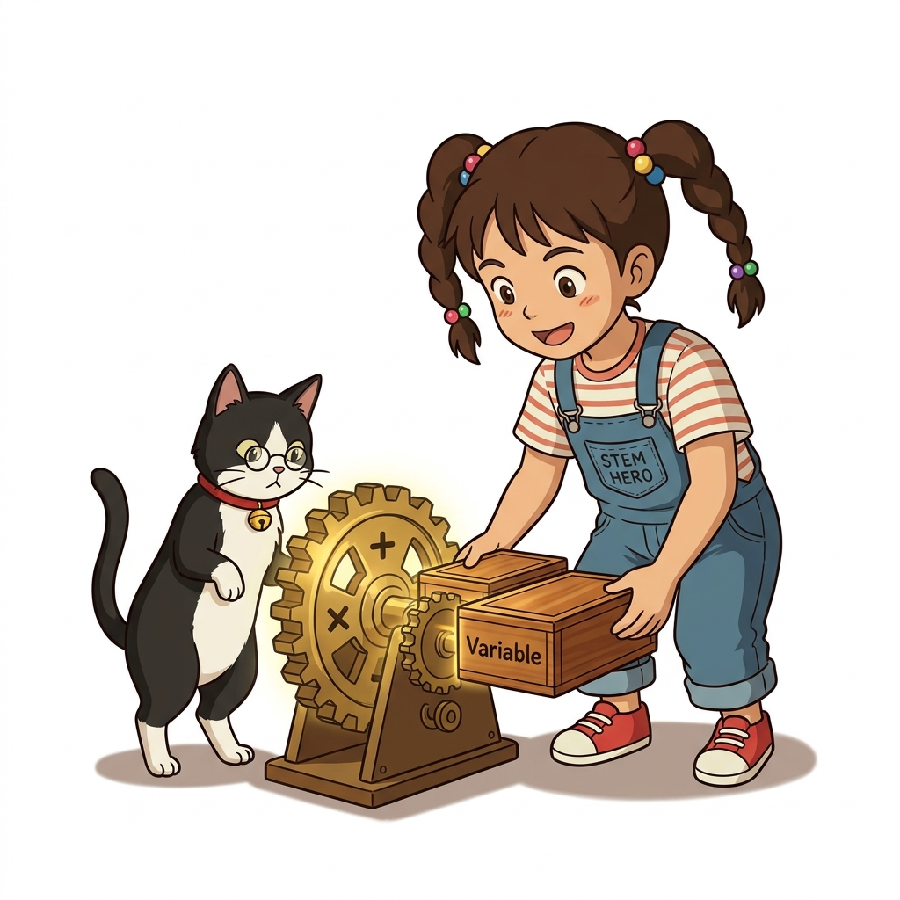
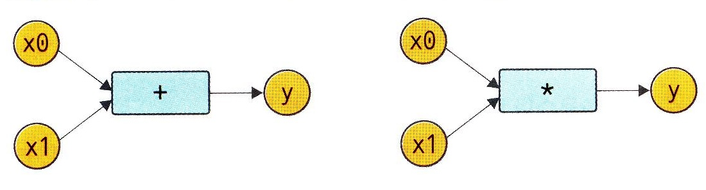
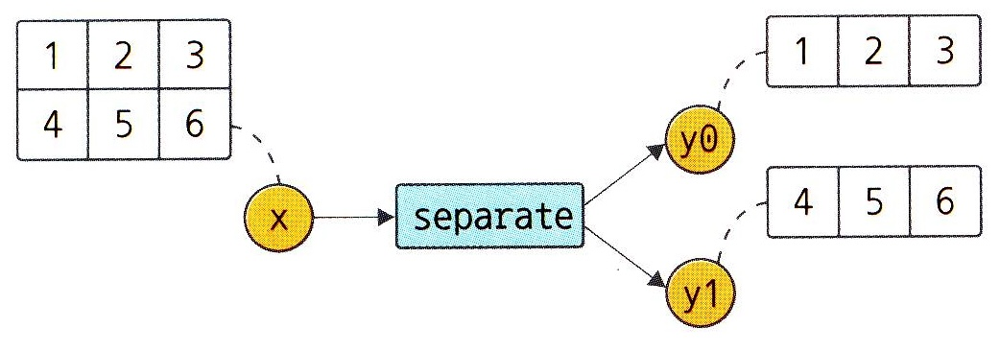
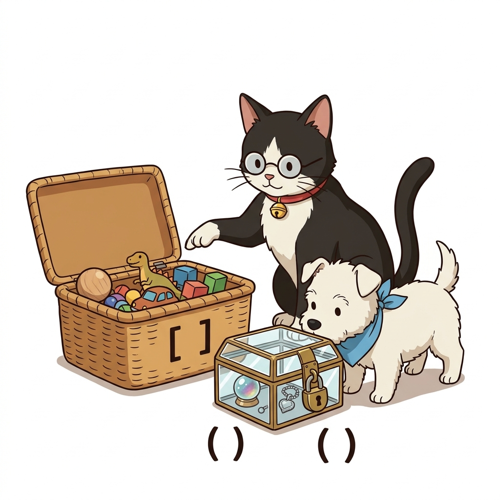
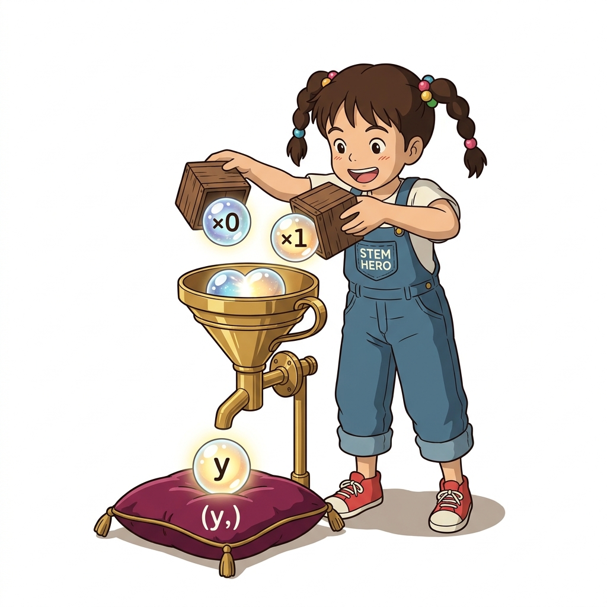
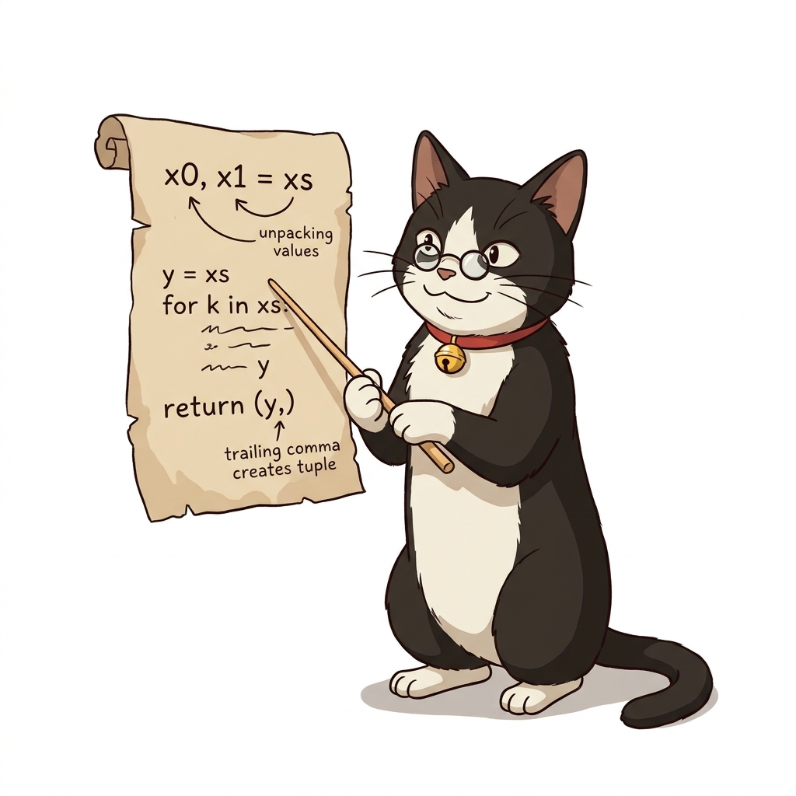

# 11단계 가변 길이 인수(순전파 편)

지금까지 우리는 함수에 입출력 변수가 하나씩인 경우만 생각해왔습니다. 


*이호진 교수님이 단일 입출력 함수(1개 상자)에서 여러 입출력 변수를 다루는 새로운 계산 세계를 소개하고 있습니다.*

---

예를 들어 $y = \text{square}(x)$ 와 $y = \text{exp}(x)$ 등은 입출력 변수가 하나씩입니다. 그러나 함수에 따라 여러 개의 변수를 입력받기도 합니다. 


*도로시와 지니가 덧셈(+)과 곱셈(×)처럼 두 개 이상의 입력 상자를 필요로 하는 다변수 함수들을 살펴봅니다.*

---

[그림 11-1]의 '덧셈'과 '곱셈'이 대표적이죠.

그림 11-1 '덧셈' 계산 그래프와 '곱셈' 계산 그래프(곱셈 연산은 *로 표시)


---

출력이 여러 개인 함수도 있습니다. 

예를 들어 [그림 11-2]와 같은 함수가 있을 수 있겠죠.

그림 11-2 출력이 여러 개인 계산 그래프(다차원 배열을 분할하는 함수)


---

이상을 고려하여 DeZero가 가변 길이 입출력을 처리할 수 있도록 확장하려 합니다. 

가변 길이라고 함은 인수(또는 반환값)의 수가 달라질 수 있다는 뜻입니다. Function 클래스를 조금 수정하면 가변 길이 입출력에 대응할 수 있을 것 같습니다.


*틴맨(Tinny) 로봇이 입력 슬롯의 개수를 자유자재로 조절할 수 있는 아코디언형 컨베이어 장치를 선보입니다.*

---

## 11.1 Function 클래스 수정

가변 길이 입출력을 표현하려면 변수들을 리스트(또는 튜플)에 넣어 처리하면 편할 것 같습니다. 

즉, Function 클래스는 지금까지처럼 '하나의 인수'만 받고 '하나의 값'만 반환하는 것이죠. 대신 인수와 반환값의 타입을 리스트로 바꾸고, 필요한 변수들을 이 리스트에 넣으면 됩니다.


*도로시가 여러 개의 나무 상자(Variable)들을 깔끔하게 '리스트(List)' 수레에 차곡차곡 정리하고 있습니다.*

---

> **NOTE**  
> 파이썬의 리스트와 튜플은 여러 개의 데이터를 한 줄로 저장합니다. 리스트는 `[1, 2, 3]`과 같이 `[]`로 묶고 튜플은 `(1, 2, 3)`과 같이 `()`로 묶습니다. 리스트와 튜플의 주요 차이는 원소를 변경할 수 있는지 여부입니다. 튜플의 경우 한 번 생성되면 원소를 변경할 수 없습니다. 예를 들어 `x = (1, 2, 3)`으로 튜플을 생성한 후에는 `x[0] = 4` 등으로 덮어 쓸 수 없는 것이죠. 반면 리스트는 원소를 변경할 수 있습니다.


*조교 지니와 토토가 수정 가능한 열린 리스트 상자와 자물쇠가 달린 단단한 불변 튜플 상자를 비교합니다.*

---

그러면 현재의 Function 클래스가 어떻게 구현되어 있는지부터 확인해보죠.

**steps/step10.py**
```python
class Function:
    def __call__(self, input):
        x = input.data  # ❶
        y = self.forward(x)  # ❷
        output = Variable(as_array(y))  # ❸
        output.set_creator(self)  # ❹
        self.input = input
        self.output = output
        return output

    def forward(self, x):
        raise NotImplementedError()

    def backward(self, gy):
        raise NotImplementedError()
```

---

Function의 `__call__` 메서드는 ❶ Variable이라는 '상자'에서 실제 데이터를 꺼낸 다음 ❷ forward 메서드에서 구체적인 계산을 합니다. 그리고 ❸ 계산 결과를 Variable에 넣고 ❹ 자신이 '창조자'라고 원산지 표시를 합니다. 


*이호진 교수님이 상자 열기, 순전파 계산, 결과 포장, 창조자 표기라는 4단계 파이프라인을 설명합니다.*

---

이상의 로직을 염두에 두고 `__call__` 메서드의 인수와 반환값을 리스트로 바꿔보겠습니다.

**steps/step11.py**
```python
class Function:
    def __call__(self, inputs):
        xs = [x.data for x in inputs]
        ys = self.forward(xs)
        outputs = [Variable(as_array(y)) for y in ys]

        for output in outputs:
            output.set_creator(self)
        self.inputs = inputs
        self.outputs = outputs
        return outputs

    def forward(self, xs):
        raise NotImplementedError()

    def backward(self, gys):
        raise NotImplementedError()
```

---

인수와 반환값을 리스트로 변경했습니다. 

변수를 리스트에 담아 취급한다는 점을 제외하고는 달라진 게 없습니다. 참고로 앞의 코드에서는 리스트를 생성할 때 리스트 내포<sup>list comprehension</sup>를 사용했습니다.


*틴맨과 도로시가 여러 입력을 받아 여러 출력을 내보내는 확장형 듀얼 호퍼(Dual Hopper) 기계를 조립합니다.*

---


> **NOTE**  
> 리스트 내포는 `xs = [x.data for x in inputs]` 형태로 사용합니다. 이 코드는 inputs 리스트의 각 원소 x에 대해 각각의 데이터(x.data)를 꺼내고, 꺼낸 원소들로 구성된 새로운 리스트를 만듭니다.


*조교 지니가 마법봉을 휘두르자 여러 Variable 상자에서 숫자 데이터(data) 알맹이만 쏙쏙 뽑아냅니다.*


---


이상이 새로운 Function 클래스입니다. 

이어서 새로운 Function 클래스를 사용하여 구체적인 함수를 구현하겠습니다. 첫 번째는 덧셈을 해주는 Add 클래스 차례입니다.


*이호진 교수님과 틴맨이 덧셈 기호(+)가 새겨진 신규 Add 클래스 기계 블록을 제작대 위에 올려놓습니다.*

---

## 11.2 Add 클래스 구현

이번 절에서는 Add 클래스의 forward 메서드를 구현합니다. 주의할 점은 인수와 반환값이 리스트(또는 튜플)여야 한다는 것입니다. 


*도로시가 상자 두 개(x0, x1)에서 꺼낸 숫자 구슬들을 깔끔하게 합쳐 하나의 결과 구슬(y)로 만듭니다.*

---

이 조건을 반영하여 다음과처럼 구현할 수 있습니다.

**steps/step11.py**
```python
class Add(Function):
    def forward(self, xs):
        x0, x1 = xs
        y = x0 + x1
        return (y,)
```

---

Add 클래스의 인수는 변수가 두 개 담긴 리스트입니다. 따라서 `x0, x1 = xs` 형태로 리스트 `xs`에서 원소 두 개를 꺼냈습니다. 그런 다음 꺼낸 원소들을 사용하여 계산합니다. 결과를 반환할 때는 `return (y,)` 형태로 튜플을 반환합니다(`return y,` 처럼 괄호는 생략해도 됩니다). 


*조교 지니가 'x0, x1 = xs' 리스트 언패킹을 보여주며 쉼표가 붙은 튜플 반환 방식을 메모판에 정리합니다.*

---

수정한 Add 클래스는 다음과 같이 사용할 수 있습니다.

**steps/step11.py**
```python
xs = [Variable(np.array(2)), Variable(np.array(3))]  # 리스트로 준비
f = Add()
ys = f(xs)  # ys 튜플
y = ys[0]
print(y.data)
```

---


**실행 결과**

```
```

보시는 것처럼 2 + 3 = 5 계산을 DeZero도 제대로 처리할 수 있게 되었습니다. 

---


입력을 리스트로 바꿔서 여러 개의 변수를 다룰 수 있게 하였고, 출력은 튜플로 바꿔서 역시 여러 개의 변수에 대응할 수 있게 했습니다. 이제 순전파에 한해서는 가변 길이 인수와 반환값에 대응할 수 있는 것입니다. 


*도로시와 토토가 두 개의 Variable(2와 3)을 더해 완벽한 결과 상자(5)를 얻고 기뻐서 환호합니다.*

---

그런데 앞의 코드를 보면 다소 귀찮은 느낌이 듭니다. 왜냐하면 Add 클래스를 사용하는 사람에게 입력 변수를 리스트에 담아 건네주라고 요구하거나 반환값으로 튜플을 받게 하는 것은 자연스럽지 않기 때문입니다. 


---

그래서 다음 단계에서는 더 자연스러운 코드로 쓸 수 있도록 지금의 구현을 개선하겠습니다.


