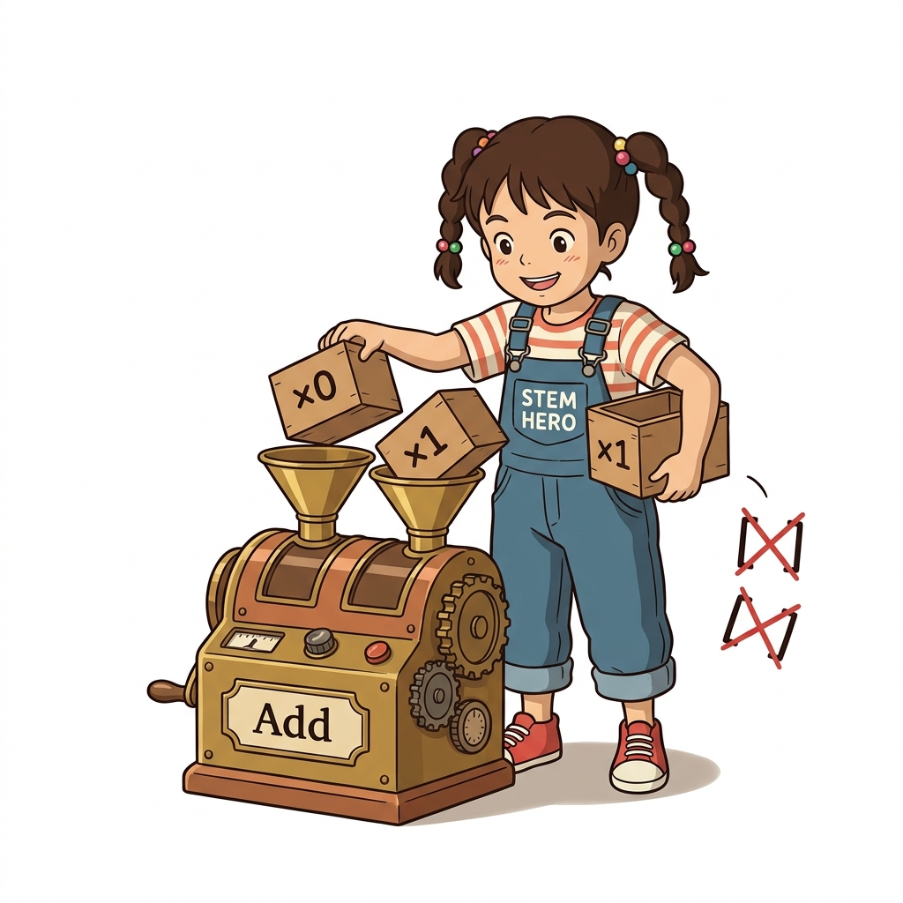
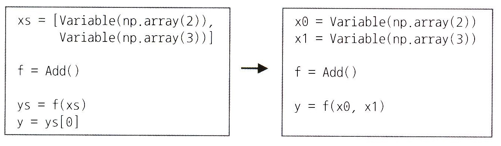
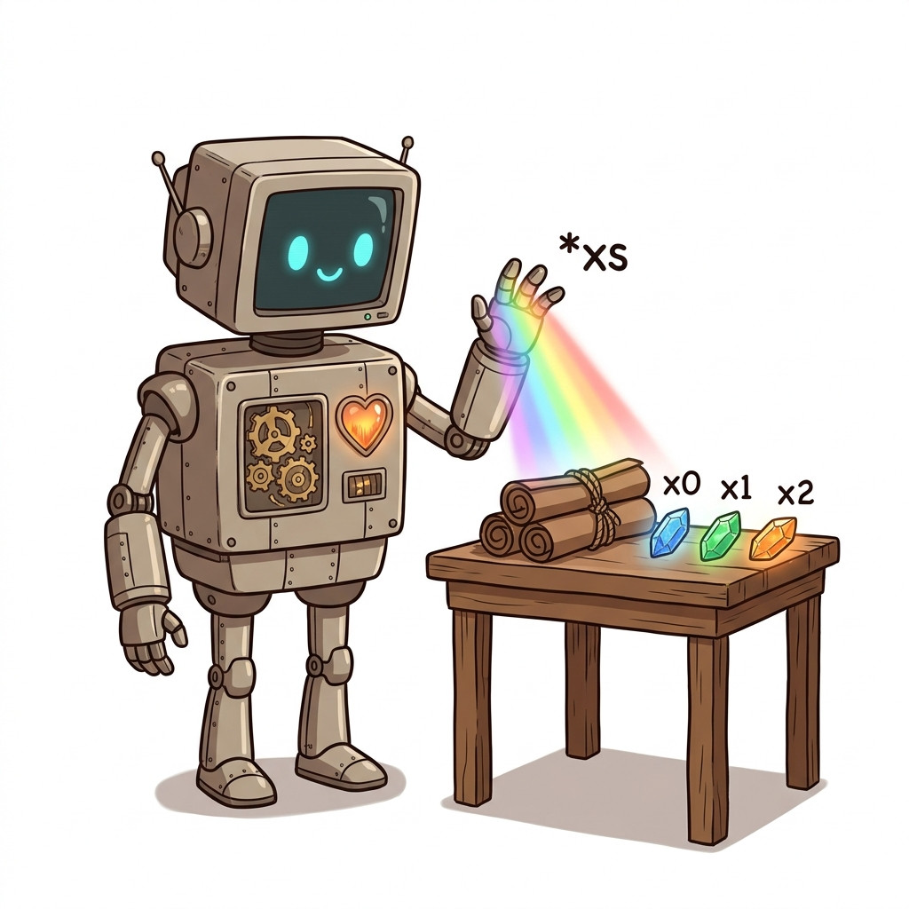
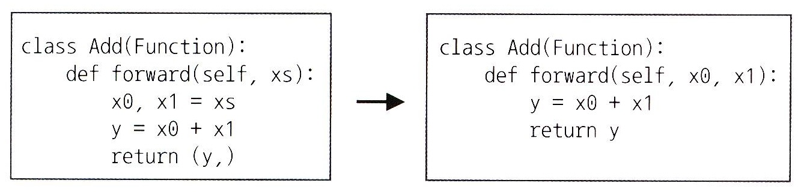
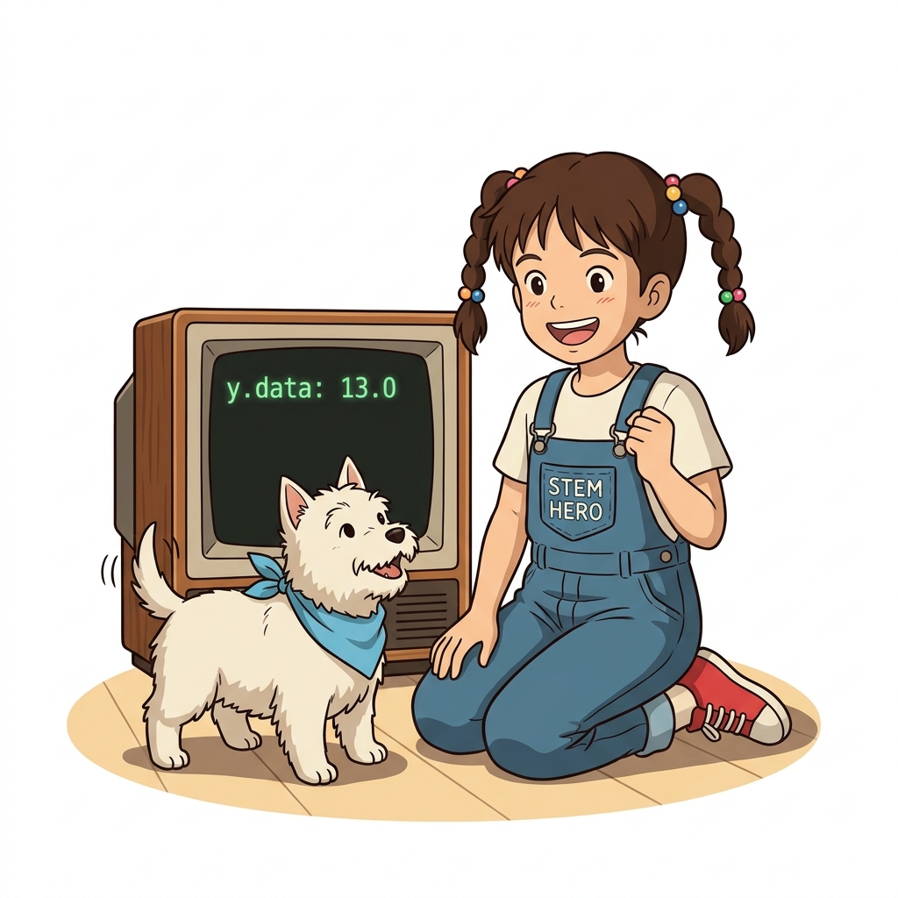
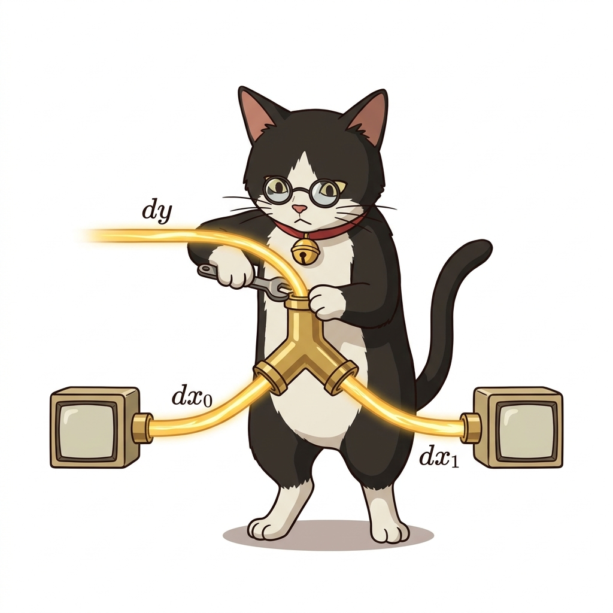

# 12단계 가변 길이 인수(개선 편)

이전 단계에서는 가변 길이 인수에 대응할 수 있도록 DeZero를 확장했습니다. 하지만 개선이 필요해 보였습니다. 그래서 이번 단계에서는 DeZero를 더 쉽게 사용할 수 있도록 두 가지를 개선하겠습니다. 


*이호진 교수님과 도로시가 함수 호출 간소화와 단일 결과 언패킹이라는 2대 개선 깃발을 세웁니다.*

---

첫 번째는 Add 클래스(혹은 다른 구체적인 함수 클래스)를 '사용하는 사람'을 위한 개선이고, 두 번째는 '구현하는 사람'을 위한 개선입니다. 



*도로시가 불필요한 대괄호 리스트 상자를 벗겨내고 두 변수를 직접 함수 슬롯에 쏙 넣는 모습입니다.*

---

## 12.1 첫 번째 개선: 함수를 사용하기 쉽게

첫 번째 개선부터 시작하겠습니다.


*조교 지니가 별표(*)가 빛나는 마술봉으로 흩어진 여러 인수를 단숨에 하나의 튜플로 모읍니다.*

---


이전 단계에서 Add 클래스를 사용하여 계산을 해보았는데, [그림 12-1]의 왼쪽 코드를 썼습니다.

그림 12-1 현재의 코드(왼쪽)와 개선 후의 코드(오른쪽)


---


[그림 12-1]의 왼쪽 코드에서 알 수 있듯이 현재의 Add 클래스는 인수를 리스트에 모아서 받고 결과는 튜플로 반환합니다. 그러나 오른쪽 그림처럼 리스트나 튜플을 거치지 않고 인수와 결과를 직접 주고받는 편이 훨씬 자연스럽습니다. 코드를 이와 같은 형태로 작성할 수 있게 해주는 것이 첫 번째 개선입니다.


*틴맨 로봇이 상자 묶음에 별표(*) 레이저를 쏘아 각각의 독립된 인수로 펼쳐놓는 모습을 연출합니다.*

---


그럼 첫 번째 개선에 도전해봅시다. 

그러려면 우선 Function 클래스를 수정합니다. 이전 단계와 달라진 부분에는 음영을 넣었습니다.

```python
class Function:
    def __call__(self, *inputs):  # ❶ 별표를 붙인다.
        xs = [x.data for x in inputs]
        ys = self.forward(xs)
        outputs = [Variable(as_array(y)) for y in ys]

        for output in outputs:
            output.set_creator(self)
        self.inputs = inputs
        self.outputs = outputs

        # ❷ 리스트의 원소가 하나라면 첫 번째 원소를 반환한다.
        return outputs if len(outputs) > 1 else outputs[0]
```

---

우선 ❷ 부분부터 설명하겠습니다. `outputs`에 원소가 하나뿐이면 리스트가 아니라 그 원소만을 반환합니다. 

다시 말해 함수의 반환값이 하나라면 해당 변수를 직접 돌려줍니다.


*이호진 교수님이 칠판에서 함수 정의 시(모으기)와 함수 호출 시(펼치기) 별표의 양방향 역할을 정리합니다.*

---

이어서 ❶ 부분입니다. 

함수를 정의할 때 인수 앞에 별표(`*`)를 붙였습니다. 이렇게 하면 리스트를 사용하는 대신 임의 개수의 인수(가변 길이 인수)를 건네 함수를 호출할 수 있습니다. 


---

가변 길이 인수의 사용법은 다음 예를 보면 명확해질 것입니다.

```python
>>> def f(*x):
...     print(x)

>>> f(1, 2, 3)
(1, 2, 3)

>>> f(1, 2, 3, 4, 5, 6)
(1, 2, 3, 4, 5, 6)
```

---

이 코드에서 알 수 있듯이 함수를 '정의'할 때 인수에 별표를 붙이면 호출할 때 넘긴 인수들을 별표를 붙인 인수 하나로 모아서 받을 수 있습니다. 


---

이상의 변경 덕분에 DeZero의 함수 클래스(Add 클래스)를 다음 코드처럼 사용할 수 있게 됩니다.

```python
x0 = Variable(np.array(2))
x1 = Variable(np.array(3))
f = Add()
y = f(x0, x1)
print(y.data)
```

---

**실행 결과**

```
```

이것으로 Add 클래스 사용자들에게 더 자연스러운 사용법을 제공하게 되었군요. 지금까지가 첫 번째 개선이었습니다. 이어서 두 번째 개선으로 이동합니다.

---

## 12.2 두 번째 개선: 함수를 구현하기 쉽도록

두 번째는 Add 클래스를 '구현하는 사람'을 위한 개선입니다. 


*도로시가 Add 클래스를 직관적인 소문자 `add(x0, x1)` 파이썬 함수로 래핑하여 완성합니다.*

---

현재 Add 클래스를 구현하려면 [그림 12-2]의 왼쪽처럼 작성해야 합니다.

그림 12-2 현재의 코드(왼쪽)와 개선 후의 코드(오른쪽)


---

왼쪽은 Add 클래스의 forward 메서드의 코드입니다. 인수는 리스트로 전달되고 결과는 튜플을 반환하고 있습니다. 물론 오른쪽 코드가 더 바람직해 보입니다. 입력도 변수를 직접 받고 결과도 변수를 직접 돌려주는 것이죠. 이것이 두 번째 개선에서 할 일입니다.


*도로시, 틴맨, 지니가 제곱과 덧셈 기계가 매끄럽게 파이프로 이어진 유기적 계산 파이프라인을 작동시킵니다.*

---

두 번째 개선을 위해 Function 클래스에서 다음 부분을 수정합니다.

**steps/step12.py**
```python
class Function:
    def __call__(self, *inputs):
        xs = [x.data for x in inputs]
        ys = self.forward(*xs) # ❶ 별표를 붙여 언팩
        if not isinstance(ys, tuple): # ❷ 튜플이 아닌 경우 추가 지원
            ys = (ys,)
        outputs = [Variable(as_array(y)) for y in ys]

        for output in outputs:
            output.set_creator(self)
        self.inputs = inputs
        self.outputs = outputs

        return outputs if len(outputs) > 1 else outputs[0]
```

---

우선 ❶의 `self.forward(*xs)` 부분을 보죠. 함수를 '호출'할 때 별표를 붙였는데, 이렇게 하면 리스트 언팩<sup>list unpack</sup>이 이루어집니다. 언팩은 리스트의 원소를 낱개로 풀어서 전달하는 기법입니다. 예를 들어 `xs = [x0, x1]`일 때 `self.forward(*xs)`를 하면 `self.forward(x0, x1)`로 호출하는 것과 동일하게 동작합니다.


*터미널 화면에 `y.data: 13.0`이 선명하게 나타나며 도로시와 토토가 기뻐합니다.*

---


이어서 ❷에서는 `ys`가 튜플이 아닌 경우 튜플로 변경합니다. 이제 `forward` 메서드는 반환 원소가 하나뿐이라면 해당 원소를 직접 반환합니다. 


*이호진 교수님이 순전파 트랙에는 녹색 깃발을 꽂았지만, 아직 붉은 물음표가 켜진 역전파 트랙을 가리킵니다.*

---

이상의 수정으로 Add 클래스를 다음과 같이 구현할 수 있습니다.

**steps/step12.py**
```python
class Add(Function):
    def forward(self, x0, x1):
        y = x0 + x1
        return y
```

이와 같이 순전파 메서드를 `def forward(self, x0, x1):`이라고 정의할 수 있습니다. 결과는 `return y`처럼 하여 원소 하나만 반환하죠. 

---

이제 Add 클래스를 구현하는 사람에게 DeZero는 더 쓰기 편한 프레임워크가 되었습니다. 

이상으로 두 번째 개선을 마무리합니다.


*하나의 상류 기울기 $dy$ 가 들어와서 두 개의 입력 상자 $x0, x1$ 로 나뉘어 전파되어야 하는 원리를 보여줍니다.*

---

## 12.3 add 함수 구현

마지막으로 Add 클래스를 '파이썬 함수'로 사용할 수 있는 코드를 추가하겠습니다.

**steps/step12.py**
```python
def add(x0, x1):
    return Add()(x0, x1)
```

이 add 함수를 사용하면 계산 코드를 다음과처럼 작성할 수 있습니다.

---

**steps/step12.py**
```python
x0 = Variable(np.array(2))
x1 = Variable(np.array(3))
y = add(x0, x1) # Add 클래스 생성 과정이 감춰짐
print(y.data)
```

---

**실행 결과**

```
```

이상으로 함수가 가변 길이 인수를 더 자연스럽게 다룰 수 있게 해봤습니다. 

---

여기에서는 '덧셈'만을 구현했지만 '곱셈'과 '나눗셈'도 같은 방식으로 구현할 수 있습니다. 그러나 가변 길이 인수를 다룰 수 있는 것은 아직 '순전파'뿐입니다. 예상하셨듯이 '역전파'는 바로 다음 단계에서 구현할 것입니다.


*도로시, 틴맨, 지니, 토토가 나침반을 들고 역전파 확장의 13단계를 향해 힘차게 나아갑니다.*
