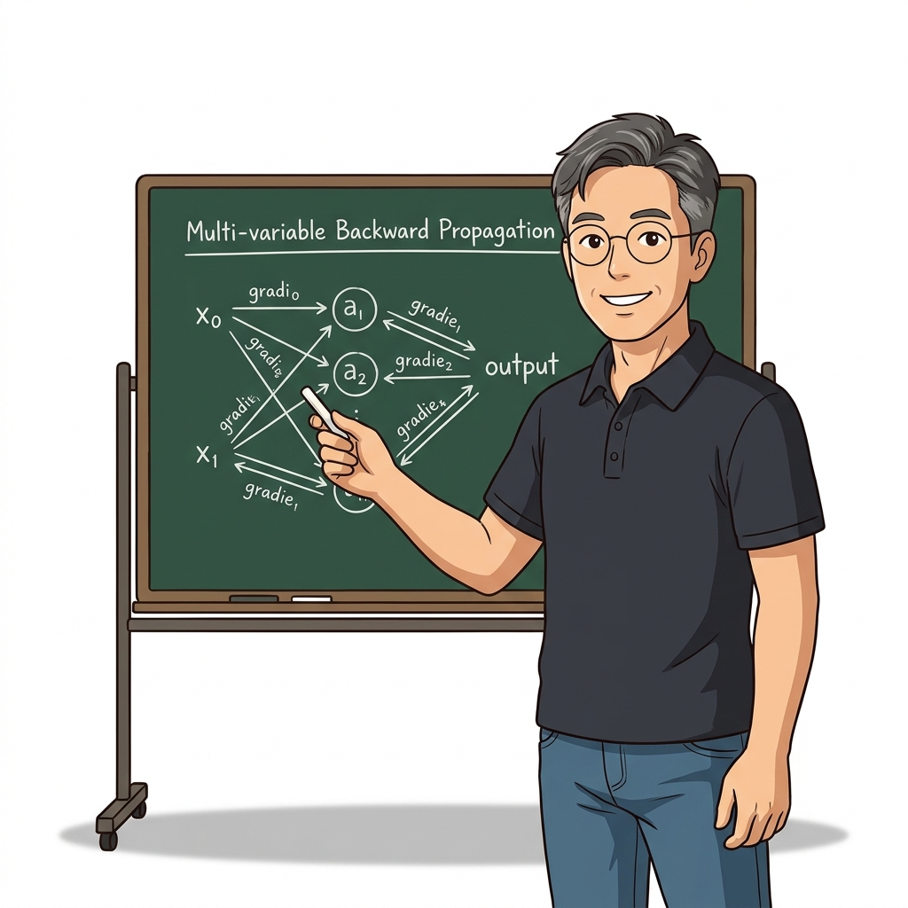
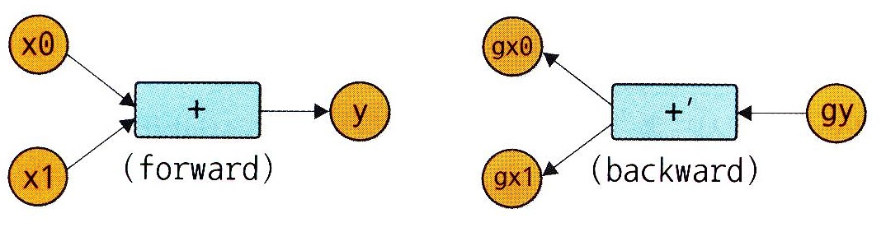
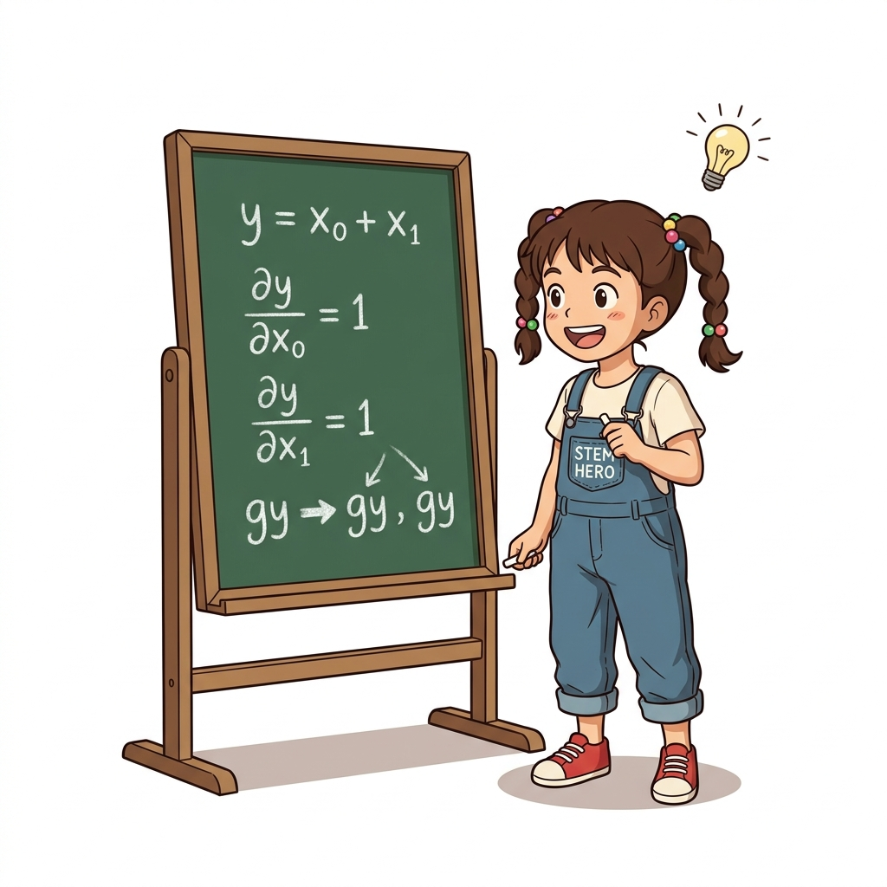
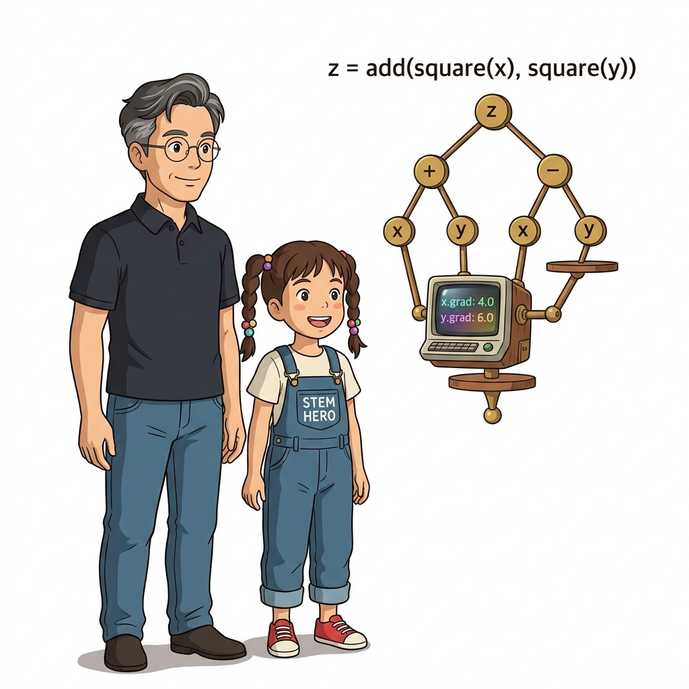
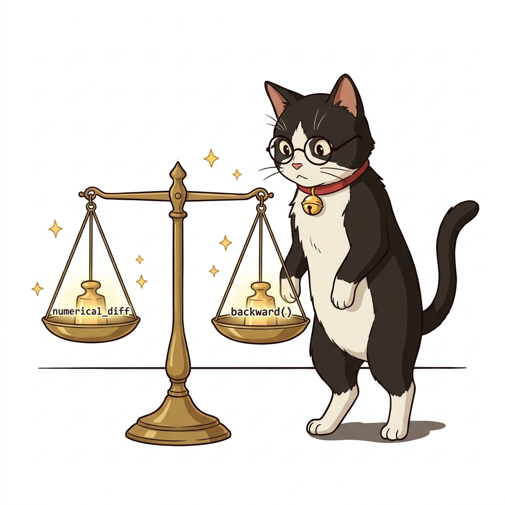
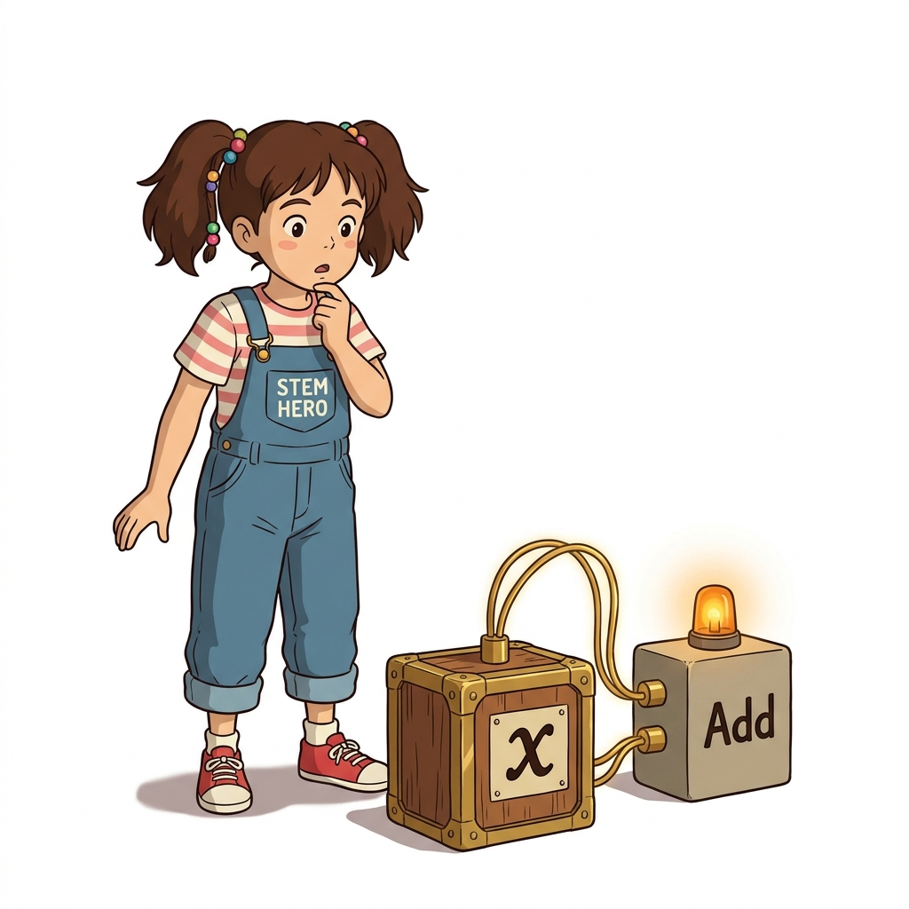

# 13단계 가변 길이 인수(역전파 편)

이전 단계까지의 변경으로 함수가 여러 개의 변수를 입력받고 반환할 수 있게 되었습니다. 이를 순전파 구현에 반영하고 계산이 올바르게 이뤄지는지도 확인했습니다. 순전파 다음은 당연히 '역전파'입니다. 그래서 이번 단계에서는 역전파를 구현합니다.


*이호진 교수님이 역전파에서도 여러 개의 미분값(gys, gxs)을 주고받는 핵심 설계를 제시합니다.*

---

## 13.1 가변 길이 인수에 대응한 Add 클래스의 역전파

역전파를 구현하기에 앞서 [그림 13-1]의 덧셈 계산 그래프를 살펴봅시다.

그림 13-1 덧셈 계산 그래프에서 순전파와 역전파('+'는 $y = x_0 + x_1$ 을 미분하는 함수)


[그림 13-1]에서 덧셈의 순전파는 입력이 2개, 출력이 1개입니다. 역전파는 그 반대가 되어 입력이 1개, 출력이 2개입니다. 수식으로 확인하면 $y = x_0 + x_1$ 일 때 미분하면 $\frac{\partial y}{\partial x_0} = 1$, $\frac{\partial y}{\partial x_1} = 1$ 이 구해집니다.

---

> **CAUTION**  
> $y = x_0 + x_1$ 계산(함수)의 입력 변수는 2개입니다. 이처럼 입력 변수가 여러 개인 함수를 다변수 함수라고 합니다. 다변수 함수에서 하나의 입력 변수에만 주목하여(다른 변수는 상수로 취급) 미분하는 것을 편미분<sup>\*</sup>이라고 합니다. 편미분에서는 미분 기호로 $\partial$ 을 사용합니다. 예를 들어 $\frac{\partial y}{\partial x_0}$ 는 $x_0$ 이외의 변수를 상수로 생각하고 $x_0$ 에만 주목하여 미분한다는 뜻입니다. 이 책에서는 앞으로 편미분을 따로 구분하지 않고 '미분'으로 통일해 부르겠습니다. 또한 변수가 하나인 경우에도 수식에서 $\partial$ 기호를 사용하겠습니다.


*도로시가 덧셈 연산에서 기울기가 감쇠나 증폭 없이 그대로 상류 미분값(gy)을 전달함을 확인합니다.*

---

덧셈의 역전파는 출력 쪽에서 전해지는 미분값에 1을 곱한 값이 입력 변수($x_0, x_1$)의 미분입니다. 즉, 상류에서 흘러오는 미분값을 '그대로 흘려보내는 것'이 덧셈의 역전파입니다. 


*틴맨 로봇이 `return gy, gy` 코드가 새겨진 황동 부품을 Add 클래스 모듈 뒷면에 결합합니다.*

---

이상을 반영하여 Add 클래스를 다음과 같이 구현합니다.

**steps/step13.py**
```python
class Add(Function):
    def forward(self, x0, x1):
        y = x0 + x1
        return y

    def backward(self, gy):
        return gy, gy
```

이와 같이 `backward` 메서드는 입력이 1개, 출력이 2개입니다. 

---

물론 이 코드처럼 여러 개의 값을 반환할 수 있게 하려면 역전파의 핵심 구현을 변경해야 합니다. 

DeZero에서는 Variable 클래스의 `backward` 메서드를 수정하기로 했습니다.


---

## 13.2 Variable 클래스 수정

그럼 Variable 클래스의 `backward` 메서드를 살펴보겠습니다.


---

복습할 겸 Variable 클래스의 현재 코드를 먼저 보여드리죠.

**steps/step12.py**
```python
class Variable:
    ...
```

---

> 편미분은 영어로는 partial derivative라 하여 부분적(partial)으로 미분한다는 뜻입니다. 한자로는 偏微分으로 쓰는데, 여기서 편(偏)은 '편을 나누어 대립하다'라고 할 때의 편입니다. 여러 변수 중 하나씩 편을 나눠 미분한다고 해석하면 될 것 같습니다.


---


```python
    def backward(self):
        if self.grad is None:
            self.grad = np.ones_like(self.data)

        funcs = [self.creator]
        while funcs:
            f = funcs.pop()
            x, y = f.input, f.output # ❶ 함수의 입출력을 얻는다.
            x.grad = f.backward(y.grad) # ❷ backward 메서드를 호출한다.

            if x.creator is not None:
                funcs.append(x.creator)
```

여기서 주목할 곳은 음영 부분입니다. 

---

우선 `while` 블록 안의 ❶에서 함수의 입출력 변수를 꺼냅니다. 그리고 ❷에서 함수의 `backward` 메서드를 호출합니다. 지금까지 우리는 ❶에서 함수의 입출력이 하나씩이라고 한정했습니다. 


---

이 부분을 여러 개의 변수에 대응할 수 있도록 수정하겠습니다.

**steps/step13.py**
```python
class Variable:
    ...

    def backward(self):
        if self.grad is None:
            self.grad = np.ones_like(self.data)

        funcs = [self.creator]
        while funcs:
            f = funcs.pop()
            gys = [output.grad for output in f.outputs] # ❶
            gxs = f.backward(*gys) # ❷
            if not isinstance(gxs, tuple): # ❸
                gxs = (gxs,)

            for x, gx in zip(f.inputs, gxs): # ❹
                x.grad = gx

                if x.creator is not None:
                    funcs.append(x.creator)
```

총 네 군데를 수정했습니다. 

---

우선 ❶에서 출력 변수인 `outputs`에 담겨 있는 미분값들을 리스트에 담습니다. 그리고 ❷에서 함수 `f`의 역전파를 호출합니다. 이때 `f.backward(*gys)`처럼 인수에 별표를 붙여 호출하여 리스트를 풀어줍니다(리스트 언팩). ❸에서는 `gxs`가 튜플이 아니라면 튜플로 변환합니다.


*도로시와 이호진 교수님이 두 변수의 제곱합 그래프를 실행하고 터미널에서 미분값을 확인합니다.*

---


> **NOTE**  
> ❷와 ❸은 이전 단계에서 순전파 개선 시 활용한 관례와 같습니다. ❷에서 Add 클래스의 backward 메서드를 호출할 때 인수를 풀어서 전달합니다. ❸에서는 Add 클래스의 backward 메서드가 튜플이 아닌 해당 원소를 직접 반환할 수 있게 합니다.


*조교 지니가 정밀 저울에 수치 미분값과 역전파 미분값을 올려놓자 바늘이 정중앙(0 오차)을 가리킵니다.*


---


❹에서는 역전파로 전파되는 미분값을 Variable의 인스턴스 변수 `grad`에 저장해둡니다. 여기서 `gxs`와 `f.inputs`의 각 원소는 서로 대응 관계에 있습니다. 더 정확히 말하면 i번째 원소에 대해 `f.inputs[i]`의 미분값은 `gxs[i]`에 대응합니다. `zip` 함수와 `for` 문을 이용해서 모든 Variable 인스턴스 각각에 알맞은 미분값을 설정한 것입니다. 이상이 Variable 클래스의 새로운 `backward` 메서드입니다.


*도로시, 틴맨, 지니, 토토가 축하 폭죽 아래에서 역전파 다중 입출력 달성 배지를 들고 환호합니다.*

---

## 13.3 Square 클래스 구현

지금까지 Variable과 Function 클래스가 가변 길이 입출력을 지원하도록 개선했습니다. 그리고 구체적인 함수로서 Add 클래스를 구현했습니다. 마지막으로 Square 클래스도 새로운 Variable과 Function 클래스에 맞게 수정하겠습니다. 


*도로시가 `y = add(x, x)` 처럼 같은 변수를 두 번 입력했을 때 발생하는 이상 현상을 발견하고 놀랍니다.*

---

수정할 곳은 단 하나뿐입니다. 다음 코드에서 음영을 입힌 부분이죠.

**steps/step13.py**
```python
class Square(Function):
    def forward(self, x):
        y = x ** 2
        return y

    def backward(self, gy):
        x = self.inputs[0].data # 수정 전: x = self.input.data
        gx = 2 * x * gy
        return gx
```

---

Function 클래스의 인스턴스 변수 이름이 단수형인 `input`에서 복수형인 `inputs`로 변경되었으니 바뀐 변수에서 입력 변수 x를 가져오도록 코드를 수정해주면 됩니다. 이것으로 새로운Square 클래스도 완성입니다. 그럼 add 함수와 square 함수를 실제로 사용해봅시다. 


---

다음은 $z = x^2 + y^2$ 을 계산하는 코드입니다.

**steps/step13.py**
```python
x = Variable(np.array(2.0))
y = Variable(np.array(3.0))

z = add(square(x), square(y))
z.backward()
print(z.data)
print(x.grad)
print(y.grad)
```

---

**실행 결과**

```
13.0
4.0
6.0
```

보다시피 DeZero를 사용하여 $z = x^2 + y^2$ 이라는 계산을 `z = add(square(x), square(y))`라는 코드로 풀어냈습니다. 그런 다음 `z.backward()`를 호출하기만 하면 미분 계산이 자동으로 이루어집니다!

---

이상에서 복수의 입출력에 대응한 자동 미분 구조를 완성했습니다. 이제 다른 함수들도 적절히 구현해주면 더 복잡한 계산도 가능할 것입니다. 그러나 사실 지금의 DeZero에는 몇 가지 문제가 숨어 있습니다. 다음 단계에서는 이 문제들을 먼저 해결하겠습니다.


