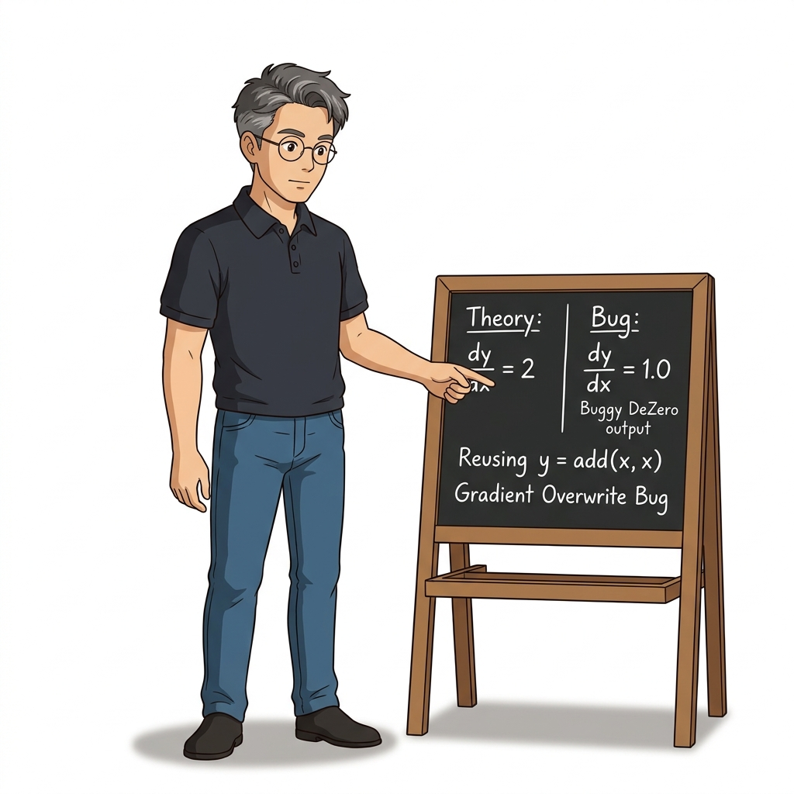
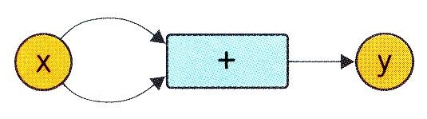
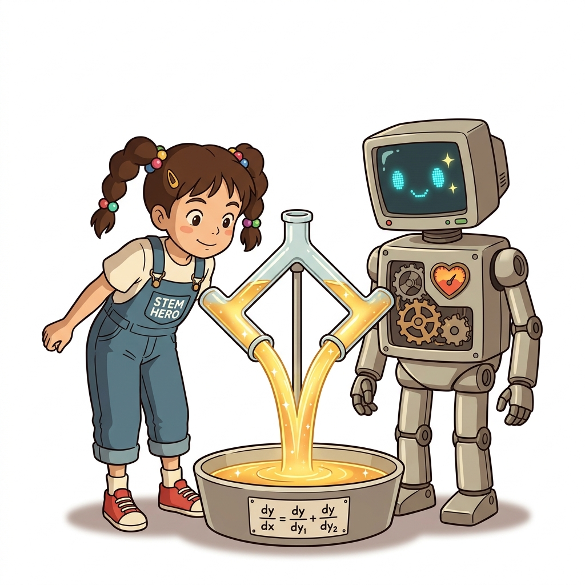
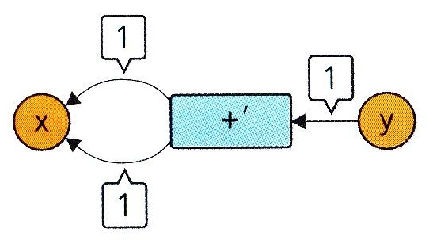

# 14단계 같은 변수 반복 사용

현재의 DeZero에는 문제가 있습니다. 

같은 변수를 반복해서 사용한 경우 의도대로 동작하지 않을 수 있다는 문제입니다.


*이호진 교수님이 `y = add(x, x)` 계산에서 이론적 도함수(2)와 DeZero의 현재 출력(1) 사이의 불일치를 설명합니다.*

---

 $y = \text{add}(x, x)$ 계산을 예로 생각해봅시다.

그림 14-1 $y = \text{add}(x, x)$ 의 계산 그래프


DeZero는 [그림 14-1]처럼 동일한 변수를 사용하여 덧셈을 하면 제대로 미분하지 못합니다. 실

---

제로 어떤 결과가 나오는지 직접 확인해보겠습니다.

```python
x = Variable(np.array(3.0))
y = add(x, x)
print('y', y.data)

y.backward()
print('x.grad', x.grad)
```

---

**실행 결과**

```
y 6.0
x.grad 1.0
```

x = 3.0으로 설정한 후 더해봤습니다. y의 값은 6.0이라고 제대로 계산했군요. 그러나 x에 대한 미분값(`x.grad`)을 구하니 1.0이라는 잘못된 결과가 나왔습니다. 제대로 계산한다면 $y = x + x$ 일 때 $y = 2x$ 이니 미분값은 $\frac{\partial y}{\partial x} = 2$ 가 됩니다.

---

## 14.1 문제의 원인

왜 x에 대한 미분값(`x.grad`)이 틀리게 나왔을까요? 원인은 Variable 클래스의 다음 위치에 있습니다.

**steps/step13.py**
```python
class Variable:
    ...

    def backward(self):
        if self.grad is None:
            self.grad = np.ones_like(self.data)

        funcs = [self.creator]
        while funcs:
            f = funcs.pop()
            gys = [output.grad for output in f.outputs]
            gxs = f.backward(*gys)
            if not isinstance(gxs, tuple):
                gxs = (gxs,)

            for x, gx in zip(f.inputs, gxs):
                x.grad = gx  # # 여기가 실수!

                if x.creator is not None:
                    funcs.append(x.creator)
```

---

이 코드에서 알 수 있듯이 현재 구현에서는 출력 쪽에서 전해지는 미분값을 그대로 대입합니다. 따라서 같은 변수를 반복해서 사용하면 전파되는 미분값이 덮어 써지는 것입니다. 


*도로시와 틴맨이 두 갈래로 나뉘었던 강물이 하나로 합쳐지듯 두 기울기가 합산되는 수로를 관찰합니다.*

---

예를 들어 앞의 덧셈 예에서는 미분값이 [그림 14-2]처럼 전파됩니다.

그림 14-2 $y = \text{add}(x, x)$ 의 역전파(화살표 위아래의 숫자는 전파되는 미분값)


[그림 14-2]에 전파되는 미분값도 표시했습니다. 이때 x의 미분은 $1 + 1 = 2$ 가 되어야 올바른 결과입니다. 즉, 전파되는 미분값의 '합'을 구해야 합니다. 그러나 지금의 구현에서는 그냥 덮어 쓰고 있습니다.

---

## 14.2 해결책

해결책은 간단합니다. 위 설명을 Variable 클래스의 코드에 그대로 반영하면 됩니다.

**steps/step14.py**
```python
class Variable:
    ...

    def backward(self):
        if self.grad is None:
            self.grad = np.ones_like(self.data)

        funcs = [self.creator]
        while funcs:
            f = funcs.pop()
            gys = [output.grad for output in f.outputs]
            gxs = f.backward(*gys)
            if not isinstance(gxs, tuple):
                gxs = (gxs,)

            for x, gx in zip(f.inputs, gxs):
                if x.grad is None:
                    x.grad = gx
                else:
                    x.grad = x.grad + gx

                if x.creator is not None:
                    funcs.append(x.creator)
```

---

이와 같이 미분값(`grad`)을 처음 설정하는 경우에는 지금까지와 똑같이 출력 쪽에서 전해지는 미분값을 그대로 대입합니다. 

그리고 다음부터는 전달된 미분값을 '더해'주도록 수정합니다.


*조교 지니가 기존의 덮어쓰기(=) 스탬프를 치우고 누적 덧셈(+=) 황동 계량기를 설치합니다.*

---

> **CAUTION**  
> 앞의 코드에서 미분값을 더할 때 코드를 `x.grad = x.grad + gx`라고 썼습니다. 그 대신 복합 대입 연산자 `+=`을 사용하여 `x.grad += gx`처럼 써도 좋을 것입니다. 그러나 이렇게 하면 문제가 되는 경우가 있습니다. 그 이유와 배경은 다소 복잡하고 딥러닝의 본질적인 문제에서도 벗어나기 때문에 부록 A에서 따로 설명했습니다. 관심 있는 분은 참고하세요.


---


이제 같은 변수를 반복해서 사용할 수 있습니다. 

시험 삼아 앞에서 실패했던 계산에 다시 도전해 보겠습니다.

**steps/step14.py**
```python
x = Variable(np.array(3.0))
y = add(x, x)
y.backward()
print(x.grad)
```

---

**실행 결과**

```
2.0
```

이번에는 2.0이라는 올바른 결과를 얻었습니다. 그렇다면 x를 세 번 사용해도 여전히 잘 작동하는지 봅시다.

---

**steps/step14.py**
```python
x = Variable(np.array(3.0))
y = add(add(x, x), x)
y.backward()
print(x.grad)
```

---

**실행 결과**

```
3.0
```

결과로 3.0을 얻었습니다. 수식으로 확인하면 $y = x + x + x = 3x$ 이므로 미분하면 3이 나옵니다. 실행 결과와 일치하는군요. 이상으로 같은 변수를 반복 사용하기 위한 구현을 완성했습니다.

---

## 14.3 미분값 재설정

방금 역전파 시 미분값을 더해주도록 코드를 수정했습니다. 그런데 이 변경으로 인해 새로운 주의사항이 튀어나옵니다. 바로 같은 변수를 사용하여 '다른' 계산을 할 경우 계산이 꼬이는 문제입니다. 


---

다음 코드를 예로 살펴보십시다.

```python
# 첫 번째 계산
x = Variable(np.array(3.0))
y = add(x, x)
y.backward()
print(x.grad)

# 두 번째 계산(같은 x를 사용하여 다른 계산을 수행)
y = add(add(x, x), x)
y.backward()
print(x.grad)
```

---

**실행 결과**

```
2.0
5.0
```

앞의 코드는 서로 다른 두 가지 미분 계산을 수행했습니다. 그러면서 메모리를 절약하고자 Variable 인스턴스인 x를 재사용했다고 해봅시다. 그 결과 두 번째 x의 미분값에 첫 번째 미분값이 더해지고, 5.0이라는 잘못된 값을 돌려줍니다(3.0이 되어야 합니다).

---

이 문제를 해결하기 위해 Variable 클래스에 미분값을 초기화하는 `cleargrad` 메서드를 추가하겠습니다.

**steps/step14.py**
```python
class Variable:
    ...

    def cleargrad(self):
        self.grad = None
```

`cleargrad`는 미분값을 초기화하는 메서드로, 단순히 `self.grad`에 `None`을 대입합니다. 이 메서드를 사용하면 여러 가지 미분을 연달아 계산할 때 똑같은 변수를 재사용할 수 있습니다. 

---

앞의 예는 다음과 같이 수정하면 됩니다.

```python
# 첫 번째 계산
x = Variable(np.array(3.0))
y = add(x, x)
y.backward()
print(x.grad) # 2.0

# 두 번째 계산(같은 x를 사용하여 다른 계산을 수행)
x.cleargrad() # 미분값 초기화
y = add(add(x, x), x)
y.backward()
print(x.grad) # 3.0
```

---

**실행 결과**

```
2.0
3.0
```

이번에는 두 번째 미분값도 제대로 구했습니다(두 번째 미분의 올바른 값은 3.0입니다). 예시처럼 두 번째 `x.backward()`를 호출하기 전에 `x.cleargrad()`를 호출하면 변수에 누적된 미분값이 초기화됩니다. 이것으로 다른 계산에 똑같은 변수를 재사용할 때 생기던 문제가 사라졌습니다.

---

> **CAUTION**  
> DeZero의 `cleargrad` 메서드는 최적화 문제를 풀 때 유용하게 사용할 수 있습니다. 최적화 문제란 함수의 최솟값과 최댓값을 찾는 문제를 말합니다. 실제로 28단계에서 로젠브록 함수<sup>Rosenbrock function</sup>를 최적화할 때 `cleargrad` 메서드를 사용합니다.


---

이상으로 이번 단계를 마무리합니다. 이번 단계를 거치며 Variable 클래스는 한층 성장했습니다. 그러나 아직도 중요한 문제가 하나 남아 있습니다. 그 문제는 이어지는 15, 16단계에서 해결하겠습니다. 16단계까지 마치면 마침내 Variable 클래스가 완성됩니다.


