# 15단계 복잡한 계산 그래프(이론 편)

지금까지 우리는 [그림 15-1]처럼 한 줄로 늘어선 계산 그래프를 다뤘습니다.

그림 15-1 일직선 계산 그래프
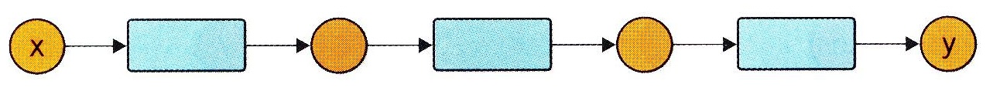

그러나 변수와 함수가 꼭 이렇게 한 줄로 연결되리라는 법은 없습니다. 우리 DeZero는 꾸준히 발전을 거듭하고 있습니다. 

---

그리고 지금의 DeZero는, 예를 들어 [그림 15-2]와 같은 계산 그래프도 만들 수 있습니다.

그림 15-2 더 복잡하게 연결된 계산 그래프 예
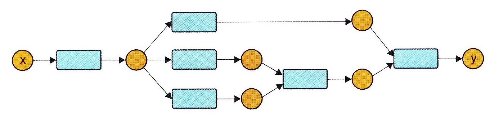

[그림 15-2]처럼 같은 변수를 반복해서 사용하거나 여러 변수를 입력받는 함수를 사용하는 계산을 할 수 있습니다. 

---

이를 통해 더 복잡한 연결을 만들 수 있는 것이죠. 그러나 불행히도 지금의 DeZero는 이런 계산의 미분은 제대로 계산하지 못합니다. 더 정확하게는 이런 복잡한 연결의 역전파를 제대로 할 수 없습니다.

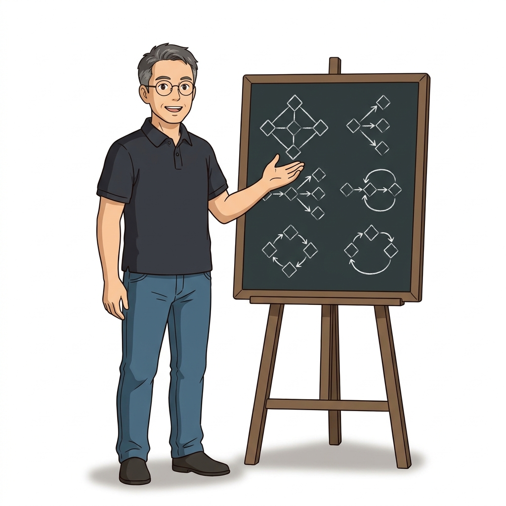
*이호진 교수님이 다이아몬드형, 분기형 등 다양한 형태의 계산 그래프 위상을 칠판에 펼쳐 보입니다.*

---

> **NOTE**  
> 그래프의 '연결된 형태'를 위상<sup>topology</sup>이라고 합니다. 이번 단계의 목표는 다양한 위상의 계산 그래프에 대응하는 것입니다. 어떤 모양으로 연결된 계산 그래프라도 제대로 미분할 수 있도록 지금부터 새로운 아이디어를 도입하겠습니다.

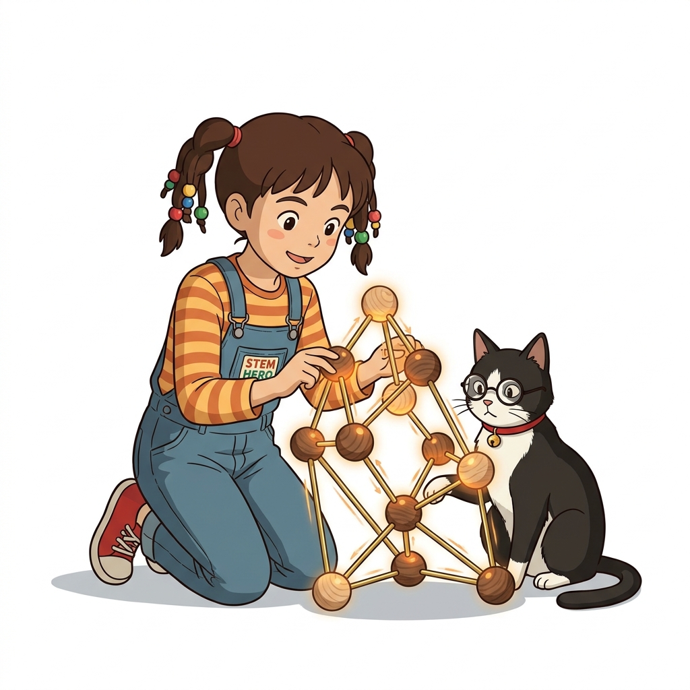
*도로시와 지니가 블록들이 여러 경로로 얽힌 기하학적 3D 모형을 관찰하며 그래프 위상의 의미를 배웁니다.*

---

## 15.1 역전파의 올바른 순서

DeZero의 어디에 문제가 있는 걸까요? 원인을 파악하기 위해 [그림 15-3]과 같은 비교적 간단한 계산 그래프를 생각해보겠습니다. 

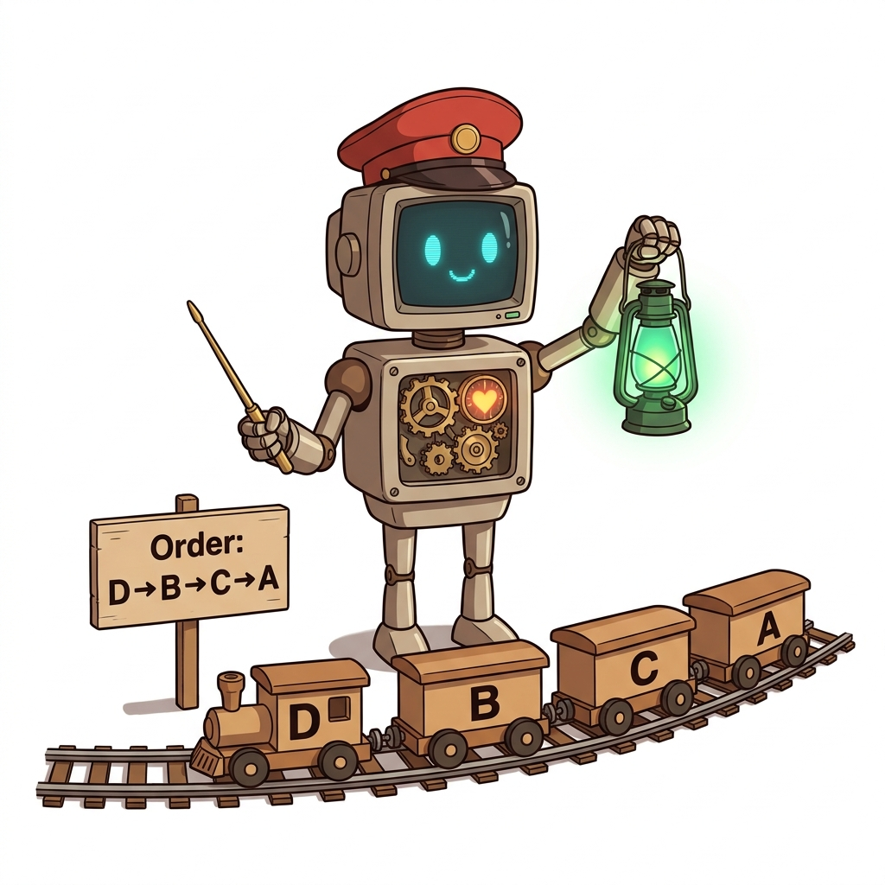
*틴맨 로봇이 신호등 지휘봉으로 역전파 기차들이 올바른 순서(D가 먼저, B와 C가 그 다음, A가 마지막)로 진입하도록 유도합니다.*

---

이 계산 그래프도 현재의 DeZero로는 제대로 미분하지 못합니다.

그림 15-3 중간에 분기했다가 다시 합류하는 계산 그래프
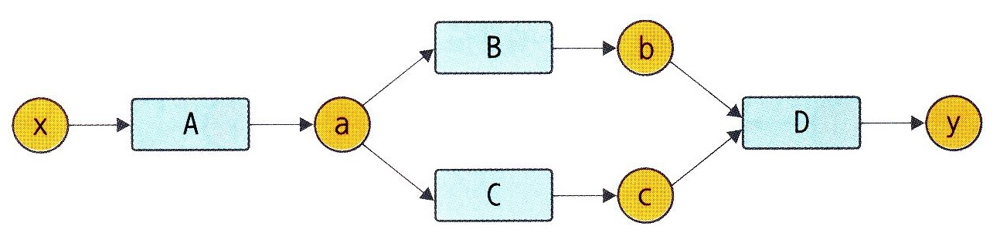

[그림 15-3]에서 주목할 부분은 계산 중간에 등장하는 변수 `a`입니다. 

---

이전 단계에서 설명한 것처럼 같은 변수를 반복해서 사용하면 역전파 때는 출력 쪽에서 전파되는 미분값을 더해야 합니다. 따라서 `a`의 미분(수식으로는 $\frac{\partial y}{\partial a}$)을 계산하려면 `a`의 출력 쪽에서 전파하는 2개의 미분값이 필요합니다. 그 2개의 미분값이 전해진 '후'에야 `a`에서 `x`로 미분값을 전파할 수 있습니다. 이 점을 감안한 역전파의 흐름은 [그림 15-4]와 같습니다.


---

[그림 15-4]는 변수 `y`로부터 `x`로 미분값이 전파되는 흐름을 보여줍니다. 다시 한 번 이야기하자면, 여기서 주목할 것은 변수 `a`에 2개의 미분값이 모두 전파된 '후'에야 `a`에서 `x`로 미분값을 전파한다는 점입니다. 함수의 관점에서 보면 역전파가 D, B, C, A의 순서로 진행되는 것이죠. 단, B와 C의 순서는 상관없으므로 D, C, B, A도 올바른 순서입니다. 


---

반드시 지켜야 할 규칙은 함수 B와 C의 역전파를 모두 끝내고 나서 함수 A를 역전파한다는 것입니다.

그림 15-4 올바른 역전파의 순서
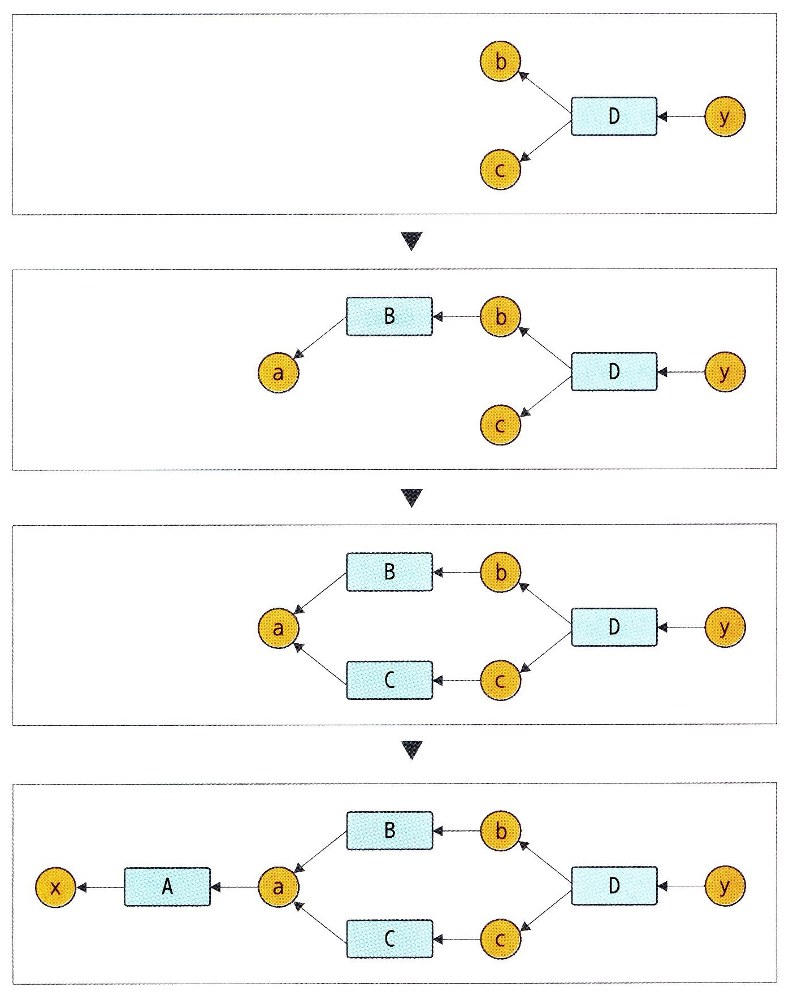

---

## 15.2 현재의 DeZero

우리 DeZero는 어떻게 구현되어 있는지 살펴보겠습니다. [그림 15-4]의 순서로 역전파하고 있을까요? 


---

다음은 Variable 클래스의 현재 모습입니다. 음영 부분만 주목해보죠.

**steps/step14.py**
```python
class Variable:
    ...

    def backward(self):
        if self.grad is None:
            self.grad = np.ones_like(self.data)

        funcs = [self.creator]
        while funcs:
            f = funcs.pop()
            gys = [output.grad for output in f.outputs]
            gxs = f.backward(*gys)
            if not isinstance(gxs, tuple):
                gxs = (gxs,)

            for x, gx in zip(f.inputs, gxs):
                if x.grad is None:
                    x.grad = gx
                else:
                    x.grad = x.grad + gx

                if x.creator is not None:
                    funcs.append(x.creator)
```

---

눈여겨 볼 대상은 `funcs` 리스트입니다. `while` 블록의 마지막 줄을 보면 처리할 함수의 후보를 `funcs` 리스트의 끝에 추가하고 있습니다(`funcs.append(x.creator)`). 그리고 다음에 처리할 함수를 그 리스트의 끝에서 꺼냅니다(`funcs.pop()`). 


---


이 코드대로 진행하면 역전파의 흐름이 [그림 15-5]처럼 됩니다.

그림 15-5 현재의 DeZero에서의 역전파 흐름
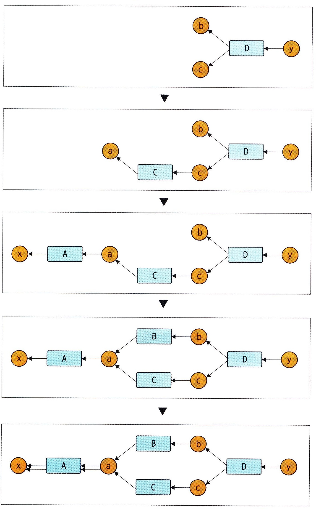

[그림 15-5]와 같이 함수의 처리 순서는 D, C, A, B, A가 됩니다. C 다음에 A로 바로 이어지는 게 문제군요. 그리고 함수 A의 역전파가 두 번 일어나는 것도 문제입니다. 

---

왜 이런 문제가 일어나는지 앞의 코드와 비교하면서 살펴보겠습니다.

가장 먼저 `funcs` 리스트에 D가 추가되어 `[D]` 상태로 시작됩니다. 

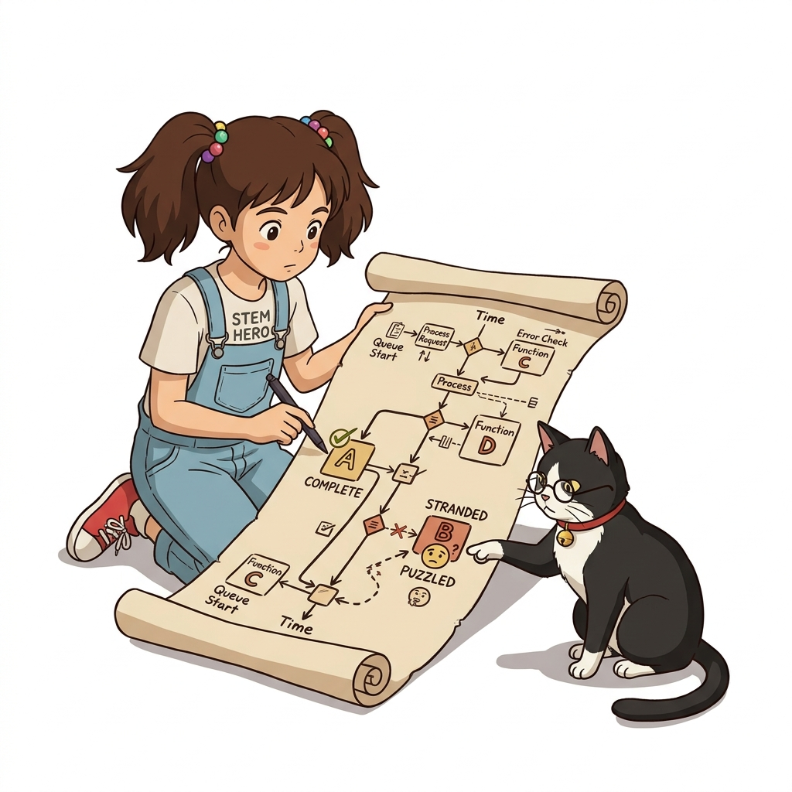
*도로시와 지니가 타임라인 차트를 보며 B보다 A가 먼저 실행되어 미분값이 유실되는 버그를 추적합니다.*

---

여기에서 함수 D가 꺼내지고, 그런 다음 D의 입력 변수(`D.inputs`)의 창조자인 B와 C가 `funcs` 리스트에 추가됩니다(그림 15-6).

그림 15-6 함수 D의 역전파(오른쪽은 funcs 리스트를 처리하는 코드)
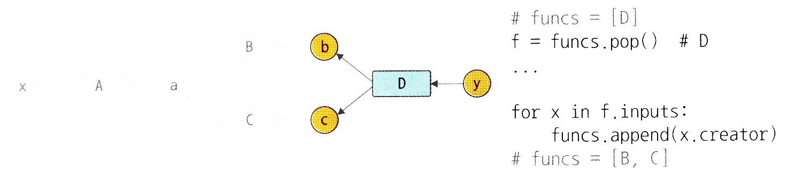

---


```python
# funcs = [D]
f = funcs.pop()  # # D
...
for x in f.inputs:
    funcs.append(x.creator)
# funcs = [B, C]
```

이 시점에서 `funcs` 리스트는 `[B, C]`입니다. 그런 다음 리스트의 마지막 원소인 C가 꺼내집니다. 그리고 C의 입력 변수의 창조자인 A가 리스트에 추가됩니다. 

---

이 시점의 `funcs` 리스트는 `[B, A]`입니다(그림 15-7).

그림 15-7 함수 C의 역전파와 대응 코드
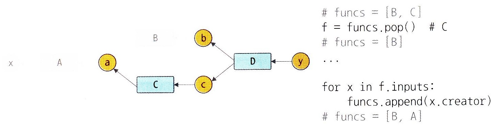

---


```python
# funcs = [B, C]
f = funcs.pop()  # # C
# funcs = [B]
...
for x in f.inputs:
    funcs.append(x.creator)
# funcs = [B, A]
```

이어서 다시 마지막 원소인 A가 꺼내집니다. 여기가 바로 문제를 일으키는 부분입니다. 원래는 B를 꺼내야 하는데 A를 꺼낸 것이죠.

---


> **CAUTION**  
> 지금까지 우리는 한 줄로 나열된 계산 그래프를 다뤘습니다. 그래서 리스트에서 원소(함수)를 꺼내 처리하는 순서를 고려하지 않아도 괜찮았습니다. 리스트에서 원소를 꺼낼 때는 항상 원소가 하나뿐이었기 때문입니다.

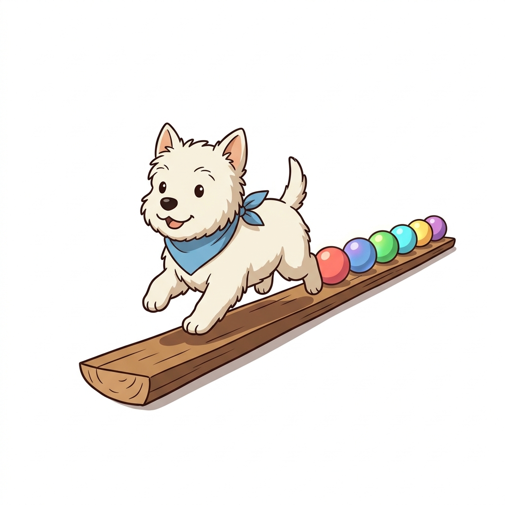
*토토가 일직선 외나무다리를 신나게 건너는 모습을 통해 이전까지는 순서 문제가 없었던 이유를 비유합니다.*

---

## 15.3 함수 우선순위

`funcs` 리스트에는 다음에 처리할 함수의 '후보'들이 들어 있습니다. 그러나 지금까지는 (아무 생각 없이) '마지막' 원소만 꺼냈습니다. 물론 `funcs` 리스트에서 적절한 함수를 꺼낼 수 있어야 합니다. 앞의 예로 말하면 `[B, A]` 상태의 리스트에서 출력 쪽에 더 가까운 B를 꺼낼 수 있어야 합니다. 이 문제를 해결하기 위해서는 함수에 '우선순위'를 줄 수 있어야 합니다. 만약 A보다 B의 우선순위가 높다면 B를 먼저 꺼내는 식이죠.


*이호진 교수님이 함수 카드 위에 금빛 왕관(우선순위 계급장)을 달아주어 꺼내는 순서를 바로잡는 개념을 제시합니다.*

---

그럼 우선순위는 어떻게 설정하면 좋을까요? 첫 번째로, 주어진 계산 그래프를 '분석'하여 알아내는 방법이 있습니다. 가령 위상 정렬<sup>Topological Sort</sup> 알고리즘을 사용하면 노드의 연결 방법을 기초로 노드들을 정렬할 수 있습니다. 그 정렬 순서가 바로 우선순위가 됩니다. 그러나 더 쉬운 방법도 있습니다. 사실 우리는 그 답을 이미 목격했습니다.

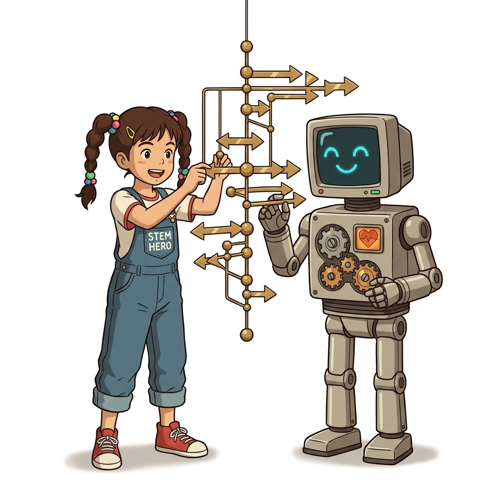
*도로시와 틴맨이 그물망처럼 얽힌 화살표들을 방향에 맞춰 왼쪽에서 오른쪽으로 가지런히 정렬합니다.*

---

우리는 일반적인 계산(순전파) 때 '함수'가 '변수'를 만들어내는 과정을 '목격'하고 있습니다. 즉, 어떤 함수가 어떤 변수를 만들어내는가 하는 '창조자-피조물 관계' 혹은 '부모-자식 관계'를 이미 목격하고 있습니다. 


---

이 관계를 기준으로 [그림 15-8]처럼 함수와 변수의 '세대<sup>generation</sup>'를 기록할 수 있습니다.

그림 15-8 순전파 때의 함수와 변수 '세대'
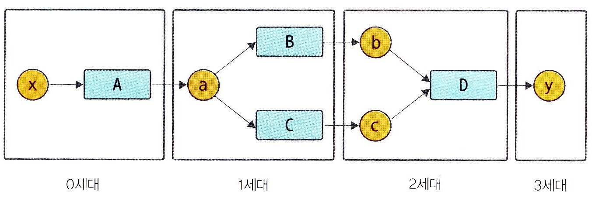

[그림 15-8]에서 말하는 '세대'가 바로 우선순위에 해당합니다. 

---

역전파 시 세대 수가 큰 쪽부터 처리하면 '부모'보다 '자식'이 먼저 처리됨을 보장할 수 있습니다. [그림 15-8]의 예에서는 함수 B와 A 중 하나를 선택해야 할 때 세대 수가 큰 B를 먼저 꺼내면 됩니다. 이상이 역전파를 올바른 순서로 진행하는 요령입니다. 다음 단계에서는 이 이론을 코드로 구현하겠습니다.


