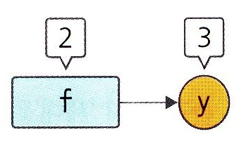
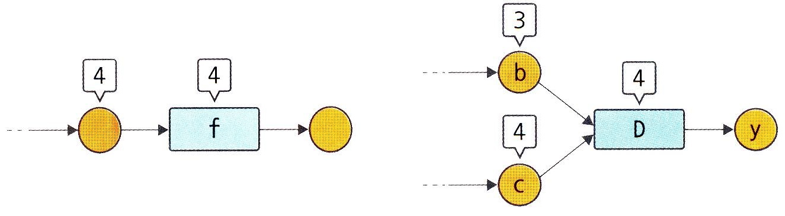
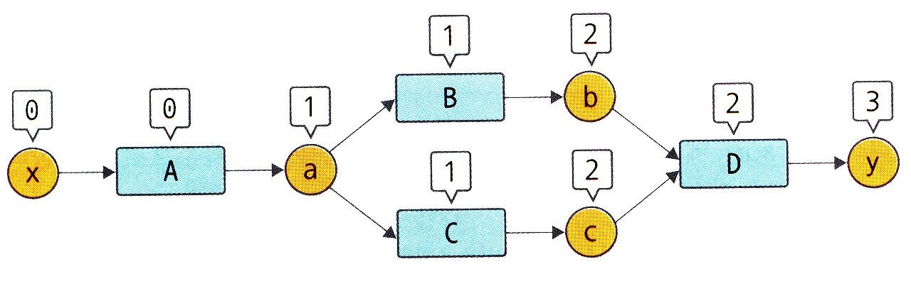
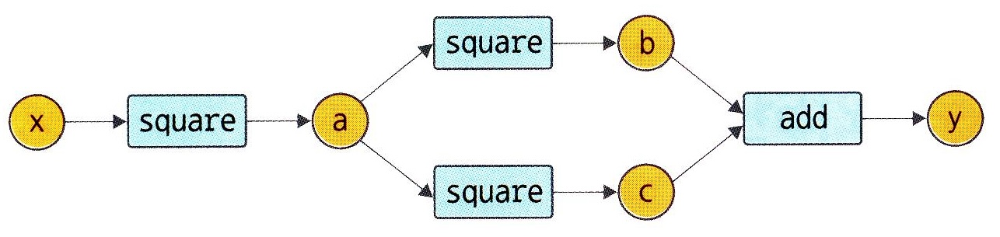
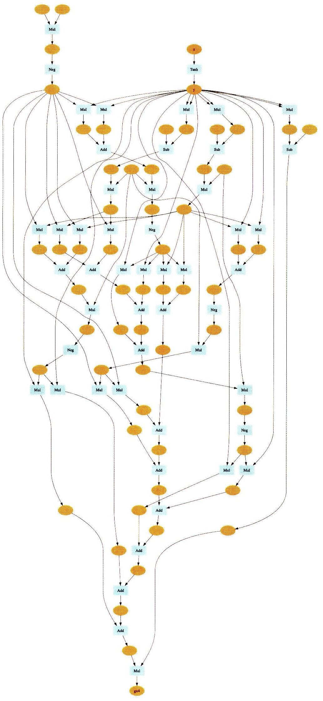

# 16단계 복잡한 계산 그래프(구현 편)

이번 단계에서는 15단계에서 설명한 이론을 코드로 구현합니다. 

가장 먼저 순전파 시 '세대'를 설정하는 부분부터 시작하겠습니다. 


---

그런 다음 역전파 시 최근 세대의 함수부터 꺼내도록 합니다. 

이렇게 하면 아무리 복잡한 계산 그래프라도 올바른 순서로 역전파가 이루어집니다.


---

## 16.1 세대 추가

먼저 Variable 클래스와 Function 클래스에 인스턴스 변수 `generation`을 추가하겠습니다. 

몇 번째 '세대'의 함수(혹은 변수)인지 나타내는 변수죠. 


---

Variable 클래스부터 시작하겠습니다.

**steps/step16.py**
```python
class Variable:
    def __init__(self, data):
        if data is not None:
            if not isinstance(data, np.ndarray):
                raise TypeError('{}은(는) 지원하지 않습니다.'.format(type(data)))

        self.data = data
        self.grad = None
        self.creator = None
        self.generation = 0  # 세대 수를 기록하는 변수

    def set_creator(self, func):
        self.creator = func
        self.generation = func.generation + 1  # 세대를 기록한다(부모 세대 + 1).

    ...
```

Variable 클래스는 `generation`을 0으로 초기화합니다. 그리고 `set_creator` 메서드가 호출될 때 부모 함수의 세대보다 1만큼 큰 값을 설정합니다. 

---


예를 들어 [그림 16-1]처럼 `f.generation`이 2인 함수에서 만들어진 변수인 `y`의 `generation`은 3이 됩니다. 이상이 Variable 클래스에 추가되는 구현입니다.

그림 16-1 변수 generation의 관계도(노드 위의 숫자가 generation값)


---


다음 차례는 Function 클래스입니다. 

Function 클래스의 `generation`은 입력 변수와 같은 값으로 설정합니다. 

예를 들어 [그림 16-2]의 왼쪽처럼 입력 변수의 `generation`이 4라면 함수의 `generation`도 4가 됩니다.

그림 16-2 함수 generation의 관계도


---

입력 변수가 둘 이상이라면 가장 큰 `generation`의 수를 선택합니다. 

예를 들어 [그림 16-2]의 오른쪽처럼 입력 변수가 2개고 각각의 `generation`이 3과 4라면 함수 D의 `generation`은 4로 설정합니다. 


---

다음은 이상의 설계를 반영한 Function 클래스의 코드입니다.

**steps/step16.py**

```python
class Function(object):
    def __call__(self, *inputs):
        xs = [x.data for x in inputs]
        ys = self.forward(*xs)
        if not isinstance(ys, tuple):
            ys = (ys,)
        outputs = [Variable(as_array(y)) for y in ys]

        self.generation = max([x.generation for x in inputs])
        for output in outputs:
            output.set_creator(self)
        self.inputs = inputs
        self.outputs = outputs
        return outputs if len(outputs) > 1 else outputs[0]

    ...
```

이 코드의 음영 부분에서 Function의 `generation`을 설정했습니다.

---

## 16.2 세대 순으로 꺼내기

지금까지의 수정을 반영하여 일반적인 계산(순전파)을 하면 모든 변수와 함수에 세대가 설정됩니다. 


---

구체적인 예로 [그림 16-3]과 같은 계산 그래프를 살펴보죠.

그림 16-3 세대 개념이 반영된 계산 그래프


[그림 16-3]을 보면 함수 A, B, C, D의 세대는 차례로 0, 1, 1, 2입니다. 이렇게 세대가 설정되어 있으면 역전파 때 함수를 올바른 순서로 꺼낼 수 있습니다. 예를 들어 함수 A보다 세대가 큰 B와 C를 먼저 꺼내게 됩니다.

---

> **NOTE**  
> 이전 단계에서 이야기한 것처럼 Variable 클래스의 `backward` 메서드 안에서는 처리할 함수의 후보들을 `funcs` 리스트에 보관합니다. 따라서 `funcs`에서 세대가 큰 함수부터 꺼내게 하면 올바른 순서로 역전파할 수 있습니다.


---

이어서 함수를 세대 순으로 꺼낼 차례입니다. 

그 준비 작업으로 더미<sup>dummy</sup> DeZero 함수를 사용하여 간단한 실험을 해보겠습니다.

```python
>>> generations = [2, 0, 1, 4, 2]
>>> funcs = []

>>> for g in generations:
...     f = Function()  # 더미 함수 클래스
...     f.generation = g
...     funcs.append(f)
...
>>> [f.generation for f in funcs]
[2, 0, 1, 4, 2]
```

---

이와 같이 더미 함수를 준비하고 `funcs` 리스트에 추가합니다. 그런 다음 이 리스트에서 세대가 가장 큰 함수를 꺼내보겠습니다.

```python
>>> funcs.sort(key=lambda x: x.generation)  # 리스트 정렬
>>> [f.generation for f in funcs]
[0, 1, 2, 2, 4]

>>> f = funcs.pop()  # 가장 큰 값을 꺼낸다.
>>> f.generation
```

---

코드에서 보듯 리스트의 `sort` 메서드를 이용하여 `generation`을 오름차순으로 정렬합니다. 이 메서드의 인수인 `key=lambda x: x.generation`은 '리스트의 원소를 x라고 했을 때 `x.generation`을 키로 사용해 정렬하라'라는 뜻입니다. 정렬 후 `pop` 메서드를 써서 리스트의 끝 원소를 꺼내면 자연스럽게 세대가 가장 큰 함수를 얻을 수 있습니다.


---

> **CAUTION**  
> 지금 우리가 원하는 것은 세대가 가장 큰 함수를 꺼내는 것뿐입니다. 따라서 모든 원소를 정렬할 필요 없이 '우선순위 큐'를 이용하면 더 효율적입니다. 이 교제에서는 우선순위 큐까지는 구현하지 않습니다. 관심 있는 분은 직접 구현해보기 바랍니다(힌트: 파이썬에는 heapq라는 모듈이 있습니다).


---

## 16.3 Variable 클래스의 backward

본론으로 돌아와서 Variable 클래스의 `backward` 메서드를 구현하겠습니다. 


---

이전과 달라진 부분(음영)에 주목해서 살펴보죠.

**steps/step16.py**
```python
class Variable:
    ...

    def backward(self):
        if self.grad is None:
            self.grad = np.ones_like(self.data)

        funcs = []
        seen_set = set()

        def add_func(f):
            if f not in seen_set:
                funcs.append(f)
                seen_set.add(f)
                funcs.sort(key=lambda x: x.generation)

        add_func(self.creator)

        while funcs:
            f = funcs.pop()
            gys = [output.grad for output in f.outputs]
            gxs = f.backward(*gys)
            if not isinstance(gxs, tuple):
                gxs = (gxs,)

            for x, gx in zip(f.inputs, gxs):
                if x.grad is None:
                    x.grad = gx
                else:
                    x.grad = x.grad + gx

                if x.creator is not None:
                    add_func(x.creator)  # 수정 전: funcs.append(x.creator)
```

---

가장 큰 변화는 새로 추가된 `add_func` 함수입니다. 

그동안 'DeZero 함수'를 리스트에 추가할 때 `funcs.append(f)`를 호출했는데, 대신 `add_func` 함수를 호출하도록 변경했습니다. 이 `add_func` 함수가 DeZero 함수 리스트를 세대 순으로 정렬하는 역할을 합니다. 그 결과 `funcs.pop()`은 자동으로 세대가 가장 큰 DeZero 함수를 꺼내게 됩니다.


---

참고로 `add_func` 함수를 `backward` 메서드 안에 중첩 함수로 정의했습니다. 중첩 함수는 주로 다음 두 조건을 충족할 때 적합합니다.

* 감싸는 메서드(`backward` 메서드) 안에서만 이용한다.
* 감싸는 메서드(`backward` 메서드)에 정의된 변수(`funcs`과 `seen_set`)를 사용해야 한다.

`add_func` 함수는 이 조건들을 모두 충족하기 때문에 메서드 안에 정의했습니다.


---

> **NOTE**  
> 앞의 구현에서는 `seen_set`이라는 '집합<sup>set</sup>'을 이용하고 있습니다. `funcs` 리스트에 같은 함수를 중복 추가하는 일을 막기 위해서입니다. 덕분에 함수의 `backward` 메서드가 잘못되어 여러 번 불리는 일은 발생하지 않습니다.


---

## 16.4 동작 확인

이상으로 세대가 큰 함수부터 꺼낼 수 있게 되었습니다. 아무리 복잡한 계산 그래프의 역전파도 올바른 순서로 진행할 수 있게 된 것이죠.


---

 그럼 시험 삼아 [그림 16-4]의 계산을 미분해보십시다.

그림 16-4 아직까지 올바르게 다루지 못했던 계산 그래프


---

코드로는 다음과 같습니다.

**steps/step16.py**

```python
x = Variable(np.array(2.0))
a = square(x)
y = add(square(a), square(a))
y.backward()

print(y.data)
print(x.grad)
```

---

**실행 결과**

```
32.0
64.0
```

결과를 보면 `x`의 미분은 64.0입니다. 수식으로 확인하면 [그림 16-4]의 계산 그래프는 $y = (x^2)^2 + (x^2)^2$ 이므로 간단히 $y = 2x^4$ 을 미분하는 문제입니다. 이때 $y' = 8x^3$ 이므로 $x = 2.0$ 일 때의 미분은 64.0입니다. 물론 코드를 실행한 결과와 일치합니다.

---

축하합니다! 여러분은 드디어 복잡한 계산 그래프도 다룰 수 있게 되었습니다. [그림 16-4]는 여전히 간단한 편이지만, 사실 지금의 DeZero는 아무리 복잡한 '연결'도 제대로 미분할 수 있습니다. 가령 다음 페이지의 [그림 16-5]와 같은 계산 그래프도 문제없습니다!


---

이상으로 또 하나의 단계를 끝마쳤습니다. 이번 단계는 이 교제에서 특별히 어려운 부분에 속합니다. 여기까지 잘 쫓아왔다면 곧 DeZero의 제대로 된 실력을 확인할 수 있으니 조금만 더 견뎌주세요. 다음 단계에서는 DeZero 성능, 특히 메모리 사용량에 대해 살펴보겠습니다.


---

그림 16-5 더 복잡하게 연결된 계산 그래프(35단계에서 만들어볼 $y = \tanh(x)$ 의 4차 미분 계산 그래프입니다.)

