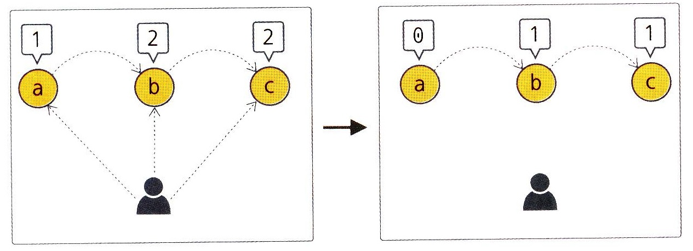
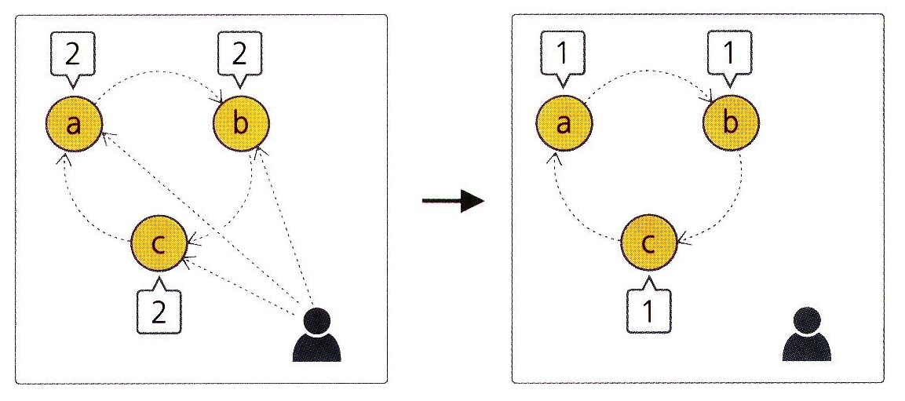
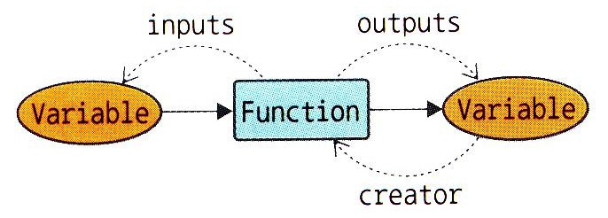
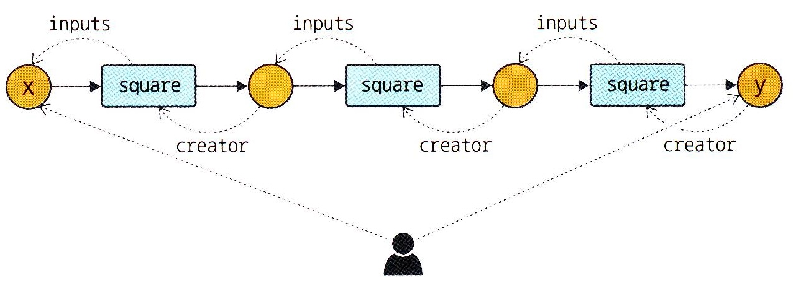

# 17단계 메모리 관리와 순환 참조

DeZero는 교육적인 면을 중시하여 가능한 한 이해하기 쉽도록 만들었습니다. 그래서 성능은 다소 희생한 감이 있습니다. 실제로도 지금까지의 구현에서는 처리 속도와 메모리 사용량에 전혀 신경 쓰지 않았습니다. 하지만 너무 한쪽으로 치우치는 것도 교육적으로 좋지는 않으므로 이번 단계와 다음 단계에 걸쳐 성능을 개선할 수 있는 대책(기술)을 DeZero에 도입할 계획입니다. 그럼 본격적인 시작에 앞서 파이썬에서의 메모리 관리에 대해 살짝 알아보겠습니다.

---

> **NOTE**  
> '파이썬'이라고 하면 보통은 '프로그래밍 언어'를 가리키지만 때로는 파이썬 코드를 실행하는 '프로그램'을 지칭할 때도 씁니다. 이 프로그램을 일반적으로 '파이썬 인터프리터'라고 부릅니다. 또한 표준으로 사용되는 파이썬 인터프리터는 C 언어로 구현된 CPython입니다. 그래서 이번 단계에서 설명하는 파이썬 메모리 관리 설명은 CPython을 기준으로 합니다.

---

## 17.1 메모리 관리

파이썬은 필요 없어진 객체를 메모리에서 자동으로 삭제합니다. 이 고마운 기능 덕분에 우리는 메모리 관리를 의식할 일이 크게 줄어듭니다. 

---

불필요한 객체는 파이썬 인터프리터가 (우리 모르게) 제거해주기 때문에 우리는 더 중요한 작업에 집중할 수 있는 것이죠. 그렇더라도 코드를 제대로 작성하지 않으면 때때로 메모리 누수<sup>memory leak</sup> 또는 메모리 부족<sup>out of memory</sup> 등의 문제가 발생합니다. 

---

특히 신경망에서는 큰 데이터를 다루는 경우가 많아서 메모리 관리를 제대로 하지 않으면 실행 시간이 오래 걸리는(GPU의 경우 실행할 수조차 없는) 일이 자주 발생합니다.

---

그렇다면 파이썬은 메모리를 어떤 식으로 관리하고 있을까요? 

---

파이썬(정확하게는 CPython)의 메모리 관리는 두 가지 방식으로 진행됩니다. 하나는 참조<sup>reference</sup> 수를 세는 방식이고, 다른 하나는 세대<sup>generation</sup>를 기준으로 쓸모없어진 객체<sup>garbage</sup>를 회수<sup>collection</sup>하는 방식입니다. 

---

이 강의에서는 전자를 '참조 카운트'로, 후자를 'GC<sup>Garbage Collection, 가비지 컬렉션</sup>'라고 부르겠습니다. 우선 참조 카운트에 대해 설명합니다.

---

> **CAUTION**  
> 문헌에 따라 참조 카운트 방식의 메모리 관리도 GC로 보기도 합니다. 이 강의에서는 둘을 구분해서 부르겠습니다.

---

## 17.2 참조 카운트 방식의 메모리 관리

파이썬 메모리 관리의 기본은 참조 카운트입니다. 

---
참조 카운트는 구조가 간단하고 속도도 빠릅니다! 모든 객체는 참조 카운트가 0인 상태로 생성되고, 다른 객체가 참조할 때마다 1씩 증가합니다. 반대로 객체에 대한 참조가 끊길 때마다 1만큼 감소하다가 0이 되면 파이썬 인터프리터가 회수해갑니다. 

---

이런 방식으로 객체가 더 이상 필요 없어지면 즉시 메모리에서 삭제됩니다. 이상이 참조 카운트 방식의 메모리 관리입니다.

---

참고로 가령 다음과 같은 경우에 참조 카운트가 증가합니다.

* 대입 연산자를 사용할 때
* 함수에 인수로 전달할 때
* 컨테이너 타입 객체(리스트, 튜플, 클래스 등)에 추가할 때

---

코드로서 예를 준비했습니다(개념을 설명하기 위한 의사코드라서 동작하지는 않습니다).

```python
class obj:
    pass

def f(x):
    print(x)

a = obj()  # 변수에 대입: 참조 카운트 1
f(a)       # 함수에 전달: 함수 안에서는 참조 카운트 2
# 함수 완료: 빠져나오면 참조 카운트 1
a = None   # 대입 해제: 참조 카운트 0
```

---

먼저 `obj()`에 의해 생성된 객체<sup>\*</sup>를 `a`에 대입했습니다. 그러면 이 객체의 참조 카운트는 1입니다. 다음 줄에서 함수 `f(a)`를 호출하는데, 이때 `a`가 인수로 전달되기 때문에 함수 `f`의 범위 안에서는 참조 카운트가 1 증가합니다(총 2). 그리고 함수의 범위를 벗어나면 참조 카운트가 다시 1 감소합니다. 

---

마지막으로 `a = None`에서 참조를 끊으면 결국 0이 됩니다(아무도 참조하지 않는 상태). 이렇게 0이 되는 즉시 해당 객체는 메모리에서 삭제됩니다.

---

보다시피 참조 카운트 방식은 간단합니다. 그리고 이 간단한 방식을 사용하여 수많은 메모리 문제를 해결할 수 있습니다. 다음 코드를 보시죠.

```python
a = obj()
b = obj()
c = obj()

a.b = b
b.c = c

a = b = c = None
```

---

`a`, `b`, `c`라는 세 개의 객체를 생성했습니다. 그리고 `a`가 `b`를 참조하고, `b`가 `c`를 참조합니다. 자, 이제 객체의 관계는 [그림 17-1]의 왼쪽처럼 되었습니다.

그림 17-1 객체 관계도(참조 관계는 점선, 숫자는 참조 카운트)


---

그런 다음 `a = b = c = None` 줄을 실행하면 객체의 관계는 [그림 17-1]의 오른쪽처럼 변합니다. 이때 `a`의 참조 카운트는 0이 됩니다(b와 c의 참조 카운트는 1입니다). 따라서 `a`는 즉시

---
파이썬에서는 사실 모든 대상이 객체입니다. 클래스도 함수도 다 객체인 것이죠. 클래스로부터 생성된 인스턴스 역시 객체입니다. 

---

이번 단계에서는 참조 카운트를 설명하기 위해, 이 중에서 특히 인스턴스를 가리켜 객체라고 부르겠습니다.

그 여파로 `b`의 참조 카운트가 1에서 0으로 감소하여 `b` 역시 삭제됩니다. 똑같은 원리로 `c`의 참조 카운트도 0이 되어 삭제됩니다. 이렇게 사용자로부터 참조되지 않는 객체들이 마치 도미노처럼 한꺼번에 삭제되는 것입니다.

---


이것이  파이썬의 참조 카운트 방식 메모리 관리입니다. 이 기능이 수많은 메모리 관리 문제를 해결해줍니다. 
---

하지만 참조 카운트로는 해결할 수 없는 문제가 있으니, 바로 순환 참조입니다.

---

## 17.3 순환 참조

다음은 순환 참조<sup>circular reference</sup>를 설명하기 위해 준비한 코드입니다.

```python
a = obj()
b = obj()
c = obj()

a.b = b
b.c = c
c.a = a

a = b = c = None
```
---

앞서 보여드린 코드와 거의 같지만, 이번에는 `c`에서 `a`로의 참조가 추가됐습니다. 그래서 세 개의 객체가 원 모양을 이루며 서로가 서로를 참조하게 되는데, 이 상태가 바로 순환 참조입니다. 

---
현재의 `a`, `b`, `c` 관계는 [그림 17-2]와 같습니다.

그림 17-2 순환 참조가 발생한 객체 관계도(점선이 참조를 뜻함)


[그림 17-2]의 오른쪽에서 `a`, `b`, `c`의 참조 카운트는 모두 1입니다. 

---

하지만 사용자는 이들 세 객체 중 어느 것에도 접근할 수 없습니다(즉, 모두 불필요한 객체입니다). 그러나 `a = b = c = None`을 실행하는 것으로는 순환 참조의 참조 카운트가 0이 되지 않고, 결과적으로 메모리에서 삭제되지 않습니다. 

---

그래서 또 다른 메모리 관리 방식이 등장합니다. 그 주인공이 GC입니다(정확하게는 '세대별 가비지 컬렉션<sup>generational garbage collection</sup>').

---

GC는 참조 카운트보다 영리한 방법으로 불필요한 객체를 찾아냅니다(GC의 구조는 복잡하기 때문에 이 교제에서는 설명을 생략합니다). GC는 참조 카운트와 달리 메모리가 부족해지는 시점에 파이썬 인터프리터에 의해 자동으로 호출됩니다. 물론 명시적으로 호출할 수도 있습니다(`gc` 모듈을 임포트해서 `gc.collect()`를 실행).

---


GC는 순환 참조를 올바르게 처리합니다. 따라서 일반적인 파이썬 프로그래밍에서는 순환 참조를 의식할 필요가 특별히 없습니다. 

---

하지만 메모리 해제를 GC에 미루다 보면 프로그램의 전체 메모리 사용량이 (순환 참조가 없을 때와 비교해) 커지는 원인이 됩니다(자세한 내용은 문헌 [10] 참고). 

---
그런데 마침 머신러닝, 특히 신경망에서 메모리는 중요한 자원입니다. 따라서 DeZero를 개발할 때는 순환 참조를 만들지 않는 것이 좋겠지요.
---
이 정도면 파이썬의 메모리 관리에 관한 지식은 충분한 것 같습니다. 그럼 DeZero로 눈을 돌려볼까요? 사실 현재의 DeZero에는 순환 참조가 존재합니다. 

---
바로 [그림 17-3]과 같이 '변수'와 '함수'를 연결하는 방식에 순환 참조가 숨어 있습니다.

그림 17-3 Variable과 Function 사이의 순환 참조


---

[그림 17-3]에서 보듯 Function 인스턴스는 두 개의 Variable 인스턴스(입력과 출력)를 참조합니다. 그리고 출력 Variable 인스턴스는 창조자인 Function 인스턴스를 참조합니다. 

---
이때 Function 인스턴스와 Variable 인스턴스가 순환 참조 관계를 만듭니다. 다행히 이 순환 참조는 표준 파이썬 모듈인 `weakref`로 해결할 수 있습니다.

---

## 17.4 weakref 모듈

파이썬에서는 `weakref.ref` 함수를 사용하여 약한 참조<sup>weak reference</sup>를 만들 수 있습니다. 약한 참조란 다른 객체를 참조하되 참조 카운트는 증가시키지 않는 기능입니다. 

---

다음은 `weakref.ref` 함수를 사용하는 예입니다.

```python
>>> import weakref
>>> import numpy as np

>>> a = np.array([1, 2, 3])
>>> b = weakref.ref(a)

>>> b
<weakref at 0x103b7f048; to 'numpy.ndarray' at 0x103b67e90>

>>> b()
array([1, 2, 3])
```

---

`ndarray` 인스턴스를 대상으로 실험을 해봤습니다. 먼저 `a`는 일반적인 방식으로 참조하고, 다음으로 `b`는 약한 참조를 갖게 했습니다. 

---
이 상태로 `b`를 출력해보면 `ndarray`를 가리키는 약한 참조(weakref)임을 확인할 수 있습니다. 참고로, 참조된 데이터에 접근하려면 `b()`라고 쓰면 됩니다.

---


그럼 앞의 코드에 바로 이어서 `a = None`을 실행하면 어떻게 될까요? 

---
결과는 다음과 같습니다.

```python
>>> a = None
>>> b
<weakref at 0x103b7f048; dead>
```

이와 같이 `ndarray` 인스턴스는 참조 카운트 방식에 따라 메모리에서 삭제됩니다.

---
. `b`도 참조를 가지고 있지만 약한 참조이기 때문에 참조 카운트에 영향을 주지 못하는 것이죠. 그래서 `b`를 출력하면 dead라는 문자가 나오고, 이것으로 `ndarray` 인스턴스가 삭제됐음을 알 수 있습니다.

---

> **CAUTION**  
> 지금까지의 약한 참조 실험 코드는 파이썬 인터프리터에서 실행한다고 가정했습니다. IPython과 주피터 노트북<sup>Jupyter Notebook</sup> 등의 인터프리터는 인터프리터 자체가 사용자가 모르는 참조를 추가로 유지하기 때문에 앞의 코드에서 `b`가 여전히 유효한 참조를 유지할 것입니다(dead가 되지 않습니다).

---

이 `weakref` 구조를 DeZero에도 도입하려 합니다. 먼저 `Function`에 다음 음영 부분을 추가합니다.

**steps/step17.py**
```python
import weakref

class Function:
    def __call__(self, *inputs):
        xs = [x.data for x in inputs]
        ys = self.forward(*xs)
        if not isinstance(ys, tuple):
            ys = (ys,)
        outputs = [Variable(as_array(y)) for y in ys]

        self.generation = max([x.generation for x in inputs])
        for output in outputs:
            output.set_creator(self)
        self.inputs = inputs
        self.outputs = [weakref.ref(output) for output in outputs]
        return outputs if len(outputs) > 1 else outputs[0]
```

---

이와 같이 인스턴스 변수 `self.outputs`가 대상을 약한 참조로 가리키게 변경합니다. 그 결과 함수는 출력 변수를 약하게 참조합니다. 또한 이 변경의 여파로 다른 클래스에서 `Function` 클래스의 `outputs`를 참조하는 코드도 수정해야 합니다. 

---

DeZero에서는 `Variable` 클래스의 `backward` 메서드를 다음처럼 수정하면 됩니다.

**steps/step17.py**
```python
class Variable:
    # ...
    def backward(self):
        # ...
        while funcs:
            f = funcs.pop()
            # 수정 전: gys = [output.grad for output in f.outputs]
            gys = [output().grad for output in f.outputs]
            # ...
```

이와 같이 `[output.grad for ...]` 부분을 `[output().grad for ...]`로 수정합니다. 이상으로 DeZero의 순환 참조 문제가 해결되었습니다.

---

## 17.5 동작 확인

순환 참조가 없어진 새로운 DeZero에서 다음 코드를 실행해보죠.

**steps/step17.py**
```python
for i in range(10):
    x = Variable(np.random.randn(10000))  # 거대한 데이터
    y = square(square(square(x)))         # 복잡한 계산을 수행한다.
```
---

`for` 문을 사용하여 계산을 반복해 수행했습니다. 이 반복문은 [그림 17-4]와 같이 복잡한 참조 구조를 만들어냅니다.

그림 17-4 `x`와 `y`를 사용자가 참조하고 있을 때의 관계도

---

그리고 `for` 문이 두 번째 반복될 때 `x`와 `y`가 덮어 써집니다. 그러면 사용자는 이전의 계산 그래프를 더 이상 참조하지 않게 되죠. 참조 카운트가 0이 되므로 이 시점에 계산 그래프에 사용된 메모리가 바로 삭제됩니다. 

이것으로 DeZero 순환 참조 문제가 해소되었습니다.

---

> **NOTE**  
> 파이썬으로 메모리 사용량을 측정하려면 외부 라이브러리인 memory profiler<sup>[11]</sup> 등을 사용하면 편리합니다. 방금 전의 코드를 실제로 측정해보면 메모리 사용량이 전혀 증가하지 않음을 확인할 수 있을 겁니다.
