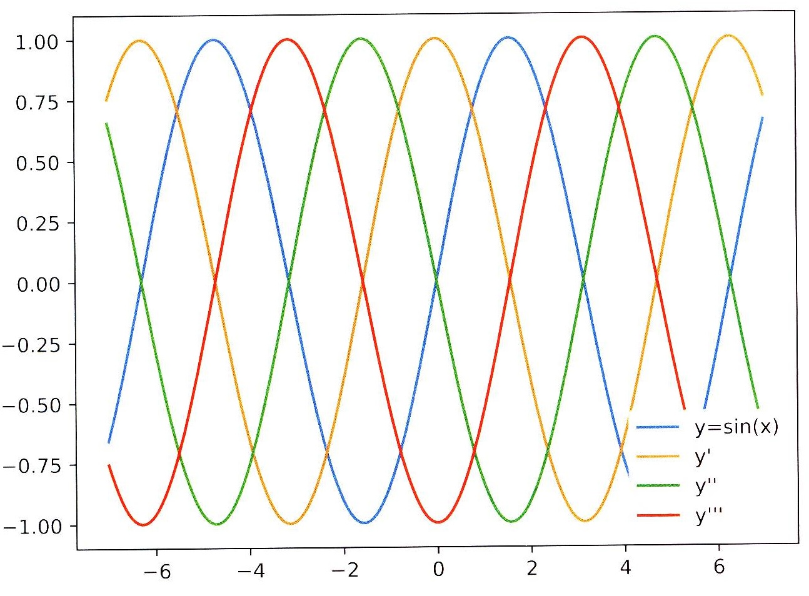

# 34단계 sin 함수 고차 미분

지금까지 고차 미분에 대응하는 함수들(`Add`, `Mul`, `Neg`, `Sub`, `Div`, `Pow` 클래스)을 구현하여 `dezero/core.py`에 추가해뒀습니다. 이번 단계에서는 새로운 DeZero 함수 몇 개를 추가로 구현하겠습니다.

> **NOTE**
> 앞으로 나오는 DeZero 함수는 `dezero/functions.py`에 추가하겠습니다. 따라서 이 DeZero 함수들을 다른 파일에서 사용하려면 `from dezero.functions import sin` 형태로 임포트해야 합니다.

---

## 34.1 sin 함수 구현

우선 고차 미분에 대응하는 새로운 `Sin` 클래스를 구현하겠습니다. 수식으로는 $y = \sin(x)$ 일 때 $\frac{\partial y}{\partial x} = \cos(x)$ 입니다. 따라서 `Sin` 클래스와 `sin` 함수는 다음과처럼 구현할 수 있습니다.

**dezero/functions.py**
```python
import numpy as np
from dezero.core import Function

class Sin(Function):
    def forward(self, x):
        y = np.sin(x)
        return y
```

```python
    def backward(self, gy):
        x, = self.inputs
        gx = gy * cos(x) # 1
        return gx

def sin(x):
    return Sin()(x)
```

`backward` 메서드에 주목해보죠. 특히 `backward` 메서드 안의 모든 변수가 `Variable` 인스턴스인 점이 중요합니다(`forward` 메서드 안의 변수는 `ndarray` 인스턴스입니다). 따라서 1의 `cos(x)`는 DeZero의 `cos` 함수입니다. 이는 `Sin` 클래스를 구현하려면 `Cos` 클래스와 `cos` 함수가 필요하다는 뜻입니다.

또한 `backward` 메서드 구현 시 모든 계산은 반드시 DeZero 함수를 사용해야 합니다. 만약 해당하는 DeZero 함수가 없다면 새로 구현해야 합니다. 앞의 코드에서 `gy * cos(x)`에는 곱셈 연산자를 오버로드해 놓았기 때문에 DeZero의 `mul` 함수가 호출됩니다.

> **NOTE**
> `dezero/functions.py`에 있는 `Sin` 클래스의 코드는 앞의 코드와 다른 부분이 일부 있습니다. GPU를 활용하는 코드가 추가되어 있기 때문이죠. 앞으로 선보이는 함수들도 마찬가지로 GPU 대응 코드는 지면에서 생략하겠습니다. 참고로 GPU 대응은 52단계에서 진행합니다.

---

## 34.2 cos 함수 구현

이어서 `Cos` 클래스와 `cos` 함수를 구현하겠습니다. 수식으로는 $y = \cos(x)$ 일 때 $\frac{\partial y}{\partial x} = -\sin(x)$ 입니다. 코드는 다음과 같습니다.

**dezero/functions.py**
```python
class Cos(Function):
    def forward(self, x):
        y = np.cos(x)
        return y

    def backward(self, gy):
        x, = self.inputs
        gx = gy * -sin(x)
        return gx
```

```python
def cos(x):
    return Cos()(x)
```

이번에도 `backward` 메서드에 주목해야 합니다. `backward`에서의 구체적인 계산에서 `sin` 함수를 사용하고 있군요. 다행히 `sin` 함수는 앞 절에서 이미 구현했으니 더 할 일은 없습니다. 이것으로 DeZero의 `sin` 함수와 `cos` 함수의 구현이 끝났습니다.

---

## 34.3 sin 함수 고차 미분

다음 차례로 `sin` 함수의 고차 미분입니다. 이번에는 2차 미분뿐 아니라 3차 미분, 4차 미분도 계산해보겠습니다. 코드는 다음과 같습니다.

```python
import numpy as np
from dezero import Variable
import dezero.functions as F

x = Variable(np.array(1.0))
y = F.sin(x)
y.backward(create_graph=True)

for i in range(3):
    gx = x.grad
    x.cleargrad()
    gx.backward(create_graph=True)
    print(x.grad) # n차 미분
```

**실행 결과**
```text
variable(-0.8414709848078965)
variable(-0.5403023058681398)
variable(0.8414709848078965)
```

`for` 문을 사용하여 역전파를 반복했습니다. 그에 따라 2차 미분, 3차 미분, ... 식으로 'n차 미분'이 구해집니다. 이 `for` 문 안의 코드는 지금까지와 다르지 않습니다. 먼저 `gx = x.grad`에서 미분값을 꺼내 `gx`에서 역전파하는 것이죠. 그리고 역전파를 하기 전에 `x.cleargrad()`를 호출하여 미분값을 재설정합니다. 이 작업을 반복하여 n차 미분을 계산하고 있습니다.

> **NOTE**
> 앞의 코드에서는 `import dezero.functions as F`라는 임포트문을 사용했습니다. DeZero 함수들을 `F.sin()`이나 `F.cos()`처럼 간단히 사용하기 위해서입니다. 앞으로 `dezero/functions.py`에 다양한 함수를 추가할 것이므로 `F.xxx()` 형태로 사용하는 게 편리합니다.

이어서 앞의 코드를 조금 확장하여 그래프를 그려보겠습니다. 코드는 다음과 같습니다.

**steps/step34.py**
```python
import numpy as np
import matplotlib.pyplot as plt
from dezero import Variable
import dezero.functions as F

x = Variable(np.linspace(-7, 7, 200)) # 1
y = F.sin(x)
y.backward(create_graph=True)

logs = [y.data]

for i in range(3):
    logs.append(x.grad.data)
    gx = x.grad
    x.cleargrad()
    gx.backward(create_graph=True)

# 그래프 그리기
labels = ["y=sin(x)", "y'", "y''", "y'''"]
for i, v in enumerate(logs):
    plt.plot(x.data, logs[i], label=labels[i])
plt.legend(loc='lower right')
plt.show()
```

이전 코드와의 주요 차이는 1 부분으로, 입력 변수를 `x = Variable(np.linspace(-7, 7, 200))` 형태로 설정했습니다. `np.linspace(-7, 7, 200)`은 -7부터 7까지 균일하게 200등분한 배열을 만들어줍니다. 구체적으로는 `[-7., -6.92964824, -6.85929648, ..., 7.]`이라는 1차원 배열이 만들어지죠. 그리고 이렇게 만들어진 1차원 배열을 `Variable`로 감싸 $x$ 에 할당했습니다.

입력 변수가 1차원 배열이 된 것을 제외하면 고차 미분을 계산하는 코드는 이전과 똑같습니다. 그리고 지금까지 구현해온 DeZero 함수는 다차원 배열을 입력받으면 각 원소에 대해 독립적

으로 계산합니다. 따라서 한 번의 계산(순전파)으로 원소 200개의 계산이 모두 이루어집니다.

> **CAUTION**
> 넘파이 함수 대부분은 다차원 배열이 주어지면 원소별로 독립적으로 계산해줍니다. 그리고 DeZero 함수는 순전파 시 `ndarray` 인스턴스에는 넘파이 함수를 사용하므로 DeZero 함수에 다차원 배열을 건네면 원소별 계산이 이루어집니다.

코드를 실행하면 [그림 34-1]을 얻을 수 있습니다.

**그림 34-1 $y = \sin(x)$ 와 고차 미분 그래프($y'$ 는 1차 미분, $y''$ 는 2차 미분, $y'''$ 는 3차 미분)**

*(사인 그래프와 그것의 1차, 2차, 3차 미분 그래프들이 위상이 순차적으로 변동하면서 그려져 있습니다.)*

[그림 34-1]과 같이 $y = \sin(x)$ 와 그 고차 미분 그래프를 얻을 수 있습니다. 보다시피 각각의 그래프는 파도 모양 위상이 '어긋난' 함수입니다. 1차 미분, 2차 미분, 3차 미분, ... 식으로 차수가 증가함에 따라 $y = \sin(x) \rightarrow y = \cos(x) \rightarrow y = -\sin(x) \rightarrow y = -\cos(x)$ 식으로 진행될 것입니다.

이것으로 이번 단계를 마칩니다. 이번 단계에서는 DeZero에 `sin` 함수와 `cos` 함수를 새로 구해 넣었습니다. 다음 단계에서도 새로운 DeZero 함수를 추가할 것입니다.
