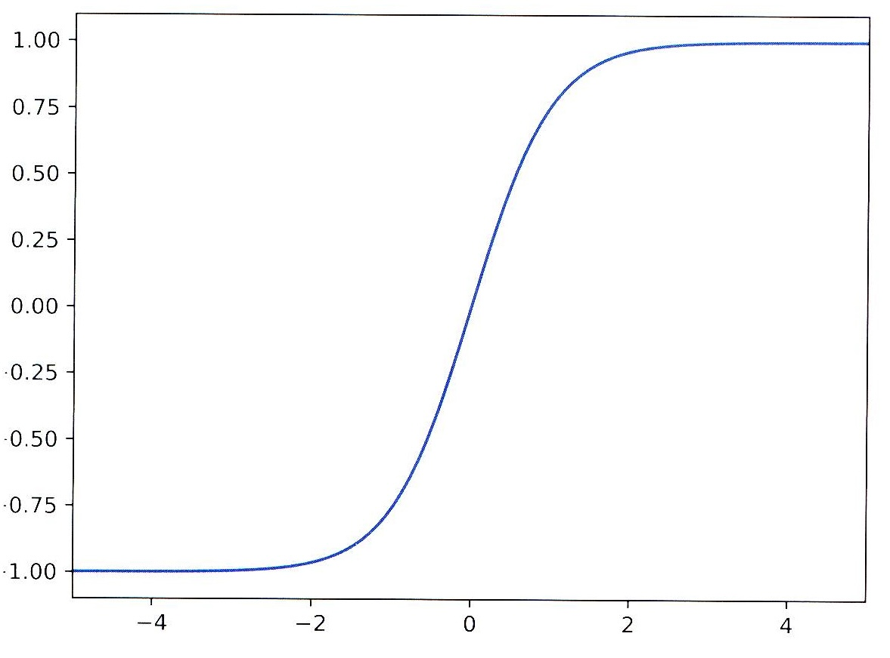
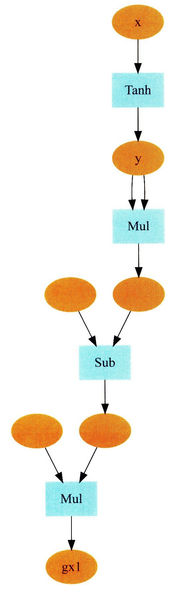
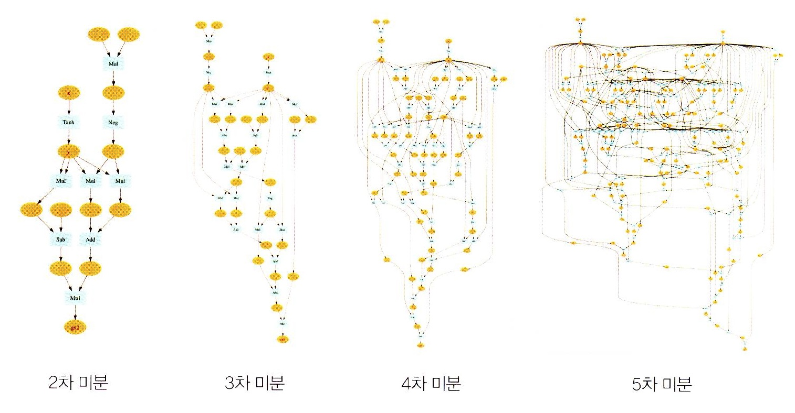
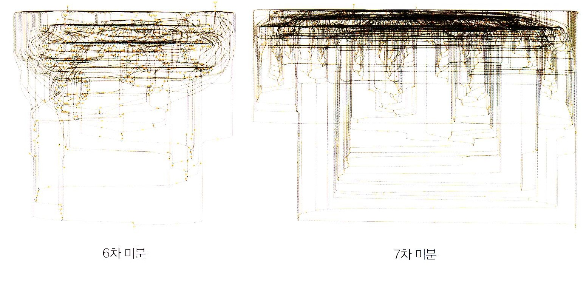
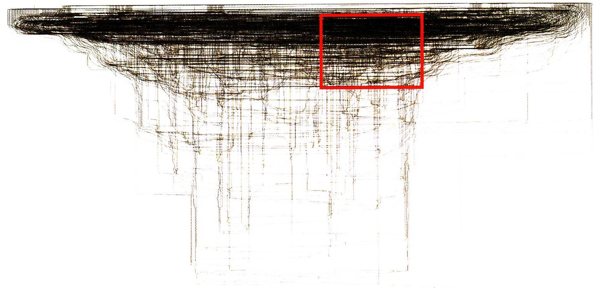

# 35단계 고차 미분 계산 그래프

이전 단계에 이어 이번 단계에서도 DeZero 함수를 추가합니다. 이번에 추가할 함수는 `tanh`입니다. `tanh`는 쌍곡탄젠트 혹은 하이퍼볼릭 탄젠트라고 읽습니다. 수식은 [식 35.1]과 같으며, 모양은 [그림 35-1]과 같습니다.

$$
y = \tanh(x) = \frac{e^x - e^{-x}}{e^x + e^{-x}}
$$

   [식 35.1]

**그림 35-1 tanh 함수의 모양**

*(대표적인 S자 곡선을 그리는 하이퍼볼릭 탄젠트 함수 그래프가 나타나 있습니다.)*

[그림 35-1]과 같이 `tanh` 함수는 입력을 $-1 \sim 1$ 사이의 값으로 변환합니다. 그럼 [식 35.1]의 미분인 $\frac{\partial y}{\partial x}$ 부터 구해봅시다.

---

## 35.1 tanh 함수 미분

`tanh` 함수의 미분은 다음의 미분 공식을 이용해 계산합니다.

$$
\left\{ \frac{f(x)}{g(x)} \right\}' = \frac{f'(x)g(x) - f(x)g'(x)}{g(x)^2}
$$

   [식 35.2]

[식 35.2]는 분수 함수의 미분 공식입니다. 여기에서는 읽기 쉽도록 $f(x)$ 의 $x$ 에 대한 미분을 $f'(x)$ 로 표기했습니다. 이때 자연로그의 밑($e$)에 대해 $\frac{\partial e^x}{\partial x} = e^x$ 이고 $\frac{\partial e^{-x}}{\partial x} = -e^{-x}$ 인 점을 이용하면 [식 35.1]의 `tanh` 함수는 다음과 같이 미분할 수 있습니다.

$$
\begin{aligned}
\frac{\partial \tanh(x)}{\partial x} &= \frac{(e^x + e^{-x})(e^x + e^{-x}) - (e^x - e^{-x})(e^x - e^{-x})}{(e^x + e^{-x})^2} \\
&= 1 - \frac{(e^x - e^{-x})(e^x - e^{-x})}{(e^x + e^{-x})^2} \\
&= 1 - \left\{ \frac{e^x - e^{-x}}{e^x + e^{-x}} \right\}^2 \quad \text{[식 35.3]} \\
&= 1 - \tanh(x)^2 \\
&= 1 - y^2
\end{aligned}
$$

[식 35.3]과 같이 `tanh` 함수의 미분은 '분수 함수의 미분'을 이용하여 간단한 식으로 변환할 수 있으며, 최종적으로는 $1 - y^2$ 이라는 결과를 얻었습니다.

---

## 35.2 tanh 함수 구현

`tanh` 함수의 미분은 $y = \tanh(x)$ 일 때 $\frac{\partial \tanh(x)}{\partial x} = 1 - y^2$ 입니다. 그래서 `Tanh` 클래스와 `tanh` 함수는 다음과 같이 구현할 수 있습니다.

**dezero/functions.py**
```python
class Tanh(Function):
    def forward(self, x):
        y = np.tanh(x)
        return y

    def backward(self, gy):
        y = self.outputs[0]()
        gx = gy * (1 - y * y)
        return gx

def tanh(x):
    return Tanh()(x)
```

순전파에서는 넘파이의 `np.tanh` 메서드를 이용합니다. 한편 역전파에서는 `gy * (1 - y * y)` 형태로 구현합니다(물론 `gy * (1 - y ** 2)`라고 작성해도 됩니다). 이상이 DeZero의 `tanh` 함수 구현입니다. `tanh` 함수는 앞으로도 사용할 수 있도록 `dezero/functions.py`에 추가하겠습니다.

---

## 35.3 고차 미분 계산 그래프 시각화

DeZero의 `tanh` 함수를 구현했으니 이 함수를 사용하여 재미있는 실험을 하나 해보려 합니다. 먼저 `tanh` 함수의 고차 미분을 계산하고, 그 계산 그래프를 시각화해보죠. 1차 미분, 2차 미분, 3차 미분, ... 식으로 진행하면서 어떤 계산 그래프가 만들어지는지 살펴보겠습니다. 실험 코드는 다음과 같습니다.

**steps/step35.py**
```python
import numpy as np
from dezero import Variable
from dezero.utils import plot_dot_graph
import dezero.functions as F

x = Variable(np.array(1.0))
y = F.tanh(x)
x.name = 'x'
y.name = 'y'
y.backward(create_graph=True)

iters = 0

for i in range(iters):
    gx = x.grad
    x.cleargrad()
    gx.backward(create_graph=True)

# 계산 그래프 그리기
gx = x.grad
gx.name = 'gx' + str(iters+1)
plot_dot_graph(gx, verbose=False, to_file='tanh.png')
```

지금까지 보아온 코드와 거의 같습니다. `for` 문에서 반복해서 역전파함으로써 고차 미분을 계산합니다. 반복 횟수는 `iters`값으로 지정합니다. `iters = 0`이면 1차 미분이, `iters = 1`이면 2차 미분이 계산되는 식입니다. 마지막으로, 생성된 계산 그래프를 시각화합니다.

> **NOTE**
> 계산 그래프 시각화에는 26단계에서 구현한 `plot_dot_graph` 함수를 이용했습니다. 이 함수는 `dezero/utils.py`에 있습니다.

코드를 실행해보죠. 우선 `iters = 0`일 때의 계산 그래프를 보겠습니다. 결과는 [그림 35-2]와 같습니다.

**그림 35-2 $y = \tanh(x)$ 의 1차 미분 계산 그래프**

*(입력 $x$ 가 `Tanh` 함수를 거쳐 $y$ 가 되고, $y$ 의 제곱($y \times y$)을 구하기 위해 `Mul`을 통과한 후, $1 - y^2$ 을 위해 `Sub`를 거치고, 최종적으로 `gy`와 곱해지는 `Mul`을 거쳐 $gx1$ 이 되는 계산 그래프가 그려져 있습니다.)*

[그림 35-2]는 $y = \tanh(x)$ 의 1차 미분을 계산하기 위한 계산 그래프입니다. DeZero 함수 중 `Tanh`, `Mul`, `Sub`가 사용되고 있음을 알 수 있습니다.

이어서 `iters`값을 변경하여 2~5차 미분을 계산해보겠습니다. 어떤 계산 그래프가 만들어질까요? 결과는 [그림 35-3]과 같습니다.

**그림 35-3 $n$ 차 미분($n = 2, 3, 4, 5$)의 계산 그래프**

*(2차 미분, 3차 미분, 4차 미분, 5차 미분으로 갈수록 노드와 연결선이 기하급수적으로 복잡해져서 그물망처럼 변해가는 형태를 보여줍니다.)*

[그림 35-3]에서 보듯 차수가 늘어날수록 계산 그래프도 복잡해집니다. 역전파를 할 때마다 기존까지의 계산에 대한 새로운 계산 그래프가 만들어지므로 노드 수가 기하급수적으로 증가합니다. 그림을 보니 마치 세포가 분열하는 듯하군요. 계속해서 [그림 35-4]는 6차 미분과 7차 미분의 결과입니다.

**그림 35-4 $n$ 차 미분($n = 6, 7$)의 계산 그래프**

*(6차 미분과 7차 미분에 이르러서는 노드와 연결선이 너무 조밀하여 거의 검은색 상자나 숲처럼 보일 정도로 극도로 복잡해집니다.)*

매우 복잡한 계산 그래프가 만들어졌습니다. 이 정도로 복잡한 계산 그래프를 손으로 그리는 것은 거의 불가능할 거 같습니다. DeZero는 분명 우리 손으로 만들었지만, DeZero 활용해 '우리 이상의 무언가'를 만들어낸 순간입니다! 이런 점이 컴퓨터와 프로그래밍의 매력이 아닐까 싶습니다.

> **NOTE**
> 이 계산 그래프들의 고해상도 버전을 [WegraLee/deep-learning-from-scratch-3](https://github.com/WegraLee/deep-learning-from-scratch-3/tree/tanh)에 올려뒀으니 관심 있는 분은 참고하세요.

마지막으로 8차 미분을 시각화해보며 이번 단계의 실험을 마치겠습니다.

**그림 35-5 8차 미분의 계산 그래프**

*(8차 미분 계산 그래프 전체의 전경입니다. 중앙 상단부에 붉은색 사각형 영역이 표시되어 있으며, 이 영역을 다음 페이지에서 확대해 보여줍니다.)*

계산 그래프가 한층 더 복잡해졌습니다. 지면으로는 노드의 형태조차 확인할 수 없을 정도지요. 얼마나 복잡한지 느껴볼 수 있도록 다음 페이지에는 [그림 35-5]의 사각형 영역만 확대하여 실어보았습니다. 이것으로 이번 단계의 실험은 끝입니다.
