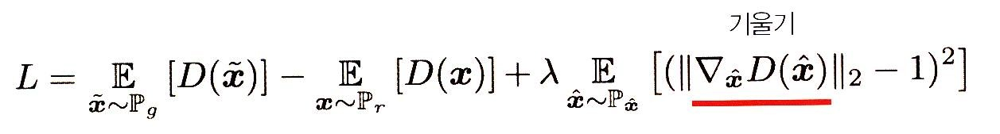

# 36단계 고차 미분 이외의 용도

지금까지 여러 단계를 거쳐 DeZero로 고차 미분을 계산해봤습니다. 본질적으로는 한 가지 일을 한 셈인데, 바로 역전파 시 수행되는 계산에 대해서도 '연결'을 만들도록 했습니다. 여기에서 중요한 점은 역전파의 계산 그래프를 만드는 기능 자체가 DeZero의 새로운 능력이라는 사실입니다. 고차 미분은 이 능력을 응용한 한 가지 예에 지나지 않습니다. 그래서 이번 단계에서는 새로워진 DeZero를 고차 미분 외에 또 어떻게 활용할 수 있는지 살펴보겠습니다.

> **NOTE**
> 새로운 DeZero에서는 역전파로 수행한 계산에 대해 또 다시 역전파할 수 있습니다. 이를 double backpropagation이라고 합니다(이후 double backprop로 줄여 표기). double backprop은 현대적인 딥러닝 프레임워크 대부분이 지원합니다.

---

## 36.1 double backprop의 용도

고차 미분 외에 double backprop을 또 어디에 활용할 수 있을까요? 우선 다음 문제를 생각해보죠.

**문제**: 다음의 두 식이 주어졌을 때 $x = 2.0$ 에서 $x$ 에 대한 $z$ 의 미분 $\frac{\partial z}{\partial x}$ 를 구하라.

$$
y = x^2
$$

 \hfill [식 36.1]

$$
z = \left( \frac{\partial y}{\partial x} \right)^3 + y
$$

 \hfill [식 36.2]

지금까지와 같은 미분 계산 문제지만 [식 36.2]에 이미 미분이 포함되어 있는 점이 다릅니다. 즉, 미분이 포함된 식에서 다시 한 번 미분해야 합니다. 이 문제도 `double backprop`으로 계산할 수 있습니다. 설명에 앞서 $\frac{\partial z}{\partial x}$ 를 손으로 계산해보겠습니다. 다음은 식의 전개 과정입니다.

$$
\frac{\partial y}{\partial x} = 2x
$$

$$
z = \left(\frac{\partial y}{\partial x}\right)^3 + y = 8x^3 + x^2
$$

$$
\frac{\partial z}{\partial x} = 24x^2 + 2x
$$

식을 이와 같이 전개한 후 $24x^2 + 2x$ 에 $x = 2.0$ 을 대입하면 $100.0$ 이라는 답을 얻을 수 있습니다.

> **CAUTION**
> 위 식에서 $\frac{\partial y}{\partial x}$ 는 값이 아니라 $x$ 의 식입니다. 만약 여기에서 $x = 2.0$ 일 때 $\frac{\partial y}{\partial x}$ 의 값을 찾고, 그 값을 $z = \left(\frac{\partial y}{\partial x}\right)^3 + y$ 에 대입하면 올바른 결과를 얻을 수 없습니다.

이상의 내용을 바탕으로 같은 문제를 DeZero를 사용해 풀어봅시다. 코드는 다음과 같습니다.

**steps/step36.py**
```python
import numpy as np
from dezero import Variable

x = Variable(np.array(2.0))
y = x ** 2
y.backward(create_graph=True)
gx = x.grad
x.cleargrad()

z = gx ** 3 + y
z.backward()
print(x.grad)
```

**실행 결과**
```text
variable(100.)
```

이 코드에서 중요한 부분은 `y.backward(create_graph=True)`입니다. 미분을 하기 위해 역전파하는 코드죠. 이 코드가 새로운 계산 그래프를 생성합니다(지금의 경우 `2 * x`라는 계산 그래프가 자동으로 생성됩니다). 그리고 역전파가 만들어낸 계산 그래프를 사용하여 새로운 계산을 하고 다시 역전파합니다. 이렇게 하면 미분이 올바르게 이루어집니다.

> **NOTE**
> 코드의 `gx = x.grad`는 단순한 변수(값)가 아니라 계산 그래프(식)입니다. 따라서 `x.grad`의 계산 그래프에 대해 추가로 역전파할 수 있습니다.

이상과 같은 형태의 문제(미분의 식을 구하고, 그 식을 사용하여 계산한 다음, 또다시 미분하는 문제)를 `double backprop`으로 해결할 수 있습니다. 딥러닝 연구에서도 많이 볼 수 있는 유형의 문제로, 다음 절에서는 딥러닝 연구에서 사용한 예를 몇 가지 소개하겠습니다.

---

## 36.2 딥러닝 연구에서의 사용 예

딥러닝에서 `double backprop`을 사용하는 연구는 여러 가지입니다. 예를 들어 WGAN-GP<sup>[21]</sup> 논문에서는 [그림 36-1]의 수식을 최적화합니다.

**그림 36-1 WGAN-GP에서 최적화하는 함수(수식은 참고문헌 [21]에서 인용)**


$$
L = \mathbb{E}_{\tilde{x} \sim \mathbb{P}_g} [D(\tilde{x})] - \mathbb{E}_{x} \sim \mathbb{P}_r [D(x)] + \lambda \mathbb{E}_{\hat{x} \sim \mathbb{P}_{\hat{x}}} \left[ \left( \left\| \nabla_{\hat{x}} D(\hat{x}) \right\|_2 - 1 \right)^2 \right]
$$

*(기울기 항 부분 아래에 빨간 선 지시선이 있으며, 해당 수식의 마지막 항 부분이 "기울기"를 나타냅니다.)*

[그림 36-1]에서 주목할 점은 최적화하는 식에 기울기(텐서의 각 원소에 대한 미분 결과)가 들어 있다는 것입니다. 이 기울기는 첫 번째 역전파에서 구할 수 있습니다. 그리고 이 기울기를 사용하여 함수 $L$ 을 계산하고 함수 $L$ 을 최적화하기 위해 두 번째 역전파를 합니다.

이와 같이 최신의 연구에서도 `double backprop`이 사용됩니다. WGAN-GP 외에 MAML<sup>[22]</sup>과 TRPO<sup>[23]</sup> 등 유명한 연구에서 `double backprop` 기능이 실제로 사용되고 있답니다.

> **NOTE**
> `TRPO`에서는 헤세 행렬과 벡터의 곱을 구할 때 `double backprop`을 사용합니다. `double backprop`을 사용하면 계산 효율이 좋아지죠. 헤세 행렬과 벡터의 곱에 관해서는 이어지는 '칼럼: 뉴턴 방법과 double backprop 보충 학습'에서 설명합니다.

<p align="center">★ ★ ★ ★ ★ ★ ★</p>

이상으로 제3고지도 정복했습니다. 이번 고지에서는 DeZero의 역전파를 수정하여 `double backprop`이 가능하게 되었습니다. 이를 통해 고차 미분에 필요한 뉴턴 방법을 구현할 수 있었습니다. 다음 고지부터는 DeZero를 본격 신경망용으로 탈바꿈시킬 계획입니다.
