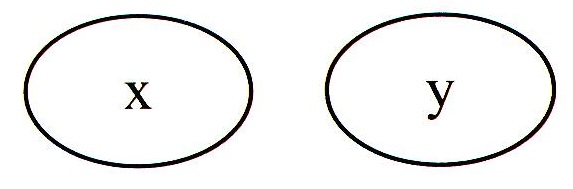
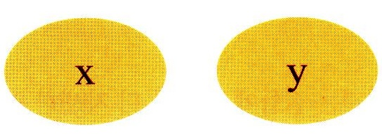
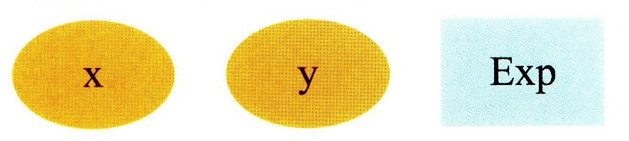
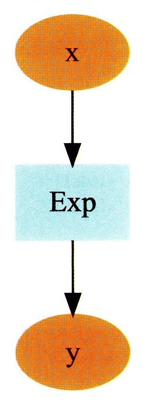

# 25단계 계산 그래프 시각화(1)

DeZero는 이제 복잡한 수식도 쉽게 코드로 옮길 수 있습니다. 실제로 24단계에서는 Goldstein-Price 함수라는 매우 복잡한 함수를 코딩했습니다. 그런데 이런 복잡한 식을 계산할 때 그 뒤편에서는 어떤 '계산 그래프'가 만들어지는 것일까요? 그 전모를 눈으로 직접 확인하고 싶지 않나요? 그런 분들을 위해 이번 단계에서는 계산 그래프를 시각화합니다.

> **NOTE**
> 계산 그래프를 시각화하면 문제가 발생했을 때 원인이 되는 부분을 파악하기 쉬워집니다. 또한 더 나은 계산 방법을 발견할 수도 있고, 신경망의 구조를 3자에게 시각적으로 전달하는 용도로도 활용할 수 있습니다.

시각화 도구도 밑바닥부터 만들 수 있지만 이 책의 주제인 딥러닝에서 조금 탈선하는 느낌이라 외부 자원인 Graphviz<sup>[18]</sup>를 활용하려 합니다. 이번 단계에서는 주로 Graphviz의 사용법을 설명하고, 다음 단계에서 Graphviz를 사용하여 계산 그래프를 시각화하겠습니다.

---

## 25.1 Graphviz 설치하기

Graphviz는 그래프를 시각화해주는 도구입니다(여기서 '그래프'는 계산 그래프와 같이 노드와 화살표로 이뤄진 데이터 구조를 말합니다). Graphviz를 이용하면 예쁜 그림을 쉽게 그릴 수 있습니다. 우선 설치부터 함께 해보겠습니다.

> **NOTE**
> Graphviz는 윈도우, macOS, 리눅스에서 사용할 수 있습니다. 이 책에서는 macOS와 우분투<sup>Ubuntu</sup>(리눅스 배포판 중 하나)에서의 설치 방법을 소개합니다. 다른 OS에서의 설치 방법은 Graphviz의 웹 페이지를 참고하세요(https://graphviz.gitlab.io/download/).

macOS는 Homebrew와 MacPorts를 사용하여 설치할 수 있습니다. Homebrew를 사용하는 경우 터미널을 열고 다음 명령을 실행합니다.

```bash
$ brew install graphviz
```

우분투의 경우 터미널에서 다음 명령을 실행하면 됩니다.

```bash
$ sudo apt install graphviz
```

설치가 끝나면 터미널에서 `dot` 명령을 사용할 수 있게 됩니다. 시험 삼아 다음 명령을 실행해 볼까요?

```bash
$ dot -V
dot - graphviz version 2.40.1 (20161225.0304)
```

이와 같이 Graphviz 버전이 출력되면 제대로 설치된 것입니다. 이어서 `dot` 명령의 사용법을 보겠습니다.

```bash
$ dot sample.dot -T png -o sample.png
```

이 명령은 `sample.dot`라는 파일을 `sample.png`로 변환합니다. 옵션 `-o` 다음에 출력 '파일 이름'을 지정하고, 옵션 `-T` 다음에 출력 파일의 '형식'을 지정합니다. png 외에 pdf나 svg 등도 지원합니다.

앞의 명령에서 첫 번째 인수로 `sample.dot`라는 파일을 지정했습니다. 이 `sample.dot` 파일에는 그리려는 그래프의 내용이 'DOT 언어'로 쓰여 있답니다. DOT 언어는 그래프를 설명하는 언어로, 간단한 문법으로 그래프를 작성할 수 있습니다. 다음 절에서는 이 DOT 언어에 대해 배웁니다.

---

## 25.2 DOT 언어로 그래프 작성하기

그럼 DOT 언어로 그래프를 그려봅시다. 각자 좋아하는 편집기를 열고 다음 텍스트를 입력하세요.

```text
digraph g {
x
y
}
```

DOT 언어의 문법부터 설명하겠습니다. 우선 반드시 `digraph g {...}` 구조여야 합니다. 그리고 그리려는 그래프의 정보가 `...` 안에 들어갑니다. 앞의 예에서는 `x`와 `y`가 등장하는데, 2개의 노드를 그린다는 뜻입니다. 또한 각 노드는 '줄바꿈'으로 구분해야 합니다.

앞의 내용을 입력한 다음 `sample.dot` 파일로 저장하고 다음 명령을 실행해보세요.

```bash
$ dot sample.dot -T png -o sample.png
```

그러면 [그림 25-1]의 이미지가 출력됩니다.

**그림 25-1 dot 파일에서 변환된 이미지**

```text
┌───┐   ┌───┐
│ x │   │ y │
└───┘   └───┘
```

이상으로 DOT 언어를 최대한 간단하게 소개해봤습니다. 이어지는 절들에서 조금 더 자세히 알아보겠습니다.

---

## 25.3 노드에 속성 지정하기

노드에는 '색'과 '모양'을 지정할 수 있습니다. 방금 사용한 `sample.dot` 파일을 다음과 같이 수정해봅시다.

```text
digraph g {
1 [label='x', color=orange, style=filled]
2 [label='y', color=orange, style=filled]
}
```

이전과 마찬가지로 각 줄에는 노드 하나의 정보가 담깁니다. 그러나 이번에는 각 줄이 '1'과 '2' 같은 숫자로 시작하고 있습니다. 이 값은 노드의 ID를 나타냅니다. 그리고 해당 ID의 노드에 부여할 속성을 대괄호 `[ ]` 안에 적습니다. 예를 들어 `label='x'`라고 쓰면 노드 안에 `x`라는 문자가 표시됩니다. `color=orange`는 노드를 오렌지색으로 그리라는 뜻이고, `style=filled`는 노드 안쪽을 색칠하라는 뜻입니다.

> **CAUTION**
> 노드 ID는 0 이상의 정수이며, 다른 노드와 중복되지 않아야 합니다.

앞에서처럼 터미널에서 `dot sample.dot -T png -o sample.png` 명령을 실행해보세요. 그러면 [그림 25-2]를 얻을 수 있습니다.

**그림 25-2 노드의 색상을 오렌지색으로 변경**

*(주황색 원형 노드 2개 (x와 y)가 그려집니다.)*

[그림 25-2]처럼 오렌지색 노드가 2개 렌더링되었습니다. 여기에 사각형의 하늘색 노드를 추가해보죠.

```text
digraph g {
1 [label='x', color=orange, style=filled]
2 [label='y', color=orange, style=filled]
3 [label='Exp', color=lightblue, style=filled, shape=box]
}
```

이와 같이 새로운 노드를 추가하고 속성으로 사각형(`box`)과 하늘색(`lightblue`)을 지정합니다. 이 파일로부터는 [그림 25-3]을 얻을 수 있습니다.

**그림 25-3 원형(타원형) 노드와 사각형 노드**

*(주황색 원형 노드 2개(x, y)와 하늘색 사각형 노드(Exp)가 그려집니다.)*

원형과 사각형 노드를 그릴 수 있으니, 이것으로 DeZero의 '변수'와 '함수'를 그릴 준비가 끝났습니다. 나머지는 노드들을 화살표로 연결하기만 하면 됩니다.

> **NOTE**
> 이 책에서는 계산 그래프를 그릴 때 변수를 원(타원)으로, 함수를 사각형으로 표현했습니다. 그래서 DOT 언어를 사용한 시각화에서도 변수는 원으로, 함수는 사각형으로 그리겠습니다.

---

## 25.4 노드 연결하기

노드를 연결하려면 두 노드의 ID를 `->`로 연결하면 됩니다. 예를 들어 `1 -> 2`라고 쓰면 ID가 1인 노드에서 ID가 2인 노드로 화살표가 그려집니다. 다음 dot 파일을 작성해봅시다.

```text
digraph g {
1 [label='x', color=orange, style=filled]
2 [label='y', color=orange, style=filled]
3 [label='Exp', color=lightblue, style=filled, shape=box]
1 -> 3
3 -> 2
}
```

이 dot 파일로부터 [그림 25-4]를 얻을 수 있습니다.

**그림 25-4 화살표로 연결된 노드**

```text
  ( x )
    │
    ▼
  [Exp]
    │
    ▼
  ( y )
```

이처럼 노드들을 화살표로 연결할 수 있습니다. DOT 언어는 이외에도 많은 기능을 제공하지만 우리에게는 지금까지의 지식이면 충분합니다. 이제 DeZero 계산 그래프를 그릴 준비가 끝났습니다. 다음 단계에서는 DeZero 계산 그래프를 DOT 언어로 출력하는 기능을 추가하겠습니다.
