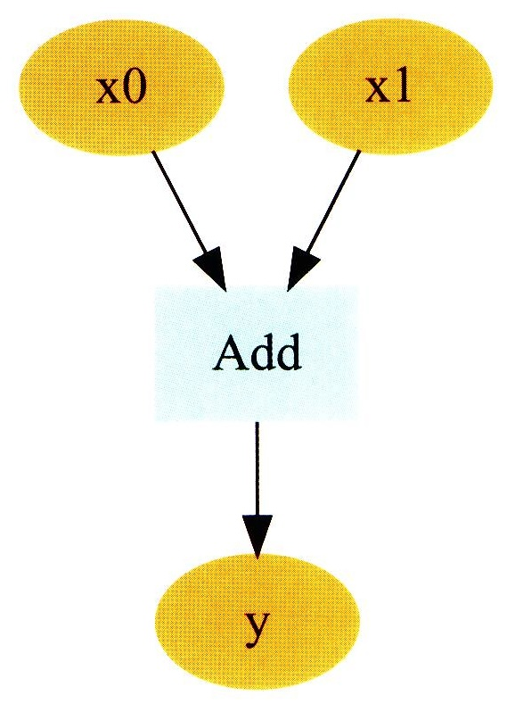
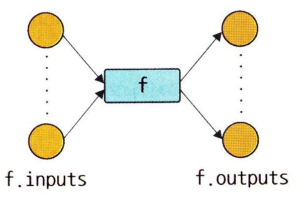
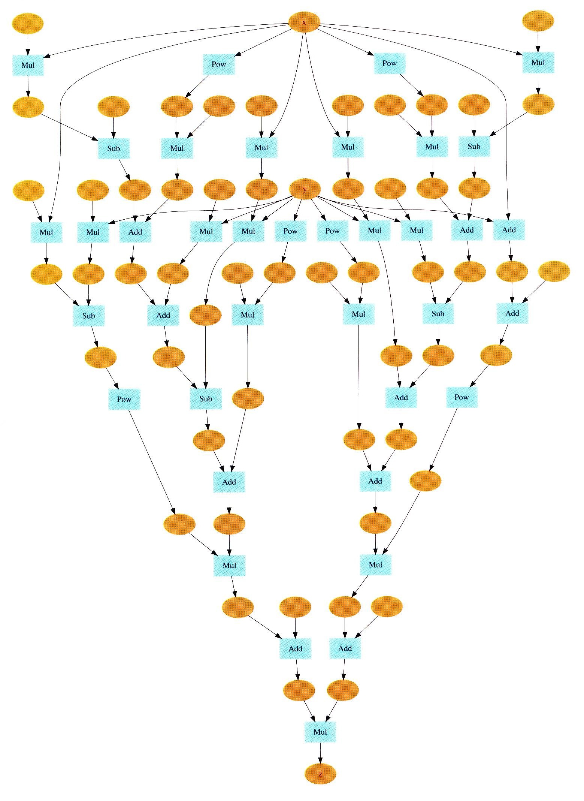

# 26단계 계산 그래프 시각화(2)

이전 단계에서는 DOT 언어를 작성하는 방법을 배웠습니다. 그 지식을 바탕으로 이번 단계에서는 DeZero 계산 그래프를 DOT 언어로 변환하려 합니다. 구체적으로는 DeZero에서 실행한 계산을 DOT 언어로 변환하는 기능을 구현할 것입니다.

---

## 26.1 시각화 코드 예

계산 그래프를 시각화하는 함수를 `get_dot_graph`라는 이름으로 `dezero/utils.py`에 구현하겠습니다. 우선 이 함수를 사용하는 모습부터 보여드리죠.

```python
import numpy as np
from dezero import Variable
from dezero.utils import get_dot_graph

x0 = Variable(np.array(1.0))
x1 = Variable(np.array(1.0))
y = x0 + x1  # 어떤 계산

# 변수 이름 지정
x0.name = 'x0'
x1.name = 'x1'
y.name = 'y'

txt = get_dot_graph(y, verbose=False)
print(txt)
```

```python
# dot 파일로 저장
with open('sample.dot', 'w') as o:
    o.write(txt)
```

**실행 결과**
```text
digraph g {
4423761088 [label='y', color=orange, style=filled]
4423742632 [label='Add', color=lightblue, style=filled, shape=box]
4403357456 -> 4423742632
4403358016 -> 4423742632
4423742632 -> 4423761088
4403357456 [label='x0', color=orange, style=filled]
4403358016 [label='x1', color=orange, style=filled]
}
```

여기에서 알 수 있듯이 `get_dot_graph` 함수에는 최종 출력인 변수 `y`를 인수로 제공합니다. 그러면 출력 변수 `y`를 기점으로 한 계산 과정을 DOT 언어로 전환한 문자열을 반환합니다(인수 `verbose`의 역할은 조금 뒤에 설명합니다). 또한 `get_dot_graph` 함수를 호출하기 전에 `x0.name = 'x0'`과 `x1.name = 'x1'`처럼 `Variable` 인스턴스의 속성에 `name`을 추가합니다. 계산 그래프를 시각화할 때 변수 노드에 레이블(이름)을 달아주기 위해서입니다.

앞의 출력 결과를 `sample.dot` 파일에 저장한 다음 터미널에서 `dot sample.dot -T png -o sample.png` 명령을 실행하면 [그림 26-1]을 얻을 수 있습니다.

**그림 26-1 시각화된 계산 그래프의 예**

```text
  ( x0 )      ( x1 )
     │          │
     └───┐  ┌───┘
         ▼  ▼
        [Add]
          │
          ▼
        (  y )
```

여기까지가 계산 그래프 시각화의 흐름입니다. 정리하면, 출력 변수를 기점으로 그 변수가 걸어온 계산 과정을 DOT 언어로 표현하는 것입니다. 사실 우리는 이 방법을 이미 알고 있습니다. 역전파를 구현한 논리를 거의 그대로 사용하면 되니까요.

> **NOTE**
> 역전파는 출력 변수를 기점으로 역방향으로 모든 노드(변수와 함수)를 추적합니다. 이 구조를 활용하여 계산 그래프의 노드를 DOT 언어로 변환할 수 있습니다.

---

## 26.2 계산 그래프에서 DOT 언어로 변환하기

이상의 내용을 코드로 옮겨봅시다. 몸체인 `get_dot_graph` 함수는 잠시 뒤로 미루고, `_dot_var`라는 보조 함수부터 구현하겠습니다. 이름 앞에 밑줄(`_`)이 붙은 이유는 이 함수를 로컬에서만, 즉 `get_dot_graph` 함수 전용으로 사용할 것이기 때문입니다. 다음은 `_dot_var` 함수의 코드와 사용 예입니다.

**dezero/utils.py**
```python
def _dot_var(v, verbose=False):
    dot_var = '{} [label="{}", color=orange, style=filled]\n'

    name = '' if v.name is None else v.name
    if verbose and v.data is not None:
        if v.name is not None:
            name += ': '
        name += str(v.shape) + ' ' + str(v.dtype)
    return dot_var.format(id(v), name)
```

**사용 예**
```python
x = Variable(np.random.randn(2, 3))
x.name = 'x'
print(_dot_var(x))
print(_dot_var(x, verbose=True))
```

**실행 결과**
```text
4423761088 [label="x", color=orange, style=filled]
4423761088 [label="x: (2, 3) float64", color=orange, style=filled]
```

이와 같이 `_dot_var` 함수에 `Variable` 인스턴스를 건네면 인스턴스의 내용을 DOT 언어로 작성된 문자열로 바꿔서 반환합니다. 한편 변수 노드에 고유한 ID를 부여하기 위해 파이썬 내장 함수인 `id`를 사용했습니다. `id` 함수는 주어진 객체의 ID를 반환하는데, 객체 ID는 다른 객체와 중복되지 않기 때문에 노드의 ID로 사용하기에 적합합니다.

또한 마지막 반환 직전에 `format` 메서드를 이용했습니다. `format` 메서드는 문자열에 등장하는 `"{}"` 부분을 메서드 인수로 건넨 객체(문자열이나 정수 등)로 차례로 바꿔줍니다. 가령 앞의 코드에서는 `dot_var` 문자열의 첫 번째 `{}` 자리에는 `id(v)`의 값이, 두 번째 `{}` 자리에는 `name`의 값이 채워집니다.

> **NOTE**
> `_dot_var` 함수는 `verbose` 인수도 받습니다. 이 값을 `True`로 설정하면 `ndarray` 인스턴스의 '형상'과 '타입'도 함께 레이블로 출력합니다.

이어서 'DeZero 함수'를 DOT 언어로 변환하는 편의 함수를 구현하겠습니다. 이름은 `_dot_func`이고 코드는 다음과 같습니다.

**dezero/utils.py**
```python
def _dot_func(f):
    dot_func = '{} [label="{}", color=lightblue, style=filled, shape=box]\n'
    txt = dot_func.format(id(f), f.__class__.__name__)

    dot_edge = '{} -> {}\n'
    for x in f.inputs:
        txt += dot_edge.format(id(x), id(f))
    for y in f.outputs:
        txt += dot_edge.format(id(f), id(y()))  # y는 약한 참조(weakref, 17.4절 참고)
    return txt
```

**사용 예**
```python
x0 = Variable(np.array(1.0))
x1 = Variable(np.array(1.0))
y = x0 + x1
txt = _dot_func(y.creator)
print(txt)
```

**실행 결과**
```text
4423742632 [label="Add", color=lightblue, style=filled, shape=box]
4403357456 -> 4423742632
4403358016 -> 4423742632
4423742632 -> 4423761088
```

`_dot_func` 함수는 'DeZero 함수'를 DOT 언어로 기술합니다. 또한 '함수와 입력 변수의 관계' 그리고 '함수와 출력 변수의 관계'도 DOT 언어로 기술합니다. 복습해보자면, DeZero 함수는 `Function` 클래스를 상속하고 [그림 26-2]처럼 `inputs`와 `outputs`라는 인스턴스 변수를 가지고 있습니다.

**그림 26-2 Function 클래스의 inputs와 outputs**

```text
  (입력 변수들) ──> [ f ] ──> (출력 변수들)
    f.inputs                   f.outputs
```

준비가 끝났습니다. 이제 본격적으로 `get_dot_graph` 함수를 구현할 차례입니다. `Variable` 클래스의 `backward` 메서드를 참고하여 다음과 같이 구현할 수 있습니다.

**dezero/utils.py**
```python
def get_dot_graph(output, verbose=True):
    txt = ''
    funcs = []
    seen_set = set()

    def add_func(f):
        if f not in seen_set:
            funcs.append(f)
            # funcs.sort(key=lambda x: x.generation)
            seen_set.add(f)

    add_func(output.creator)
    txt += _dot_var(output, verbose)
```

```python
    while funcs:
        func = funcs.pop()
        txt += _dot_func(func)
        for x in func.inputs:
            txt += _dot_var(x, verbose)

            if x.creator is not None:
                add_func(x.creator)
    return 'digraph g {\n' + txt + '}'
```

이 코드의 로직은 `Variable` 클래스의 `backward` 메서드와 거의 같습니다(backward 메서드 구현에서 달라진 부분은 음영으로 표시했습니다). `backward` 메서드는 미분값을 전파했지만, 여기에서는 미분 대신 DOT 언어로 기술한 문자열을 `txt`에 추가합니다.

또한 실제 역전파에서는 노드를 따라가는 순서가 중요했습니다. 그래서 함수에 `generation`(세대)이라는 정숫값을 부여하고 그 값이 큰 순서대로 꺼냈죠(자세한 내용은 15~16단계 참고). 하지만 `get_dot_graph` 함수에서는 노드를 추적하는 순서는 문제가 되지 않으므로 `generation` 값으로 정렬하는 코드를 주석으로 처리했습니다.

> **NOTE**
> 계산 그래프를 DOT 언어로 변환할 때는 '어떤 노드가 존재하는가'와 '어떤 노드끼리 연결되는가'가 문제입니다. 즉, 노드의 추적 '순서'는 문제가 되지 않기 때문에 generation을 사용하여 순서대로 꺼내는 구조는 사용하지 않아도 됩니다.

이것으로 계산 그래프 시각화 코드가 완성되었습니다. 이어서 계산 그래프를 더 손쉽게 시각화하는 함수를 추가하겠습니다.

---

## 26.3 이미지 변환까지 한 번에

`get_dot_graph` 함수는 계산 그래프를 DOT 언어로 변환합니다. 그런데 DOT 언어를 이미지로 변환하려면 `dot` 명령을 수동으로 실행해야 하므로 매번 하기에는 번거롭습니다. 그래서 `dot` 명령 실행까지 한 번에 해주는 함수를 제공하려 합니다. 코드는 다음과 같습니다.

**dezero/utils.py**
```python
import os
import subprocess

def plot_dot_graph(output, verbose=True, to_file='graph.png'):
    dot_graph = get_dot_graph(output, verbose)

    # ❶ dot 데이터를 파일에 저장
    tmp_dir = os.path.join(os.path.expanduser('~'), '.dezero')
    if not os.path.exists(tmp_dir): # ~/.dezero 디렉터리가 없다면 새로 생성
        os.mkdir(tmp_dir)
    graph_path = os.path.join(tmp_dir, 'tmp_graph.dot')

    with open(graph_path, 'w') as f:
        f.write(dot_graph)

    # ❷ dot 명령 호출
    extension = os.path.splitext(to_file)[1][1:] # 확장자(png, pdf 등)
    cmd = 'dot {} -T {} -o {}'.format(graph_path, extension, to_file)
    subprocess.run(cmd, shell=True)
```

우선 ❶에서는 방금 구현한 `get_dot_graph` 함수를 호출하여 계산 그래프를 DOT 언어(텍스트)로 변환하고 파일에 저장합니다. 대상 디렉터리는 `~/.dezero`이고 파일 이름은 `tmp_graph.dot`로 했습니다(일시적으로 사용할 파일이므로 tmp라는 이름을 썼습니다). `os.path.expanduser('~')` 문장은 사용자의 홈 디렉터리를 뜻하는 `'~'`를 절대 경로로 풀어줍니다.

❷에서는 앞에서 저장한 파일 이름을 지정하여 `dot` 명령을 호출합니다. 이때 `plot_dot_graph` 함수의 인수인 `to_file`에 저장할 이미지 파일의 이름을 지정합니다. 참고로 파이썬에서 외부 프로그램을 호출하기 위해 `subprocess.run` 함수를 사용했습니다.

> **CAUTION**
> 실제 `plot_dot_graph` 함수에는 앞에서 보여드린 코드 외에 몇 줄이 더 추가되어 있습니다. 추가된 코드는 독자가 주피터 노트북에서 이 코드를 실행하는 경우 주피터 노트북의 셀에 이미지를 직접 출력해주는 기능입니다.

이상으로 계산 그래프를 시각화하는 함수를 작성했습니다. 여기서 구현한 함수는 앞으로 다양한 장소에서 사용되기 때문에 `dezero/utils.py`에 추가합니다. 그러면 `from dezero.utils import plot_dot_graph`로 임포트할 수 있습니다.

---

## 26.4 동작 확인

24단계에서 구현한 Goldstein-Price 함수를 시각화해보겠습니다.

**steps/step26.py**
```python
import numpy as np
from dezero import Variable
from dezero.utils import plot_dot_graph

def goldstein(x, y):
    z = (1 + (x + y + 1)**2 * (19 - 14*x + 3*x**2 - 14*y + 6*x*y + 3*y**2)) * \
        (30 + (2*x - 3*y)**2 * (18 - 32*x + 12*x**2 + 48*y - 36*x*y + 27*y**2))
    return z

x = Variable(np.array(1.0))
y = Variable(np.array(1.0))
z = goldstein(x, y)
z.backward()

x.name = 'x'
y.name = 'y'
z.name = 'z'
plot_dot_graph(z, verbose=False, to_file='goldstein.png')
```

이 코드를 실행하면 `goldstein.png`라는 파일이 생성됩니다. 그 결과는 [그림 26-3]과 같이 다양한 변수와 함수가 복잡하게 얽힌 계산 그래프입니다. 자세히 보면 입력 변수 `x`와 `y`에서 시작하여 최종적으로 변수 `z`가 출력되고 있음을 알 수 있습니다.* 참고로 Goldstein-Price 함수를 DeZero에서 구현할 때 수식을 거의 그대로 코드에 옮길 수 있었는데, 그 뒤편에는 [그림 26-3]처럼 복잡하게 얽힌 계산 그래프가 만들어져 있던 것입니다!

이상으로 계산 그래프를 시각화해봤습니다. 여기서 구현한 시각화 함수는 앞으로도 필요할 때마다 계속 이용할 것입니다.

<br>

\* 옮긴이\_ `y`는 원 모양 노드를 기준으로 세 번째 줄에 있습니다.

**그림 26-3 Goldstein-Price 함수의 계산 그래프**


*(Goldstein-Price 함수의 매우 복잡한 계산 그래프 시각화 결과가 표시되어 있습니다. 입력 변수 `x`와 `y`에서 시작하여 수많은 `Mul`, `Add`, `Sub`, `Pow` 함수 노드를 거쳐 최종 출력 변수 `z`로 수렴하는 대칭 형태의 계산 그래프입니다.)*
