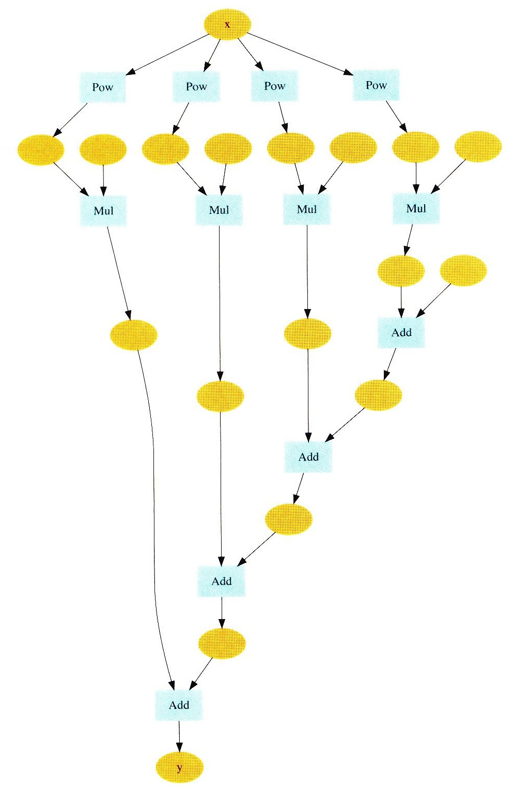

# 27단계 테일러 급수 미분

지금부터는 DeZero를 사용하여 구체적인 문제를 몇 개 풀어보겠습니다. 이번 단계의 목표는 `sin` 함수의 미분입니다. 아시다시피 `sin`의 미분은 해석적으로 풀립니다. 그러니 우선은 정공법을 써서 `sin` 함수를 DeZero로 구현하고, 이어서 그 미분을 테일러 급수를 이용해 계산해보겠습니다.

---

## 27.1 sin 함수 구현

`sin` 함수의 미분은 해석적으로 풀 수 있습니다. $y = \sin(x)$ 일 때 그 미분은 $\frac{dy}{dx} = \cos(x)$ 입니다. 따라서 `Sin` 클래스와 `sin` 함수는 다음처럼 구현할 수 있습니다.

**steps/step27.py**
```python
import numpy as np
from dezero import Function

class Sin(Function):
    def forward(self, x):
        y = np.sin(x)
        return y

    def backward(self, gy):
        x = self.inputs[0].data
        gx = gy * np.cos(x)
        return gx
```

```python
def sin(x):
    return Sin()(x)
```

보다시피 넘파이가 제공하는 `np.sin` 함수와 `np.cos` 함수를 사용해 간단하게 구현할 수 있습니다. 이제 DeZero에서도 `sin` 함수를 사용해 계산할 수 있게 되었군요. 시험 삼아 $x = \pi/4$ 에서 $y = \sin(x)$ 를 미분해보면 다음과 같습니다.

**steps/step27.py**
```python
from dezero import Variable

x = Variable(np.array(np.pi/4))
y = sin(x)
y.backward()

print(y.data)
print(x.grad)
```

**실행 결과**
```text
0.7071067811865476
0.7071067811865476
```

`y`값과 `x`의 미분 모두 `0.7071067811865476`이군요. `1 / np.sqrt(2)`와 거의 일치합니다(수식으로는 $1/\sqrt{2}$). 물론 $\sin(\pi/4) = \cos(\pi/4) = 1/\sqrt{2}$ 이기 때문에 옳은 결과입니다.

---

## 27.2 테일러 급수 이론

본론으로 넘어가보죠. 이제부터 `sin` 함수의 미분을 다른 방법으로 계산해보려 합니다. 바로 테일러 급수<sup>Taylor Series</sup>를 이용한 방법입니다. 테일러 급수란 어떤 함수를 다항식으로 근사하는 방법으로, 수식으로는 다음과 같습니다.

$$
f(x) = f(a) + f'(a)(x - a) + \frac{1}{2!} f''(a)(x - a)^2 + \frac{1}{3!} f'''(a)(x - a)^3 + \cdots
$$

 <span style="float:right;">[식 27.1]</span>

이것이 점 $a$ 에서 $f(x)$ 의 테일러 급수입니다. $a$ 는 임의의 값이고, $f(a)$ 는 점 $a$ 에서 $f(x)$ 의 값입니다. 또한 $f'$ 는 1차 미분, $f''$ 는 2차 미분, $f'''$ 은 3차 미분을 뜻합니다. 그리고 $!$ 기호는 계승<sup>factorial</sup>을 뜻하며 $n!$, 즉 $n$ 의 계승은 1에서 $n$ 까지 모든 정수의 곱을 말합니다. 예컨대 $5! = 5 \times 4 \times 3 \times 2 \times 1 = 120$ 이 됩니다.

> **NOTE**
> 2차 미분은 미분한 값을 한 번 더 미분한 것입니다. 물리 세계에서 예를 찾아보면 위치의 미분(변화)은 속도이며 속도의 미분(변화)은 가속도입니다. 이때 속도가 1차 미분이고 가속도가 2차 미분에 해당합니다.

테일러 급수에 의해 $f(x)$ 는 점 $a$ 를 기점으로 [식 27.1]로 나타낼 수 있습니다. [식 27.1]은 1차 미분, 2차 미분, 3차 미분, $\dots$ 식으로 항이 무한히 계속되지만, 어느 시점에서 중단하면 $f(x)$ 의 값을 근사할 수 있습니다. 물론 항이 많아질수록 근사의 정확도가 높아집니다.

한편 $a = 0$ 일 때의 테일러 급수를 **매클로린 전개**<sup>Maclaurin's series</sup>라고도 합니다. 실제로 [식 27.1]에 $a = 0$ 을 대입하면 다음과 같이 됩니다.

$$
f(x) = f(0) + f'(0)x + \frac{1}{2!} f''(0)x^2 + \frac{1}{3!} f'''(0)x^3 + \cdots
$$

 <span style="float:right;">[식 27.2]</span>

[식 27.2]에서 $a = 0$ 으로 한정함으로써 더 간단한 수식이 되었습니다. 이제 $f(x) = \sin(x)$ 를 [식 27.2]에 적용시켜 보겠습니다. 그러면 $f'(x) = \cos(x)$, $f''(x) = -\sin(x)$, $f'''(x) = -\cos(x)$, $f^{(4)}(x) = \sin(x)$, $\dots$ 형태가 반복되는데, $\sin(0) = 0$, $\cos(0) = 1$ 이기 때문에 다음 식을 이끌어낼 수 있습니다.

$$
\sin(x) = \frac{x}{1!} - \frac{x^3}{3!} + \frac{x^5}{5!} - \cdots = \sum_{i=0}^{\infty} (-1)^i \frac{x^{2i+1}}{(2i+1)!}
$$

 <span style="float:right;">[식 27.3]</span>

[식 27.3]에서 보듯 $\sin$ 함수는 $x$ 의 거듭제곱으로 이루어진 항들이 무한히 계속되는 형태로 표현됩니다. 여기서 중요한 점은 $\sum$ 의 $i$ 가 커질수록 근사 정밀도가 좋아진다는 것입니다. 또한 $i$ 가 커질수록 $(-1)^i \frac{x^{2i+1}}{(2i+1)!}$ 의 절댓값은 작아지므로, 이 값을 참고하여 $i$ 의 값(반복 횟수)을 적절히 결정할 수 있습니다.

---

## 27.3 테일러 급수 구현

그러면 [식 27.3]에 따라 `sin` 함수를 구현해보죠. 계승 계산은 파이썬의 `math` 모듈에 있는 `math.factorial` 함수를 사용하겠습니다.

**steps/step27.py**
```python
import math

def my_sin(x, threshold=0.0001):
    y = 0
    for i in range(100000):
        c = (-1) ** i / math.factorial(2 * i + 1)
        t = c * x ** (2 * i + 1)
        y = y + t
        if abs(t.data) < threshold:
            break
    return y
```

이와 같이 `for` 문 안에서 $i$ 번째에 추가할 항목을 `t`로 하여 [식 27.3]을 구현했습니다. 이때 임계값을 `threshold`로 지정하고, `t`의 절댓값이 `threshold`보다 낮아지면 `for` 문을 빠져나오게 합니다. `threshold`로 근사치의 정밀도를 조정하는 것이죠(`threshold`가 작을수록 정밀도가 높아집니다).

그러면 앞에서 구현한 `my_sin` 함수를 사용하여 계산을 한번 해봅시다.

**steps/step27.py**
```python
x = Variable(np.array(np.pi/4))
y = my_sin(x)
y.backward()

print(y.data)
print(x.grad)
```

**실행 결과**
```text
0.7071064695751781
0.7071032148228457
```

이번 단계 시작 시 구현한 `sin` 함수와 거의 같은 결과를 얻었습니다. 오차는 무시할 정도로 작습니다. 더구나 `threshold`값을 줄이면 이마저도 더 줄일 수 있습니다.

> **CAUTION**
> 테일러 급수의 임계값<sup>threshold</sup>을 작게 할수록 이론상으로는 근사 정밀도가 좋아집니다. 그러나 컴퓨터가 하는 계산에서는 '자릿수 누락'이나 '반올림' 등이 발생할 수 있으니 반드시 이론과 일치하는 것은 아닙니다.

---

## 27.4 계산 그래프 시각화

앞 절의 코드를 실행했을 때 어떤 계산 그래프가 나오는지 볼까요? 이어지는 그림들은 앞 단계에서 구현한 시각화 함수, 즉 `dezero/utils.py`의 `plot_dot_graph` 함수를 이용해 만들었습니다. 우선 `threshold = 0.0001`일 때 `my_sin` 함수의 계산 그래프는 [그림 27-1]과 같습니다.

**그림 27-1 threshold = 0.0001일 때 my_sin 함수의 계산 그래프**

*(입력 변수 x로부터 Pow, Mul, Add 연산 노드들을 거쳐 출력 변수 y로 수렴하는 계산 그래프가 대칭 및 누적 덧셈 형태로 그려집니다.)*

[그림 27-1]은 `sin` 함수를 근사하기 위해 만들어진 계산 그래프입니다. 여기에서 흥미로운 점은 `threshold`값으로 '계산 그래프의 복잡성'을 제어한다는 것입니다. 시험 삼아 `threshold = 1e-150`*으로 설정하여 계산 그래프를 시각화해봅시다. 결과는 [그림 27-2]와 같습니다.

**그림 27-2 threshold = 1e-150일 때 my_sin 함수의 계산 그래프**

*(수많은 노드가 대각선 방향으로 길게 이어진 매우 깊고 거대한 형태의 계산 그래프가 그려집니다.)*

`threshold`값을 줄이자 `for` 문의 반복 횟수가 늘어나서 [그림 27-2]와 같은 '깊은' 계산 그래프가 만들어졌습니다. 자! 방금 우리는 이렇게 큰 계산 그래프를 단순히 파이썬의 `for` 문과 `if` 문

<br>

\* $1 \times 10^{-150}$ 을 뜻합니다. 따라서 $0.00\dots1$ 형태에서 소수점과 마지막 1 사이에 0이 149개 등장합니다.

을 사용하여 만들었습니다. (다른 특별한 구조가 아닌) 파이썬의 제어 구문만으로 지극히 평범한 코드를 작성한 것이죠. 여기서 우리는 DeZero가 제공하는 Define-by-Run의 '사용 편의성'이 이미 상당한 수준에 도달했음을 알 수 있습니다.
