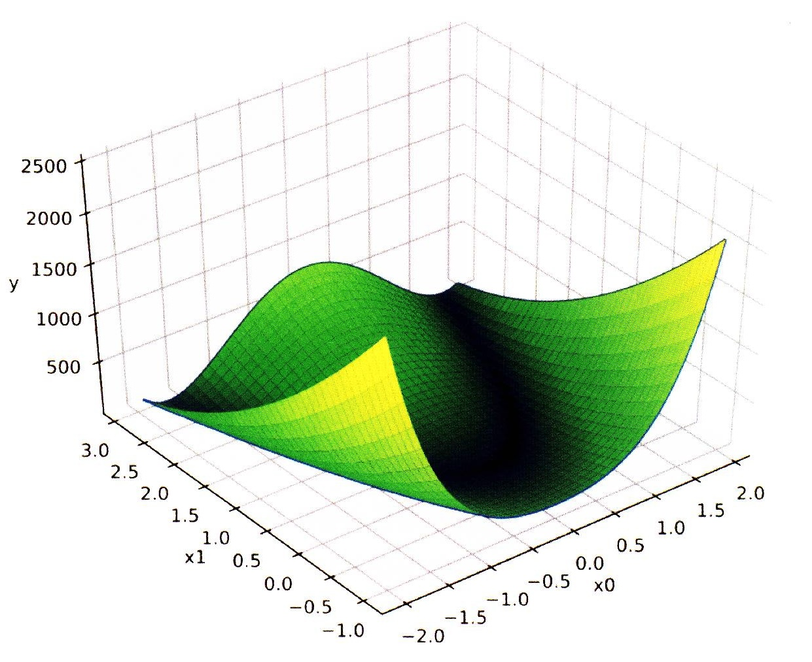
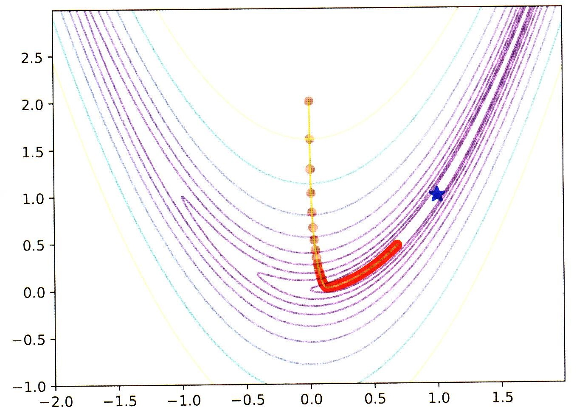
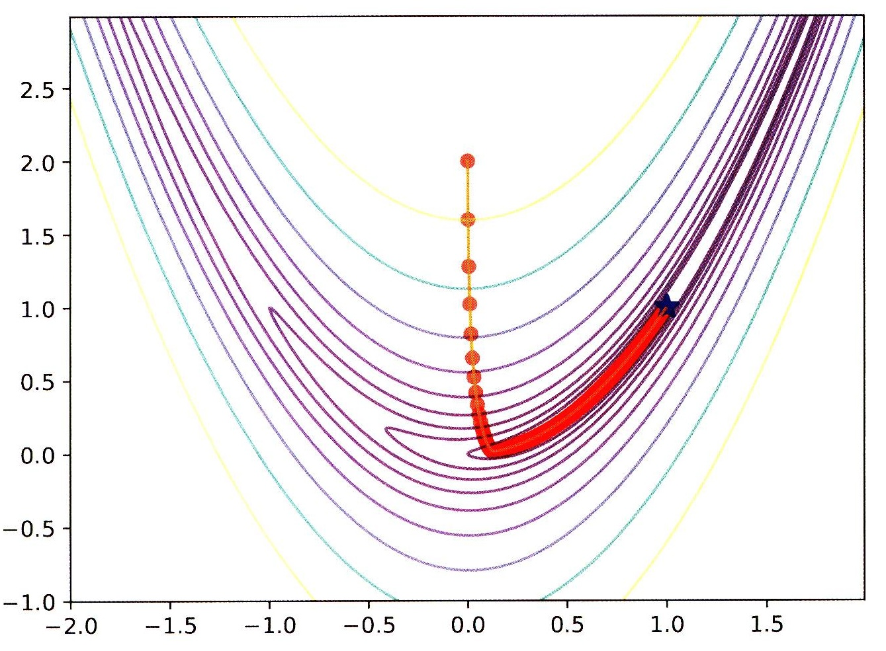

# 28단계 함수 최적화

DeZero는 이제 미분을 자동으로 계산할 줄 압니다. 미분은 다양한 분야에서 다양한 용도로 활용되며, 그중 가장 중요한 용도로 함수 최적화를 들 수 있습니다. 이번 단계에서는 구체적인 함수를 대상으로 최적화를 해보겠습니다.

> **NOTE**
> 최적화란 어떤 함수가 주어졌을 때 그 최솟값(또는 최댓값)을 반환하는 '입력(함수의 인수)'을 찾는 일입니다. 신경망 학습의 목표도 손실 함수의 출력을 최소화하는 매개변수를 찾는 것이니 최적화 문제에 속합니다. 따라서 이번 단계에서 수행하는 내용은 그대로 신경망 학습에도 적용할 수 있습니다.

---

## 28.1 로젠브록 함수

이번 단계에서는 로젠브록 함수<sup>Rosenbrock function</sup>를 다룹니다. 수식으로는 [식 28.1]로 표현되며, 모양은 [그림 28-1]과 같습니다.

$$
y = 100(x_1 - x_0^2)^2 + (1 - x_0)^2
$$

 <span style="float:right;">[식 28.1]</span>

[그림 28-1]을 보면 포물선 모양으로 길게 뻗은 골짜기가 보입니다. 참고로 [그림 28-1]의 '산'에 등고선을 그리면 그 모양이 바나나를 닮았다고 하여 로젠브록 함수를 바나나 함수<sup>Banana function</sup>라고도 합니다.

**그림 28-1 로젠브록 함수의 형태(이미지는 참고문헌 [19]에서 발췌)**

*(로젠브록 함수의 3차원 형태 곡면 그래프가 표현되어 있습니다. 완만한 경사 뒤로 좁고 굽어지며 깊게 파인 골짜기가 형성되어 있습니다.)*

이번 단계의 목표는 로젠브록 함수의 출력이 최소가 되는 $x_0$ 와 $x_1$ 을 찾는 것입니다. 답부터 말하면, 로젠브록 함수의 최솟값은 $(x_0, x_1) = (1, 1)$ 입니다. 이번 단계에서는 DeZero를 사용하여 이 최솟값을 실제로 찾아낼 수 있는지 확인합니다.

> **NOTE**
> 로젠브록 함수의 올바른 정의는 $a, b$ 가 실수(혹은 상수)일 때 $f(x_0, x_1) = b(x_1 - x_0^2)^2 + (a - x_0)^2$ 입니다. 그래서 [식 28.1]과 [그림 28-1]은 $a = 1, b = 100$ 일 때의 로젠브록 함수에 해당합니다. 로젠브록 함수는 최적화 문제의 벤치마크 함수로 자주 사용되며, 지금처럼 $a = 1, b = 100$ 으로 설정하여 벤치마크하는 것이 일반적입니다.*

---

## 28.2 미분 계산하기

가장 먼저 로젠브록 함수의 $(x_0, x_1) = (0.0, 2.0)$ 에서의 미분($\frac{\partial y}{\partial x_0}$ 와 $\frac{\partial y}{\partial x_1}$)을 계산해보죠. DeZero를 이용하면 다음과 같이 구현할 수 있습니다.

<br>

\* 옮긴이\_ 로젠브록 함수가 벤치마크로 자주 쓰이는 이유는 골짜기로 향하는 기울기에 비해 골짜기 바닥에서 전역 최솟값으로 가는 기울기가 너무 작아서 최적화하기가 어렵기 때문입니다.

**steps/step28.py**
```python
import numpy as np
from dezero import Variable

def rosenbrock(x0, x1):
    y = 100 * (x1 - x0 ** 2) ** 2 + (1 - x0) ** 2
    return y

x0 = Variable(np.array(0.0))
x1 = Variable(np.array(2.0))

y = rosenbrock(x0, x1)
y.backward()
print(x0.grad, x1.grad)
```

**실행 결과**
```text
-2.0 400.0
```

이와 같이 수치 데이터(`ndarray` 인스턴스)를 `Variable`로 감싸서 건네주기만 하면 그다음은 수식을 따라 코딩하면 됩니다. 그리고 마지막에 `y.backward()`를 호출하면 자동으로 미분을 계산할 수 있습니다.

이 코드를 실행하면 `x0`와 `x1`의 미분은 각각 `-2.0`과 `400.0`이라고 나옵니다. 이때 두 미분값을 모은 값, 즉 `(-2.0, 400.0)` 벡터를 **기울기**<sup>gradient</sup> 혹은 **기울기 벡터**라고 합니다. 기울기는 각 지점에서 함수의 출력을 가장 크게 하는 방향을 가리킵니다. 지금 예에서는 $(x_0, x_1) = (0.0, 2.0)$ 지점에서 `y`값을 가장 크게 늘려주는 방향이 `(-2.0, 400.0)`이라는 의미입니다. 반대로 기울기에 마이너스를 곱한 `(2.0, -400.0)` 방향은 `y`값을 가장 작게 줄여주는 방향을 뜻합니다.

---

## 28.3 경사하강법 구현

복잡한 형상의 함수라면 기울기가 가리키는 방향에 반드시 최댓값이 존재한다고는 볼 수 없습니다(마찬가지로 반대 방향에 최솟값이 존재한다고 볼 수도 없습니다). 그러나 국소적으로 보면 기울기는 함수의 출력을 가장 크게 하는 방향을 나타냅니다. 그래서 기울기 방향으로 일정

거리만큼 이동하여 다시 기울기를 구하는 작업을 반복하면 점차 원하는 지점(최댓값 혹은 최솟값)에 접근하리라 기대할 수 있습니다. 이것이 **경사하강법**<sup>gradient descent</sup>입니다. 알맞은 지점에서 시작하면 (좋은 초깃값을 주면) 경사하강법은 우리를 목적지까지 효율적으로 안내해줍니다.

그러면 경사하강법을 우리 문제에 적용해보죠. 여기에서 문제는 로젠브록 함수의 '최솟값' 찾기입니다. 따라서 기울기 방향에 마이너스를 곱한 방향으로 이동합니다. 코드는 다음과 같습니다.

**steps/step28.py**
```python
x0 = Variable(np.array(0.0))
x1 = Variable(np.array(2.0))
lr = 0.001  # 학습률
iters = 1000  # 반복 횟수

for i in range(iters):
    print(x0, x1)

    y = rosenbrock(x0, x1)

    x0.cleargrad()
    x1.cleargrad()
    y.backward()

    x0.data -= lr * x0.grad
    x1.data -= lr * x1.grad
```

이와 같이 반복 횟수를 `iters`로 설정합니다(`iters`는 iterations의 약자입니다). 또한 기울기에 곱하는 값을 미리 설정해두고 있는데, 앞의 예에서는 `lr = 0.001`로 설정했습니다(`lr`은 learning rate의 머리글자로, 학습률을 의미합니다).

> **CAUTION**
> 앞 코드의 `for` 문에서는 `x0`와 `x1`이라는 `Variable` 인스턴스를 반복 사용하여 미분값을 구합니다. 이때 `x0.grad`와 `x1.grad`에는 미분값이 계속 누적되기 때문에 새롭게 미분할 때는 지금까지 누적된 값을 초기화해야 합니다. 그래서 역전파하기 전에 각 변수의 `cleargrad` 메서드를 호출하여 미분값을 초기화한 것입니다.

코드를 실행해보면 $(x_0, x_1)$ 값이 갱신되는 과정을 볼 수 있습니다. 실제로 터미널에 다음과 같은 결과가 출력됩니다.

**실행 결과**
```text
variable(0.) variable(2.)
variable(0.002) variable(1.6)
variable(0.005276) variable(1.2800008)
...
...
variable(0.68349178) variable(0.4656506)
```

출발점 $(0.0, 2.0)$ 에서 시작하여 위치가 계속 갱신되는 모습을 볼 수 있습니다. [그림 28-2]는 이 결과를 플롯한 모습입니다.

**그림 28-2 갱신 경로(빨간 점의 궤적이 갱신 과정, 별이 최솟값의 위치)**

*(로젠브록 함수의 등고선 위에 $(0, 2)$ 에서 시작한 빨간 점의 궤적이 아래로 내려오다가 골짜기를 타고 곡선을 그리며 $(0.68, 0.46)$ 근처에서 멈춘 모습입니다. 최솟값인 $(1, 1)$ 지점에는 파란색 별이 표시되어 있습니다.)*

[그림 28-2]를 보면 목적지인 별의 위치에 서서히 접근하고 있음을 알 수 있습니다. 다만 도중에 멈춘 것 같군요. 그래서 반복 횟수를 `iters = 10000`으로 늘려 다시 실행해봤습니다. 그 결과가 [그림 28-3]입니다.

**그림 28-3 iters = 10000일 때의 결과**

*(빨간 점의 궤적이 골짜기의 바닥을 따라 길게 곡선을 그리며 흘러와 파란색 별 최솟값 위치인 $(1, 1)$ 바로 근처까지 깊게 전진해 멈춘 모습입니다.)*

[그림 28-3]에서는 목적지에 더욱 가까워졌습니다. 이때 $(x_0, x_1)$ 값은 $(0.99449622, 0.98900063)$ 입니다. 참고로 횟수를 더 늘려서, 예컨대 `iters = 50000`으로 설정해 실행하면 실제로 $(1.0, 1.0)$ 위치에 간신히 도착합니다.

이것으로 이번 단계도 끝냅니다. 이번 단계에서는 DeZero를 사용하여 경사하강법을 구현했고, 이를 이용해 로젠브록 함수의 최솟값 위치를 찾을 수 있었습니다. 그러나 50,000번이나 반복한다는 것은 너무 과해 보입니다. 사실 경사하강법은 로젠브록 함수 같이 골짜기가 길게 뻗은 함수에는 잘 대응하지 못합니다. 그래서 다음 단계에서는 또 다른 최적화 기법을 소개하고 구현할 예정입니다.
