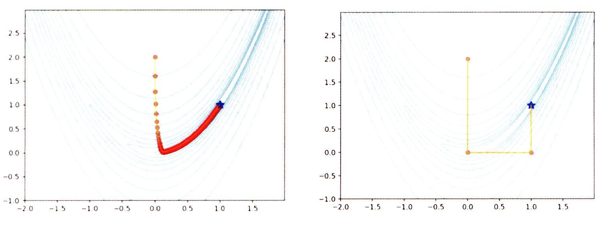
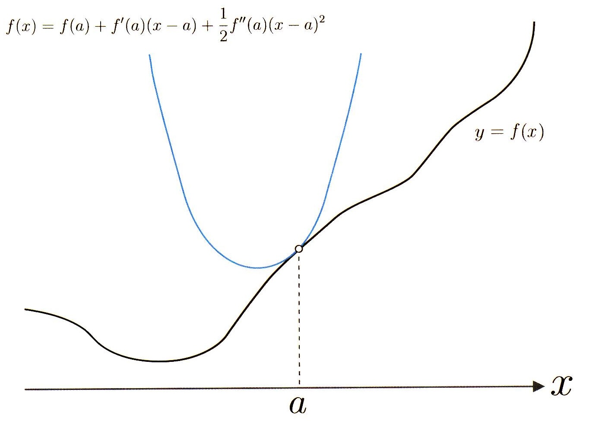
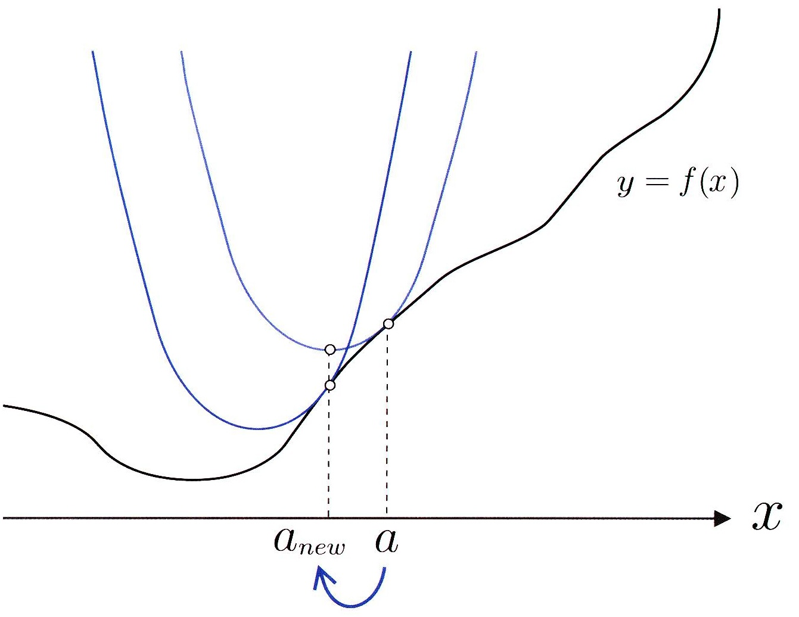
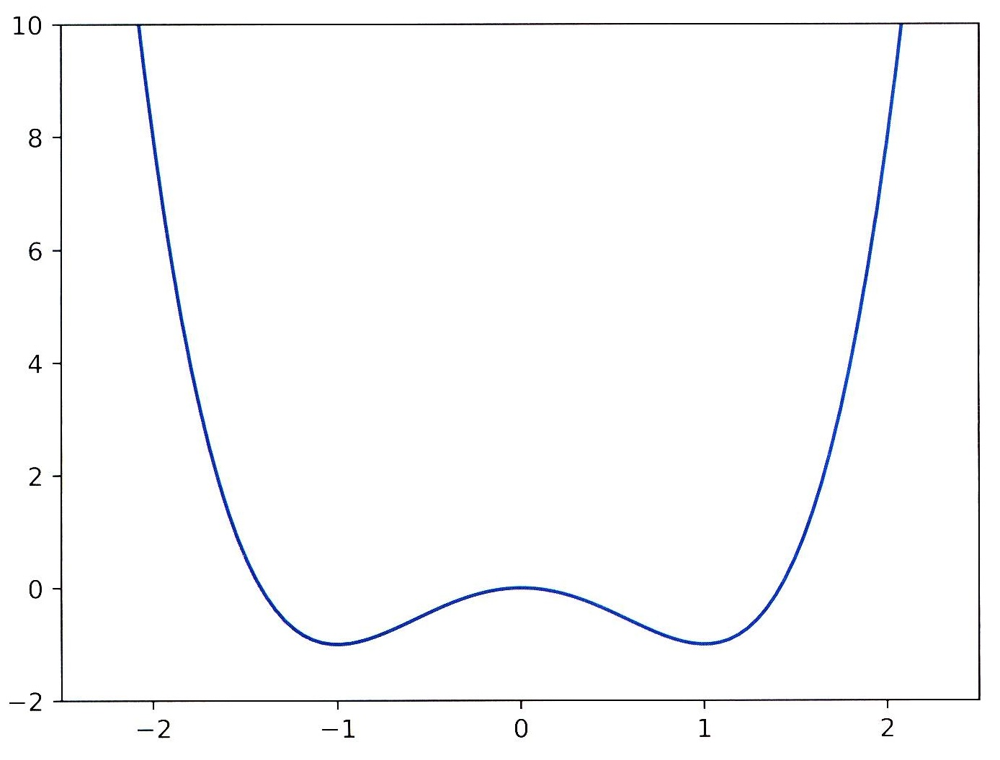
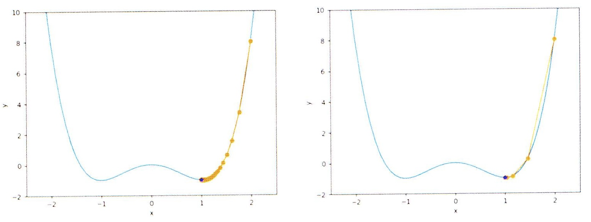

# 29단계 뉴턴 방법으로 푸는 최적화(수동 계산)

이전 단계에서는 로젠브록 함수의 최솟값을 경사하강법으로 구해봤는데, 기울기를 구하는 작업을 5만 번 가까이 반복하고 나서야 겨우 목적지에 도달했습니다. 그 예에서 알 수 있듯이 경사하강법은 일반적으로 수렴이 느리다는 단점이 있습니다.

경사하강법을 대체할 수 있는, 수렴이 더 빠른 방법은 여러 가지가 있습니다. 그중에서 유명한 것이 **뉴턴 방법**<sup>Newton's method</sup>입니다. 뉴턴 방법으로 최적화하면 더 적은 단계로 최적의 결과를 얻을 가능성이 높아집니다. 예를 들어 이전 단계에서 푼 문제를 뉴턴 방법으로 풀면 [그림 29-1]의 오른쪽과 같은 결과를 얻을 수 있습니다.

**그림 29-1 경사하강법의 갱신 경로(왼쪽)와 뉴턴 방법에 의한 최적화 기법 갱신 경로(오른쪽)**

*(왼쪽 경사하강법의 갱신 경로는 골짜기를 따라 5만 번 굽어지며 서서히 기어가지만, 오른쪽 뉴턴 방법의 갱신 경로는 단 몇 단계(약 5~6단계)만에 꺾여 바로 최솟값 별표 지점으로 직행하는 모습을 보여줍니다.)*

[그림 29-1]을 보면 경사하강법이 '계곡'에서 고전하면서 서서히 목표값에 접근해가는 반면 뉴턴 방법은 계곡을 뛰어넘어 단번에 목적지에 도착합니다. 갱신 횟수는 불과 6회입니다! 경사하강법에서 5만 번 가까이 필요했던 갱신이 불과 6회만에 끝나다니, 극적인 차이가 아닐 수 없습니다.

> **CAUTION**
> 로젠브록 함수에서는 경사하강법과 뉴턴 방법의 갱신 횟수 차이가 아주 크게 나왔습니다. 물론 이 횟수는 초깃값이나 학습률 등을 어떻게 설정하느냐에 크게 좌우되며, 이렇게까지 큰 차이를 볼 수 없는 경우도 많습니다. 일반적으로 초깃값이 정답에 충분히 가까우면 뉴턴 방법이 더 빨리 수렴합니다.

---

## 29.1 뉴턴 방법을 활용한 최적화 이론

이번 단계의 목표는 뉴턴 방법을 활용한 최적화를 구현하는 것입니다. 경사하강법 대신 뉴턴 방법을 사용하여 실제로 더 빨리 수렴하는지 확인할 것입니다. 참고로 설명을 단순화하기 위해 변수를 하나만 받는 함수를 예로 들겠습니다(로젠브록 함수는 두 개의 변수를 입력받는 함수였습니다).

그렇다면 뉴턴 방법은 최적의 값을 어떤 원리로 찾아내는 것일까요? $y = f(x)$ 라는 함수의 최솟값을 구하는 문제를 생각해보죠. 뉴턴 방법으로 최적화하려면 테일러 급수에 따라 $y = f(x)$ 를 다음과 같이 변환합니다.

$$
f(x) = f(a) + f'(a)(x - a) + \frac{1}{2!} f''(a)(x - a)^2 + \frac{1}{3!} f'''(a)(x - a)^3 + \cdots
$$

 <span style="float:right;">[식 29.1]</span>

테일러 급수에 따라 어떤 점 $a$ 를 기점으로 $f$ 를 $x$ 의 다항식으로 나타낼 수 있습니다(테일러 급수에 대해서는 27단계에서 설명했습니다). 이때 1차 미분, 2차 미분, 3차 미분, $\dots$ 형태로 항이 증가하는데, 증가하는 걸 어느 시점에서 중단하면 $f(x)$ 를 근사적으로 나타낼 수 있습니다. 여기에서는 다음과 같이 2차 미분에서 중단하겠습니다.

$$
f(x) \approx f(a) + f'(a)(x - a) + \frac{1}{2} f''(a)(x - a)^2
$$

 <span style="float:right;">[식 29.2]</span>

[식 29.2]와 같이 $y = f(x)$ 함수를 2차 미분항까지 사용하여 근사했습니다. 변수 $x$ 를 기준으

로, 이 식은 $x$ 의 2차 함수임을 알 수 있습니다. 즉, $y = f(x)$ 는 '어떤 함수'를 $x$ 의 2차 함수로 근사한 것입니다(그래서 2차 근사라고 합니다). 참고로 이 작업을 [그림 29-2]로 표현할 수 있습니다.

**그림 29-2 2차까지 테일러 급수로 근사한 예**


$$
f(x) = f(a) + f'(a)(x - a) + \frac{1}{2} f''(a)(x - a)^2
$$

*(검은색 원래 함수 곡선 $y = f(x)$ 위의 $x = a$ 지점에서 파란색 2차 함수(포물선)가 접해 있는 모습이 그려져 있습니다.)*

[그림 29-2]와 같이 근사한 2차 함수는 $a$ 에서 $y = f(x)$ 에 접하는 곡선입니다. 다행히 2차 함수의 최솟값은 해석적으로 구할 수 있습니다. 2차 함수의 미분 결과가 $0$ 인 위치를 확인하면 되죠. 수식으로는 다음과 같습니다.

$$
\frac{d}{dx} \left( f(a) + f'(a)(x - a) + \frac{1}{2} f''(a)(x - a)^2 \right) = 0
$$

$$
f'(a) + f''(a)(x - a) = 0
$$

 <span style="float:right;">[식 29.3]</span>

$$
x = a - \frac{f'(a)}{f''(a)}
$$

이 결과로부터 근사한 2차 함수의 최솟값은 $x = a - \frac{f'(a)}{f''(a)}$ 위치에 있음을 알 수 있습니다. 즉, [그림 29-3]처럼 $a$ 의 위치를 $-\frac{f'(a)}{f''(a)}$ 만큼 갱신하면 됩니다.

**그림 29-3 a의 위치 갱신**

*(이전 그림에서 접했던 2차 함수 곡선의 최솟값 위치인 $a_{new}$ 로 $a$ 의 위치가 갱신되어 이동하고, 새로운 위치 $a_{new}$ 에서 다시 2차 근사 곡선을 접해 나가는 단계적 갱신 방식이 화살표로 묘사되어 있습니다.)*

[그림 29-3]처럼 $a$ 의 위치를 갱신합니다. 그리고 갱신된 $a$ 의 위치에서 같은 작업을 반복합니다. 이것이 뉴턴 방법에 의한 최적화입니다. 이 뉴턴 방법을 경사하강법과 비교해보면 특성이 명확히 드러납니다. 다음 식을 살펴보시죠.

$$
x \leftarrow x - \alpha f'(x)
$$

 <span style="float:right;">[식 29.4]</span>

$$
x \leftarrow x - \frac{f'(x)}{f''(x)}
$$

 <span style="float:right;">[식 29.5]</span>

[식 29.4]가 경사하강법이고 [식 29.5]\*가 뉴턴 방법입니다. 보시는 것처럼 두 방법 모두 $x$ 를 갱신하지만 방법이 다릅니다. 경사하강법에서는 $\alpha$ 라는 계수를 사람이 수동으로 설정하고 $\alpha$ 의 값만큼 기울기(1차 미분) 방향으로 진행하여 $x$ 의 값을 갱신합니다. 이에 반해 뉴턴 방법은 2차 미분을 이용하여 경사하강법에서 말하는 $\alpha$ 를 자동으로 조정합니다. 즉, 뉴턴 방법은 $\alpha = \frac{1}{f''(x)}$ 로 대치한 방법이라고 생각할 수 있습니다.

<br>

\* 비교하기 편하도록 [식 29.3]의 $a$ 를 $x$ 로 바꿔 표기했습니다.

> **CAUTION**
> 지금까지 함수의 입력이 '스칼라'일 때의 뉴턴 방법을 설명했는데, 입력이 '벡터'인 경우로도 자연스럽게 확장할 수 있습니다. 다른 점은 벡터인 경우 1차 미분으로 기울기를 사용하고, 2차 미분으로 헤세 행렬<sup>Hessian matrix</sup>을 사용하는 점입니다. 자세한 내용은 '칼럼: 뉴턴 방법과 double backprop 보충 학습'에서 설명합니다.

지금까지의 이야기를 정리하면 경사하강법은 1차 미분만의 정보를 사용하는 반면 뉴턴 방법을 활용한 최적화는 2차 미분의 정보도 이용합니다. 물리 세계에서 예를 들면 속도 정보만 사용하는 것이 경사하강법이고, 속도와 가속도 정보까지 사용하는 것이 뉴턴 방법입니다. 뉴턴 방법은 추가된 2차 미분 정보 덕분에 효율적인 탐색을 기대할 수 있으며, 결과적으로 목적지에 더 빨리 도달할 확률이 커집니다.

자, 그렇다면 뉴턴 방법을 이용하여 구체적인 문제를 풀어볼 차례입니다. $y = x^4 - 2x^2$ 이라는 수식의 최적화를 해볼까 합니다. 이 함수의 모양은 [그림 29-4]와 같이 '오목'한 부분이 두 곳이며, 최솟값은 $x$ 가 각각 $-1$ 과 $1$ 인 위치입니다. 초깃값을 $x = 2$ 로 설정한 후 최솟값 중 하나인 $x = 1$ 에 도달할 수 있는지 검증해볼 것입니다.

**그림 29-4 $y = x^4 - 2x^2$ 의 그래프**

*(W자 형태의 4차 함수 그래프가 그려져 있습니다. $x = 0$ 에서 극대값을 갖고, $x = -1$ 과 $x = 1$ 지점에서 전역 최솟값을 가집니다.)*

---

## 29.2 뉴턴 방법을 활용한 최적화 구현

그럼 뉴턴 방법을 구현해봅시다. 뉴턴 방법을 활용한 최적화를 구현하려면 [식 29.5]를 구현하기만 하면 됩니다. 하지만 DeZero는 아쉽게도 2차 미분은 자동으로 구하지 못하므로 다음과 같이 수동으로 2차 미분을 구하기로 합시다.

$$
y = x^4 - 2x^2
$$

$$
\frac{\partial y}{\partial x} = 4x^3 - 4x
$$

$$
\frac{\partial^2 y}{\partial x^2} = 12x^2 - 4
$$

이 결과를 사용하면 뉴턴 방법을 활용한 최적화를 다음처럼 구현할 수 있습니다.

**steps/step29.py**
```python
import numpy as np
from dezero import Variable

def f(x):
    y = x ** 4 - 2 * x ** 2
    return y

def gx2(x):
    return 12 * x ** 2 - 4

x = Variable(np.array(2.0))
iters = 10

for i in range(iters):
    print(i, x)

    y = f(x)
    x.cleargrad()
    y.backward()

    x.data -= x.grad / gx2(x.data)
```

이와 같이 1차 미분은 지금까지처럼 역전파로 구하고 2차 미분은 수동으로 코딩해 구합니다. 그런 다음 뉴턴 방법의 갱신 수식에 따라 $x$ 를 갱신합니다. 이 코드를 실행하면 $x$ 값의 갱신 과정이 다음과 같이 출력됩니다.

```text
0 variable(2.0)
1 variable(1.4545454545454546)
2 variable(1.1510467893775467)
3 variable(1.0253259289766978)
4 variable(1.0009084519430513)
5 variable(1.0000012353089454)
6 variable(1.000000000002289)
7 variable(1.0)
8 variable(1.0)
9 variable(1.0)
```

이 문제의 답(최솟값)은 1입니다. 앞의 결과를 보면 목적지까지 빠르게 도달했음을 알 수 있습니다. 단 7회의 갱신만으로 최솟값에 도달했죠. 한편 경사하강법은 최적값에 도달하는 데 오랜 시간이 걸립니다. [그림 29-5]는 두 기법의 갱신 경로를 비교한 모습입니다.

**그림 29-5 경사하강법의 갱신 경로(왼쪽)와 뉴턴 방법을 활용한 최적화 기법의 갱신 경로(오른쪽)**

*(왼쪽 경사하강법의 경우 주황색 점들이 조밀하게 찍혀 여러 번의 단계를 거쳐 내려오지만, 오른쪽 뉴턴 방법의 경우 단 몇 개의 큰 걸음으로 훌쩍 건너뛰어 최솟값에 신속히 도달하는 모습이 플롯되어 있습니다.)*

이처럼 경사하강법으로는 갱신을 여러 번 해야 합니다. 참고로 [그림 29-5]에서 경사하강법의 모습은 학습률을 $0.01$ 로 했을 때의 결과입니다. 이때 $x = 1.0$ 과의 절대오차가 $0.001$ 이하로 좁혀지기까지는 124번이나 갱신해야 했습니다. 그에 반해 뉴턴 방법은 불과 7번입니다!

이상이 뉴턴 방법의 이론과 구현입니다. 이번 단계에서는 뉴턴 방법을 활용한 최적화를 구현하고 구체적인 문제를 풀어봤습니다. 그리고 실제로 좋은 결과를 얻어냈습니다. 그러나 구현 시 2차 미분을 수동으로 계산했다는 한계가 있군요(2차 미분을 계산하기 위해 수식을 손으로 써 내려갔고, 그 결과를 하드코딩했습니다). 이쯤이면 자연스럽게 짐작되시겠죠? 바로 다음으로 정복할 목표는 이 수작업을 자동화하는 것입니다.
