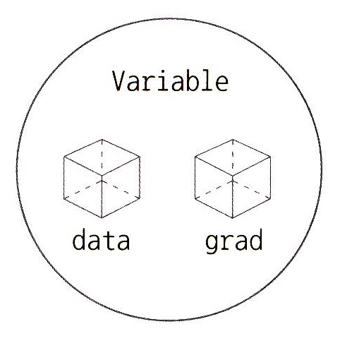
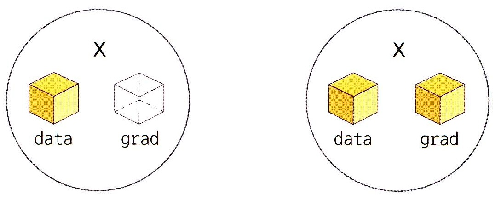
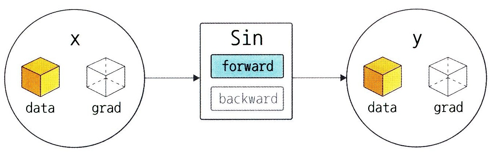
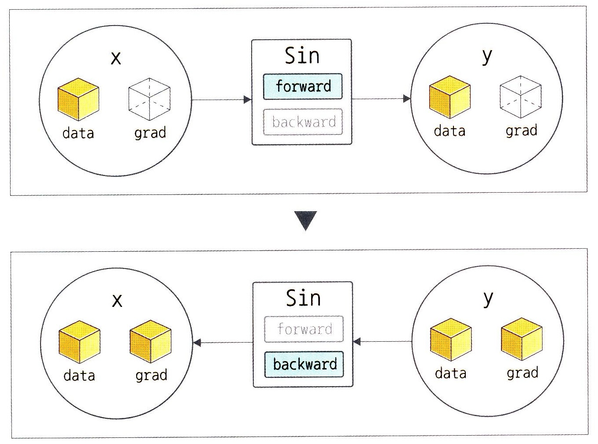

# 30단계 고차 미분(준비 편)

현재의 DeZero는 미분을 자동으로 계산할 수 있지만 1차 미분 한정입니다. 그래서 이번 단계에서는 2차 미분도 자동으로 계산할 수 있도록, 나아가 3차 미분, 4차 미분, $\dots$ 형태의 모든 고차 미분까지 자동으로 계산할 수 있도록 DeZero를 확장할 것입니다.

그러려면 DeZero를 사용하여 2차 미분을 계산하려는 현재의 역전파 구현을 근본적으로 재검토해야 합니다. DeZero의 역전파는 `Variable`과 `Function` 클래스에 기초해 동작합니다. 그래서 우선 `Variable`과 `Function`의 현재 구현부터 간단히 되돌아보려 합니다. 앞으로의 이야기는 조금 길어지므로 3개 절로 나눠 하나씩 확인하겠습니다.

---

## 30.1 확인 ①: Variable 인스턴스 변수

첫 번째로 `Variable` 클래스의 인스턴스 변수에 관해 복습하겠습니다. 우선 `Variable` 클래스를 초기화하는 `__init__` 메서드를 보죠.

```python
class Variable:
    def __init__(self, data, name=None):
        if data is not None:
            if not isinstance(data, np.ndarray):
                raise TypeError('{}은(는) 지원하지 않습니다.'.format(type(data)))
```

```python
        self.data = data
        self.name = name
        self.grad = None
        self.creator = None
        self.generation = 0
```

이와 같이 `Variable` 클래스에는 인스턴스 변수가 여러 개입니다. 그중 `data`와 `grad`에 주목해보죠. `data`와 `grad`는 각각 순전파 계산과 역전파 계산 시 사용됩니다. 주의할 것은 `data`와 `grad` 모두 `ndarray` 인스턴스를 저장한다는 사실입니다. 이 점을 부각하기 위해 [그림 30-1]처럼 그리겠습니다.

**그림 30-1 Variable을 그리는 새로운 방법**

*(Variable 동그라미 안에 투명한 입방체 상자 모양으로 data와 grad가 놓여 있는 그림입니다.)*

[그림 30-1]과 같이 `data`와 `grad`는 '입방체의 상자'로 그리겠습니다. 그리고 `data`와 `grad`가 `ndarray` 인스턴스를 참조하는 경우에는 [그림 30-2]처럼 그립니다.

**그림 30-2 Variable을 그리는 새로운 방법(데이터 참조 시)**

*(왼쪽 변수 x는 data 상자가 노란색으로 채워져 있고 grad 상자는 비어 있습니다. 오른쪽 변수 x는 data와 grad 상자 모두 노란색으로 채워져 실물 ndarray 데이터를 참조하고 있음을 표현합니다.)*

[그림 30-2]의 왼쪽은 예컨대 `x = Variable(np.array(2.0))`을 실행했을 때의 상태입니다. 추가로 `x.backward()`와 `x.grad = np.array(1.0)`까지 실행하면 오른쪽 그림의 상태가 됩니다. 앞으로의 설명에서는 이런 그림을 사용할 테니 잘 기억해두세요.

---

## 30.2 확인 ②: Function 클래스

이번 차례는 `Function`입니다. 다음은 `Function` 클래스의 `__call__` 메서드 코드로, 음영 부분에 주목해주세요.

```python
class Function:
    def __call__(self, *inputs):
        inputs = [as_variable(x) for x in inputs]
        # ① 순전파 계산(메인 처리)
        xs = [x.data for x in inputs]
        ys = self.forward(*xs)
        if not isinstance(ys, tuple):
            ys = (ys,)
        outputs = [Variable(as_array(y)) for y in ys]

        if Config.enable_backprop:
            self.generation = max([x.generation for x in inputs])
            # ② '연결'을 만듦
            for output in outputs:
                output.set_creator(self)
            self.inputs = inputs
            self.outputs = [weakref.ref(output) for output in outputs]

        return outputs if len(outputs) > 1 else outputs[0]
```

우선 **①** 부분입니다. 여기에서는 `xs = [x.data for x in inputs]`에 의해 `Variable` 인스턴스 변수인 `data`를 꺼내 리스트 `xs`로 모읍니다. 그리고는 `forward(*xs)`를 호출하여 구체적인 계산을 수행합니다.

이어서 **②** 부분을 살펴보죠. 여기에서는 `Variable`과 `Function`의 '관계'가 만들어집니다. 변수에서 함수로의 '연결'은 `set_creator` 메서드가 만들어줍니다. 새로 생성된 `Variable`에 부모 함

수(자신)를 알려주는 것이죠. 또한 함수의 입력과 출력 변수를 `inputs`와 `outputs`라는 인스턴스 변수에 저장하여 함수에서 변수로의 '연결'을 유지합니다.

> **NOTE**
> 변수와 함수의 '연결'을 만드는 이유는 나중에 미분값을 역방향으로 흘려보내기 때문입니다. DeZero는 계산이 이루어지는 시점에 '관계'를 동적으로 생성하는 Define-by-Run 방식으로 동작함을 잊지 않으셨죠?

DeZero의 함수는 모두 `Function` 클래스를 상속합니다. 그리고 구체적인 계산은 상속된 클래스에서 `forward` 메서드에 구현합니다. 예를 들어 sin 함수를 계산하는 `Sin` 클래스의 코드는 다음과 같습니다.

```python
class Sin(Function):
    def forward(self, x):
        y = np.sin(x)
        return y

    def backward(self, gy):
        x = self.inputs[0].data
        gx = gy * np.cos(x)
        return gx
```

여기에서 `forward` 메서드의 인수와 반환값은 모두 `ndarray` 인스턴스입니다. 마찬가지로 `backward` 메서드의 인수와 반환값도 `ndarray` 인스턴스입니다. 이 `Sin` 클래스를 사용하면 계산을 다음과 같이 할 수 있습니다.

```python
def sin(x):
    return Sin()(x)

x = Variable(np.array(1.0))
y = sin(x)
```

여기에서는 sin 함수의 순전파만 해보았습니다. 이때 변수와 함수의 '동작'을 시각화하면 [그림 30-3]과 같이 됩니다.

**그림 30-3 $y = \sin(x)$ 의 계산 그래프(순전파만)**

*(Variable x (data: 노란색 입방체, grad: 투명 입방체)가 Sin 함수의 forward 단계를 거쳐 Variable y (data: 노란색 입방체, grad: 투명 입방체)를 생성하는 연결 상태가 묘사되어 있습니다.)*

[그림 30-3]과 같이 순전파의 구체적인 계산은 `Sin` 클래스의 `forward` 메서드에서 진행됩니다. 그리고 변수와 함수의 '연결'이 만들어지죠. 다시 말하지만 이 '연결'은 `Function` 클래스의 `__call__` 메서드에서 만들어집니다.

---

## 30.3 확인 ③: Variable 클래스의 역전파

마지막으로 역전파 로직을 살펴보겠습니다. 역전파는 `Variable` 클래스의 `backward` 메서드에서 구현합니다. 그래서 `Variable` 클래스의 `backward` 메서드를 준비했습니다. 음영 부분에 주목해서 살펴보시죠.

```python
class Variable:
    ...

    def backward(self, retain_grad=False):
        if self.grad is None:
            self.grad = np.ones_like(self.data)

        funcs = []
        seen_set = set()

        def add_func(f):
            if f not in seen_set:
                funcs.append(f)
                seen_set.add(f)
                funcs.sort(key=lambda x: x.generation)
```

```python
        add_func(self.creator)

        while funcs:
            f = funcs.pop()

            # 역전파 계산(메인 처리)
            gys = [output().grad for output in f.outputs] # ①
            gxs = f.backward(*gys) # ②
            if not isinstance(gxs, tuple):
                gxs = (gxs,)

            for x, gx in zip(f.inputs, gxs): # ③
                if x.grad is None:
                    x.grad = gx
                else:
                    x.grad = x.grad + gx

                if x.creator is not None:
                    add_func(x.creator)

            if not retain_grad:
                for y in f.outputs:
                    y().grad = None
```

우선 **①**에서 `Variable`의 인스턴스 변수인 `grad`를 리스트로 모읍니다. 여기에서 인스턴스 변수 `grad`는 `ndarray` 인스턴스를 참조하고 있습니다. 따라서 **②**의 `backward` 메서드에는 `ndarray` 인스턴스가 담긴 리스트가 전달됩니다. 그리고 **③**에서 출력 쪽에서 전파하는 미분값(gxs)을 함수의 입력 변수(`f.inputs`)의 `grad`로 설정합니다.

그럼 이상의 사실을 기억하면서 다음 코드를 살펴봅시다.

```python
x = Variable(np.array(1.0))
y = sin(x)
y.backward(retain_grad=True)
```

sin 함수를 계산(순전파)하고 곧바로 역전파한 코드입니다. 여기에서는 `y.backward(retain_grad=True)`에 의해 모든 변수가 미분 결과를 메모리에 유지합니다(18단계에서 성능 개선을 위해 도입한 기능입니다). [그림 30-4]는 이때의 변수와 함수의 '동작'을 시각화한 모습입니다.

**그림 30-4 $y = \sin(x)$ 의 계산 그래프의 순전파와 역전파**

*(위쪽 그림은 순전파 시 data만 채워지는 모습을 보여주고, 아래쪽 그림은 역전파가 실행되면서 Sin의 backward 단계를 거쳐 x와 y의 grad 상자가 노란색 실물 데이터로 채워진 모습을 표현합니다.)*

[그림 30-4]와 같이 일반적인 계산(순전파)인 $y = \sin(x)$ 가 실행될 때 계산 그래프가 만들어지고, `Variable` 인스턴스 변수인 `data`가 채워집니다. 그리고 역전파 시 `Sin` 클래스의 `backward` 메서드가 불리고 `Variable`의 인스턴스 변수인 `grad`가 채워집니다.

이상이 현재의 DeZero에 의한 역전파 구현 방식입니다. 다음 단계에서는 고차 미분을 계산할 수 있도록 현재의 DeZero를 개선하겠습니다.
