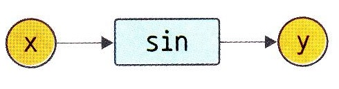
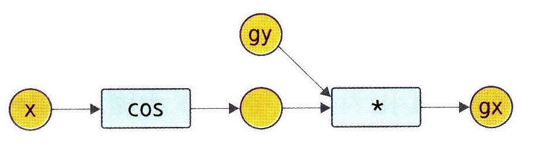
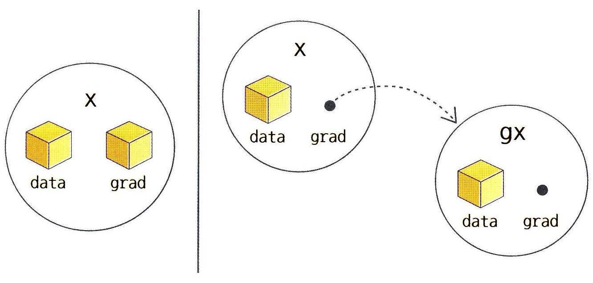
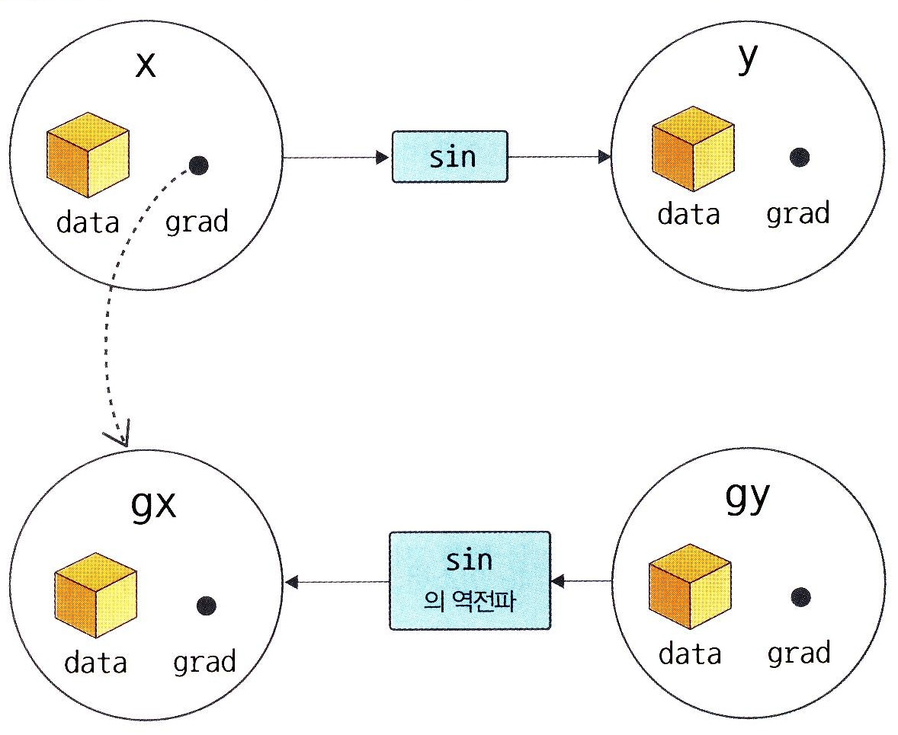
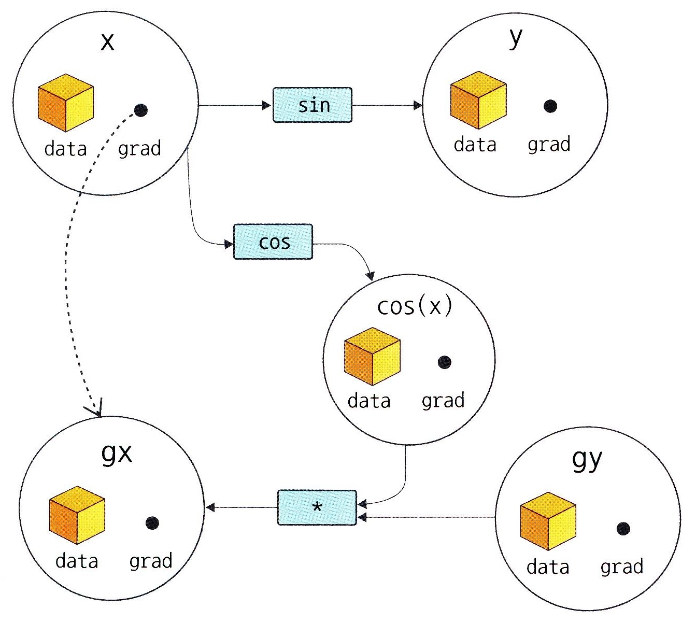

# 31단계 고차 미분(이론 편)

이전 단계에서는 현재의 DeZero 구현을 되돌아봤습니다. 요점은 다음과 같습니다.

* 계산의 '연결'은 `Function` 클래스의 `__call__` 메서드에서 만들어집니다.
* 구체적인 순전파와 역전파 계산은 `Function` 클래스를 상속한 클래스의 `forward` 메서드와 `backward` 메서드로 처리합니다.

여기서 주목할 점은 계산 그래프의 '연결'이 만들어지는 시점으로, 순전파를 계산할 때 만들어집니다. 역전파를 계산할 때는 만들어지지 않는데, 여기에 문제의 핵심이 있습니다.

---

## 31.1 역전파 계산

순전파와 마찬가지로 역전파에도 구체적인 계산 로직이 있습니다. 예를 들어 이전 단계에서 본 `Sin` 클래스의 `backward` 메서드의 구현은 다음과 같습니다.

```python
class Sin(Function):
    ...

    def backward(self, gy):
        x = self.inputs[0].data
        gx = gy * np.cos(x)
        return gx
```

이와 같이 `gx = gy * np.cos(x)`라는 구체적인 계산이 이루어집니다. 하지만 현재의 DeZero는 이 계산과 관련한 아무런 계산 그래프도 만들지 않습니다. 왜냐하면 이 계산에서는 `ndarray` 인스턴스가 사용되기 때문이죠. 만약 역전파를 계산할 때도 '연결'이 만들어진다면 어떤 장점이 있을까요? 바로 고차 미분을 자동으로 계산할 수 있게 됩니다! 원리를 이해하기 위해 우선 [그림 31-1]의 계산 그래프를 살펴보죠.

**그림 31-1 $y = \sin(x)$ 의 계산 그래프**

*(Variable x가 sin 연산을 거쳐 Variable y를 생성하는 모습이 그려져 있습니다.)*

[그림 31-1]은 $y = \sin(x)$ 의 계산 그래프입니다. 이때 `y.backward()`를 호출하면 $y$ 의 $x$ 에 대한 미분이 구해집니다. 앞에서도 한번 살펴본 예죠. 이어서 [그림 31-2]의 계산 그래프도 살펴보죠.

**그림 31-2 $y = \sin(x)$ 의 미분을 구하는 계산 그래프($gx$ 는 $y$ 의 $x$ 에 대한 미분 결과)**

*(Variable x가 cos 연산을 거친 중간 결과와, 위에서 유입된 Variable gy가 곱하기(*) 연산 블록을 통해 곱해져서 Variable gx를 생성하는 그래프가 묘사되어 있습니다.)*

[그림 31-2]는 'sin 함수의 미분'을 구하기 위한 계산 그래프입니다. 참고로 이 계산 그래프는 앞서 제시한 `Sin` 클래스의 역전파 코드(`gx = gy * np.cos(x)`)를 계산 그래프로 나타낸 것입니다. 만약 [그림 31-2]와 같은 계산 그래프가 있다면 `gx.backward()`를 호출하여 $gx$ 의 $x$ 에 대한 미분을 계산할 수 있습니다. 원래 $gx$ 는 $y = \sin(x)$ 의 미분이기 때문에 `gx.backward()`를 호출함으로써 $x$ 에 대한 미분이 한 번 더 이루어집니다. 즉, 이것이 $x$ 의 2차 미분에 해당합니다.

> **NOTE**
> 앞의 설명으로 이해되지 않는다면 [그림 31-2]의 $x$ 를 '시간'으로, $gx$ 를 '속도'로 바꿔 생각해보세요. 그러면 [그림 31-2]는 '시간'을 입력하면 그 시간에서의 '속도'가 출력되는 계산 그래프가 됩니다. 이때 역전파를 하면 '속도'의 '시간'에 대한 미분(변화)이 구해지는데, 바로 '가속도'에 해당합니다.

앞으로의 목표는 [그림 31-2]와 같은 '미분 계산'을 계산 그래프로 만드는 것입니다. 여기서 '미분 계산'이라 함은, 다시 말해 역전파 때 수행되는 계산입니다. 따라서 역전파 때 수행되는 계산

에 대해서도 '연결'을 만들면 문제가 해결됩니다. 이제 이 아이디어를 현실화하는 방법을 생각해보겠습니다.

---

## 31.2 역전파로 계산 그래프 만들기

DeZero는 순전파 계산의 '연결'을 만듭니다. 더 정확하게는 'Variable 인스턴스를 사용'하여 일반적인 계산(순전파)을 하는 시점에 '연결'이 만들어지죠. 이 말인즉슨 함수의 `backward` 메서드에서도 `ndarray` 인스턴스가 아닌 `Variable` 인스턴스를 사용하면 계산의 '연결'이 만들어진다는 뜻입니다.

이를 위한 준비로 우선 미분값(기울기)을 `Variable` 인스턴스 형태로 유지해야 합니다. 즉, `Variable`을 [그림 31-3]처럼 변경합니다.

**그림 31-3 지금까지의 Variable 클래스(왼쪽)와 새로운 Variable 클래스(오른쪽)**

*(왼쪽의 기존 Variable x는 data와 grad가 모두 ndarray 상자(노란색)를 참조합니다. 오른쪽의 새로운 Variable x는 grad가 ndarray 대신 새로운 Variable gx 인스턴스를 참조(점선 화살표)하고, Variable gx 내부의 data가 실제 미분값 ndarray를 참조하는 구조를 가집니다.)*

[그림 31-3]에서 알 수 있듯이 지금까지 `Variable` 클래스의 `grad`는 `ndarray` 인스턴스를 참조했습니다. 이를 `Variable` 인스턴스를 참조하도록 변경합니다. 이렇게 변경하면, 예컨대 방금 전의 $y = \sin(x)$ 를 [그림 31-4]와 같은 계산 그래프로 표현할 수 있습니다.

**그림 31-4 Sin 클래스의 순전파와 역전파의 계산 그래프(역전파 계산 내용은 생략)**

*(순전파 블록 sin 아래에 역전파 블록 'sin의 역전파'가 생겨서 gy에서 gx로의 역전파 흐름이 또 하나의 계산 그래프(실선 화살표 연결)를 형성하는 모습입니다. 또한 x의 grad는 gx를 가리키는 점선 화살표로 묘사되어 있습니다.)*

[그림 31-4]는 `Sin` 클래스의 순전파와 역전파를 수행한 후의 계산 그래프입니다. 중요한 점은 역전파 계산에 대한 계산 그래프도 만들어진다는 것입니다. 미분값을 나타내는 `gy`가 `Variable` 인스턴스가 된 덕분에 `gy`를 사용한 계산에도 '연결'이 만들어지는 것입니다.

> **CAUTION**
> $y = \sin(x)$ 계산에서 `y.backward()`를 수행하면 $x$ 와 같은 '말단 변수(사용자가 제공한 변수)'만 미분값을 유지합니다. $y$ 는 함수가 만들어내는 변수이므로 미분값을 유지하지 않기 때문입니다. [그림 31-4]에서도 `y.grad`에서 `gy`로의 참조는 없습니다.

그런데 [그림 31-4]에서는 `Sin` 클래스의 역전파 계산 내용을 생략했습니다. `Sin` 클래스의 `backward` 메서드를 구현했을 때 그 미분을 계산하는 코드는 `gx = gy * cos(x)`였습니다. 이때의 변수가 모두 `Variable` 인스턴스로 바뀌었다고 생각해보죠. 그러면 [그림 31-4]에서 생략한 역전파 계산은 실제로는 [그림 31-5]의 계산 그래프를 만듭니다.

**그림 31-5 실제로 만들어지는 계산 그래프**

*(순전파 그래프인 x -> sin -> y 외에 역전파 과정에서 x가 cos 함수를 거쳐 cos(x) 변수를 생성하고, 이 cos(x)와 gy가 곱하기(*) 연산을 거쳐 gx를 생성하는 전체 계산 그래프가 유기적으로 엮여서 형성된 구조입니다.)*

[그림 31-5]는 `y.backward()`를 호출함으로써 '새로' 만들어지는 계산 그래프입니다. 즉, '역전파에 의해 새롭게 계산 그래프가 만들어졌다'는 뜻입니다. [그림 31-5]와 같은 계산 그래프가 있다면 `gx.backward()`를 호출함으로써 $y$ 의 $x$ 에 대한 2차 미분이 이루어집니다.

이상이 고차 미분을 계산하기 위한 전략입니다. 다음 단계에서는 전략을 실제로 구현하겠습니다.
