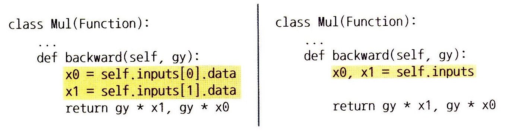

# 32단계 고차 미분(구현 편)

이번 단계에서는 고차 미분을 해낼 수 있도록 DeZero를 변경하겠습니다. 이전 단계에서 이야기한 대로 역전파 시 수행되는 계산에 대해서도 계산 그래프를 만들면 됩니다. 역전파 때도 `Variable` 인스턴스를 사용하면 해결된다는 것을 이전 단계에서 설명했으니, 이제 코드로 구현할 차례입니다.

> **NOTE**
> 지금까지는 `Variable` 클래스를 `dezero/core_simple.py`에서 구현했습니다. 하지만 이번 단계에서는 기존의 것을 대체하는 새로운 `Variable` 클래스를 `dezero/core.py`에 구현하겠습니다. 그리고 `dezero/core_simple.py`에 구현했던 사칙연산 등의 함수와 연산자 오버로드들 또한 `dezero/core.py`에서 새로 구현하겠습니다.

---

## 32.1 새로운 DeZero로!

새로운 DeZero로 가는 가장 중요한 변화는 `Variable` 클래스의 인스턴스 변수인 `grad`입니다. 지금까지의 `grad`는 `ndarray` 인스턴스를 참조했습니다. 반면 새로운 DeZero에서는 다른 `Variable` 인스턴스를 참조하겠습니다. 따라서 `Variable` 클래스의 다음 음영 부분을 변경합니다.

**dezero/core.py**
```python
class Variable:
    ...

    def backward(self, retain_grad=False):
        if self.grad is None:
            # self.grad = np.ones_like(self.data)
            self.grad = Variable(np.ones_like(self.data))
        ...
```

이와 같이 단 한 줄만 바꾸면 됩니다. 하지만 이 작은 변경 덕에 미분값을 자동으로 저장하는 코드에서 `self.grad`가 `Variable` 인스턴스를 담게 되죠. 이상으로 새로운 `Variable` 클래스를 완성했습니다.

---

## 32.2 함수 클래스의 역전파

이제 DeZero의 구체적인 함수들의 `backward` 메서드를 수정하는 일이 남았습니다(`Function` 클래스는 수정할 게 없습니다). 지금까지는 `dezero/core_simple.py` 파일에서 다음 DeZero 함수 클래스들을 구현했습니다.

* Add
* Mul
* Neg
* Sub
* Div
* Pow

이번 단계에서는 이 클래스들의 `backward` 메서드를 수정한 다음 `dezero/core.py`로 옮기겠습니다. 첫 번째인 `Add` 클래스는 수정할 게 아무것도 없습니다. 참고로 `Add` 클래스의 구현은 다음과 같습니다.

**dezero/core.py**
```python
class Add(Function):
    def forward(self, x0, x1):
        y = x0 + x1
        return y
```

```python
    def backward(self, gy):
        return gy, gy
```

`Add` 클래스의 역전파가 하는 일은 출력 쪽에서 전해지는 미분값을 입력 쪽으로 전달하는 게 다입니다. 이처럼 역전파 때는 아무것도 계산하지 않기 때문에 수정할 거리도 없는 것입니다.

다음은 `Mul` 클래스 차례입니다. `Mul` 클래스의 `backward` 메서드는 다음처럼 수정합니다.

**그림 32-1 Mul 클래스의 backward 메서드 비교(왼쪽: 수정 전, 오른쪽: 수정 후)**

* **수정 전 (왼쪽)**
  ```python
  class Mul(Function):
      ...
      def backward(self, gy):
          x0 = self.inputs[0].data
          x1 = self.inputs[1].data
          return gy * x1, gy * x0
  ```
* **수정 후 (오른쪽)**
  ```python
  class Mul(Function):
      ...
      def backward(self, gy):
          x0, x1 = self.inputs
          return gy * x1, gy * x0
  ```

[그림 32-1]과 같이 수정 전에는 `Variable` 인스턴스 안에 있는 데이터(`ndarray` 인스턴스)를 꺼내야 했습니다. 한편 수정 후에는 `Mul` 클래스에서 `Variable` 인스턴스를 그대로 사용합니다. [그림 32-1]에서 주목할 점은 역전파를 계산하는 `gy * x1` 코드입니다. 다시 말하지만 새로운 DeZero에서는 `gy`와 `x1`이 `Variable` 인스턴스입니다. `Variable` 클래스의 `* 연산자`는 이미 오버로드되어 있으므로 `gy * x1`이 실행되는 뒤편에서는 `Mul` 클래스의 순전파가 호출됩니다. 그때 `Function.__call__()`이 호출되고, 그 안에서 계산 그래프가 만들어집니다.

> **CAUTION**
> 역전파 계산은 `Variable` 인스턴스에 대해 이루어집니다. 따라서 DeZero 함수에 `Variable` 인스턴스를 넣어 계산해야 합니다.

나머지 `Sub`, `Div`, `Pow` 클래스의 `backward` 메서드도 같은 방법으로 수정하면 되므로 설명은 생략하겠습니다.

---

## 32.3 역전파를 더 효율적으로(모드 추가)

우리는 18단계에서 역전파의 활성/비활성 모드를 도입했습니다. 역전파가 필요 없는 경우에는

'역전파 비활성 모드'로 전환하여 역전파 처리(계산 그래프 생성과 입력 변수 유지 등)를 생략한 것이죠. 이번 절에서는 역전파에서 수행하는 계산에도 같은 전략을 도입합니다. 즉, 역전파를 처음 한 번 이후로 다시 할 일이 없다면(역전파를 1회만 한다면) 역전파 계산도 '역전파 비활성 모드'로 실행하도록 하는 것이죠. 이를 위해 `Variable` 클래스의 `backward` 메서드에 다음 코드를 추가합니다.

**dezero/core.py**
```python
    def backward(self, retain_grad=False, create_graph=False):
        ...

        while funcs:
            f = funcs.pop()
            gys = [output().grad for output in f.outputs]

            with using_config('enable_backprop', create_graph):
                gxs = f.backward(*gys) # 메인 backward
                if not isinstance(gxs, tuple):
                    gxs = (gxs,)

                for x, gx in zip(f.inputs, gxs):
                    if x.grad is None:
                        x.grad = gx
                    else:
                        x.grad = x.grad + gx # 이 계산도 대상

                    if x.creator is not None:
                        add_func(x.creator)
        ...
```

우선 인수 `create_graph`를 추가하고 기본값을 `False`로 설정합니다. 그리고 실제 역전파의 처리를 `with using_config(...)`에서 수행합니다(`using_config` 메서드 사용법은 18단계에서 설명했습니다). 따라서 `create_graph`가 `False`면 역전파로 인한 계산은 '역전파 비활성 모드'에서 이루어집니다.

> **NOTE**
> 이야기가 조금 복잡하므로 구체적인 예를 들어 보충하겠습니다. 가령 `Mul` 클래스의 `backward` 메서드는 `gy * x1` 계산을 합니다. 여기서 `* 연산자`는 오버로드되어 있기 때문에 실제로는 `Mul()(gy, x1)` 코드가 호출되고, 이어서 부모 클래스인 `Function`의 `__call__()`이 호출됩니다. `Function.__call__()` 메서드에서 `Config.enable_backprop`이 참조되고, 역전파 활성/비활성 모드가 전환됩니다.

또한 `create_graph=False`로 기본 설정한 이유는 실무에서 역전파가 단 1회만 수행되는 경우가 압도적으로 많기 때문입니다. 만약 2차 이상의 미분이 필요하다면 `create_graph`를 `True`로 설정합니다. 그러면 역전파를 계산할 때도 계산 그래프가 만들어지므로 역전파를 반복해서 할 수 있습니다.

---

## 32.4 `__init__.py` 변경

이것으로 새로운 DeZero의 핵심은 완성됐습니다. 그러니 지금까지의 수정을 새로운 `dezero/core.py`에 넣어보겠습니다. 그리고 앞으로는 `dezero/core_simple.py` 대신 `dezero/core.py`를 사용할 것이므로 초기화를 수행하는 `dezero/__init__.py`를 다음처럼 수정합니다.

**dezero/__init__.py**
```python
# step23.py에서 step32.py까지는 simple_core를 이용
is_simple_core = False # True

if is_simple_core:
    from dezero.core_simple import Variable
    from dezero.core_simple import Function
    from dezero.core_simple import using_config
    from dezero.core_simple import no_grad
    from dezero.core_simple import as_array
    from dezero.core_simple import as_variable
    from dezero.core_simple import setup_variable
else:
    from dezero.core import Variable
    from dezero.core import Function
    from dezero.core import using_config
    from dezero.core import no_grad
    from dezero.core import as_array
    from dezero.core import as_variable
    from dezero.core import setup_variable
...
```

이와 같이 `is_simple_core`를 `False`로 설정하여 주요 기능을 `dezero/core.py`에서 임포트하도록 바꿉니다. 이것으로 고차 미분에 대응하는 core 파일을 임포트할 수 있습니다.

> **CAUTION**
> `core_simple.py`에서 변경되지 않은 클래스와 함수도 `dezero/core.py`에 복사해 넣었습니다(`Function` 클래스와 `using_config` 함수 등).

이상으로 이번 단계를 마칩니다. 다음 단계에서는 새로운 DeZero를 사용하여 고차 미분을 자동으로 계산해보겠습니다.
