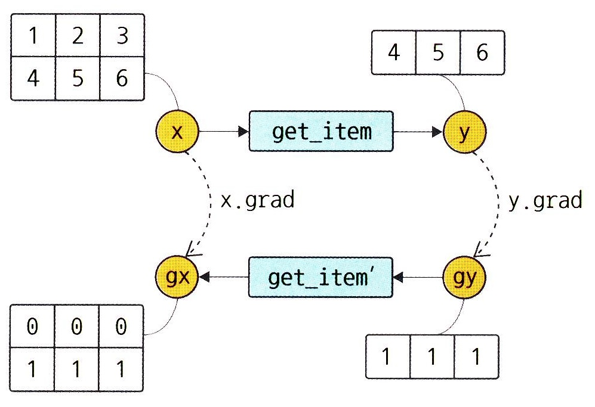
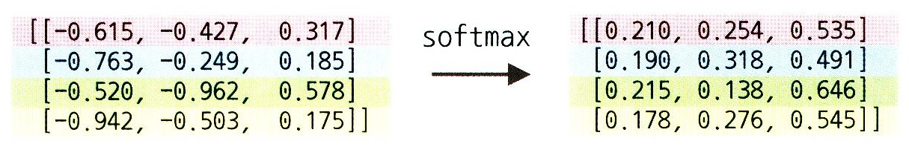

# 47단계 소프트맥스 함수와 교차 엔트로피 오차

지금까지 신경망을 사용하여 회귀 문제를 풀어왔는데, 앞으로는 새로운 유형의 문제에 도전해 보겠습니다. 바로 **다중 클래스 분류(multi-class classification)**입니다. 다중 클래스 분류는 이름처럼 '여러 클래스'로 '분류'하는 문제로, 분류 대상이 여러 가지 클래스 중 어디에 속하는지 추정합니다. 이번 단계에서는 다중 클래스 분류를 위한 사전 준비를 합니다. 그리고 다음 단계에서 `DeZero`를 사용하여 다중 클래스 분류를 구현하겠습니다.

---

## 47.1 슬라이스 조작 함수

우선 사전 준비로 편의 함수를 하나 추가합니다. `get_item`이라는 함수로, 당장은 함수 사용법만 보여드리겠습니다. 구현 방법에 관심 있는 분은 '부록 B'를 참고하세요. 다음은 `get_item` 함수의 사용 예입니다.

```python
import numpy as np
from dezero import Variable
import dezero.functions as F

x = Variable(np.array([[1, 2, 3], [4, 5, 6]]))
y = F.get_item(x, 1)
print(y)
```

**실행 결과**
```text
variable([4 5 6])
```

이와 같이 `get_item` 함수는 `Variable`의 다차원 배열 중에서 일부를 슬라이스(slice)하여 뽑아줍니다. 이 예에서는 (2, 3) 형상의 `x`에서 1번째 행의 원소를 추출했습니다. 이 함수는 `DeZero` 함수로 구현했기 때문에 역전파도 제대로 수행합니다. 확인차 앞의 코드 뒤에 다음 코드를 추가해보세요.

```python
y.backward()
print(x.grad)
```

**실행 결과**
```text
variable([[0. 0. 0.]
          [1. 1. 1.]])
```

`y.backward()`를 호출하여 역전파를 해봤습니다(이때 `y.grad = Variable(np.ones_like(y.data))`로, 기울기가 자동으로 채워집니다). 슬라이스로 인한 '계산'은 다차원 배열의 데이터 일부를 수정하지 않고 전달하는 것입니다. 따라서 그 역전파는 원래의 다차원 배열에서 데이터가 추출된 위치에 해당 기울기를 설정하고, 그 외에는 0으로 설정합니다. 그림으로는 [그림 47-1]과 같습니다.

**그림 47-1 get_item 함수의 순전파와 역전파 예**


*(순전파/역전파 흐름: 순전파에서는 `x: [[1, 2, 3], [4, 5, 6]]` $\rightarrow$ `get_item` $\rightarrow$ `y: [4, 5, 6]`로 진행되며, 역전파에서는 `gy: [1, 1, 1]` $\rightarrow$ `get_item'` $\rightarrow$ `gx: [[0, 0, 0], [1, 1, 1]]`로 진행됨)*

> **NOTE**
> 다차원 배열의 일부를 추출하는 작업을 '슬라이스'라고 합니다. 파이썬에서는 리스트나 튜플인 `x`에 대해 `x[1]`이나 `x[1:4]` 같은 형태로 슬라이스 조작을 할 수 있습니다.

또한 `get_item` 함수를 사용하면 다음 코드 예처럼 같은 인덱스를 반복 지정하여 동일한 원소를 여러 번 빼낼 수 있습니다.

```python
x = Variable(np.array([[1, 2, 3], [4, 5, 6]]))
indices = np.array([0, 0, 1])
y = F.get_item(x, indices)
print(y)
```

**실행 결과**
```text
variable([[1 2 3]
          [1 2 3]
          [4 5 6]])
```

이상이 `DeZero`의 `get_item` 함수입니다. 이어서 `get_item` 함수를 `Variable`의 메서드로도 사용할 수 있게 특수 메서드로 설정합니다.

```python
Variable.__getitem__ = F.get_item  # Variable의 메서드로 설정

y = x[1]
print(y)

y = x[:, 2]
print(y)
```

**실행 결과**
```text
variable([4 5 6])
variable([3 6])
```

이렇게 해두면 `x[1]`이나 `x[:, 2]` 등의 기법을 사용할 때도 `get_item` 함수가 불립니다. 더구나 이 슬라이스 작업의 역전파도 올바르게 이루어지죠. 이 특수 메서드 설정은 `dezero/core.py`의 `setup_variable` 함수에서 수행하게 합니다(`setup_variable` 함수는 `DeZero` 초기화 시

호출되는 함수입니다). 이것으로 `Variable` 인스턴스를 자유롭게 슬라이스할 수 있게 되었으니, 이번 단계의 주제로 넘어가겠습니다.

---

## 47.2 소프트맥스 함수

다중 클래스 분류를 신경망으로 하게 되면 지금까지 선형 회귀 때 이용한 신경망을 그대로 사용할 수 있습니다. 앞서 `MLP` 클래스로 구현해둔 신경망을 그대로 이용할 수 있다는 뜻입니다. 예를 들어 입력 데이터의 차원 수가 2이고 3개의 클래스로 분류하는 문제라면 다음과 같이 작성할 수 있습니다.

**steps/step47.py**
```python
from dezero.models import MLP

model = MLP((10, 3))
```

`MLP((10, 3))` 코드는 2층으로 이루어진 완전연결 신경망을 만들어줍니다. 첫 번째 완전연결 계층의 출력 크기는 10이고, 두 번째 완전연결계층의 출력 크기는 3입니다. 이제 `model`은 입력 데이터를 3차원 벡터(원소가 3개인 벡터)로 변환합니다. 실제로 적당한 데이터를 입력해보겠습니다.

**steps/step47.py**
```python
x = np.array([[0.2, -0.4]])
y = model(x)
print(y)
```

**실행 결과**
```text
variable([[-0.6150578 -0.42790162  0.31733288]])
```

`x`의 형상은 `(1, 2)`입니다. 샘플 데이터가 하나 있고, 그 데이터는 원소가 2개인 2차원 벡터임을 뜻합니다. 그리고 신경망의 출력 형태는 `(1, 3)`입니다. 이는 곧 하나의 샘플 데이터가 3개의 원소(= 3차원 벡터)로 변환된다는 말입니다. 이때 3차원 벡터의 원소 각각이 하나의 클래스에 해당합니다. 그리고 출력된 벡터에서 값이 가장 큰 원소의 인덱스가 이 모델이 분류한(정답이

라고 예측한) 클래스입니다. 앞의 예는 (0번, 1번, 2번 원소 중) 2번 원소가 0.31733288으로 가장 크기 때문에 2번 클래스로 분류한 것입니다.

> **NOTE**
> 앞의 코드에서는 입력 데이터가 하나뿐이었지만 여러 데이터를 한꺼번에 처리할 수도 있습니다. 예를 들어 `x = np.array([[0.2, -0.4], [0.3, 0.5], [1.3, -3.2], [2.1, 0.3]])`처럼 하면 4개의 입력 데이터를 하나로 묶어 전달합니다. 그러면 `y = model(x)` 코드는 입력 데이터 4개를 한꺼번에 처리해주죠. 이때 `y`의 형상(`y.shape`)은 `(4, 3)`이 되며, `i`번째 입력 데이터는 `x[i]`가 되고, 그에 대응하는 출력은 `y[i]`가 됩니다. `i`의 값은 물론 0~3 사이의 정수입니다.

이번 코드 예시에서는 신경망의 출력이 단순한 '수치'인데, 이 수치를 '확률'로 변환할 수 있습니다. 이 일을 해주는 것이 **소프트맥스 함수(softmax function)**입니다. 소프트맥스 함수는 다음 식으로 표현됩니다.

$$
p_k = \frac{\exp(y_k)}{\sum_{i=1}^{n} \exp(y_i)} \tag{식 47.1}
$$

여기서 소프트맥스 함수의 입력 $y_k$ 가 총 $n$ 개라고 가정합니다($n$ 은 '클래스 수'). 그리고 [식 47.1]은 $k$ 번째 출력 $p_k$ 를 구하는 계산식을 보여줍니다. 소프트맥스 함수의 분자는 입력 $y_k$ 의 지수 함수고, 분모는 모든 입력의 지수 함수의 총합입니다. 따라서 $0 \le p_i \le 1$ 이고, $p_1 + p_2 + \cdots + p_n = 1$ 이 성립하여 $(p_1, p_2, \cdots, p_n)$ 의 원소 각각을 확률로 해석할 수 있게 됩니다.

그럼 `DeZero`용 소프트맥스 함수를 구현해봅시다. 우선 입력 데이터가 하나(샘플 데이터가 하나)인 경우에 한정하여 소프트맥스 함수를 구현하겠습니다. 코드는 다음과 같습니다.

**steps/step47.py**
```python
from dezero import Variable, as_variable
import dezero.functions as F

def softmax1d(x):
    x = as_variable(x)
    y = F.exp(x)
    sum_y = F.sum(y)
    return y / sum_y
```

보다시피 `DeZero` 함수들을 사용하여 [식 47.1]을 코드로 옮기면 됩니다(`DeZero`의 `Exp` 클래스와 `exp` 함수는 `functions.py`에 존재합니다). 첫 번째 줄 `x = as_variable(x)`는 `x`가 `ndarray` 인스턴스인 경우 `Variable` 인스턴스로 변환해줍니다.

> **NOTE**
> 이 코드의 `y / sum_y` 계산에서는 `y`와 `sum_y`의 형상이 다르기 때문에 형상을 일치시켜주는 브로드캐스트가 일어납니다. `DeZero`는 브로드캐스트에 대한 대응을 이미 마쳤으므로 브로드캐스트가 일어나더라도 역전파를 올바르게 수행합니다.

그러면 `softmax1d` 함수를 사용해볼까요?

**steps/step47.py**
```python
x = Variable(np.array([[0.2, -0.4]]))
y = model(x)
p = softmax1d(y)
print(y)
print(p)
```

**실행 결과**
```text
variable([[-0.61505778 -0.42790161  0.31733289]])
variable([[0.21068638 0.25404893 0.53526469]])
```

보다시피 `p`의 각 원소는 0 이상 1 이하이고, 총합은 1이 됩니다. 이처럼 신경망의 출력을 '확률'로 변환할 수 있었습니다.

> **CAUTION**
> 소프트맥스 함수의 계산은 지수 함수로 이루어지기 때문에 결괏값이 너무 커지거나 작아지기 쉽습니다. 따라서 소프트맥스 함수를 구현할 때는 오버플로 문제에 잘 대처해야 합니다. 이 책에서는 설명을 생략하니, 소프트맥스 함수를 더 잘 구현하는 방법은 『밑바닥부터 시작하는 딥러닝』의 '3.5.2 소프트맥스 함수 구현 시 주의점' 절을 참고하세요.

이어서 배치(batch) 데이터에도 소프트맥스 함수를 적용할 수 있도록 확장하겠습니다. [그림 47-2]와 같이 샘플 데이터 각각에 소프트맥스 함수를 적용하는 경우를 생각해보죠.

**그림 47-2 2차원 데이터에 소프트맥스 함수를 적용하는 예**


```text
[[ -0.615, -0.427,  0.317]    softmax     [[0.210, 0.254, 0.535]
 [ -0.763, -0.249,  0.185]   --------->    [0.190, 0.318, 0.491]
 [ -0.520, -0.962,  0.578]                 [0.215, 0.138, 0.646]
 [ -0.942, -0.503,  0.175]]                [0.178, 0.276, 0.545]]
```

배치 데이터도 처리할 수 있는 소프트맥스 함수는 다음과처럼 구현할 수 있습니다.<sup>\*</sup>

**dezero/functions.py**
```python
def softmax_simple(x, axis=1):
    x = as_variable(x)
    y = exp(x)
    sum_y = sum(y, axis=axis, keepdims=True)
    return y / sum_y
```

인수 `x`는 2차원 데이터라고 가정합니다. 그리고 인수 `axis`에서 어떤 축을 따라 소프트맥스 함수를 적용할지 정합니다. `axis=1`이면 소프트맥스 함수가 [그림 47-2]처럼 적용됩니다. 합계 계산에서는 `keepdims=True`이므로 각 행에서 [식 47.1]의 나눗셈이 이루어지게 됩니다.

참고로 여기서 구현한 `softmax_simple` 함수는 `DeZero` 함수를 사용한 간단한 구현으로, 올바른 결과를 내지만 개선할 점도 있습니다. 더 나은 구현 방식은 (다시 이야기하지만) `Function` 클래스를 상속하여 `Softmax` 클래스를 구현하고 파이썬 함수로 `softmax`를 구현하는 것입니다. 여기에서는 설명을 생략하니 관심 있는 분은 `dezero/functions.py`를 참고하기 바랍니다.

---

## 47.3 교차 엔트로피 오차

선형 회귀에서는 손실 함수로 평균 제곱 오차를 이용했습니다. 하지만 다중 클래스 분류에 적합한 손실 함수는 따로 있습니다. 흔히 **교차 엔트로피 오차(cross entropy error)**를 사용하며, 다음 식으로 정의됩니다.

$$
L = -\sum_{k} t_k \log p_k \tag{식 47.2}
$$

여기서 $t_k$ 는 정답 데이터의 $k$ 차원째 값을 나타냅니다. 정답 데이터의 각 원소는 정답에 해당하는 클래스면 1로, 그렇지 않으면 0으로 기록되어 있습니다. 이러한 표현 방식을 **원핫 벡터(one-hot vector)**라고 합니다. 벡터를 구성하는 여러 원소 중 한 원소만 핫(hot)하다(값이 1이다)는 뜻입니다. 또한 $p_k$ 는 신경망에서 소프트맥스 함수를 적용한 후의 출력입니다.

---
<sup>\* 이 코드는 `dezero/functions.py`에서 정의합니다. `exp` 함수와 `sum` 함수 역시 같은 `dezero/functions.py`에 정의되어 있으므로 DeZero를 `F.exp()`가 아닌 단순히 `exp()`로 호출합니다.</sup>

교차 엔트로피 오차를 뜻하는 [식 47.2]를 더 간단하게 표현할 수도 있습니다. 예를 들어 $\mathbf{t} = (0, 0, 1)$ 이고 $\mathbf{p} = (p_0, p_1, p_2)$ 인 경우를 [식 47.2]에 대입하면 $L = -\log p_2$ 가 됩니다. 다시 말해, 정답 클래스에 해당하는 번호의 확률 $\mathbf{p}$ 를 추출함으로써 교차 엔트로피 오차를 계산할 수 있습니다. 따라서 정답 데이터에 의해 정답 클래스의 번호가 $t$ 로 주어지면 다음처럼도 계산할 수 있습니다.

$$
L = -\log \mathbf{p}[t] \tag{식 47.3}
$$

여기서 $\mathbf{p}[t]$ 는 벡터 $\mathbf{p}$ 에서 $t$ 번째 요소만을 추출한다는 뜻입니다. 이 슬라이스 작업은 이번 단계를 시작할 때(47.1절) `DeZero`에 갖춰둔 기능입니다.

> **CAUTION**
> 이번 교차 엔트로피 오차 설명은 데이터가 하나인 경우에 대한 것입니다. 만약 데이터가 $N$ 개라면 각 데이터에서 교차 엔트로피 오차를 구하고, 전체를 더한 다음 $N$ 으로 나눕니다. 즉, 평균 교차 엔트로피 오차를 구합니다.

그럼 교차 엔트로피 오차를 구현해봅시다. '소프트맥스 함수'와 '교차 엔트로피 오차'를 한꺼번에 수행하는 함수를 `softmax_cross_entropy_simple(x, t)`라는 이름으로 구현하겠습니다.

**dezero/functions.py**
```python
def softmax_cross_entropy_simple(x, t):
    x, t = as_variable(x), as_variable(t)
    N = x.shape[0]

    p = softmax(x) # 또는 softmax_simple(x)
    p = clip(p, 1e-15, 1.0) # log(0)을 방지하기 위해 p의 값을 1e-15 이상으로 한다.
    log_p = log(p) # log는 DeZero 함수
    tlog_p = log_p[np.arange(N), t.data]
    y = -1 * sum(tlog_p) / N
    return y
```

인수 `x`는 신경망에서 소프트맥스 함수를 적용하기 전의 출력이며, `t`는 정답 데이터입니다. 이 정답 데이터로는 정답 클래스의 번호(레이블)가 주어진다고 가정합니다(원핫 벡터가 아닙니다).

앞 코드의 `p = softmax(x)`에서 `p`의 원소값은 0 이상 1 이하입니다. 이어서 `log` 계산을 수행합니다. 이때 `log` 함수에 0을 건네면 오류(정확하게는 경고)가 발생하므로, 이를 방지하기

위해 값이 0이면 `1e-15`라는 작은 값으로 대체합니다. 이 일을 해주는 것이 `clip` 함수입니다. `clip` 함수는 `clip(x, x_min, x_max)` 형태로 사용하는데, `x`(`Variable` 인스턴스)의 원소가 `x_min` 이하이면 `x_min`으로 변환하고, `x_max` 이상이면 `x_max`로 변환해줍니다. `clip` 함수 구현에 관한 설명은 생략하겠습니다(코드는 `dezero/functions.py`에 있습니다).

한편 `np.arange(N)`은 `[0, 1, ..., N-1]` 형태의 `ndarray` 인스턴스를 생성해줍니다. 따라서 `log_p[np.arange(N), t.data]` 코드는 `log_p[0, t.data[0]]`, `log_p[1, t.data[1]]`, ...와 정답 데이터(`t.data`)에 대응하는 모델의 출력을 구하고, 그 값을 1차원 배열에 담아줍니다.

> **CAUTION**
> 앞의 `softmax_cross_entropy_simple` 함수는 간단한 구현입니다. 더 나은 구현은 `dezero/functions.py`에 `softmax_cross_entropy` 함수로 구현되어 있습니다. 지면에서는 이해하기 쉽도록 간단한 구현을 기준으로 설명했습니다.

그러면 다중 클래스 분류를 하는 신경망에 구체적인 데이터를 주어 교차 엔트로피 오차를 계산해보겠습니다.

```python
x = np.array([[0.2, -0.4], [0.3, 0.5], [1.3, -3.2], [2.1, 0.3]])
t = np.array([2, 0, 1, 0])
y = model(x)
loss = F.softmax_cross_entropy_simple(y, t)
# 혹은 F.softmax_cross_entropy(y, t)
print(loss)
```

**실행 결과**
```text
variable(1.4967442524053058)
```

먼저 입력 데이터 `x`와 정답 데이터 `t`를 준비합니다. 정답 데이터에는 정답 클래스의 번호가 기록되어 있습니다. 그런 다음 `y = model(x)`에서 변환을 하고, `F.softmax_cross_entropy_simple(y, t)`에서 손실 함수를 계산합니다. 이상으로 다중 클래스 분류를 해볼 준비를 마쳤습니다. 다음 단계에서는 다중 클래스 분류를 실제로 해보겠습니다.
