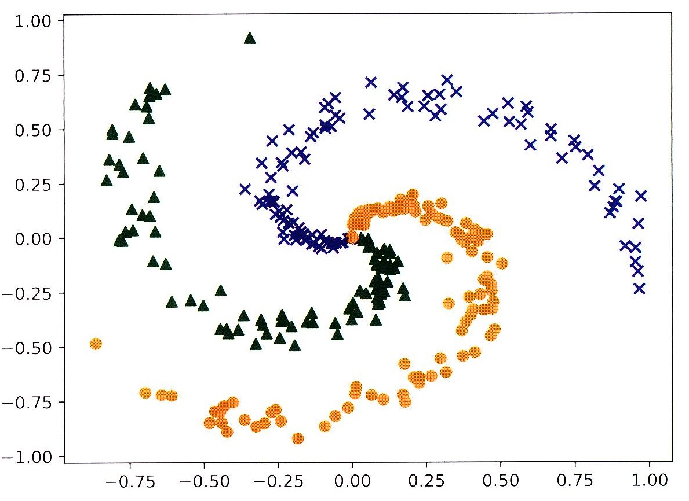
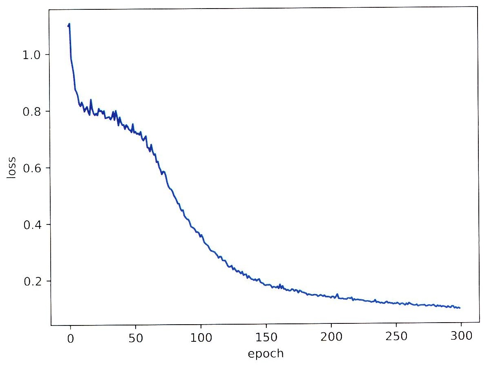
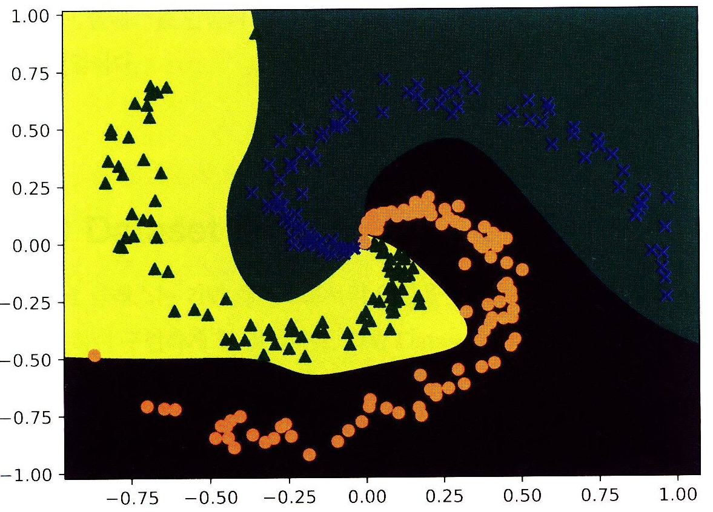

# 48단계 다중 클래스 분류

이전 단계에서는 소프트맥스 함수와 교차 엔트로피 오차를 구현했습니다. 그러니 이제 다중 클래스 분류를 할 수 있습니다. 이번 단계에서는 '스파이럴 데이터셋'이라는 작은 데이터셋을 사용하여 다중 클래스 분류를 실제로 해보겠습니다(스파이럴(spiral)은 나선형 혹은 소용돌이 모양이라는 뜻입니다). 먼저 스파이럴 데이터셋을 확인하는 일부터 시작합니다.

---

## 48.1 스파이럴 데이터셋

`DeZero`의 `dezero/datasets.py` 모듈(파일)에는 데이터셋 관련 클래스와 함수가 준비되어 있습니다. 또한 머신러닝에서 사용하는 대표적인 데이터셋도 몇 가지 들어 있는데, 여기에서는 그중 '스파이럴 데이터셋'을 읽어오겠습니다. `get_spiral` 함수를 사용하면 됩니다.

```python
import dezero

x, t = dezero.datasets.get_spiral(train=True)
print(x.shape)
print(t.shape)

print(x[10], t[10])
print(x[110], t[110])
```

**실행 결과**
```text
(300, 2)
(300,)
[0.05984409 0.0801167 ] 0
[-0.08959206 -0.04442143] 1
```

`get_spiral` 함수는 인수로 `train`이라는 플래그를 받습니다. `train=True`면 학습(훈련)용 데이터를 반환하고, `False`면 테스트용 데이터를 반환합니다. 실제로 반환되는 값은 입력 데이터인 `x`와 정답 데이터(레이블)인 `t`입니다. `x`와 `t`는 모두 `ndarray` 인스턴스이며, 형상은 각각 `(300, 2)`와 `(300,)`입니다. 이번에 다루는 문제는 3 클래스 분류이므로 `t`의 원소는 0, 1, 2 중 하나가 됩니다. 참고로 [그림 48-1]은 `x`와 `t`를 그래프로 표현한 모습입니다.

**그림 48-1 소용돌이 모양으로 분포하는 데이터셋**


*(나선형/소용돌이 형태로 세 종류의 클래스 데이터 포인트가 ○, △, × 기호로 흩어져 있는 산점도 그래프)*

[그림 48-1]은 각각의 클래스를 ○, △, × 기호로 바꿔 그렸습니다. 보다시피 데이터가 소용돌이 모양으로 분포합니다. 앞으로 신경망을 사용하여 이 데이터를 정확하게 분류할 수 있는지 살펴보겠습니다.

---

## 48.2 학습 코드

이제 다중 클래스 분류를 하는 코드를 보겠습니다. 내용이 기니 전반과 후반으로 나눠 살펴보죠. 우선 전반 코드입니다.

**steps/step48.py**
```python
import math
import numpy as np
import dezero
from dezero import optimizers
import dezero.functions as F
from dezero.models import MLP

# ❶ 하이퍼파라미터 설정
max_epoch = 300
batch_size = 30
hidden_size = 10
lr = 1.0

# ❷ 데이터 읽기 / 모델, 옵티마이저 생성
x, t = dezero.datasets.get_spiral(train=True)
model = MLP((hidden_size, 3))
optimizer = optimizers.SGD(lr).setup(model)
```

지금까지 본 코드와 거의 같습니다. 우선 ❶에서 하이퍼파라미터를 설정합니다. 하이퍼파라미터는 '사람'이 결정하는 매개변수로, 은닉층 수와 학습률 등이 여기 속합니다. 그리고 ❷에서 데이터셋을 읽고 모델과 옵티마이저를 생성합니다.

또한 `max_epoch = 300`으로 설정했는데, '에포크(epoch)'는 일종의 단위를 나타냅니다. 준비된 데이터셋을 모두 사용했을 때(모두 '살펴봤을' 때)가 1에포크입니다. 그리고 배치 크기는 30으로(`batch_size = 30`) 설정하여 데이터를 한 번에 30개씩 묶어 처리하도록 했습니다.

> **NOTE**
> 여기에서 취급하는 데이터는 총 300개로, 지금까지 다룬 예보다 많습니다. 실전 문제에서는 훨씬 많은 데이터를 취급하는 경우가 대부분입니다. 이처럼 데이터가 많을 때는 모든 데이터를 한꺼번에 처리하는 대신 조금씩 무작위로 모아서 처리합니다. 이때의 '데이터 뭉치'를 **미니배치(mini batch)**라고 합니다.

다음은 후반 코드입니다.

```python
data_size = len(x)
max_iter = math.ceil(data_size / batch_size) # 소수점 반올림

for epoch in range(max_epoch):
    # ❸ 데이터셋의 인덱스 뒤섞기
    index = np.random.permutation(data_size)
    sum_loss = 0

    for i in range(max_iter):
        # ❹ 미니배치 생성
        batch_index = index[i * batch_size:(i + 1) * batch_size]
        batch_x = x[batch_index]
        batch_t = t[batch_index]

        # ❺ 기울기 산출 / 매개변수 갱신
        y = model(batch_x)
        loss = F.softmax_cross_entropy(y, batch_t)
        model.cleargrads()
        loss.backward()
        optimizer.update()
        sum_loss += float(loss.data) * len(batch_t)

    # ❻ 에포크마다 학습 결과 출력
    avg_loss = sum_loss / data_size
    print('epoch %d, loss %.2f' % (epoch + 1, avg_loss))
```

❸에서는 `np.random.permutation` 함수를 사용하여 데이터셋의 인덱스를 무작위로 섞습니다. 이 함수는 예를 들어 인수로 `N`을 주면 0에서 `N-1`까지의 정수가 무작위로 배열된 리스트를 반환합니다. 여기에서는 에포크별로 `index = np.random.permutation(data_size)`를 호출하여 무작위로 정렬된 색인 리스트를 새로 생성했습니다.

❹에서는 미니배치를 생성합니다. 미니배치의 인덱스(`batch_index`)는 방금 생성한 `index`에서 앞에서부터 차례로 꺼내 사용합니다. 한편 `DeZero` 함수는 `Variable`과 `ndarray` 인스턴스 중 하나를 입력받는데, 이번 예에서 `batch_x`와 `batch_t`는 모두 `ndarray` 인스턴스입니다. 물론 `Variable(batch_x)`처럼 명시적으로 `Variable`로 변환해도 제대로 계산됩니다.

❺에서는 언제나처럼 기울기를 구하고 매개변수를 갱신합니다. 그리고 ❻에서는 에포크마다 손실 함수의 결과를 출력합니다. 이상이 스파이럴 데이터셋을 학습하기 위한 코드입니다.

그럼 코드를 실행해봅시다. 손실(loss)이 잘 줄어드는 모습을 확인할 수 있으며, [그림 48-2]는 이를 그래프로 나타낸 모습입니다.

**그림 48-2 손실 그래프(가로축은 에포크, 세로축은 에포크별 손실의 평균)**


*(가로축 epoch 0~300, 세로축 loss 0.0~1.0 구간에서 학습이 진행됨에 따라 손실이 약 1.1에서 0.1 근처로 매끄럽게 하강하는 선 그래프)*

[그림 48-2]와 같이 학습을 진행할수록 손실이 줄어듭니다. 우리 신경망이 올바른 방향으로 학습하고 있다는 뜻이죠. 그럼 학습이 완료된 신경망은 클래스별 영역, 즉 **결정 경계(decision boundary)**를 어떻게 구분하고 있는지 시각화해봅시다.

**그림 48-3 학습 후 신경망의 결정 경계**


*(세 개의 서로 다른 색상 영역(노란색, 청록색/검은색 계열 등)으로 나뉘고, 각 영역 안에 소용돌이 모양의 데이터 포인트(○, △, ×)들이 깔끔하게 분류되어 있는 결정 경계 시각화 그래프)*

[그림 48-3]과 같이 학습 후 신경망은 '소용돌이' 패턴을 제대로 파악하고 있습니다. 신경망이 비선형 분리 영역을 학습해낸 것입니다! 이와 같이 신경망에 은닉층을 추가하면 복잡한 표현도 가능해집니다. 그리고 층을 더 깊게 쌓는 식으로 표현력을 키울 수 있다는 것이 딥러닝의 특징입니다.
