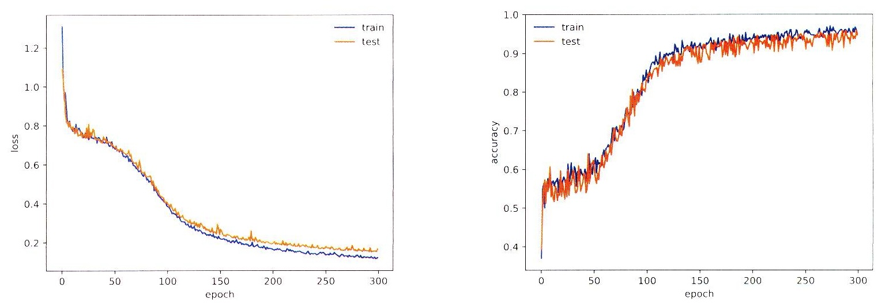

# 50단계 미니배치를 뽑아주는 DataLoader

이전 단계에서는 `Dataset` 클래스를 만들어서 통일된 인터페이스로 데이터셋을 다룰 수 있게 하였습니다. 이번 단계에서는 `Dataset` 클래스에서 미니배치를 뽑아주는 `DataLoader` 클래스를 구현합니다. `DataLoader`는 미니배치 생성과 데이터셋 뒤섞기 등의 기능을 제공하여 사용자가 작성해야 할 학습 코드가 더 간단해집니다. 이번 단계에서는 우선 '반복자'가 무엇인지 알아보고 이어서 `DataLoader` 클래스를 구현하는 흐름으로 진행하겠습니다.

---

## 50.1 반복자란

**반복자(iterator)**는 이름에서 알 수 있듯이 원소를 반복하여 꺼내줍니다. 그리고 파이썬의 반복자는 리스트나 튜플 등 여러 원소를 담고 있는 데이터 타입으로부터 데이터를 순차적으로 추출하는 기능을 제공합니다. 구체적인 예를 보시죠.

```python
>>> t = [1, 2, 3]
>>> x = iter(t)
>>> next(x)
>>> next(x)
>>> next(x)
```

```python
>>> next(x)
Traceback (most recent call last):
  File "<stdin>", line 1, in <module>
StopIteration
```

리스트를 반복자로 변환하려면 `iter` 함수를 사용합니다. 이 코드에서는 리스트 `t`에서 `x`라는 반복자를 만들었습니다. 그런 다음 반복자에서 데이터를 순서대로 추출하기 위해 `next` 함수를 사용합니다. 앞의 예에서 `next` 함수가 실행될 때마다 리스트의 원소가 차례대로 꺼내지는 것을 확인할 수 있습니다. 또한 네 번째 실행에서는 원소가 더는 존재하지 않기 때문에 `StopIteration` 예외가 발생했습니다.

> **NOTE**
> `for` 문에서 리스트의 원소를 꺼낼 때 내부적으로(사용자에게 보이지 않는 곳에서) 반복자가 이용됩니다. 예를 들어 `t = [1, 2, 3]`일 때 `for x in t:` `x`를 실행하면 리스트 `t`가 내부적으로 반복자로 변환됩니다.

파이썬에서는 반복자를 직접 만들 수도 있습니다. 예를 들어 다음 코드는 고유한 반복자를 만들어줍니다.

```python
class MyIterator:
    def __init__(self, max_cnt):
        self.max_cnt = max_cnt
        self.cnt = 0

    def __iter__(self):
        return self

    def __next__(self):
        if self.cnt == self.max_cnt:
            raise StopIteration()

        self.cnt += 1
        return self.cnt
```

보다시피 `MyIterator`라는 클래스를 구현했습니다. 클래스를 파이썬 반복자로 사용하려면 `__iter__` 특수 메서드를 구현하고 자기 자신(`self`)을 반환하도록 합니다. 그리고 `__next__` 특수 메서드에서는 다음 원소를 반환하도록 구현합니다. 만약 반환할 원소가 없다면 `raise StopIteration()`을 수행합니다. 이것으로 `MyIterator` 인스턴스를 반복자로 사용할 수 있습니다. 실제로 사용해보겠습니다.

```python
obj = MyIterator(5)
for x in obj:
    print(x)
```

**실행 결과**
```text
```

이처럼 `for x in obj:` 구문을 사용하여 원소를 꺼낼 수 있습니다. 다음으로 반복자 구조를 이용하여 미니배치를 뽑아주는 `DataLoader` 클래스를 구현하겠습니다. 기본적으로 `DataLoader`는 주어진 데이터셋의 첫 데이터부터 차례로 꺼내주지만, 필요에 따라 뒤섞을 수도 있습니다. 다음이 `DataLoader`의 코드입니다.

**dezero/dataloaders.py**
```python
import math
import random
import numpy as np

class DataLoader:
    def __init__(self, dataset, batch_size, shuffle=True):
        self.dataset = dataset
        self.batch_size = batch_size
        self.shuffle = shuffle
        self.data_size = len(dataset)
        self.max_iter = math.ceil(self.data_size / batch_size)

        self.reset()

    def reset(self):
        self.iteration = 0 # 반복 횟수 초기화
        if self.shuffle:
            self.index = np.random.permutation(len(self.dataset)) # 데이터 뒤섞기
        else:
            self.index = np.arange(len(self.dataset))

    def __iter__(self):
        return self
```

```python
    def __next__(self):
        if self.iteration >= self.max_iter:
            self.reset()
            raise StopIteration

        i, batch_size = self.iteration, self.batch_size
        batch_index = self.index[i * batch_size:(i + 1) * batch_size]
        batch = [self.dataset[i] for i in batch_index]
        x = np.array([example[0] for example in batch])
        t = np.array([example[1] for example in batch])

        self.iteration += 1
        return x, t

    def next(self):
        return self.__next__()
```

초기화 메서드는 다음 인수를 받습니다.

* `dataset` : `Dataset` 인터페이스를 만족하는 인스턴스\*
* `batch_size` : 배치 크기
* `shuffle` : 에포크별로 데이터셋을 뒤섞을지 여부

초기화 코드는 인수를 인스턴스 변수로 저장한 후 `reset` 메서드를 부릅니다. `reset` 메서드에서는 인스턴스 변수의 반복 횟수를 0으로 설정하고 필요에 따라 데이터의 인덱스를 뒤섞습니다.

`__next__` 메서드는 미니배치를 꺼내 `ndarray` 인스턴스로 변환합니다. 지금까지 사용해온 코드와 똑같으니 설명은 생략하겠습니다.

> **CAUTION**
> `dezero/dataloaders.py`의 `DataLoader` 클래스는 데이터를 GPU로 전송하는 로직도 포함하지만 지면에서는 생략했습니다. GPU 대응은 52단계에서 진행합니다.

마지막으로 `dezero/__init__.py`에 `from dezero.dataloaders import DataLoader`라는 임포트문을 추가합니다. 이를 통해 사용자는 `from dezero import DataLoader` 구문을 사용하여 `DataLoader`를 임포트할 수 있습니다(`from dezero.dataloaders import DataLoader`처럼 전체를 명시할 필요는 없습니다).

---
\* 'Dataset 인터페이스를 만족하는 인스턴스'란 `__getitem__`과 `__len__` 메서드를 구현한 클래스로부터 생성된 인스턴스를 말합니다.

---

## 50.2 DataLoader 사용하기

`DataLoader` 클래스를 사용하면 미니배치를 꺼내오는 일이 간단해집니다. 시험 삼아 신경망 학습을 가정하고 `DataLoader`를 사용해보겠습니다.

```python
from dezero.datasets import Spiral
from dezero import DataLoader

batch_size = 10
max_epoch = 1

train_set = Spiral(train=True)
test_set = Spiral(train=False)
train_loader = DataLoader(train_set, batch_size)
test_loader = DataLoader(test_set, batch_size, shuffle=False)

for epoch in range(max_epoch):
    for x, t in train_loader:
        print(x.shape, t.shape) # x, t는 훈련 데이터
        break

    # 에포크 끝에서 테스트 데이터를 꺼낸다.
    for x, t in test_loader:
        print(x.shape, t.shape) # x, t는 테스트 데이터
        break
```

**실행 결과**
```text
(10, 2) (10,)
(10, 2) (10,)
```

훈련용과 테스트용 각각, 총 두 개의 `DataLoader`를 생성했습니다. 훈련용 `DataLoader`는 에포크별로 데이터를 뒤섞어야 하기 때문에 `shuffle=True`(기본값)로 설정합니다. 한편 테스트용 `DataLoader`는 정확도 평가에만 사용하므로 `shuffle=False`로 설정합니다. 이렇게만 해주면 이후 미니배치 추출과 데이터 뒤섞기는 `DataLoader`가 알아서 해줍니다.

다음은 `DataLoader` 클래스를 사용하여 스파이럴 데이터셋을 학습해볼 차례인데, 그전에 편의 기능을 하나 추가하겠습니다.

---

## 50.3 accuracy 함수 구현하기

이번 절에서는 인식 정확도를 평가해주는 `accuracy` 함수를 추가합니다. 코드는 다음과 같습니다.

**dezero/functions.py**
```python
def accuracy(y, t):
    y, t = as_variable(y), as_variable(t)

    pred = y.data.argmax(axis=1).reshape(t.shape)
    result = (pred == t.data)
    acc = result.mean()
    return Variable(as_array(acc))
```

`accuracy` 함수는 인수 `y`와 `t`를 받아서 '정답률'을 계산해줍니다. `y`는 신경망의 예측 결과이고 `t`는 정답 데이터입니다. 이 두 인수는 `Variable` 또는 `ndarray` 인스턴스여야 합니다.

내용을 보면 먼저 신경망의 예측 결과를 구해 `pred`에 저장합니다. 그러려면 예측 결과의 최대 인덱스를 찾아서 형상을 변경해야 합니다. 그리고 `pred`와 정답 데이터 `t`를 비교하면 결과는 `True/False`의 텐서(`ndarray`)가 됩니다. 이 텐서의 `True` 비율(평균)이 정답률에 해당합니다.

> **CAUTION**
> `accuracy` 함수는 `Variable` 인스턴스를 반환합니다만 내부 계산은 `ndarray` 인스턴스를 사용해 수행합니다. 따라서 `accuracy` 함수로 수행한 계산은 미분할 수 없습니다.

또한 앞의 코드 마지막 줄에서는 `as_array` 함수를 사용하고 있습니다. 이는 `acc`, 즉 `result.mean()`이 반환하는 데이터의 형식이 `np.float64`나 `np.float32`이기 때문에 `as_array` 함수를 이용하여 `ndarray` 인스턴스로 변환한 것입니다(`as_array` 함수는 9단계에서 구현했습니다).

`accuracy` 함수를 사용하면 다음과 같이 정답률(인식 정확도)을 구할 수 있습니다.

```python
import numpy as np
import dezero.functions as F

y = np.array([[0.2, 0.8, 0], [0.1, 0.9, 0], [0.8, 0.1, 0.1]])
t = np.array([1, 2, 0])
acc = F.accuracy(y, t)
print(acc)
```

**실행 결과**
```text
variable(0.6666666666666666)
```

`y`에 담긴 3개의 샘플 데이터에 대해 신경망이 어떻게 예측하는지 보았습니다(3-클래스 분류). 정답 데이터인 `t`에는 각 샘플 데이터의 정답 인덱스가 부여되어 있습니다. 결과를 보니 인식 정확도는 0.66...으로, 정확하게 나왔군요(0번과 2번 샘플에서는 정답을 맞혔고, 1번 샘플에 대해서는 틀렸으니 인식 정확도는 2/3입니다).

---

## 50.4 스파이럴 데이터셋 학습 코드

`DataLoader` 클래스와 `accuracy` 함수를 사용하여 스파이럴 데이터셋을 학습해보겠습니다. 임포트문은 생략했습니다.

**steps/step50.py**
```python
max_epoch = 300
batch_size = 30
hidden_size = 10
lr = 1.0

train_set = dezero.datasets.Spiral(train=True)
test_set = dezero.datasets.Spiral(train=False)
train_loader = DataLoader(train_set, batch_size)
test_loader = DataLoader(test_set, batch_size, shuffle=False)

model = MLP((hidden_size, 3))
optimizer = optimizers.SGD(lr).setup(model)

for epoch in range(max_epoch):
    sum_loss, sum_acc = 0, 0

    for x, t in train_loader: # ❶ 훈련용 미니배치 데이터
        y = model(x)
        loss = F.softmax_cross_entropy(y, t)
        acc = F.accuracy(y, t) # ❷ 훈련 데이터의 인식 정확도
        model.cleargrads()
        loss.backward()
        optimizer.update()
```

```python
        sum_loss += float(loss.data) * len(t)
        sum_acc += float(acc.data) * len(t)

    print('epoch: {}'.format(epoch+1))
    print('train loss: {:.4f}, accuracy: {:.4f}'.format(
        sum_loss / len(train_set), sum_acc / len(train_set)))

    sum_loss, sum_acc = 0, 0
    with dezero.no_grad(): # ❸ 기울기 불필요 모드
        for x, t in test_loader: # ❹ 테스트용 미니배치 데이터
            y = model(x)
            loss = F.softmax_cross_entropy(y, t)
            acc = F.accuracy(y, t) # ❺ 테스트 데이터의 인식 정확도
            sum_loss += float(loss.data) * len(t)
            sum_acc += float(acc.data) * len(t)

    print('test loss: {:.4f}, accuracy: {:.4f}'.format(
        sum_loss / len(test_set), sum_acc / len(test_set)))
```

먼저 ❶에서는 `DataLoader`를 사용해 미니배치를 꺼내고, ❷에서 `accuracy` 함수를 사용하여 인식 정확도를 계산합니다. 이어서 ❸에서는 에포크별로 테스트 데이터셋을 사용하여 훈련 결과를 평가합니다. 테스트 시에는 역전파가 필요 없으므로 `with dezero.no_grad():` 블록 내부로 들어갑니다. 이렇게 함으로써 역전파 관련 처리와 자원 소모를 피할 수 있습니다(`no_grad` 함수는 18단계에서 도입했습니다).

❹에서는 테스트용 `DataLoader`에서 미니배치 데이터를 꺼내 평가합니다. 마지막으로 ❺에서 `accuracy` 함수를 사용하여 인식 정확도를 계산합니다.

[그림 50-1]은 이상의 코드를 실행하여 그래프로 그린 모습입니다.

**그림 50-1 손실과 인식 정확도 추이**


*(좌측: 에포크 0~300에 따른 train/test 데이터셋의 손실(loss)이 1.2 근처에서 0.2 부근까지 꾸준히 하강하는 그래프. 우측: 인식 정확도(accuracy)가 0.5 부근에서 시작해 0.95 이상으로 우상향하는 그래프)*

[그림 50-1]을 보면 에포크가 진행됨에 따라 손실(loss)이 낮아지고 인식 정확도(accuracy)는 상승하고 있습니다. 학습이 제대로 이루어지고 있다는 증거죠. 또한 훈련(train)과 테스트(test)의 차이가 작은데, 모델이 과대적합을 일으키지 않았다는 뜻입니다.

> **NOTE**
> **과대적합(overfitting)**은 특정 훈련 데이터에 지나치게 최적화된 상태를 말합니다. 따라서 새로운 데이터에서는 예측 정확도가 훨씬 떨어지는, 달리 표현하면 일반화되지 못한 상태를 뜻합니다. 신경망으로는 표현력이 높은 모델을 만들 수 있기 때문에 과대적합이 흔히 일어납니다.

여기까지가 이번 단계의 내용입니다. 다음 단계에서는 스파이럴 데이터셋 대신 MNIST 데이터셋을 사용합니다.
