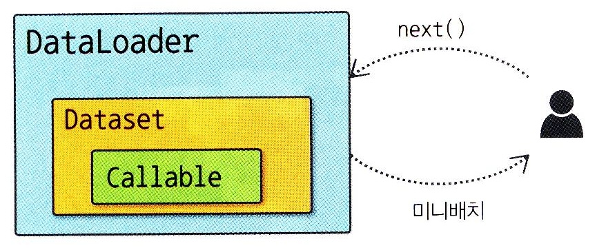
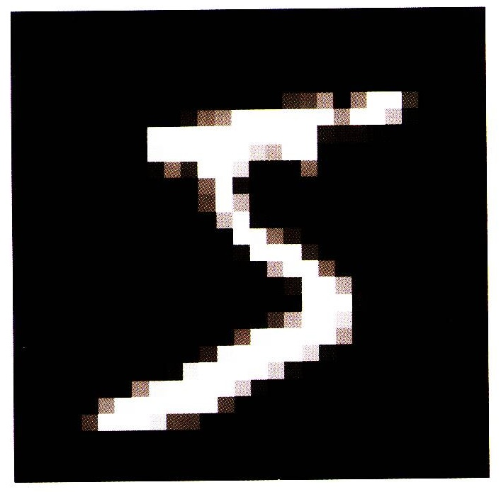

# 51단계 MNIST 학습

지금까지 데이터셋을 쉽게 다룰 수 있는 구조를 마련했습니다. 간단하게 복습하면, 우선 `Dataset` 클래스로 데이터셋 처리를 위한 공통 인터페이스를 마련했고, '전처리'를 설정할 수 있도록 했습니다. 그리고 `DataLoader` 클래스로는 `Dataset`에서 미니배치 단위로 데이터를 꺼내올 수 있게 했습니다. 이상의 관계를 [그림 51-1]로 표현할 수 있습니다.

**그림 51-1 DeZero 데이터셋의 클래스 다이어그램**


*(다이어그램 구조:*
*`DataLoader` 객체 내부가 `Dataset` 객체를 포함하고, `Dataset` 객체는 전처리 로직인 `Callable` 객체를 포함하고 있는 구조.*
*사용자가 `DataLoader`에 `next()`를 호출하면 미니배치 데이터를 반환받음)*

전처리를 수행하는 객체는 호출 가능하다는 뜻에서 `Callable`로 표시했습니다. 그림에서 볼 수 있듯이 `Callable`은 `Dataset`이 보유하고 `Dataset`은 `DataLoader`가 보유하는 관계입니다. 그리고 사용자는 `DataLoader`로부터 미니배치를 가져옵니다.

이번 단계에서는 이상의 데이터셋 구조를 활용하여 새로운 데이터셋을 학습할 것입니다. 바로 MNIST 데이터셋입니다. 우선 MNIST 데이터셋이 무엇인지부터 간략하게 살펴보죠.

---

## 51.1 MNIST 데이터셋

`DeZero`는 `dezero/datasets.py`에 `MNIST` 클래스를 준비해뒀습니다. `MNIST` 클래스는 `Dataset` 클래스를 상속하고 있으며, 다음처럼 사용할 수 있습니다.

```python
import dezero

train_set = dezero.datasets.MNIST(train=True, transform=None)
test_set = dezero.datasets.MNIST(train=False, transform=None)

print(len(train_set))
print(len(test_set))
```

**실행 결과**
```text
```

이와 같이 훈련 데이터와 테스트 데이터를 가져옵니다. `transform=None`으로 설정하여 아무런 전처리도 수행하지 않도록 했고요. 그런 다음 훈련 데이터(`train_set`)와 테스트 데이터(`test_set`)의 길이를 확인해보니 각각 60000과 10000이 나왔습니다. 훈련용 데이터가 6만 개, 테스트용 데이터가 1만 개가 존재한다는 뜻입니다. 그럼 이 코드에 이어서 다음 코드를 실행해봅시다.

```python
x, t = train_set[0]
print(type(x), x.shape)
print(t)
```

**실행 결과**
```text
<class 'numpy.ndarray'> (1, 28, 28)
```

`train_set`의 0번째 샘플 데이터를 확인해보는 코드입니다. MNIST 데이터셋도 `(data, label)` 튜플 형태로 구성되어 있군요. 참고로 `data`에는 0~9까지의 숫자를 나타내는 손글씨 이미지 데이터가 들어 있습니다. 그리고 MNIST의 입력 데이터 형상은 `(1, 28, 28)`입니다. 이는 `data`

에 1채널(그레이스케일)의 $28 \times 28$ 픽셀 이미지 데이터가 들어 있음을 나타냅니다. 또한 레이블에는 정답 숫자의 인덱스(0~9)가 들어 있습니다. 시험 삼아 입력 데이터를 시각화해보겠습니다.

```python
import matplotlib.pyplot as plt

# 데이터 예시
x, t = train_set[0] # 0번째 (data, label) 추출
plt.imshow(x.reshape(28, 28), cmap='gray')
plt.axis('off')
plt.show()
print('label:', t)
```

**실행 결과**
```text
```

이 코드를 실행하면 [그림 51-2]의 이미지가 표시됩니다.

**그림 51-2 MNIST 이미지 예시**


*(검은색 배경에 흰색으로 흘려 쓴 숫자 '5' 손글씨 이미지)*

이 손글씨 이미지 데이터를 지금부터 신경망으로 학습할 것입니다. 그러기 위해서는 입력 데이터를 전처리해야 합니다. 여기에서 수행할 전처리는 다음과 같습니다.

```python
def f(x):
    x = x.flatten()
    x = x.astype(np.float32)
    x /= 255.0
    return x

train_set = dezero.datasets.MNIST(train=True, transform=f)
test_set = dezero.datasets.MNIST(train=False, transform=f)
```

우선 $(1, 28, 28)$ 형상인 입력 데이터를 1열로 나열(평탄화; flatten)하여 $(784,)$ 형상으로 변환합니다. 그런 다음 데이터 타입을 `np.float32`(32비트 부동소수점)로 변환합니다. 마지막으로 255.0으로 나눠서 값의 범위가 $0.0 \sim 1.0$ 사이가 되도록 합니다. 한편 `MNIST` 클래스에서는 방금 설명한 전처리가 기본으로 설정되어 있습니다. 따라서 `dezero.datasets.MNIST(train=True)`로 호출하면 이상의 전처리가 자동으로 수행됩니다(`dezero/datasets.py`에는 `dezero/transforms.py`에 정의된 클래스를 이용하여 전처리하도록 작성되어 있습니다).

---

## 51.2 MNIST 학습하기

이제 MNIST를 학습해보죠. 코드는 다음과 같습니다. 임포트문은 생략했습니다.

**steps/step51.py**
```python
max_epoch = 5
batch_size = 100
hidden_size = 1000

train_set = dezero.datasets.MNIST(train=True)
test_set = dezero.datasets.MNIST(train=False)
train_loader = DataLoader(train_set, batch_size)
test_loader = DataLoader(test_set, batch_size, shuffle=False)

model = MLP((hidden_size, 10))
optimizer = optimizers.SGD().setup(model)

for epoch in range(max_epoch):
    sum_loss, sum_acc = 0, 0
```

```python
    for x, t in train_loader:
        y = model(x)
        loss = F.softmax_cross_entropy(y, t)
        acc = F.accuracy(y, t)
        model.cleargrads()
        loss.backward()
        optimizer.update()

        sum_loss += float(loss.data) * len(t)
        sum_acc += float(acc.data) * len(t)

    print('epoch: {}'.format(epoch+1))
    print('train loss: {:.4f}, accuracy: {:.4f}'.format(
        sum_loss / len(train_set), sum_acc / len(train_set)))

    sum_loss, sum_acc = 0, 0
    with dezero.no_grad():
        for x, t in test_loader:
            y = model(x)
            loss = F.softmax_cross_entropy(y, t)
            acc = F.accuracy(y, t)
            sum_loss += float(loss.data) * len(t)
            sum_acc += float(acc.data) * len(t)

    print('test loss: {:.4f}, accuracy: {:.4f}'.format(
        sum_loss / len(test_set), sum_acc / len(test_set)))
```

**실행 결과**
```text
epoch: 1
train loss: 1.9103, accuracy: 0.5553
test loss: 1.5413, accuracy: 0.6751
epoch: 2
train loss: 1.2765, accuracy: 0.7774
test loss: 1.0366, accuracy: 0.8035
epoch: 3
train loss: 0.9195, accuracy: 0.8218
test loss: 0.7891, accuracy: 0.8345
epoch: 4
train loss: 0.7363, accuracy: 0.8414
test loss: 0.6542, accuracy: 0.8558
epoch: 5
train loss: 0.6324, accuracy: 0.8542
test loss: 0.5739, accuracy: 0.8668
```

이전 단계에서 달라진 점은 MNIST 데이터셋을 사용한다는 것과 하이퍼파라미터값을 변경한 정도입니다. 이것만으로 MNIST를 학습할 수 있습니다. 인식 정확도는 테스트 데이터셋에서 약 86%를 얻었습니다. 에포크 수를 늘리면 정확도가 올라가겠지만, 근본적으로 개선해야 할 점이 눈에 띕니다. 그래서 마지막으로 더 정확한 모델로 개선한 후 이번 단계를 마치겠습니다.

---

## 51.3 모델 개선하기

방금 이용한 신경망의 활성화 함수는 시그모이드 함수였습니다. 시그모이드 함수는 신경망 분야에서 역사가 깊은 활성화 함수입니다. 그런데 최근에는 **ReLU**(rectified linear unit, 렐루)라는 함수가 더 자주 사용됩니다. ReLU는 입력이 0보다 크면 입력 그대로 출력하고, 0 이하면 0을 출력하는 함수입니다. 수식으로는 [식 51.1]과 같습니다.

$$
h(x) = \begin{cases} x & (x > 0) \\ 0 & (x \le 0) \end{cases} \tag{식 51.1}
$$

보다시피 ReLU 함수는 매우 간단합니다. 그래서 DeZero용 ReLU 함수도 다음처럼 아주 쉽게 구현할 수 있습니다.

**dezero/functions.py**
```python
class ReLU(Function):
    def forward(self, x):
        y = np.maximum(x, 0.0) # ❶
        return y

    def backward(self, gy):
        x, = self.inputs
        mask = x.data > 0 # ❷
        gx = gy * mask # ❸
        return gx

def relu(x):
    return ReLU()(x)
```

순전파에서는 `np.maximum(x, 0.0)`에 의해 `x`의 원소와 0.0 중 큰 쪽을 반환합니다(❶). 역전파에서는 입력 `x`에서 0보다 큰 원소에 해당하는 위치의 기울기는 그대로 흘려보내고, 0 이하

라면 기울기를 0으로 설정해야 합니다. 따라서 출력 쪽에서 전해지는 기울기를 '통과시킬지' 표시한 마스크(`mask`)를 준비한 후(❷) 기울기를 곱해줍니다(❸).

> **CAUTION**
> ReLU 함수가 하는 일은 신호를 '통과'시키거나 '봉쇄'하거나 둘 중 하나입니다. 순전파 시 신호를 통과시킨 원소라면 해당 역전파 시 기울기를 그대로 통과시킵니다. 반면 순전파 시 신호가 막힌 원소는 역전파 시 기울기가 통과되지 못합니다(0이 됩니다).

이제 ReLU 함수를 사용하여 새로운 신경망을 만들어보겠습니다. 이번 단계에서 설명한 학습 코드에서 모델 생성 부분을 다음과 같이 수정합니다.

**steps/step51.py**
```python
# model = MLP((hidden_size, 10))
model = MLP((hidden_size, hidden_size, 10), activation=F.relu)
```

이번에는 3층 신경망을 만들었습니다. 앞 절보다 층수를 늘려 표현력을 높인 것입니다. 그리고 활성화 함수를 ReLU로 바꿔서 학습이 더 효율적으로 이루어질 것입니다. 이 신경망을 사용하고 최적화 기법을 SGD에서 Adam으로 바꾼 후 학습을 수행해보세요. 그러면 훈련용 데이터로는 약 99%, 테스트용 데이터로는 약 98%라는 인식 정확도를 얻을 수 있습니다. 이전보다 정확도가 확실히 높아졌습니다!

<center>★ ★ ★ ★ ★ ★ ★</center>

이것으로 제4고지도 정복했습니다. 이번 고지에서는 DeZero가 신경망에 대응할 수 있도록 만들었습니다. 현재의 DeZero라면 기본적인 신경망 문제 정도는 쉽게 구현할 수 있습니다. 드디어 DeZero를 신경망 프레임워크, 아니 딥러닝 프레임워크라고 부를 수 있게 된 것이죠. 더 중요한 것은 지금까지 배운 지식이 파이토치와 체이너 같은 유명 프레임워크에서도 통한다는 사실입니다.

확신이 필요하신 분은 시험 삼아 체이너 공식 예제에 있는 MNIST 학습 코드<sup>[30]</sup>를 살펴보세요. 실제로 그 코드의 대부분은 이번 고지에서 구현한 코드와 공통점이 많습니다. 파이토치의 MNIST 코드<sup>[31]</sup>를 살펴봐도 좋습니다. 특별한 설명 없이도 즉시 이해할 수 있을 겁니다. 클래스 이름과 모듈 이름은 다르지만 본질적으로는 DeZero와 거의 같습니다. 이상으로 우리는 파이토치와 체이너 같은 실전 프레임워크를 다룰 때도 유용한 '살아있는 지식'을 손에 넣었습니다!
