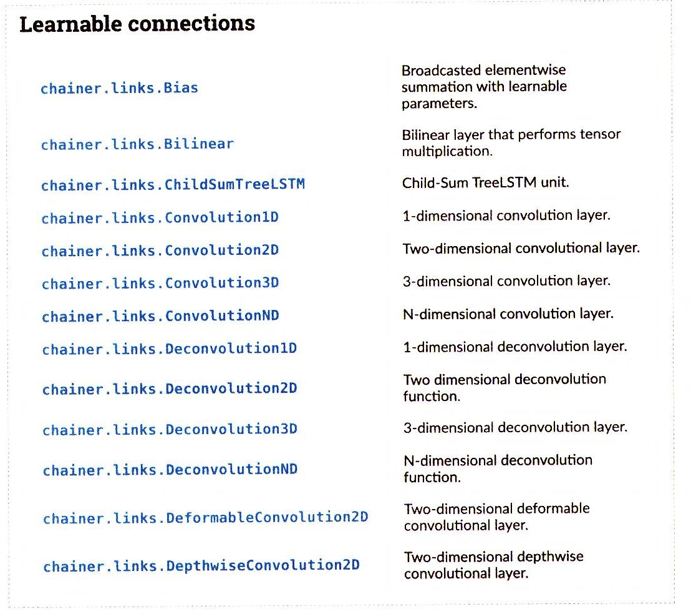
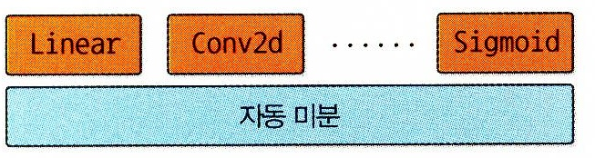
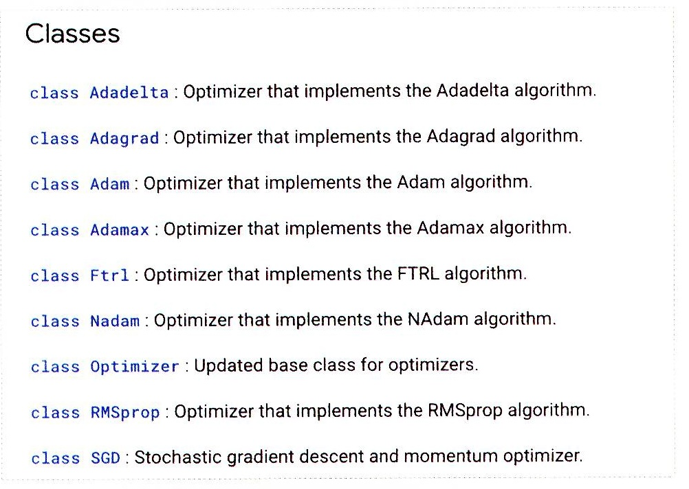
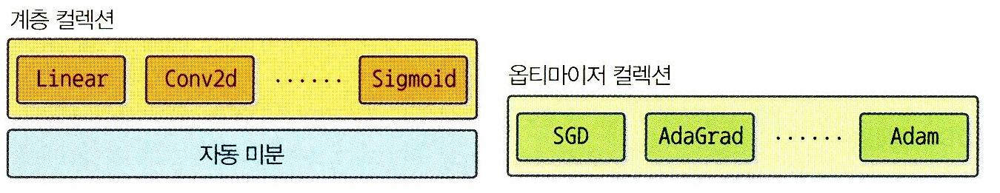

# 칼럼 딥러닝 프레임워크

딥러닝 프레임워크들은 여명기에는 제각기 큰 차이를 보였습니다. 그러나 성숙기에 접어든 지금은 파이토치, 체이너, 텐서플로 등의 인기 프레임워크들이 거의 같은 방향으로 나아가고 있습니다. 물론 각각의 특징이 있고 인터페이스도 다르지만, 핵심 설계 사상에서는 공통점이 많습니다. 구체적인 예로는 다음과 같은 점들을 들 수 있습니다.

* Define-by-Run 방식으로 계산 그래프를 만들 수 있습니다.
* 사전 정의된 다양한 함수와 계층을 제공합니다.
* 다양한 매개변수 갱신 클래스(옵티마이저)를 제공합니다.
* 모델은 상속을 통해 구현할 수 있습니다.
* 데이터셋을 관리하는 클래스를 제공합니다.
* CPU 외에도 GPU나 특정한 ASIC(Application Specific Integrated Circuit : 주문형 반도체)도 활용할 수 있습니다.
* 성능 향상을 위해(그리고 실제 제품에 적용할 것을 대비해) Define-and-Run 모드 실행도 지원합니다.

이상이 현대적인 딥러닝 프레임워크에서 공통적으로 볼 수 있는 특징들입니다. 이번 칼럼에서는 이중 처음 세 가지를 구체적인 예와 함께 더 자세히 살펴보겠습니다.

> **NOTE**
> 딥러닝 '프레임워크'는 엄밀히 말하면 '도구'나 '라이브러리'가 아닙니다. 라이브러리와 프레임워크의 차이는 프로그램을 '누가' 제어하느냐에 있습니다. 라이브러리는 편의 함수와 데이터 구조의 모음입니다. 사용자는 라이브러리에서 필요한 것을 적당히 꺼내 사용합니다. 이 과정에서 프로그램 제어(코드를 어떤 순서로 실행할지)는 사용자가 정합니다. 이와 달리 프레임워크는 전체의 토대를 제공합니다. 딥러닝 프레임워크라면 자동 미분의 기초를 제공하고 사용자는 그 위에 필요한 계산을 구축합니다. 그리고 전체적인 제어 역할을 프레임워크가 담당합니다. 이처럼 라이브러리와 프레임워크는 프로그램을 '누가' 제어하느냐에 차이가 있습니다.\*

---
\* **옮긴이\_** 다음은 라이브러리와 프레임워크의 차이를 설명하기 위해 제가 예전에 그려 활용하던 그림입니다. 본문의 설명과 맥이 통하여 이해를 돕고자 첨부합니다.

*(차이 설명 다이어그램)*
* 프레임워크 $\xrightarrow{\text{호출한다}}$ 당신의 코드 $\xrightarrow{\text{호출한다}}$ 라이브러리
* 프레임워크 $\xrightarrow{\text{포함한다}}$ 라이브러리

### Define-by-Run 방식의 자동 미분

딥러닝 프레임워크에서 가장 중요한 기능은 '자동 미분'입니다. 자동 미분 덕분에 우리는 귀찮은 계산과 코드 작성 없이도 즉시 미분값을 계산할 수 있습니다. 더구나 현대의 프레임워크는 계산 그래프를 Define-by-Run 방식으로 만들어줍니다. 코드는 즉시 실행되고, 동시에 뒤편에서는 계산 그래프가 만들어지는 것입니다. 이 특성 덕분에 우리는 파이썬 구문만 사용해서도 계산 그래프를 만들 수 있습니다. 예를 들어 파이토치로는 다음과 같은 코드를 작성할 수 있습니다.

```python
import torch

x = torch.randn(1, requires_grad=True)

y = x

for i in range(5):
    y = y * 2

y.backward()
print(x.grad)
```

**실행 결과**
```text
tensor([32.])
```

파이토치에서 텐서를 표현하는 클래스는 `Tensor`입니다(`DeZero`의 `Variable`에 해당합니다). 앞의 예에서 `torch.randn` 메서드는 무작위 수로 초기화된 텐서(`torch.Tensor` 인스턴스)를 생성합니다. 그런 다음 `for` 문을 사용하여 계산을 수행합니다. 이 시점에 즉시 계산이 수행되고 보이지 않는 곳에서 계산들의 '연결'이 만들어집니다. 이것이 Define-by-Run입니다. 마지막으로 미분값을 구하기 위해 `y.backward()`를 수행합니다. DeZero와 똑같은 방식이죠.

파이토치, 체이너, 텐서플로는 Define-by-Run 외에 Define-and-Run(정적 계산 그래프) 모드도 지원합니다. Define-by-Run은 시행착오를 많이 겪는 연구/개발 단계에 적합한 반면 Define-and-Run은 성능이 요구되는 실제 제품(서비스)이나 IoT 기기 같은 에지(edge) 환경에서 사용할 때 적합합니다.

> **NOTE**
> 텐서플로는 버전 1.x까지 독자적인 프로그래밍 언어인 Domain Specific Language(DSL)를 사용하여 계산 그래프를 구축해야 했습니다. 그러나 버전 2가 되면서 Define-by-Run 방식(텐서플로 용어로는 Eager Execution이라고 합니다) 모드를 정식으로 추가하고, 이를 표준 모드로 정했습니다.

### 계층 컬렉션

신경망에서 사용하는 모델은 `Linear` 계층과 `Sigmoid` 계층 등 이미 준비된 계층들을 조합해 구축할 수 있습니다. 그래서 레고 블록처럼 기존의 계층들을 조합하는 것만으로 원하는 딥러닝 모델을 구축할 수 있는 경우가 많습니다. 물론 이를 위해서는 프레임워크가 유용한 계층 컬렉션을 제공해야 합니다. 체이너의 경우 [그림 D-1]과 같은 계층들을 제공합니다.

**그림 D-1 체이너가 제공하는 계층 예: 체이너는 계층 모듈을 link와 function 두 가지로 구분해 제공합니다. 다음은 link 중 일부만 발췌한 것입니다(사진은 참고문헌 [32]에서 인용).**


| Learnable connections | Description |
| :--- | :--- |
| `chainer.links.Bias` | Broadcasted elementwise summation with learnable parameters. |
| `chainer.links.Bilinear` | Bilinear layer that performs tensor multiplication. |
| `chainer.links.ChildSumTreeLSTM` | Child-Sum TreeLSTM unit. |
| `chainer.links.Convolution1D` | 1-dimensional convolution layer. |
| `chainer.links.Convolution2D` | Two-dimensional convolutional layer. |
| `chainer.links.Convolution3D` | 3-dimensional convolution layer. |
| `chainer.links.ConvolutionND` | N-dimensional convolution layer. |
| `chainer.links.Deconvolution1D` | 1-dimensional deconvolution layer. |
| `chainer.links.Deconvolution2D` | Two dimensional deconvolution function. |
| `chainer.links.Deconvolution3D` | 3-dimensional deconvolution layer. |
| `chainer.links.DeconvolutionND` | N-dimensional deconvolution function. |
| `chainer.links.DeformableConvolution2D` | Two-dimensional deformable convolutional layer. |
| `chainer.links.DepthwiseConvolution2D` | Two-dimensional depthwise convolutional layer. |

[그림 D-1]과 같이 체이너는 다양한 계층을 제공합니다. 이 중에서 사용자가 원하는 계층을 골라 연결하는 것으로 신경망을 구축할 수 있습니다. 다른 딥러닝 프레임워크들도

마찬가지입니다. 여기서 중요한 점은 이러한 계층 컬렉션은 '자동 미분' 구조 위에 구축된다는 사실입니다. 그림으로 나타내면 다음과 같습니다.

**그림 D-2 프레임워크가 제공하는 다양한 계층은 자동 미분 구조 위에 구축됩니다.**


```text
+------------------------------------+
|  Linear   Conv2d  ...  Sigmoid     |  (다양한 계층)
+------------------------------------+
|             자동 미분              |  (프레임워크 밑동)
+------------------------------------+
```

[그림 D-2]처럼 딥러닝 프레임워크의 밑동은 자동 미분 구조가 지탱하고 있습니다. 자동 미분 구조를 이용하여 다양한 계층을 제공하는 것이죠. 이것이 딥러닝 프레임워크의 기본 구조입니다. 이 구조를 이해하면 세상에 나가 어떤 프레임워크와 마주쳐도 세세한 복잡함에 현혹되지 않고 더 높은 차원에서 프레임워크 자체를 바라볼 수 있습니다.

### 옵티마이저 컬렉션

딥러닝 학습은 매개변수의 기울기를 사용하여 매개변수들을 하나씩 갱신하며 진행됩니다. 갱신 방법은 아주 다양하며 지금도 계속해서 새로운 방법이 제안되고 있습니다. 이런 이유 때문에 매개변수 갱신 작업은 별도 모듈로 제공되는 것이 일반적입니다. 예컨대 텐서플로에서는 이러한 모듈을 '옵티마이저'라고 부르며 [그림 D-3]과 같이 다양한 옵티마이저를 제공합니다.

**그림 D-3 텐서플로가 제공하는 옵티마이저 목록(참고문헌 [33]에서 인용)**


#### Classes

* `class Adadelta` : Optimizer that implements the Adadelta algorithm.
* `class Adagrad` : Optimizer that implements the Adagrad algorithm.
* `class Adam` : Optimizer that implements the Adam algorithm.
* `class Adamax` : Optimizer that implements the Adamax algorithm.
* `class Ftrl` : Optimizer that implements the FTRL algorithm.
* `class Nadam` : Optimizer that implements the NAdam algorithm.
* `class Optimizer` : Updated base class for optimizers.
* `class RMSprop` : Optimizer that implements the RMSprop algorithm.
* `class SGD` : Stochastic gradient descent and momentum optimizer.

다양한 옵티마이저를 제공함으로써 사용자는 매개변수 갱신 작업을 높은 차원에서 생각할 수 있게 됩니다. 뿐만 아니라 다른 옵티마이저로 전환하기도 쉬워서 실험과 검증을 반복하기가 훨씬 쉽고 원활해집니다.

### 정리

여기에서 설명한 기능은 딥러닝 프레임워크의 핵심에 해당합니다. 정리하면, 자동 미분 기능을 기반으로 그 위에 다양한 계층 컬렉션이 존재합니다. 그리고 매개변수를 갱신하는 옵티마이저 컬렉션도 있습니다. 이상을 그림으로 표현하면 [그림 D-4]와 같습니다.

**그림 D-4 딥러닝 프레임워크의 핵심 기능**


```text
[계층 컬렉션]
+------------------------------------+
|  Linear   Conv2d  ...  Sigmoid     |
+------------------------------------+      [옵티마이저 컬렉션]
|             자동 미분              |      +------------------------------------+
+------------------------------------+      |   SGD   AdaGrad   ...   Adam       |
                                            +------------------------------------+
```

[그림 D-4]의 세 가지 요소는 거의 모든 프레임워크가 제공하는 중요한 기능입니다. 특히 자동 미분은 프레임워크를 떠받드는 '기둥'입니다. 자동 미분 기능 위에 다양한 계층 컬렉션을 쌓아 올림으로써 프레임워크의 골격이 완성되는 것이죠. 여기에 매개변수 갱신용 옵티마이저 컬렉션을 제공함으로써 딥러닝에서 수행하는 작업의 대부분에 대응할 수 있게 됩니다.

지금까지 설명한 세 가지 핵심 기능의 구조를 이해하면 프레임워크를 큰 그림에서 더 단순하게 볼 수 있는 눈이 생깁니다. 이 눈을 얻으면 파이토치, 체이너, 텐서플로 같은 다른 프레임워크를 사용할 때도 당연히 큰 도움이 됩니다.\*\*

---
\*\* **옮긴이\_** 이쯤에서 이 교제 깃허브 저장소에 올려둔 'DeZero 프레임워크 핵심 클래스 구조' 그림을 차분히 훑어봐주세요. 지금까지 만들고 개선한 수많은 클래스들이 하나의 틀 안에 유기적으로 정돈되어 기억 속에 자리 잡을 것입니다. 이 그림은 깃허브 저장소 첫 페이지에서 찾으실 수 있습니다.
