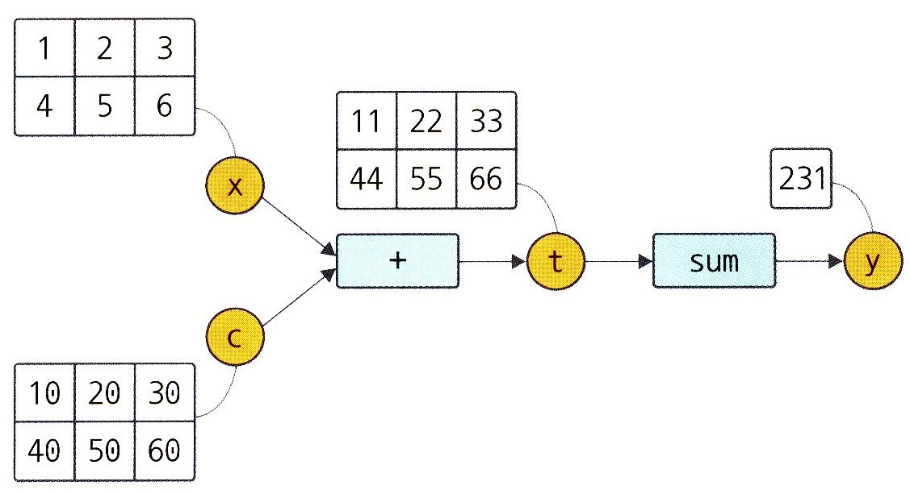
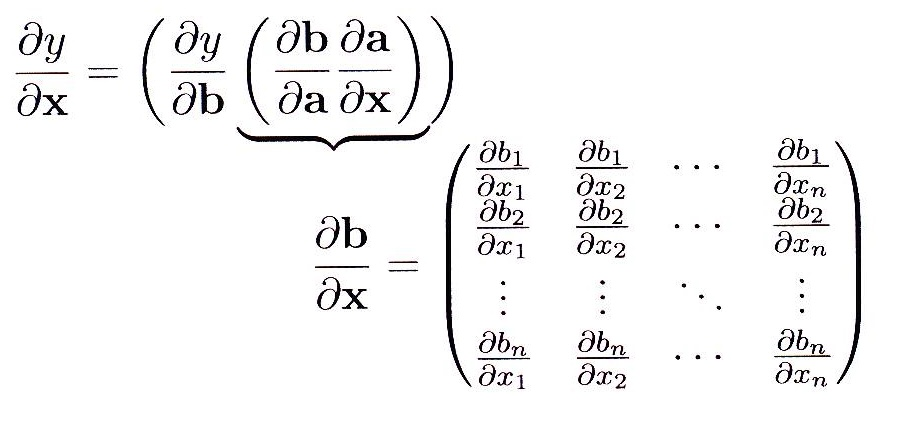
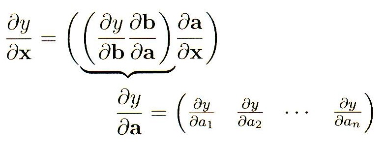

# 37단계 텐서를 다루다

지금까지는 변수로 주로 '스칼라'를 다뤘습니다. 그러나 머신러닝 데이터로는 벡터나 행렬 등의 '텐서'가 주로 쓰입니다. 이번 단계에서는 텐서를 사용할 때의 주의점을 알아보면서 DeZero 확장을 준비합니다. 또한 지금까지 구현한 DeZero 함수들이 텐서도 문제없이 다룰 수 있음을 보여드리겠습니다.

---

## 37.1 원소별 계산

이미 우리는 `add`, `mul`, `div`, `sin` 등의 DeZero 함수를 몇 가지 구현했습니다. 이 함수들을 구현하면서 우리는 입력과 출력이 모두 '스칼라'라고 가정했습니다. 예를 들어 `sin` 함수를 구현하면서 다음과 같은 경우를 가정했습니다.

```python
import numpy as np
import dezero.functions as F
from dezero import Variable

x = Variable(np.array(1.0))
y = F.sin(x)
print(y)
```

**실행 결과**
```text
variable(0.84147098)
```

이 예에서 $x$ 는 단일값인 스칼라(정확하게는 0차원의 `ndarray` 인스턴스)입니다. 하지만 $x$ 가 텐서일 경우, 가령 행렬이라면 어떻게 될까요? 이 경우 `sin` 함수가 원소별로 적용됩니다. 진짜로 그런지 실행해보죠.

```python
x = Variable(np.array([[1, 2, 3], [4, 5, 6]]))
y = F.sin(x)
print(y)
```

**실행 결과**
```text
variable([[ 0.84147098  0.90929743  0.14112001]
          [-0.7568025  -0.95892427 -0.2794155 ]])
```

이와 같이 `sin` 함수가 $x$ 의 원소 각각에 적용됩니다. 따라서 입력과 출력 텐서의 형상은 바뀌지 않습니다. 실제로 입력 $x$ 의 형상은 `(2, 3)`이고 출력 $y$ 의 형상도 `(2, 3)`입니다. 이처럼 지금까지 구현한 DeZero 함수들은 원소별 계산이 이루어집니다. 다른 예로, 덧셈에서도 다음과 같이 원소별 계산이 이루어집니다.

```python
x = Variable(np.array([[1, 2, 3], [4, 5, 6]]))
c = Variable(np.array([[10, 20, 30], [40, 50, 60]]))
y = x + c
print(y)
```

**실행 결과**
```text
variable([[11 22 33]
          [44 55 66]])
```

보다시피 $y$ 는 $x$ 와 $c$ 를 원소별로 더한 값이 되었습니다. 그래서 출력 $y$ 의 형상은 $x$, $c$ 와 똑같습니다.

> **CAUTION**
> 앞의 코드는 $x$ 와 $c$ 의 형상이 같아야 합니다. 그래야 텐서의 원소 사이에 일대일 대응 관계가 만들어집니다. 한편 넘파이에는 브로드캐스트(broadcast)라는 기능이 있습니다. 만약 $x$ 와 $c$ 의 형상이 다르면 자동으로 데이터를 복사하여 같은 형상의 텐서로 변환해주는 기능입니다. 브로드캐스트는 40단계에서 자세히 설명합니다.

---

## 37.2 텐서 사용 시의 역전파

이번 절이 이번 단계의 핵심입니다. 지금까지의 역전파 구현은 '스칼라'를 대상으로 했습니다. 그렇다면 텐서를 사용한 계산에 역전파를 적용하려면 무엇을 바꿔야 할까요? 사실 지금까지 구현한 함수들은 '텐서'를 이용해 계산해도 역전파 코드가 문제없이 작동합니다. 이유는 다음과 같습니다.

* 우리는 그동안 '스칼라'를 대상으로 역전파를 구현했습니다.
* 지금까지 구현한 DeZero 함수에 '텐서'를 건네면 텐서의 원소마다 '스칼라'로 계산합니다.
* 텐서의 원소별 '스칼라' 계산이 이루어지면 '스칼라'를 가정해 구현한 역전파는 '텐서'의 원소별 계산에서도 성립합니다.

이상의 논리로부터 원소별 계산을 수행하는 DeZero 함수들은 '텐서'를 사용한 계산에도 역전파를 올바르게 해낼 것임을 유추할 수 있습니다. 진짜로 그런지 확인해보죠.

**steps/step37.py**
```python
x = Variable(np.array([[1, 2, 3], [4, 5, 6]]))
c = Variable(np.array([[10, 20, 30], [40, 50, 60]]))
t = x + c
y = F.sum(t)
```

두 변수를 더한 다음 `sum` 함수로 모든 원소의 총합을 구하는 코드입니다. `sum` 함수는 39단계에서 구현하지만 먼저 가져와 사용했습니다. `sum` 함수를 사용하면 주어진 텐서의 모든 원소의 총합을 구해 하나의 스칼라로 출력합니다. 그래서 앞의 코드에서 `x`, `c`, `t`는 모두 `(2, 3)` 형상이지만, 마지막 출력 `y`는 스칼라입니다.

> **NOTE**
> 머신러닝 문제에서는 텐서를 입력받아 스칼라를 출력하는 함수(손실 함수, loss function)를 설정하는 것이 일반적입니다. 위 코드도 머신러닝 문제라 가정하고 마지막에 스칼라를 출력하는 계산을 수행했습니다.

[그림 37-1]은 앞의 코드가 수행하는 계산의 계산 그래프입니다.

**그림 37-1 텐서를 사용한 계산 그래프**

*(입력 변수 $x$ 는 $\begin{bmatrix} 1 & 2 & 3 \\ 4 & 5 & 6 \end{bmatrix}$ 값을 가지고, $c$ 는 $\begin{bmatrix} 10 & 20 & 30 \\ 40 & 50 & 60 \end{bmatrix}$ 값을 가지며, 이 둘을 더해 $t = \begin{bmatrix} 11 & 22 & 33 \\ 44 & 55 & 66 \end{bmatrix}$ 가 됩니다. 이후 `sum` 연산을 통해 스칼라 값 $y = 231$ 이 계산됩니다.)*

[그림 37-1]은 각 변수의 데이터를 구체적으로 보여줍니다. 그래서 마지막 출력은 스칼라임도 확인할 수 있습니다. 이번 단계는 이와 같이 '마지막 출력이 스칼라인 계산 그래프'에 대한 역전파를 다룹니다. 자, 이제 실제로 역전파를 해보겠습니다. 앞의 코드에 이어서 다음 코드를 실행하면 됩니다.

**steps/step37.py**
```python
y.backward(retain_grad=True)
print(y.grad)
print(t.grad)
print(x.grad)
print(c.grad)
```

**실행 결과**
```text
variable(1)
variable([[1 1 1]
          [1 1 1]])
variable([[1 1 1]
          [1 1 1]])
variable([[1 1 1]
          [1 1 1]])
```

이와 같이 `y.backward(retain_grad=True)`를 실행하면 각 변수의 미분값이 구해집니다. 인수 `retain_grad`를 `True`로 설정했으므로 미분값이 유지됩니다. 그리고 출력 결과가 올바르게 나왔음을 확인할 수 있습니다. 이처럼 지금까지 구현한 DeZero 함수들은 텐서를 사용한 계산에서도 제대로 역전파할 수 있습니다.

여기에서 중요한 특징이 하나 등장합니다. 기울기의 형상과 데이터(순전파 때의 데이터)의 형상이 일치한다는 것입니다. 즉, `x.shape == x.grad.shape`이며, `c.shape == c.grad.shape`이고, `t.shape == t.grad.shape`입니다. 이 성질을 이용하면 원소별 계산이 아닌 함수, 가령 `sum`이나 `reshape` 함수 등을 구현하기도 어렵지 않습니다. 이 내용은 다음 단계에서 `reshape` 함수를 구현할 때 살펴보겠습니다.

> **CAUTION**
> 텐서의 미분을 머신러닝에서는 '기울기'라고 합니다. `Variable` 클래스의 `grad`도 gradient(기울기)의 약자입니다. 그러니 이 책에서도 앞으로 '미분'이라고 하지 않고 '기울기'라고 쓰겠습니다.

이번 단계의 주요 내용은 여기까지입니다. 마지막으로 다음 절에서는 수식을 이용하여 텐서를 사용했을 때의 역전파에 대해 보충합니다. 다소 깊게 들어갑니다만, 이후의 단계에 영향이 없으니 읽지 않아도 상관없습니다.

---

## 37.3 【보충】 텐서 사용 시의 역전파

이번 절에서는 텐서를 사용했을 때의 역전파를 수식으로 설명합니다. $\mathbf{y} = F(\mathbf{x})$ 라는 함수를 생각해봅시다. $\mathbf{x}$ 와 $\mathbf{y}$ 는 벡터이고, 두 벡터 모두 원소 수가 $n$ 개라고 가정합니다.

> **CAUTION**
> 여기에서는 '벡터'에 한정하여 이야기를 진행합니다. 그러나 이 절에서 얻은 결론(이론)은 '텐서($n$ 차원 텐서)'의 경우에도 그대로 적용할 수 있습니다. 왜냐하면 데이터가 텐서일 경우에는 전처리로 '벡터화 처리'(원소를 1열로 정렬하는 형상 변환 처리)를 추가하면 되기 때문이죠.

이제 $\mathbf{y} = F(\mathbf{x})$ 의 미분에 대해 알아보겠습니다. $\mathbf{y}$ 의 $\mathbf{x}$ 에 대한 미분은 다음 식으로 정의됩니다.

$$
\frac{\partial \mathbf{y}}{\partial \mathbf{x}} = \begin{bmatrix}
\frac{\partial y_1}{\partial x_1} & \frac{\partial y_1}{\partial x_2} & \cdots & \frac{\partial y_1}{\partial x_n} \\
\frac{\partial y_2}{\partial x_1} & \frac{\partial y_2}{\partial x_2} & \cdots & \frac{\partial y_2}{\partial x_n} \\
\vdots & \vdots & \ddots & \vdots \\
\frac{\partial y_n}{\partial x_1} & \frac{\partial y_n}{\partial x_2} & \cdots & \frac{\partial y_n}{\partial x_n}
\end{bmatrix}
$$

$\mathbf{y}$ 와 $\mathbf{x}$ 모두 벡터이므로 그 미분은 이와 같이 '행렬'의 형태가 됩니다. 이 행렬을 야코비 행렬(Jacobian matrix)이라고도 합니다. 참고로, 만약 $y$ 가 스칼라라면 $y$ 의 $\mathbf{x}$ 에 대한 미분은 다음과 같습니다.

$$
\frac{\partial y}{\partial \mathbf{x}} = \left( \frac{\partial y}{\partial x_1} \quad \frac{\partial y}{\partial x_2} \quad \cdots \quad \frac{\partial y}{\partial x_n} \right)
$$

이는 $1 \times n$ 의 야코비 행렬이며, 행 벡터(가로로 나열된 벡터)로 간주할 수 있습니다.

다음으로 합성 함수에 대해 알아보겠습니다. 합성 함수 $y = F(\mathbf{x})$ 가 $\mathbf{a} = A(\mathbf{x})$, $\mathbf{b} = B(\mathbf{a})$, $y = C(\mathbf{b})$ 라는 3개의 함수로 구성되어 있는 경우를 생각해보죠. 이때 변수 $\mathbf{x}, \mathbf{a}, \mathbf{b}$ 는 벡터이고, 원소 수는 모두 똑같이 $n$ 개입니다. 그리고 최종 출력 $y$ 만 스칼라인 경우를 가정합니다. 그러면 $y$ 의 $\mathbf{x}$ 에 대한 미분은 연쇄 법칙에 의해 다음 식으로 표시됩니다.

$$
\frac{\partial y}{\partial \mathbf{x}} = \frac{\partial y}{\partial \mathbf{b}} \frac{\partial \mathbf{b}}{\partial \mathbf{a}} \frac{\partial \mathbf{a}}{\partial \mathbf{x}}
$$

 \hfill [식 37.1]

[식 37.1]이 연쇄 법칙에 의해 얻어지는 결과입니다. 여기에서 $\frac{\partial y}{\partial \mathbf{b}}$ 와 $\frac{\partial \mathbf{b}}{\partial \mathbf{a}}$ 는 야코비 행렬을 나타냅니다. 그리고 이 값들을 '행렬의 곱'으로 계산합니다(행렬의 곱은 41단계에서 설명합니다). 이것이 [식 37.1]이 의미하는 내용입니다.

이어서 [식 37.1]의 행렬 곱을 계산하는 '순서'를 알아보겠습니다. 두 가지 방법이 있습니다. 첫 번째 방법은 [그림 37-2]와 같이 입력 쪽에서 출력 쪽으로 계산해 가는 방식입니다.

**그림 37-2 입력 쪽에서 출력 쪽으로 괄호를 친다(forward 모드).**


$$
\frac{\partial y}{\partial \mathbf{x}} = \left( \frac{\partial y}{\partial \mathbf{b}} \left( \frac{\partial \mathbf{b}}{\partial \mathbf{a}} \frac{\partial \mathbf{a}}{\partial \mathbf{x}} \right) \right)
$$

$$
\frac{\partial \mathbf{b}}{\partial \mathbf{x}} = \begin{bmatrix}
\frac{\partial b_1}{\partial x_1} & \frac{\partial b_1}{\partial x_2} & \cdots & \frac{\partial b_1}{\partial x_n} \\
\frac{\partial b_2}{\partial x_1} & \frac{\partial b_2}{\partial x_2} & \cdots & \frac{\partial b_2}{\partial x_n} \\
\vdots & \vdots & \ddots & \vdots \\
\frac{\partial b_n}{\partial x_1} & \frac{\partial b_n}{\partial x_2} & \cdots & \frac{\partial b_n}{\partial x_n}
\end{bmatrix}
$$

[그림 37-2]와 같이 입력 쪽에서 출력 쪽으로 괄호를 치는 계산 방식을 '자동 미분의 forward 모드'라고 합니다. 여기에서 주목할 점은 중간의 행렬 곱의 결과가 다시 행렬이 된다는 것입니다. 예를 들어 $\frac{\partial \mathbf{b}}{\partial \mathbf{a}} \frac{\partial \mathbf{a}}{\partial \mathbf{x}}$ 의 결과는 $n \times n$ 행렬입니다.

두 번째 방법은 [그림 37-3]과 같이 출력 쪽에서 입력 쪽으로 계산해 가는 방식입니다. 첫 번째 방법과 반대이므로 `reverse` 모드라고 합니다(정확하게는 '자동 미분의 `reverse` 모드'입니다).

**그림 37-3 출력 쪽에서 입력 쪽으로 괄호를 친다(reverse 모드).**


$$
\frac{\partial y}{\partial \mathbf{x}} = \left( \left( \frac{\partial y}{\partial \mathbf{b}} \frac{\partial \mathbf{b}}{\partial \mathbf{a}} \right) \frac{\partial \mathbf{a}}{\partial \mathbf{x}} \right)
$$

$$
\frac{\partial y}{\partial \mathbf{a}} = \left( \frac{\partial y}{\partial a_1} \quad \frac{\partial y}{\partial a_2} \quad \cdots \quad \frac{\partial y}{\partial a_n} \right)
$$

[그림 37-3]은 출력 쪽에서 입력 쪽으로 괄호를 쳐서 계산합니다. 이때 $y$ 가 스칼라이므로 중간의 행렬 곱의 결과는 모두 벡터(행 벡터)입니다. 예를 들어 $\frac{\partial y}{\partial \mathbf{b}} \frac{\partial \mathbf{b}}{\partial \mathbf{a}}$ 의 결과는 $n$ 개의 원소로 구성된 벡터입니다.

> **NOTE**
> `forward` 모드는 $n \times n$ 행렬을 전파합니다. 그에 비해 `reverse` 모드에서는 $n$ 개의 벡터를 전파합니다. 그런데 행렬과 행렬의 곱보다 벡터와 행렬의 곱 쪽의 계산량이 적습니다. 이런 이유로 `reverse` 모드, 즉 역전파 쪽의 계산 효율이 좋습니다.

[그림 37-3]과 같이 `reverse` 모드는 (수식 상으로) 벡터와 야코비 행렬의 곱으로 구성됩니다. [그림 37-3]의 예로 말하면, 먼저 벡터인 $\frac{\partial y}{\partial \mathbf{b}}$ 와 야코비 행렬인 $\frac{\partial \mathbf{b}}{\partial \mathbf{a}}$ 의 곱을 구한 다음, 바로 이어서 벡터인 $\frac{\partial y}{\partial \mathbf{a}}$ 와 야코비 행렬인 $\frac{\partial \mathbf{a}}{\partial \mathbf{x}}$ 의 곱을 구합니다. 이와 같이 역전파에서는 각 함수에 대해 벡터와 야코비 행렬의 곱을 계산합니다.

여기에서 중요한 점은 명시적으로 야코비 행렬을 구하여 '행렬의 곱'을 계산할 필요가 없다는 것입니다. 결과만 필요한 상황이라면 역전파 수행에 아무런 문제가 없습니다. 예를 들어 [그림 37-3]에서 $\mathbf{a} = A(\mathbf{x})$ 가 원소별 연산을 수행한 경우를 가정해보죠(예: $\mathbf{a} = \sin(\mathbf{x})$). 이 함수의 야코비 행렬을 구하면 다음과 같습니다.

$$
\begin{bmatrix}
\frac{\partial a_1}{\partial x_1} & 0 & \cdots & 0 \\
0 & \frac{\partial a_2}{\partial x_2} & \cdots & 0 \\
\vdots & \vdots & \ddots & \vdots \\
0 & \cdots & 0 & \frac{\partial a_n}{\partial x_n}
\end{bmatrix}
$$

이와 같이 원소별 연산의 야코비 행렬은 대각 행렬이 됩니다(대각 행렬은 대각 성분 외에는 모두 0인 행렬입니다). $x_i$ 는 $a_i$ 에만 영향을 주기 때문이죠($i$ 는 1부터 $n$ 까지의 정수). 그리고 야코비 행렬이 대각 행렬이라면 벡터와 야코비 행렬의 곱은 다음과 같습니다.

$$
\frac{\partial y}{\partial \mathbf{a}} \frac{\partial \mathbf{a}}{\partial \mathbf{x}} = \left( \frac{\partial y}{\partial a_1} \quad \frac{\partial y}{\partial a_2} \quad \cdots \quad \frac{\partial y}{\partial a_n} \right) \begin{bmatrix}
\frac{\partial a_1}{\partial x_1} & 0 & \cdots & 0 \\
0 & \frac{\partial a_2}{\partial x_2} & \cdots & 0 \\
\vdots & \vdots & \ddots & \vdots \\
0 & \cdots & 0 & \frac{\partial a_n}{\partial x_n}
\end{bmatrix}
$$

$$
= \left( \frac{\partial y}{\partial a_1} \frac{\partial a_1}{\partial x_1} \quad \frac{\partial y}{\partial a_2} \frac{\partial a_2}{\partial x_2} \quad \cdots \quad \frac{\partial y}{\partial a_n} \frac{\partial a_n}{\partial x_n} \right)
$$

이 식에서 보듯 최종 결과는 원소별 미분을 계산한 다음 그 결과값을 원소별로 곱하면 얻을 수 있습니다. 즉, 원소별 연산에서는 역전파도 미분을 원소별로 곱하여 구한다는 뜻입니다.

> **NOTE**
> 여기에서 중요한 점은 명시적으로 야코비 행렬을 구하여 행렬의 곱을 계산할 필요 없이 단순히 결과만 구하면 된다는 사실입니다. 따라서 더 효율적으로 계산(구현)할 수 있는 방법이 있으면 그 계산 방식을 사용할 수 있습니다.

이상으로 텐서 버전의 역전파를 수식으로 살펴보았습니다.
