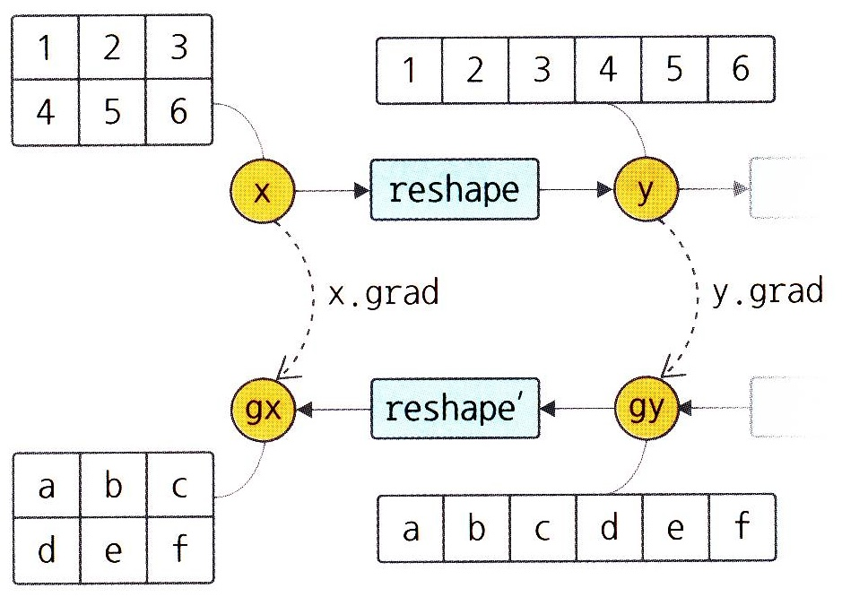
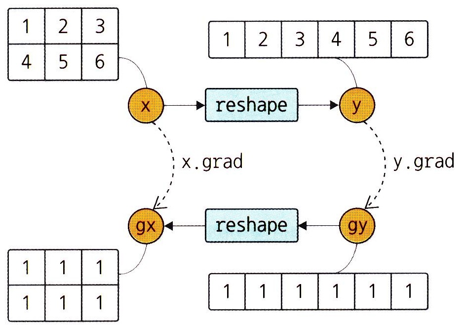
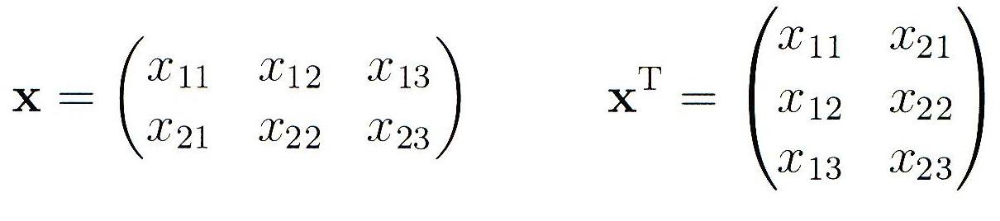
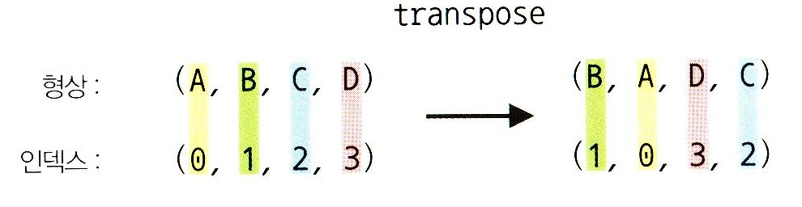

# 38단계 형상 변환 함수

이전 단계에서는 텐서를 사용한 계산에서의 역전파를 설명했습니다. 요약하면 다음과 같습니다.

* 원소별 연산을 수행하는 함수(`add`, `sin` 등)는 입출력 데이터가 스칼라라고 가정하고 순전파와 역전파를 구현할 수 있습니다.
* 이 경우 텐서를 입력해도 역전파가 올바르게 성립합니다.

앞으로는 원소별로 계산하지 않는 함수에 대해 살펴보겠습니다. 이번 단계에서는 그 첫걸음으로 두 가지 함수를 구현합니다. 텐서의 형상을 변환하는 `reshape` 함수와 행렬을 전치하는 `transpose` 함수입니다. 두 함수 모두 텐서의 형상을 바꾸는 함수입니다.

---

## 38.1 `reshape` 함수 구현

먼저 텐서의 형상을 바꾸는 함수를 구현해보죠. 사전 준비로 넘파이의 `reshape` 함수의 사용법을 확인해보겠습니다. 이 함수는 `np.reshape(x, shape)` 형태로 쓰며 `x`를 `shape` 인수로 지정한 형상으로 변환합니다. 예를 보시죠.

```python
import numpy as np

x = np.array([[1, 2, 3], [4, 5, 6]])
y = np.reshape(x, (6,))
print(y)
```

**실행 결과**
```text
[1, 2, 3, 4, 5, 6]
```

$x$ 의 형상을 `(2, 3)`에서 `(6,)`으로 변환했습니다. 텐서의 원소 수는 같고 형상만 바뀝니다. 이제 DeZero 버전의 `reshape` 함수를 구현할 차례입니다. 이때 문제는 역전파를 어떻게 구현하느냐입니다.

> **NOTE**
> 계산을 원소별로 하지 않는 함수는 텐서의 형상을 고려해야 합니다. 그러면 역전파 구현이 명확해지죠. 구체적으로는 변수의 데이터와 기울기의 형상이 일치하는지 확인해야 합니다. 예를 들어 `x`가 `Variable` 인스턴스일 때 `x.data.shape == x.grad.shape`를 만족할 수 있도록 역전파를 구현합니다.

`reshape` 함수는 단순히 형상만 변환합니다. 다시 말해, 구체적인 계산은 아무것도 하지 않습니다. 따라서 역전파는 출력 쪽에서 전해지는 기울기에 아무런 손도 대지 않고 입력 쪽으로 흘려보내줍니다. 그러나 [그림 38-1]과 같이 기울기의 형상이 입력의 형상과 같아지도록 변환합니다.

**그림 38-1 reshape 함수의 순전파와 역전파 계산 그래프(역전파 함수는 reshape'로 표시했으며 (a, b, c, d, e, f)라는 더미 기울기를 사용함)**


*(순전파)*
* 입력 $x$: $\begin{bmatrix} 1 & 2 & 3 \\ 4 & 5 & 6 \end{bmatrix}$ (형상 `(2, 3)`) $\rightarrow$ `reshape` $\rightarrow$ 출력 $y$: $[1, 2, 3, 4, 5, 6]$ (형상 `(6,)`)

*(역전파)*
* 출력 측 기울기 $gy$: $[a, b, c, d, e, f]$ (형상 `(6,)`) $\rightarrow$ `reshape'` $\rightarrow$ 입력 측 기울기 $gx$: $\begin{bmatrix} a & b & c \\ d & e & f \end{bmatrix}$ (형상 `(2, 3)`)

[그림 38-1]에서 역전파는 출력 쪽에서부터 기울기를 전달합니다. 이 기울기를 `x.data.shape`와 `x.grad.shape`가 일치하도록 변환하는데, 실제로 `(6,)`인 형상을 `(2, 3)`으로 변환하고 있습니다. 즉, 입력 변수 쪽의 형상에 맞게 변환합니다. 이것이 `reshape` 함수의 역전파입니다. 이상의 내용을 바탕으로 DeZero용 `reshape` 함수를 구현하면 다음처럼 됩니다.

**dezero/functions.py**
```python
class Reshape(Function):
    def __init__(self, shape):
        self.shape = shape

    def forward(self, x):
        self.x_shape = x.shape
        y = x.reshape(self.shape)
        return y

    def backward(self, gy):
        return reshape(gy, self.x_shape)
```

우선 `Reshape` 클래스를 초기화할 때 변형 목표가 되는 형상을 `shape` 인수로 받습니다. 그리고 `forward` 메서드(순전파)는 넘파이의 `reshape` 함수를 사용하여 형상을 변환합니다. 이때 `self.x_shape = x.shape` 코드에서 입력 `x`의 형상을 기억해둡니다. 이렇게 하여 `backward` 메서드(역전파)에서 입력 형상(`self.x_shape`)으로 변환할 수 있는 것이죠.

> **CAUTION**
> `backward(gy)`의 인수 `gy`는 `Variable` 인스턴스입니다. 따라서 `backward(gy)`에서는 `Variable` 인스턴스를 다루는 DeZero 함수를 사용해 계산해야 합니다. 즉, 바로 이어서 구현할 `reshape` 함수를 사용해야 합니다.

이어서 `reshape` 함수를 다음과 같이 구현합니다.

**dezero/functions.py**
```python
from dezero.core import as_variable

def reshape(x, shape):
    if x.shape == shape:
        return as_variable(x)
    return Reshape(shape)(x)
```

여기에서 인수 `x`는 `ndarray` 인스턴스 또는 `Variable` 인스턴스 중 하나라고 가정했습니다. 만약 `x.shape == shape`면 아무 일도 하지 않고 `x`를 그대로 돌려줍니다. 하지만 `reshape` 함수가 `Variable` 인스턴스를 반환함을 보장하기 위해 `as_variable` 함수를 사용하여 `Variable` 인스턴스로 변환합니다. 참고로 `as_variable` 함수는 21단계에서 구현했습니다. `as_variable(x)`는 `x`가 `ndarray` 인스턴스면 `Variable` 인스턴스로 변환해주고, `x`가 `Variable` 인스턴스면 그대로 `x`를 돌려줍니다.

> **CAUTION**
> DeZero 함수는 항상 `Variable` 또는 `ndarray` 인스턴스를 입력받아 `Variable` 인스턴스를 반환하는 게 규칙입니다. `Function` 클래스를 상속한 함수라면(가령 `Reshape`) 해당 함수 클래스의 `__call__` 메서드에서 `ndarray` 인스턴스는 자동으로 `Variable` 인스턴스로 변환됩니다.

방금 구현한 `reshape` 함수를 사용해보죠.

**steps/step38.py**
```python
import numpy as np
from dezero import Variable
import dezero.functions as F

x = Variable(np.array([[1, 2, 3], [4, 5, 6]]))
y = F.reshape(x, (6,))
y.backward(retain_grad=True)
print(x.grad)
```

**실행 결과**
```text
variable([[1 1 1]
          [1 1 1]])
```

이와 같이 `reshape` 함수를 사용하여 형상을 변환시켰습니다. 그리고 `y.backward(retain_grad=True)`를 수행하여 $x$ 의 기울기를 구합니다. 이 과정에서 $y$ 의 기울기도 자동으로 채워집니다. 채워진 기울기의 형상은 $y$ 와 같고(`y.grad.shape == y.shape`), 원소는 모두 1로 이루어진 텐서입니다. 그럼 실제로 어떤 데이터가 흐르게 되는지 살펴볼까요? 결과는 [그림 38-2]와 같습니다.

**그림 38-2 reshape 함수를 사용한 계산 예**


*(순전파)*
* 입력 $x$: $\begin{bmatrix} 1 & 2 & 3 \\ 4 & 5 & 6 \end{bmatrix}$ (형상 `(2, 3)`) $\rightarrow$ `reshape` $\rightarrow$ 출력 $y$: $[1, 2, 3, 4, 5, 6]$ (형상 `(6,)`)

*(역전파)*
* 출력 측 기울기 $gy$: $[1, 1, 1, 1, 1, 1]$ (형상 `(6,)`) $\rightarrow$ `reshape` $\rightarrow$ 입력 측 기울기 $gx$: $\begin{bmatrix} 1 & 1 & 1 \\ 1 & 1 & 1 \end{bmatrix}$ (형상 `(2, 3)`)

[그림 38-2]와 같이 순전파에서는 텐서의 형상이 `(2, 3)`에서 `(6,)`으로 변합니다. 그리고 역전파에서는 기울기의 형상이 `(6,)`에서 `(2, 3)`으로, 순전파 때와는 반대로 변합니다. 이때 각 변수의 `data`와 `grad`의 형상이 일치함을 확인할 수 있습니다.

이상이 DeZero의 `reshape` 함수 구현입니다. 이어서 이 함수를 더 편리하게 사용할 수 있는지 고민해보겠습니다.

---

## 38.2 Variable에서 reshape 사용하기

다음 목표는 DeZero의 `reshape` 함수를 넘파이의 `reshape`와 비슷하게 만들기입니다. 넘파이의 `reshape`는 다음처럼 사용할 수도 있습니다.

```python
x = np.random.rand(1, 2, 3)

y = x.reshape((2, 3))  # 튜플로 받기
y = x.reshape([2, 3])  # 리스트로 받기
y = x.reshape(2, 3)     # 인수를 그대로(풀어서) 받기
```

보다시피 `reshape`를 `ndarray` 인스턴스의 메서드로 사용할 수 있습니다. 또한 `x.reshape(2, 3)`과 같이 가변 인수도 받습니다. 우리 DeZero에서도 이와 똑같은 용법을 제공하고 싶습니다. 그래서 다음 코드를 `Variable` 클래스에 추가합니다.<sup>\*</sup>

**dezero/core.py**
```python
import dezero

class Variable:
    # ...

    def reshape(self, *shape):
        if len(shape) == 1 and isinstance(shape[0], (tuple, list)):
            shape = shape[0]
        return dezero.functions.reshape(self, shape)
```

<hr>

<sup>\*</sup> 코드 마지막 줄에서 `F.reshape`가 아닌 `dezero.functions.reshape` 형태로 쓴 것은 순환 임포트를 피하기 위해서입니다.

이와 같이 `Variable` 클래스에 '가변 인수'를 받는 `reshape` 메서드를 추가합니다. 그리고 주어진 인수를 적절히 조정하여 앞서 구현한 DeZero의 `reshape` 함수를 호출합니다. 그러면 다음처럼 사용할 수 있습니다.

```python
x = Variable(np.random.randn(1, 2, 3))
y = x.reshape((2, 3))
y = x.reshape(2, 3)
```

보다시피 `reshape` 함수를 `Variable` 인스턴스의 메서드 형태로도 호출할 수 있게 되어서 편의성이 더 좋아졌습니다. 이상으로 `reshape` 함수 구현을 마칩니다.

---

## 38.3 행렬의 전치

이어서 행렬을 전치해주는 함수를 구현하겠습니다. 행렬을 전치하면 행렬의 형상이 [그림 38-3]과 같이 변합니다.

**그림 38-3 행렬 전치의 예**


$$
\mathbf{X} = \begin{pmatrix} x_{11} & x_{12} & x_{13} \\ x_{21} & x_{22} & x_{23} \end{pmatrix} \quad \mathbf{X}^T = \begin{pmatrix} x_{11} & x_{21} \\ x_{12} & x_{22} \\ x_{13} & x_{23} \end{pmatrix}
$$

이제부터 전치를 `transpose`라는 이름의 DeZero 함수로 구현하겠습니다.

> **CAUTION**
> 당장은 입력 변수가 행렬(2차원 텐서)일 때로 한정하여 `transpose` 함수를 구현하겠습니다. 실제 DeZero의 `transpose` 함수는 더 범용적으로 구현되어 있고, 축 데이터를 교체할 수도 있습니다. 이와 관련해서는 이번 단계의 마지막에서 설명합니다.

그런데 넘파이에서도 `transpose` 함수를 사용하여 전치를 할 수 있습니다. 다음처럼 말이죠.

```python
x = np.array([[1, 2, 3], [4, 5, 6]])
y = np.transpose(x)
print(y)
```

**실행 결과**
```text
[[1 4]
 [2 5]
 [3 6]]
```

보다시피 $x$ 의 형상이 `(2, 3)`에서 `(3, 2)`로 달라졌습니다. 텐서의 원소 자체는 그대로이고 형상만이 바뀝니다. 따라서 역전파에서는 출력 쪽에서 전해지는 기울기의 형상만 변경합니다. 순전파 때와 정확히 '반대' 형태로 말이죠. 그래서 DeZero의 `transpose` 함수는 다음처럼 구현할 수 있습니다.

**dezero/functions.py**
```python
class Transpose(Function):
    def forward(self, x):
        y = np.transpose(x)
        return y

    def backward(self, gy):
        gx = transpose(gy)
        return gx

def transpose(x):
    return Transpose()(x)
```

이와 같이 순전파는 `np.transpose` 함수를 사용하여 전치합니다. 한편 역전파에서는 출력 쪽에서 전해지는 기울기를 바로 아래 줄에서 구현한 `transpose` 함수를 사용하여 변환합니다. 이제 역전파에서는 순전파와는 '반대'의 변환이 이루어집니다. 그럼 `transpose` 함수를 사용해보죠.

**steps/step38.py**
```python
x = Variable(np.array([[1, 2, 3], [4, 5, 6]]))
y = F.transpose(x)
y.backward()
print(x.grad)
```

**실행 결과**
```text
variable([[1 1 1]
          [1 1 1]])
```

보다시피 `transpose` 함수를 사용하여 계산할 수 있으며 역전파도 제대로 이루어집니다. 이어서 `Variable` 인스턴스에서도 `transpose` 함수를 사용할 수 있도록 다음 코드를 추가합니다.

**dezero/core.py**
```python
class Variable:
    # ...

    def transpose(self):
        return dezero.functions.transpose(self)

    @property
    def T(self):
        return dezero.functions.transpose(self)
```

이번에는 두 개의 메서드를 추가했습니다. 첫 번째인 `transpose`는 '인스턴스 메서드'로 이용하기 위한 코드입니다. 두 번째 `T`에는 `@property` 데코레이터가 붙어 있는데, '인스턴스 변수'로 사용할 수 있게 해주는 데코레이터입니다. 그래서 다음처럼 사용할 수 있게 됩니다.

```python
x = Variable(np.random.rand(2, 3))
y = x.transpose()
y = x.T
```

이상이 전치를 수행하는 `transpose` 함수의 구현입니다. 이번 절에서는 '행렬'로 한정하여 간단하게 구현했습니다만, 실제 DeZero의 `transpose` 함수에는 코드가 살짝 추가되어 있습니다. 이에 관해서는 다음 절에서 보충 설명합니다.

---

## 38.4 【보충】 실제 transpose 함수

넘파이의 `np.transpose` 함수는 더 범용적으로 사용할 수 있습니다. 예를 들어 다음과 같이 축의 데이터 순서를 바꿀 수 있습니다.

```python
A, B, C, D = 1, 2, 3, 4
x = np.random.rand(A, B, C, D)
y = x.transpose(1, 0, 3, 2)
```

이 코드는 형상이 `(A, B, C, D)`인 데이터의 축을 `np.transpose` 함수를 사용하여 변환합니다(이해하기 쉽도록 형상 값은 `A` 등의 변수를 사용해 나타냈습니다). 이 함수에 건네지는 인수는 변환 후의 축 순서(인덱스)입니다. [그림 38-4]를 보면 더 명확해질 것입니다.

**그림 38-4 np.transpose 함수의 구체적인 예**


$$
\begin{aligned}
\text{형상: } (A, B, C, D) &\xrightarrow{\text{transpose}} (B, A, D, C) \\
\text{인덱스: } (0, 1, 2, 3) &\xrightarrow{\phantom{\text{transpose}}} (1, 0, 3, 2)
\end{aligned}
$$

이와 같이 축의 순서를 지정하면 그에 맞게 데이터의 축이 달라집니다. 그리고 인수를 `None`으로 주면 축이 역순으로 정렬됩니다(기본값은 `None`입니다). 따라서 `x`가 행렬일 때 `x.transpose()`를 실행하면 0번째와 1번째 축의 데이터가 1번째와 0번째 순서로 바뀝니다. 즉, 행렬이 '전치'됩니다.

DeZero의 실제 `transpose` 함수도 이처럼 축 데이터를 교환할 수 있게 구현해뒀습니다. 역전파 때는 당연히 축의 방향도 '반대로' 변환합니다. 지면에서는 코드를 따로 싣지 않았으니 관심 있는 분은 `dezero/functions.py`의 `Transpose` 클래스를 참고하세요.
