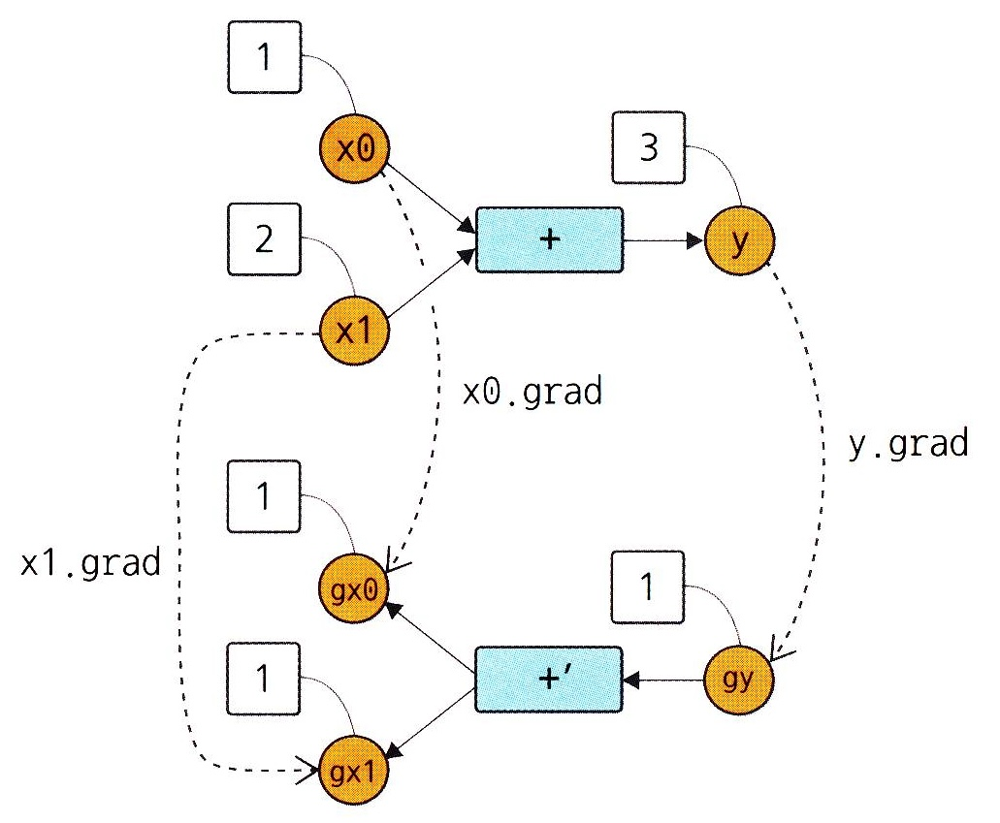
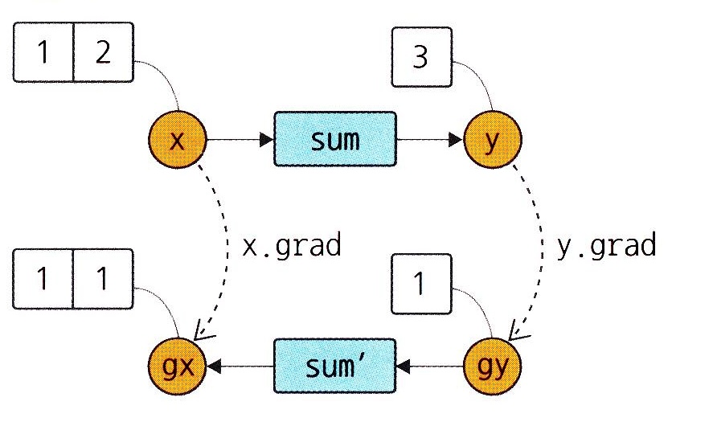
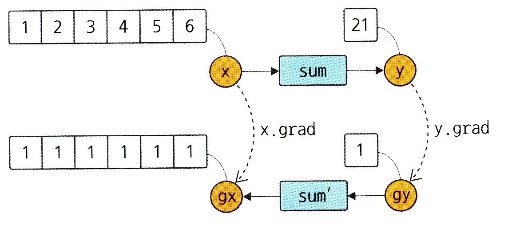
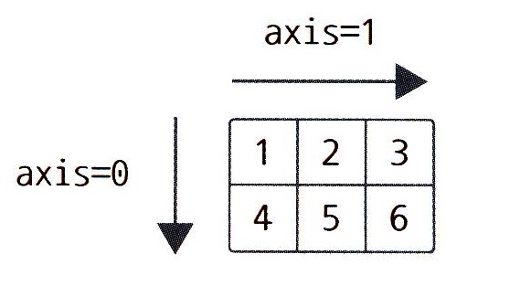
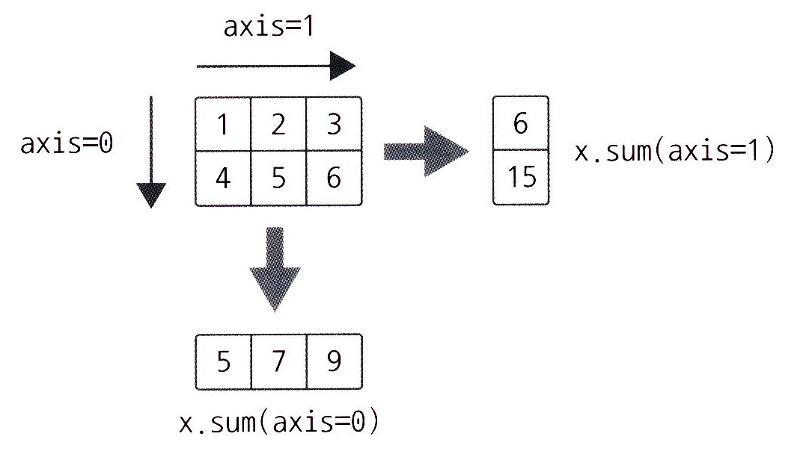

# 39단계 합계 함수

이번 단계에서는 DeZero에 합계를 구하는 함수 `sum`을 추가합니다. 먼저 '덧셈'의 미분을 복습하고 이를 응용하여 `sum` 함수의 미분을 이끌어냅니다. 그런 다음 `sum` 함수를 구현하는 순서로 진행하겠습니다.

---

## 39.1 sum 함수의 역전파

'덧셈' 함수는 이미 구현되어 있습니다. 덧셈의 미분은 $y = x_0 + x_1$ 일 때 $\frac{\partial y}{\partial x_0} = 1$, $\frac{\partial y}{\partial x_1} = 1$ 입니다. 따라서 역전파는 출력 쪽에서 전해지는 기울기를 그대로 입력 쪽으로 흘려보내기만 하면 됐습니다. [그림 39-1]과 같이 말이죠.

**그림 39-1 덧셈의 순전파와 역전파**


*(순전파)*
* 입력 $x_0$: $1$, 입력 $x_1$: $2$ $\rightarrow$ $+$ $\rightarrow$ 출력 $y$: $3$

*(역전파)*
* 출력 측 기울기 $gy$: $1$ $\rightarrow$ $+^{\prime}$ $\rightarrow$ 입력 측 기울기 $gx_0$: $1$, $gx_1$: $1$

[그림 39-1]의 계산은 덧셈을 수행한 후 변수 $y$ 로부터 역전파합니다. 이때 변수 $x_0$ 와 $x_1$ 에는 출력 쪽에서 전해준 $1$ 이라는 기울기를 두 개로 '복사'하여 전달합니다. 이것이 덧셈의 역전파입니다. 이 덧셈의 역전파는 원소가 2개인 벡터를 사용해도 똑같이 이루어집니다. 그러면 [그림 39-2]를 살펴보시죠.

**그림 39-2 sum 함수의 계산 그래프 예 1(역전파 함수는 sum'로 표시)**


*(순전파)*
* 입력 $x$: $[1, 2]$ (형상 `(2,)`) $\rightarrow$ `sum` $\rightarrow$ 출력 $y$: $3$ (스칼라)

*(역전파)*
* 출력 측 기울기 $gy$: $1$ (스칼라) $\rightarrow$ `sum'` $\rightarrow$ 입력 측 기울기 $gx$: $[1, 1]$ (형상 `(2,)`)

[그림 39-2]의 변수 $x$ 는 2개의 원소로 구성된 벡터입니다. 이 벡터에 `sum` 함수를 적용하면 스칼라를 출력합니다. 역전파는 출력 쪽에서 전해준 값인 $1$ 을 $[1, 1]$ 이라는 벡터(1차원 배열)로 확장해 전파합니다.

이상을 바탕으로 원소가 2개 이상인 벡터의 합에 대한 역전파도 이끌어낼 수 있습니다. 기울기 벡터의 원소 수만큼 '복사'하면 되죠. 그림으로는 [그림 39-3]과 같습니다.

**그림 39-3 sum 함수의 계산 그래프 예 2**


*(순전파)*
* 입력 $x$: $[1, 2, 3, 4, 5, 6]$ (형상 `(6,)`) $\rightarrow$ `sum` $\rightarrow$ 출력 $y$: $21$ (스칼라)

*(역전파)*
* 출력 측 기울기 $gy$: $1$ (스칼라) $\rightarrow$ `sum'` $\rightarrow$ 입력 측 기울기 $gx$: $[1, 1, 1, 1, 1, 1]$ (형상 `(6,)`)

[그림 39-3]에서 알 수 있듯이 기울기를 입력 변수의 형상과 같아지도록 복사합니다. 이것이 `sum` 함수의 역전파입니다. 같은 원리가 입력 변수가 2차원 이상의 배열일 때도 동일하게 적용됩니다. 그럼 계속해서 구현으로 넘어가겠습니다.

---

## 39.2 sum 함수 구현

DeZero의 `sum` 함수 역전파에서는 입력 변수의 형상과 같아지도록 기울기의 원소를 복사합니다. 그런데 역전파에서는 `Variable` 인스턴스를 사용하므로 복사 작업도 DeZero 함수로 해야 합니다.

> **CAUTION**
> 지정한 형상에 맞게 원소를 복사하는 작업은 넘파이의 브로드캐스트와 같은 기능입니다. 이 기능은 다음 단계에서 `broadcast_to(x, shape)`라는 함수로 구현할 예정입니다. `Variable` 인스턴스인 `x`의 원소를 복사하여 `shape` 인수로 지정한 형상이 되도록 만들어주는 함수입니다.

이를 위해 다음 단계에서 구현할 `broadcast_to` 함수를 미리 사용하겠습니다. 그러면 DeZero의 `Sum` 클래스와 `sum` 함수는 다음과 같이 구현할 수 있습니다.

**dezero/functions.py**
```python
class Sum(Function):
    def forward(self, x):
        self.x_shape = x.shape
        y = x.sum()
        return y

    def backward(self, gy):
        gx = broadcast_to(gy, self.x_shape)
        return gx

def sum(x):
    return Sum()(x)
```

이와 같이 `broadcast_to` 함수를 사용하여 입력 변수와 형상이 같아지도록 기울기 `gy`의 원소를 복사합니다. 이것으로 `sum` 함수도 구현 끝! 한번 사용해보죠.

**steps/step39.py**
```python
import numpy as np
from dezero import Variable
import dezero.functions as F

x = Variable(np.array([1, 2, 3, 4, 5, 6]))
y = F.sum(x)
y.backward()
print(y)
print(x.grad)
```

**실행 결과**
```text
variable(21)
variable([1 1 1 1 1 1])
```

보다시피 합계와 기울기가 올바르게 구해졌습니다. 이 함수는 입력 변수가 벡터가 아닌 경우에도 제대로 작동합니다. 정말 그런지 2차원 배열(행렬)을 입력해 확인해보겠습니다.

**steps/step39.py**
```python
x = Variable(np.array([[1, 2, 3], [4, 5, 6]]))
y = F.sum(x)
y.backward()
print(y)
print(x.grad)
```

**실행 결과**
```text
variable(21)
variable([[1 1 1]
          [1 1 1]])
```

이번에도 `x.grad`와 `x`가 같은 형상입니다. 값도 정확하고요. 이상으로 `sum` 함수의 '기본'을 완성했습니다. 이어서 현재의 `sum` 함수를 확장하여 '진짜' `sum` 함수를 완성해보겠습니다.

---

## 39.3 axis와 keepdims

넘파이의 `np.sum` 함수는 더 정교합니다. 가령 합계를 구할 때 '축'을 지정할 수 있습니다. 다음 예를 보시죠.

```python
x = np.array([[1, 2, 3], [4, 5, 6]])
y = np.sum(x, axis=0)
print(y)
print(x.shape, '-> ', y.shape)
```

**실행 결과**
```text
[5 7 9]
(2, 3) -> (3,)
```

`x`의 형상은 `(2, 3)`이고 출력 `y`의 형상은 `(3,)`입니다. 그런데 이번에는 `np.sum(x, axis=0)` 코드에서 `axis=0`으로 지정했습니다. `axis`는 우리말로 '축'을 뜻하며, [그림 39-4]와 같이 다차원 배열에서 화살표의 '방향'을 의미합니다.

**그림 39-4 ndarray 인스턴스의 axis(축의 인덱스)**


* **axis=0**: 행(row) 방향으로 합을 구합니다 (세로 아래 방향).
* **axis=1**: 열(column) 방향으로 합을 구합니다 (가로 오른쪽 방향).

$$
\begin{array}{ccc}
 & \text{axis=1} & \rightarrow \\
\text{axis=0} & \begin{pmatrix} 1 & 2 & 3 \\ 4 & 5 & 6 \end{pmatrix} \\
\downarrow &
\end{array}
$$

[그림 39-4]는 2차원 배열일 때의 예입니다. 축의 인덱스는 그림과 같이 이미 정해져 있습니다. `np.sum` 함수에서는 이 축을 지정함으로써 합계를 구할 방향을 정할 수 있습니다([그림 39-5]).

**그림 39-5 axis에 따른 x.sum()의 계산 결과**


* **axis=1 방향 합계 (`x.sum(axis=1)`)**
  

$$
\begin{pmatrix} 1 & 2 & 3 \\ 4 & 5 & 6 \end{pmatrix} \xrightarrow{\text{axis=1}} \begin{pmatrix} 6 \\ 15 \end{pmatrix}
$$

* **axis=0 방향 합계 (`x.sum(axis=0)`)**
  

$$
\begin{pmatrix} 1 & 2 & 3 \\ 4 & 5 & 6 \end{pmatrix} \xrightarrow{\text{axis=0}} \begin{pmatrix} 5 & 7 & 9 \end{pmatrix}
$$

> **CAUTION**
> 인수 `axis`는 `int` 외에도 `None`과 튜플도 받습니다. `None`이면 모든 원소를 다 더한 값 하나(스칼라)를 출력합니다(기본값이 `None`입니다). 그리고 `(0, 2)`처럼 튜플로 지정하면 해당 튜플에서 지정한 축 모두에 대해, 즉 `(0, 2)`의 경우는 0번과 2번 축 모두에 대해 합계를 계산합니다.

또한 `np.sum` 함수는 `keepdims`라는 인수도 받습니다. `keepdims`는 입력과 출력의 차원 수(축 수)를 똑같이 유지할지 정하는 플래그입니다. 예를 보시죠.

```python
x = np.array([[1, 2, 3], [4, 5, 6]])
y = np.sum(x, keepdims=True)
print(y)
print(y.shape)
```

**실행 결과**
```text
[[21]]
(1, 1)
```

여기에서 `y`의 형상은 `(1, 1)`입니다. 만약 `keepdims=False`로 지정했다면 `y`의 형상은 `()`, 즉 스칼라였을 것입니다. 이처럼 `keepdims=True`로 지정하면 축의 수가 유지됩니다.

지금까지 살펴본 두 인수 `axis`와 `keepdims`는 실전에서 자주 사용합니다. 따라서 DeZero의 `sum` 함수도 두 인수를 지원하도록 수정하겠습니다. `axis`와 `keepdims` 때문에 합계 계산이 다소 복잡해집니다만 `sum` 함수의 역전파에 적용되는 이론은 동일합니다. 입력 변수와 형상이 같아지도록 기울기의 원소를 복사하는 것이죠. 수정 버전 `Sum` 클래스와 `sum` 함수는 다음과 같습니다.

**dezero/functions.py**
```python
from dezero import utils

class Sum(Function):
    def __init__(self, axis, keepdims):
        self.axis = axis
        self.keepdims = keepdims

    def forward(self, x):
        self.x_shape = x.shape
        y = x.sum(axis=self.axis, keepdims=self.keepdims)
        return y

    def backward(self, gy):
        gy = utils.reshape_sum_backward(gy, self.x_shape, self.axis,
                                        self.keepdims)
        gx = broadcast_to(gy, self.x_shape)
        return gx

def sum(x, axis=None, keepdims=False):
    return Sum(axis, keepdims)(x)
```

보다시피 `Sum` 클래스를 초기화할 때 `axis`와 `keepdims`를 입력받아 속성으로 설정합니다. 그리고 순전파에서는 이 속성들을 사용해 합계를 구합니다. 역전파에서는 기존처럼 `broadcast_to` 함수를 사용하여 입력 변수의 형상과 같아지도록 기울기의 원소를 복사합니다.

> **CAUTION**
> 역전파 구현에서 `broadcast_to` 함수 전에 `utils.reshape_sum_backward` 함수를 사용했습니다. 이 함수는 `gy`의 형상을 '미세하게 조정'합니다(`axis`와 `keepdims`를 지원하게 되면서 기울기의 형상을 변환하는 경우가 생기기 때문에 그에 대응하는 함수입니다). 넘파이와 관련한 문제이며, 본질과는 관련이 없기 때문에 설명은 생략합니다.

이상으로 DeZero의 `sum` 함수를 완성했습니다. 다음에는 `sum` 함수를 `Variable`의 메서드로 사용할 수 있도록 하겠습니다. `Variable` 클래스에 다음 코드를 추가하면 됩니다.

**dezero/core.py**
```python
class Variable:
    # ...

    def sum(self, axis=None, keepdims=False):
        return dezero.functions.sum(self, axis, keepdims)
```

이제 DeZero의 `sum` 함수를 다음 예처럼 사용할 수 있습니다.

**steps/step39.py**
```python
x = Variable(np.array([[1, 2, 3], [4, 5, 6]]))
y = F.sum(x, axis=0)
y.backward()
print(y)
print(x.grad)

x = Variable(np.random.randn(2, 3, 4, 5))
y = x.sum(keepdims=True)
print(y.shape)
```

**실행 결과**
```text
variable([5 7 9])
variable([[1 1 1]
          [1 1 1]])
(1, 1, 1, 1)
```

이상으로 이번 단계를 마칩니다.
