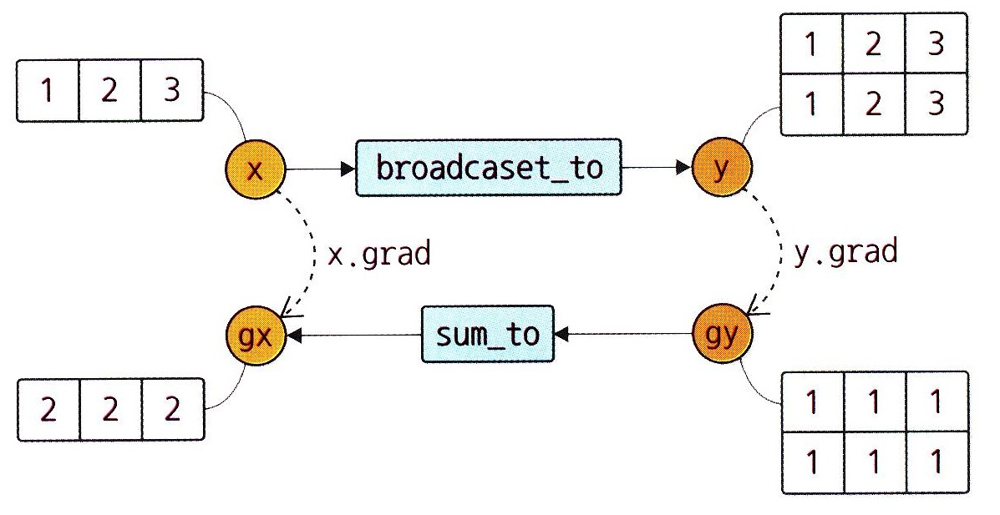
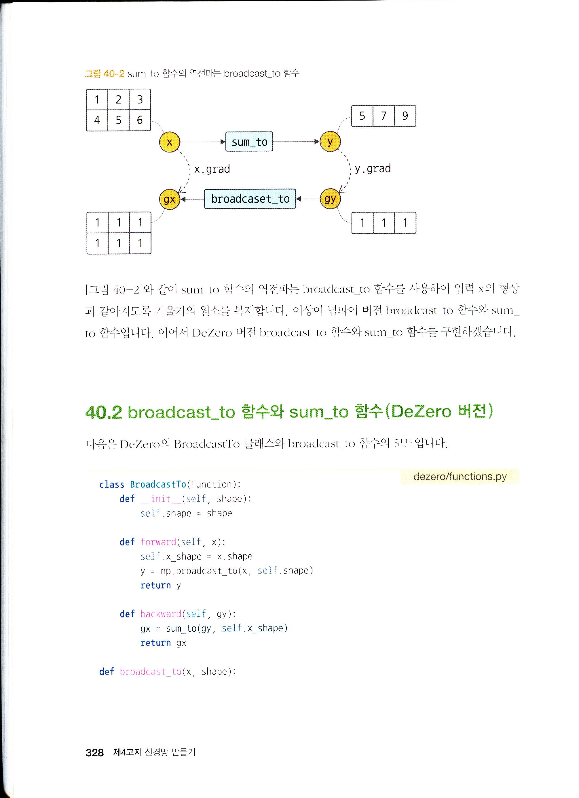

# 40단계 브로드캐스트 함수

이전 단계에서 DeZero의 `sum` 함수를 구현했는데, 이 함수의 역전파에서는 당시에는 구현되지 않은 `broadcast_to` 함수를 이용했습니다. 이번 단계에서는 바로 이 `broadcast_to` 함수를 구현합니다. 또한 DeZero에서도 넘파이와 같은 브로드캐스트를 할 수 있도록 DeZero 함수 몇 개를 손보겠습니다.

> **NOTE**
> 넘파이에는 브로드캐스트라는 기능이 있습니다. DeZero의 순전파에서는 실제로 넘파이의 브로드캐스트를 사용하기도 합니다. 하지만 현재의 DeZero에서 브로드캐스트가 일어나면 역전파가 제대로 이루어지지 않습니다. 이번 단계에서는 브로드캐스트에 올바르게 대처할 수 있도록 DeZero를 수정합니다.

먼저 넘파이 함수를 사용하여 설명한 다음 DeZero 함수를 구현하는 순서로 진행하겠습니다.

---

## 40.1 broadcast_to 함수와 sum_to 함수(넘파이 버전)

먼저 넘파이의 `np.broadcast_to(x, shape)`를 살펴보겠습니다. 이 함수는 `ndarray` 인스턴스인 `x`의 원소를 복제하여 `shape` 인수로 지정한 형상이 되도록 해줍니다. 다음처럼 사용할 수 있죠.

```python
import numpy as np

x = np.array([1, 2, 3])
y = np.broadcast_to(x, (2, 3))
print(y)
```

**실행 결과**
```text
[[1 2 3]
 [1 2 3]]
```

이와 같이 원래는 `(3,)` 형상이던 1차원 배열의 원소를 복사하여 `(2, 3)` 형상으로 바꿔줬습니다. 그런데 브로드캐스트(즉, '원소 복사')가 수행된 후의 역전파는 어떻게 될까요?

> **NOTE**
> DeZero는 같은 변수(`Variable` 인스턴스)를 여러 번 사용하여 계산할 수 있습니다. 예를 들어 $y = x + x$ 같은 계산을 지원합니다. 여기서 $x + x$ 는 $x$ 를 '복사'하여 이용한다고 가정합니다. 그리고 그 역전파에서는 $x$ 에 기울기를 두 번 흘려보내게 되어 기울기가 '더해지게' 됩니다. 이 원리에 따르면 '원소 복사'가 일어날 경우 기울기를 '합'하면 된다는 사실을 알 수 있습니다.

'원소 복사'가 일어날 경우 역전파 때는 기울기의 '합'을 구합니다. `np.broadcast_to` 같은 함수는 [그림 40-1]과 같이 동작합니다.

**그림 40-1 broadcast_to 함수의 역전파**


*(순전파)*
* 입력 $x$: $[1, 2, 3]$ (형상 `(3,)`) $\rightarrow$ `broadcast_to` $\rightarrow$ 출력 $y$: $\begin{pmatrix} 1 & 2 & 3 \\ 1 & 2 & 3 \end{pmatrix}$ (형상 `(2, 3)`)

*(역전파)*
* 출력 측 기울기 $gy$: $\begin{pmatrix} 1 & 1 & 1 \\ 1 & 1 & 1 \end{pmatrix}$ (형상 `(2, 3)`) $\rightarrow$ `sum_to` $\rightarrow$ 입력 측 기울기 $gx$: $[2, 2, 2]$ (형상 `(3,)`)

[그림 40-1]과 같이 `broadcast_to` 함수의 역전파는 입력 `x`의 형상과 같아지도록 기울기의 합을 구합니다. `sum_to(x, shape)`라는 함수가 있다면 간단하게 해결되는 문제입니다. `sum_to`는 `x`의 원소의 합을 구해 `shape` 형상으로 만들어주는 함수입니다. 이런 함수가 있다면 [그림 40-1]과 같은 순전파와 역전파의 관계가 만들어집니다.

그러나 넘파이에는 이러한 함수가 없으므로 DeZero에서는 `dezero/utils.py`에 넘파이 버전 `sum_to` 함수를 준비해뒀습니다. 이 함수를 사용하면 다음과 같은 계산이 가능합니다.

```python
import numpy as np
from dezero.utils import sum_to

x = np.array([[1, 2, 3], [4, 5, 6]])
y = sum_to(x, (1, 3))
print(y)

y = sum_to(x, (2, 1))
print(y)
```

**실행 결과**
```text
[[5 7 9]]
[[ 6]
 [15]]
```

이와 같이 `sum_to(x, shape)` 함수는 `shape` 형상이 되도록 합을 계산합니다. 기능은 `np.sum` 함수와 같지만 인수를 주는 방법이 다릅니다.

> **NOTE**
> `dezero/utils.py`의 `sum_to` 함수는 다음의 체이너 코드를 참고해 구현했습니다.
> https://github.com/chainer/chainer/blob/v6.4.0/chainer/utils/array.py#L51-L65

이어서 `sum_to` 함수의 역전파를 생각해보죠. 말했다시피 `sum_to(x, shape)`는 `x`의 원소의 합을 구해 `shape` 형상으로 만들어줍니다. 따라서 역전파는 `broadcast_to` 함수를 그대로 이용하여 [그림 40-2]처럼 할 수 있습니다.

**그림 40-2 sum_to 함수의 역전파는 broadcast_to 함수**


*(순전파)*
* 입력 $x$: $\begin{pmatrix} 1 & 2 & 3 \\ 4 & 5 & 6 \end{pmatrix}$ (형상 `(2, 3)`) $\rightarrow$ `sum_to` $\rightarrow$ 출력 $y$: $[5, 7, 9]$ (형상 `(3,)`)

*(역전파)*
* 출력 측 기울기 $gy$: $[1, 1, 1]$ (형상 `(3,)`) $\rightarrow$ `broadcast_to` $\rightarrow$ 입력 측 기울기 $gx$: $\begin{pmatrix} 1 & 1 & 1 \\ 1 & 1 & 1 \end{pmatrix}$ (형상 `(2, 3)`)

[그림 40-2]와 같이 `sum_to` 함수의 역전파는 `broadcast_to` 함수를 사용하여 입력 `x`의 형상과 같아지도록 기울기의 원소를 복제합니다. 이상이 넘파이 버전 `broadcast_to` 함수와 `sum_to` 함수입니다. 이어서 DeZero 버전 `broadcast_to` 함수와 `sum_to` 함수를 구현하겠습니다.

---

## 40.2 broadcast_to 함수와 sum_to 함수(DeZero 버전)

다음은 DeZero의 `BroadcastTo` 클래스와 `broadcast_to` 함수의 코드입니다.

**dezero/functions.py**
```python
class BroadcastTo(Function):
    def __init__(self, shape):
        self.shape = shape

    def forward(self, x):
        self.x_shape = x.shape
        y = np.broadcast_to(x, self.shape)
        return y

    def backward(self, gy):
        gx = sum_to(gy, self.x_shape)
        return gx

def broadcast_to(x, shape):
```

```python
    if x.shape == shape:
        return as_variable(x)
    return BroadcastTo(shape)(x)
```

역전파 코드에 주목해보죠. 역전파에서는 입력 `x`와 형상을 일치시키는 데 DeZero의 `sum_to` 함수를 이용하고 있습니다. `sum_to` 함수는 이제부터 구현할 것입니다. 바로 다음 코드가 `SumTo` 클래스와 `sum_to` 함수입니다.

**dezero/functions.py**
```python
from dezero import utils

class SumTo(Function):
    def __init__(self, shape):
        self.shape = shape

    def forward(self, x):
        self.x_shape = x.shape
        y = utils.sum_to(x, self.shape)
        return y

    def backward(self, gy):
        gx = broadcast_to(gy, self.x_shape)
        return gx

def sum_to(x, shape):
    if x.shape == shape:
        return as_variable(x)
    return SumTo(shape)(x)
```

여기에서도 주목할 부분은 역전파 코드입니다. 역전파에서는 입력 `x`와 형상이 같아지도록 기울기의 원소를 복제합니다. 이를 위해 방금 구현한 DeZero의 `broadcast_to` 함수를 사용합니다. 이처럼 `broadcast_to` 함수와 `sum_to` 함수는 상호 의존적입니다.

이것으로 DeZero 버전의 `broadcast_to` 함수와 `sum_to` 함수를 완성했습니다.

---

## 40.3 브로드캐스트 대응

이번 단계에서 `sum_to` 함수를 구현한 데에는 한 가지 이유가 있었습니다. 바로 넘파이 브로드캐스트에 대응하기 위해서죠. 브로드캐스트란 형상이 다른 다차원 배열끼리의 연산을 가능하게 하는 넘파이 기능입니다. 다음 예를 보시죠.

```python
x0 = np.array([1, 2, 3])
x1 = np.array([10])
y = x0 + x1
print(y)
```

**실행 결과**
```text
array([11, 12, 13])
```

여기서 `x0`와 `x1`은 형상이 다릅니다. 하지만 계산 과정에서 `x1`의 원소가 `x0` 형상에 맞춰 복제되죠. 여기서 중요한 점은 넘파이 브로드캐스트 기능은 우리에게는 보이지 않는 곳에서 이루어진다는 것입니다. 그리고 이 브로드캐스트가 DeZero에서도 일어납니다. 예를 하나 살펴보죠.

```python
x0 = Variable(np.array([1, 2, 3]))
x1 = Variable(np.array([10]))
y = x0 + x1
print(y)
```

**실행 결과**
```text
variable([11, 12, 13])
```

이와 같이 순전파는 `ndarray` 인스턴스를 사용해 구현했기 때문에 브로드캐스트가 일어납니다. 물론 순전파에서 브로드캐스트가 일어났다면 그 역전파에서는 '브로드캐스트의 역전파'가 이루어져야 합니다. 하지만 현재의 DeZero에서는 브로드캐스트의 역전파가 전혀 일어나지 않습니다.

넘파이 브로드캐스트는 `broadcast_to` 함수에서 이루어집니다. 그리고 `broadcast_to` 함수의 역전파는 `sum_to` 함수에 해당합니다. 이 사실을 떠올려 DeZero의 `Add` 클래스는 다음과 같이 수정할 수 있습니다.

**dezero/core.py**
```python
class Add(Function):
    def forward(self, x0, x1):
        self.x0_shape, self.x1_shape = x0.shape, x1.shape
        y = x0 + x1
        return y

    def backward(self, gy):
        gx0, gx1 = gy, gy
        if self.x0_shape != self.x1_shape:
            gx0 = dezero.functions.sum_to(gx0, self.x0_shape)
            gx1 = dezero.functions.sum_to(gx1, self.x1_shape)
        return gx0, gx1
```

순전파 때 브로드캐스트가 일어난다면 입력되는 `x0`와 `x1`의 형상이 다를 것입니다. 이 점을 이용해 두 형상이 다를 때 브로드캐스트용 역전파를 계산하는 것입니다. 이를 위해 기울기 `gx0`는 `x0`의 형상이 되도록 합을 구하고, 마찬가지로 기울기 `gx1`은 `x1`의 형상이 되도록 합을 구합니다.

이 수정을 `dezero/core.py`의 `Add` 클래스에 반영합니다. 마찬가지로 `Mul`, `Sub`, `Div` 클래스 등 사칙연산 클래스에는 모두 같은 수정을 반영합니다. 이것으로 브로드캐스트에 대응할 수 있게 되었습니다. 수정을 모두 마쳤다면 다음 코드가 올바르게 작동할 겁니다.

**steps/step40.py**
```python
import numpy as np
from dezero import Variable

x0 = Variable(np.array([1, 2, 3]))
x1 = Variable(np.array([10]))
y = x0 + x1
print(y)

y.backward()
print(x1.grad)
```

**실행 결과**
```text
variable([11 12 13])
variable([3])
```

앞의 예에서는 `x0 + x1`에서 브로드캐스트가 일어납니다. 보다시피 브로드캐스트 역전파가 DeZero의 함수를 이용해 제대로 이루어지고 있습니다. 실제로 `x1`의 기울기는 3이므로 올바른 결과입니다.

이것으로 브로드캐스트가 일어나도 DeZero가 올바르게 동작함을 확인했습니다.
